<p align="center">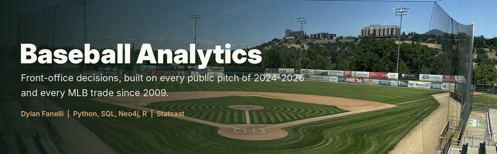</p>

<p align="center"><a href="https://github.com/IForSureI/Dylan-Fanelli-Baseball-Analytics-Portfolio/actions/workflows/tests.yml"></a>    </p>

<p align="center"><b><a href="#start-here">Start here</a> &nbsp;|&nbsp; <a href="#the-research">The research</a> &nbsp;|&nbsp; <a href="#what-a-club-gets">What a club gets</a> &nbsp;|&nbsp; <a href="#how-the-work-is-held-up">How the work is held up</a> &nbsp;|&nbsp; <a href="#the-toolkit-bb">Toolkit</a> &nbsp;|&nbsp; <a href="docs/glossary.md">Glossary</a> &nbsp;|&nbsp; <a href="#about">About</a></b></p>

# Dylan Fanelli Baseball Analytics Portfolio

My baseball-operations research and tools, built on every public pitch of 2024–2026 (2.14 million regular-season pitches) and every MLB trade since 2009. Each piece:
- **Answers a question a club would want to know.**
- **Says how it was tested.** Out of sample where the data allow, and labeled where it isn't.
- **Gets a separate review pass** before it's final. For five studies, a test also checks the headline numbers against small saved tables in [`reports/outputs/`](reports/outputs/).
- **Comes with the code that produced it,** public to read (all rights reserved; see [License](#license)). Nulls are reported as nulls.

<p align="center">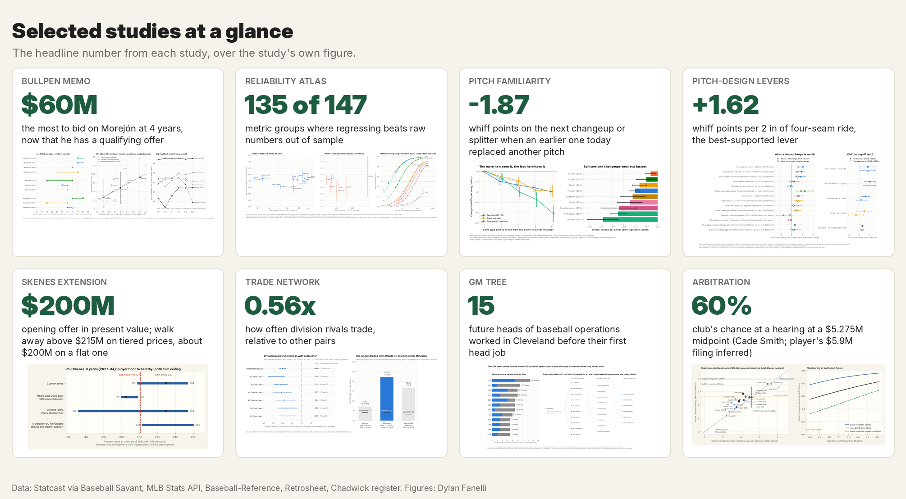</p>

## Start here
1. **[Bullpen acquisition memo, 2026-27](reports/2026-bullpen-acquisition-memo.md)** and its **[one-page version](reports/2026-bullpen-one-page.md)** for a GM. The capstone: one real offseason decision made the way a front office makes it, using every tool below.
2. **[The 2027 Offseason Decision Packet](https://iforsurei.github.io/Dylan-Fanelli-Baseball-Analytics-Portfolio/offseason/)**, the interactive front-office version of the work below: the market board scored live, buyer decisions, a frame-by-frame swing lab and catcher framing.
3. **[The 2026-27 market board](reports/2027-market-board.md).** 38 free-agent contract calls, dated Nov. 23, 2026 and frozen, scored against MLB Trade Rumors' published calls as each player signs. Last winter's edge came from one player, and the report says so.
4. **[Do hitters adapt to shapes they've seen from other pitchers?](reports/2026-shape-exposure.md)** A pre-registered study whose planned test failed its own placebo, and what an exploratory follow-up found.
5. **[Does a pitch wear out?](reports/2026-league-pitch-familiarity.md)** An original question. The association holds for fastballs, breaking balls and changeups under a shuffle test and with each game left out of its own baseline; cutters are not confirmed. It is observational, and the published sizes are the top of a range (60% to 100%). A [follow-up](reports/2026-exposure-aware-hook.md) tested whether it should change the hook. It shouldn't.
6. **[The Reliability Atlas](reports/2026-reliability-atlas.md).** Which numbers to trust, after how many pitches, swings or batted balls, and how far to regress them.
7. **The everyday work of a department:** an [advance packet](reports/2026-advance-packet-tb.md) with a [coach page](reports/2026-advance-packet-tb-coach.md) in English and [Spanish](reports/2026-advance-packet-tb-coach-es.md), two arbitration cases ([Cade Smith](reports/2027-arbitration-brief-smith.md) and [Louis Varland](reports/2027-arbitration-brief-varland.md)), a [hitter evaluation](reports/2026-hitter-evaluation-torres.md), a [SQL module](sql/README.md), and a [dated prediction log](reports/2027-prediction-log.md) scored after 2027.

<p>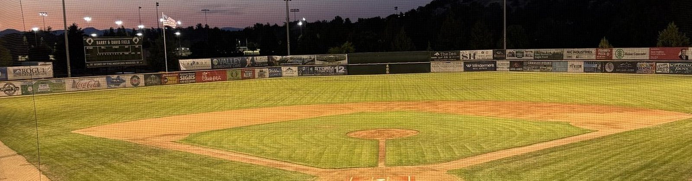</p>
<p align="center"><sub>Late nights at the ballpark. Harry & David Field, Medford, Oregon.</sub></p>

## The research

| Question | Answer | Report |
|---|---|---|
| Which reliever should the Rangers sign this winter, and at what price? | Adrián Morejón, at no more than 4 years, $64M now that he has a qualifying offer (Nov. 2), which he declined Nov. 17. That lands him about one time in three, so Bryan Abreu, who costs no pick, is the likely signing. Pete Fairbanks is priced for about a third of 2027 after thoracic outlet surgery. Revised Nov. 24, 2026. | [Memo](reports/2026-bullpen-acquisition-memo.md) |
| Does a pitch lose effectiveness on a hitter the more of it he has seen? | In association, yes, and it's specific to the pitch type. An earlier changeup or splitter in his earlier plate appearances today, in place of a pitch of another type, goes with 1.87 fewer whiff points on the next one. The pattern carries across games and partly to the next same-handed pitcher. It is observational: a placebo on pitches he hadn't seen yet is larger than the effect (+2.0 to +3.2 points), and no null simulation has been run. | [Report](reports/2026-league-pitch-familiarity.md) |
| Do hitters adapt to pitch shapes they've seen from *other* pitchers? | The planned test can't say: in a pre-registered test with 2026 held out, the raw association (−0.74 whiff points per SD) replicated, then failed its own lead placebo, which points to selection on who plays against what. An exploratory follow-up that holds a hitter's season-long diet fixed finds a small recent effect, −0.27 (−0.48 to −0.06): at most about 2 runs a club-season. | [Report](reports/2026-shape-exposure.md) |
| Should that change when the starter comes out? | No. The per-pitch cost replicates out of sample, but it doesn't reach plate-appearance run value (2026 calibration slope −0.28, SE 0.37). Managers show no response to it either. | [Report](reports/2026-exposure-aware-hook.md) |
| Which numbers can you trust, and when? | Regressing beats raw numbers out of sample for 135 of 147 scored metric groups, confirmed on a clean 2024 → 2025 replication. That shrinkage helps is expected; the useful output is how far to regress each number, and after how many pitches, swings or batted balls. Bat speed is half signal after about 3 swings and reaches r = 0.7 after about 6; wOBA's fitted curve doesn't reach r = 0.5 until about 500 plate appearances (an extrapolation). Pitch physics regress by games, not pitches. | [Atlas](reports/2026-reliability-atlas.md) |
| Does the Atlas hold up in another language and another method? | Yes. Rebuilt in R (tidyverse + DuckDB), the whiff regress step gives M = 54.5 swings vs 54.7 in Python, and 79 of 79 checks pass. A hierarchical Bayesian model in PyMC matches the Atlas out of sample on 520 hitters in 2026 (RMSE 4.94 vs 4.95, 95% coverage 95.8% for both); fitting 2024 and 2025 together cuts the 2026 error 5.3%. | [R rebuild](reports/r/README.md), [Bayesian model](reports/bayes/README.md) |
| Which pitch-design changes stick and pay? | Four-seam ride is the best-supported lever (+1.62 whiff points per 2 in). Velocity's payoff fails a placebo, so recovery isn't ruled out. Given the shape change, the single change in expected whiff predicts next season's whiff change better than the full lever model, pooled across pitch types. | [Report](reports/2026-pitch-design-levers.md) |
| Is a development plan working, and how would a department know? | On my hypothetical 2026 plan for Logan Gilbert, graded on his season through Sept. 27: four-seam velocity (95.4 to 96.4 mph, late) and slider depth (+0.8 to -2.0 in) are on track. Slider whiffs are inconclusive, as the power check said before the season, and the usage guard is breached (25.0% against a 28% limit). Three priorities, each with a number, a date, a floor and a guard. It is not the club's plan, and the pitcher was chosen in hindsight. | [Plan](reports/2026-development-plan.md) |
| Does a drop in a pitcher's velocity or stuff, against his own regressed baseline, warn of an injured-list stint? | Mostly late. Fit on 2024–25 and scored on 2026: after an outing with the fastball 2+ mph below his baseline, 10.4% of pitchers went on the IL for an arm injury within 14 days (17 of 164; base rate 3.6%), mostly from the last outing before the stint. Leave that outing out and no association is detected in 2026 (odds ratio 1.02, 0.91 to 1.14), though 2024–25 showed one, so an early signal isn't ruled out. As a forecast, velocity, spin, shape and release drops add no detectable gain to role, workload and IL history (AUC +0.005, −0.022 to +0.031). | [Report](reports/2026-il-early-warning.md) |
| Should the Pirates extend Paul Skenes before the CBA expires on Dec. 1? | Open at about $200M in present value. Walk away above about $215M on FanGraphs' tiered price of a win, or about $200M on one flat price (check added Nov. 14). The answer depends on the next agreement, and the memo prices both rule sets; its injury and cap odds are scenarios, not estimates. The tax engine reproduces the 2025 luxury-tax bills within $1 for eight of nine clubs. | [Memo](reports/2026-roster-cba-engine.md) |
| Who trades with whom? | Division rivals trade at 0.56 times the rate of other pairs (0.49–0.65), and 52 of 60 rival pairs fall below expectation. The deadline is the one window where they come closer to normal. Dodgers–Giants, Guardians–Royals and Cubs–Cardinals haven't traded since 2009. | [Report](reports/2026-trade-network-rivals.md) |
| Do front-office ties predict trade partners? | Probably, modestly. A pair of clubs trades about 14–18% more in seasons when their decision-makers share front-office history (1.18, 1.04–1.34, p = 0.009; permutation p = 0.015), and it holds without the Angels and Braves. How late-season hires are dated moves it: p runs from 0.009 to 0.059 across the rules tested. The narrower protégé-meets-old-boss tie is borderline at best. For scale, division rivalry is −45%. | [Report](reports/2026-front-office-ties.md) |
| Whose front offices did today's heads of baseball operations come through, and how did they get the job? | More future heads came through Cleveland than any other club: 15 worked there before their first head job, and 9 hold a club's top baseball-operations job today. John Hart's tree reaches 21 of the 38 heads in office on Oct. 13, 2026 within three generations; directly, he and Epstein are tied at 10 counting two or more shared seasons. Since 2009 the median head took 14 years from his first recorded front-office job, 75% held an assistant GM title first, and 58% were promoted from inside. Built as a graph in Neo4j, with PageRank from Graph Data Science. | [Report](reports/2026-gm-tree.md) |
| What would a pro scout write on the top free-agent reliever? | Adrián Morejón: OFP 60, a B1 reliever for 2027. Sinker, changeup and four-seamer grade 70; the slider is 50 now and 55 future. It got 3.3 mph harder and lost 2.7 in of drop as its whiffs fell from 40% to 30%. Delivery items that need eyes are NG, and the look before the bid is written out. | [Report](reports/2026-morejon-pro-scouting-report.md), [one page](reports/2026-morejon-pro-scouting-report.pdf) |
| How should a club pitch the Rays' lineup in the ALCS? | Pitch in the zone and get outs on weak contact: the nine regulars missed on 19.9% of swings (league 25.1%) and do little damage on contact (.331 xwOBA, league .362). The usual put-away pitch, a breaking ball below the zone, gets 17.4 swinging strikes per 100 against the league's 23.2. Hitter by hitter cards, a one-page coach version and the same page in Spanish. | [Packet](reports/2026-advance-packet-tb.md), [coach](reports/2026-advance-packet-tb-coach.md), [en español](reports/2026-advance-packet-tb-coach-es.md) |
| What should a club file in Cade Smith's first arbitration case? | $4.65M, settle at $5.0-5.1M, and go to a hearing above $5.1M. A comp pool built by a stated rule (every 20-save platform year since 2015 going into a first arbitration year, 23 closers) puts him at $4.58M; the club wins at a $5.275M midpoint about 60% of the time (49% to 71% across the assumptions tested). An independent exercise from public data, with the 2022-26 agreement's criteria and what a panel can't hear. | [Brief](reports/2027-arbitration-brief-smith.md) |
| Does the same method hold for a Super Two on another club? Toronto's Louis Varland | Yes. File $3.65M, settle at $3.8M or less, and go to a hearing above $3.8M. The same 23-closer pool puts him at $3.58M, MLB Trade Rumors says $3.8M, and the club wins at a $3.85M midpoint about 61% of the time. It is favored under any weighting of the two views (54% to 69%), but not if the panel reads only the 2020-26 market (40%). As a Super Two he has four arbitration years, so losing costs $1.39M in present value. His side's best route is the 2020-26 market alone ($4.40M). An independent exercise from public data. | [Brief](reports/2027-arbitration-brief-varland.md) |
| Do good swing decisions last, and what is Gleyber Torres worth? | Yes: decision value repeats year to year (r = 0.80 from 2025 to 2026). Torres's decisions are among the best in baseball, but his bat lost 2 mph in 2026. 1.50 WAR projected for 2027 with baserunning; sign at two years, $28-32M, walk away above $17M a year. | [Evaluation](reports/2026-hitter-evaluation-torres.md), [one page](reports/2026-hitter-evaluation-torres.pdf) |
| How much is catcher framing worth, and did ABS challenges change it? | My public model matches Baseball Savant's framing runs (r 0.92-0.98). In 2026, the first ABS challenge season, calls got clearly more predictable, and framing's spread per pitch fell 23% on my model and 10% on Savant's, after an 8-10% drop the year before. Discount pre-2026 framing by 10-23%. | [Report](reports/2026-catcher-framing.md) |
| Is Randy Arozarena's 2026 power real, frame by frame? | Not as power. The strikeout drop (26.9% to 21.6%) came from contact on two-strike chases (57% to 74%) with a shorter, slower swing, while hard-hit rate, barrels and bat speed fell and his .379 wOBA ran ahead of a .348 xwOBA. The league model chosen on training data puts his 2027 ISO at .169-.180. On 41 swings watched frame by frame on MLB.TV, his 2026 failures split among late fastballs, chased spin, and on-time swings with the wrong path; on high fastballs his bat got 4.7 mph slower. | [Report](reports/2026-arozarena-swing-breakdown.md) |
| What is a draft pick worth, and does a college stat line still beat the pick? | Pick 1 is worth about $69M on average over six seasons and about $93M over the service-time window, with bad seasons counted against the pick; from pick 11 on, about half the players return nothing or less, and first-round pitchers return about two thirds of what hitters do. A college-stat model helped on 2012-2019 classes but shows no gain over the pick on 2020-2023 classes. 23 of 30 clubs went over their 2026 bonus pool and none crossed 5%. | [Report](reports/2026-mlb-draft-analytics.md) |
| Can I beat the market on prices, performance and amateurs? | Fifteen calls for 2027, each with a probability, dated Oct. 18, 2026, and scored with the Brier score after the season (0.25 is the no-skill line). | [Log](reports/2027-prediction-log.md) |
| Can I call this winter's free-agent contracts better than MLB Trade Rumors, before they sign? | 38 calls dated Nov. 23, 2026, scored against MLBTR's as players sign. On last winter's class the edge came from one player: without Kyle Tucker my model and MLBTR were tied. So the board is a public test of whether last winter's pattern (shorter, richer deals; relievers paid more) repeats. | [Board](reports/2027-market-board.md) |
| Was Tarik Skubal's 2025 change real? | Yes, and the change was his: he ranked at the 80th–98th percentile on the changes, and the league didn't move. His changeup's 46.6% whiff rate (997 swings, 2024-25; 95% interval 43.6 to 49.7%) is an observed rate, not a regressed one. The page was written before 2026 and its "what to watch" list has not been scored. | [Report](reports/2025-skubal-arsenal.md) |

The **Edge Board** is a league scan built by `bb edge` and `bb board` ([numbers](reports/2026-edge-board.md), from the Oct. 17 run). It covers:
- release tells
- candidate in-season pitch changes (292 in 2026, by 225 pitchers; shuffling game order gives about 33 by chance, 11% of the 292)
- results beyond stuff, which persist year to year (r = 0.56 and 0.53)
- next-season whiff projections, scored against a regressed baseline: 6.4% less error on a held-out season (fit on 2024 → 2025, scored on 2025 → 2026), 8.2% leave-one-out with two seasons of history

**Search, filter and sort it:** the [Edge Board dashboard](https://iforsurei.github.io/Dylan-Fanelli-Baseball-Analytics-Portfolio/edge-board.html) has every pitch of the run (1,889 pitches, 599 pitchers) with whiff rate, expected whiff, the 2027 projection and 20-80 grades, and opens each pitcher's arsenal on a click.

<table>
<tr><td width="25%" valign="top"><a href="reports/2026-bullpen-acquisition-memo.md">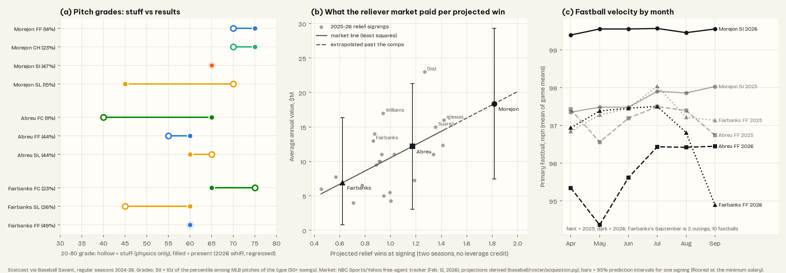</a><br><sub><b>Bullpen memo</b></sub></td><td width="25%" valign="top"><a href="reports/2026-league-pitch-familiarity.md">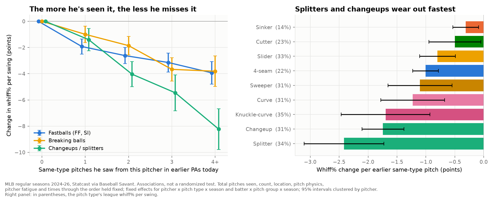</a><br><sub><b>Pitch familiarity</b></sub></td><td width="25%" valign="top"><a href="reports/2026-reliability-atlas.md">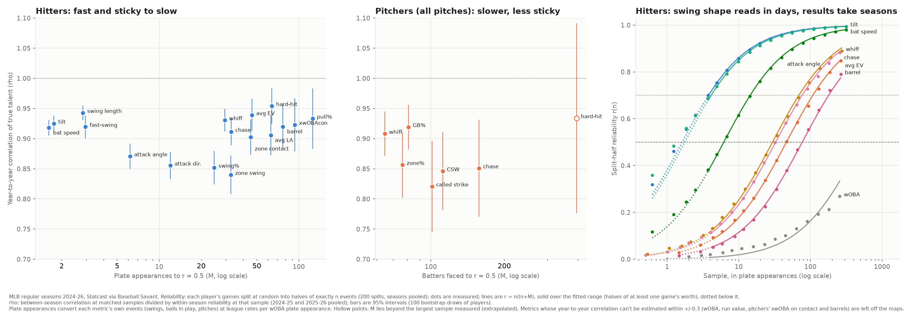</a><br><sub><b>Reliability Atlas</b></sub></td><td width="25%" valign="top"><a href="reports/2026-pitch-design-levers.md">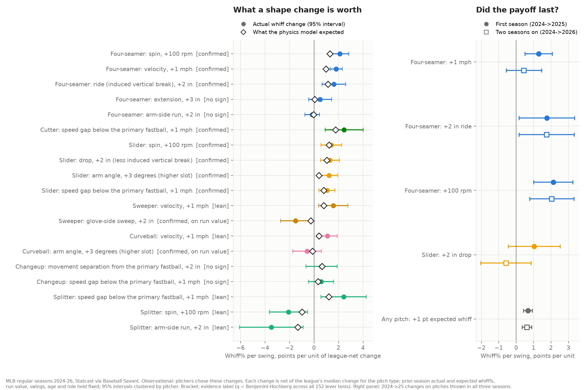</a><br><sub><b>Pitch-design levers</b></sub></td></tr>
<tr><td width="25%" valign="top"><a href="reports/2026-roster-cba-engine.md">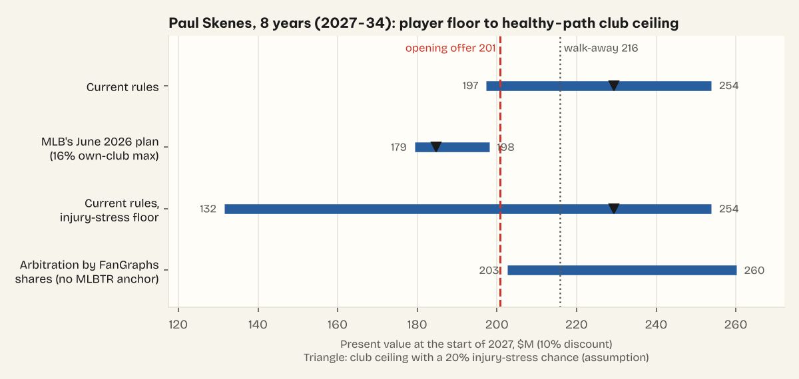</a><br><sub><b>Skenes extension</b></sub></td><td width="25%" valign="top"><a href="reports/2026-gm-tree.md">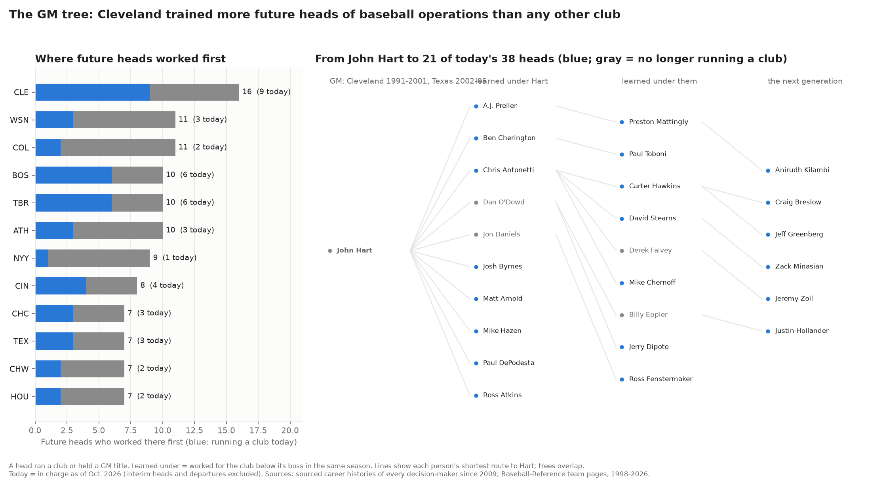</a><br><sub><b>GM tree</b></sub></td><td width="25%" valign="top"><a href="reports/2026-morejon-pro-scouting-report.md">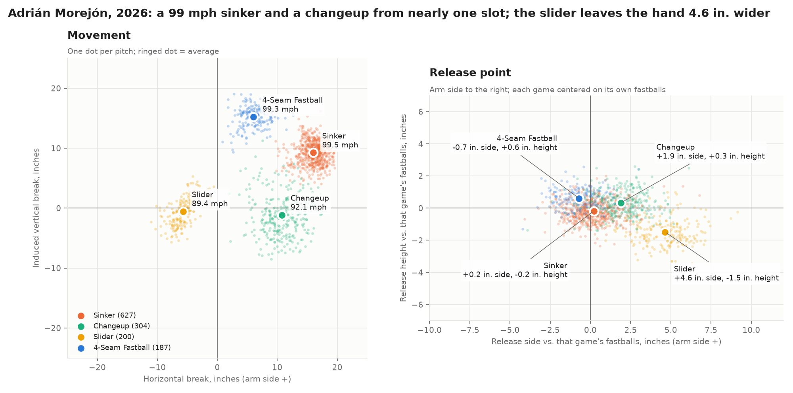</a><br><sub><b>Pro scouting report</b></sub></td><td width="25%" valign="top"><a href="reports/2026-advance-packet-tb.md">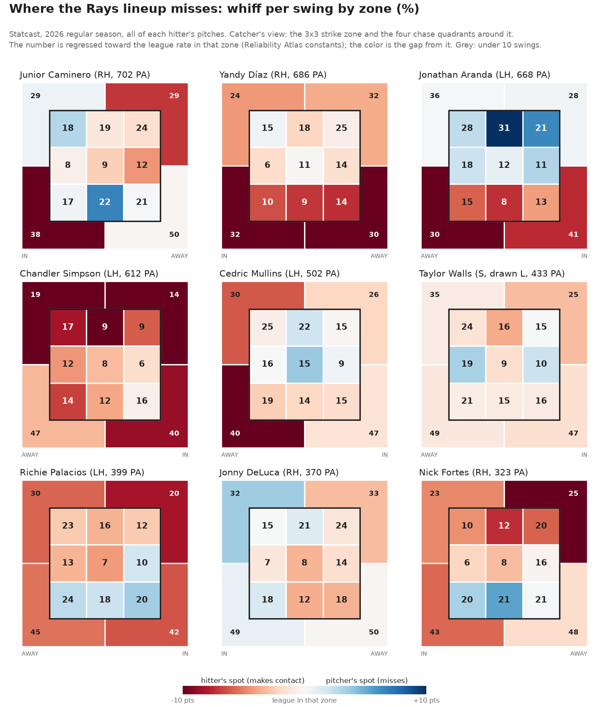</a><br><sub><b>Advance packet</b></sub></td></tr>
<tr><td width="25%" valign="top"><a href="reports/2027-arbitration-brief-smith.md">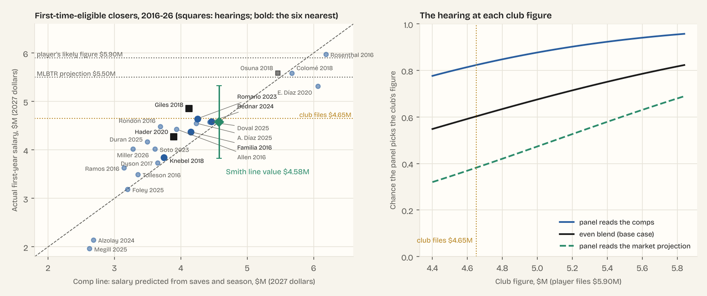</a><br><sub><b>Arbitration case</b></sub></td><td width="25%" valign="top"><a href="reports/2026-trade-network-rivals.md">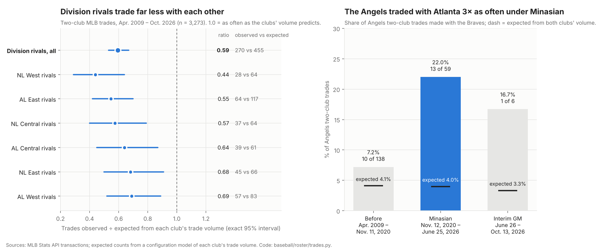</a><br><sub><b>Trade network</b></sub></td><td width="25%" valign="top"><a href="reports/2026-hitter-evaluation-torres.md">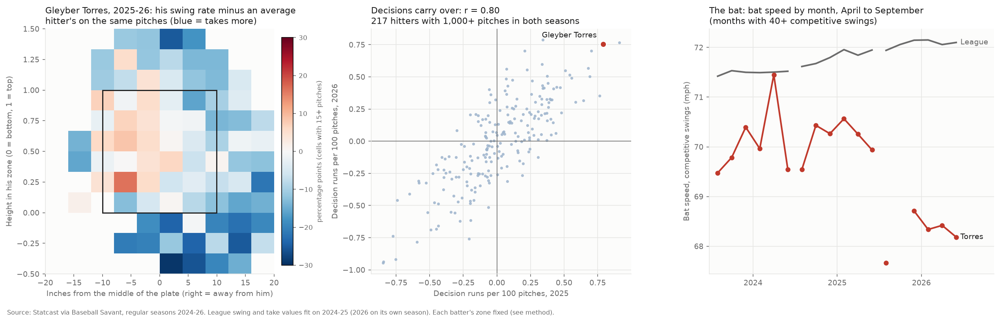</a><br><sub><b>Hitter evaluation</b></sub></td><td width="25%" valign="top"><a href="reports/2025-skubal-arsenal.md">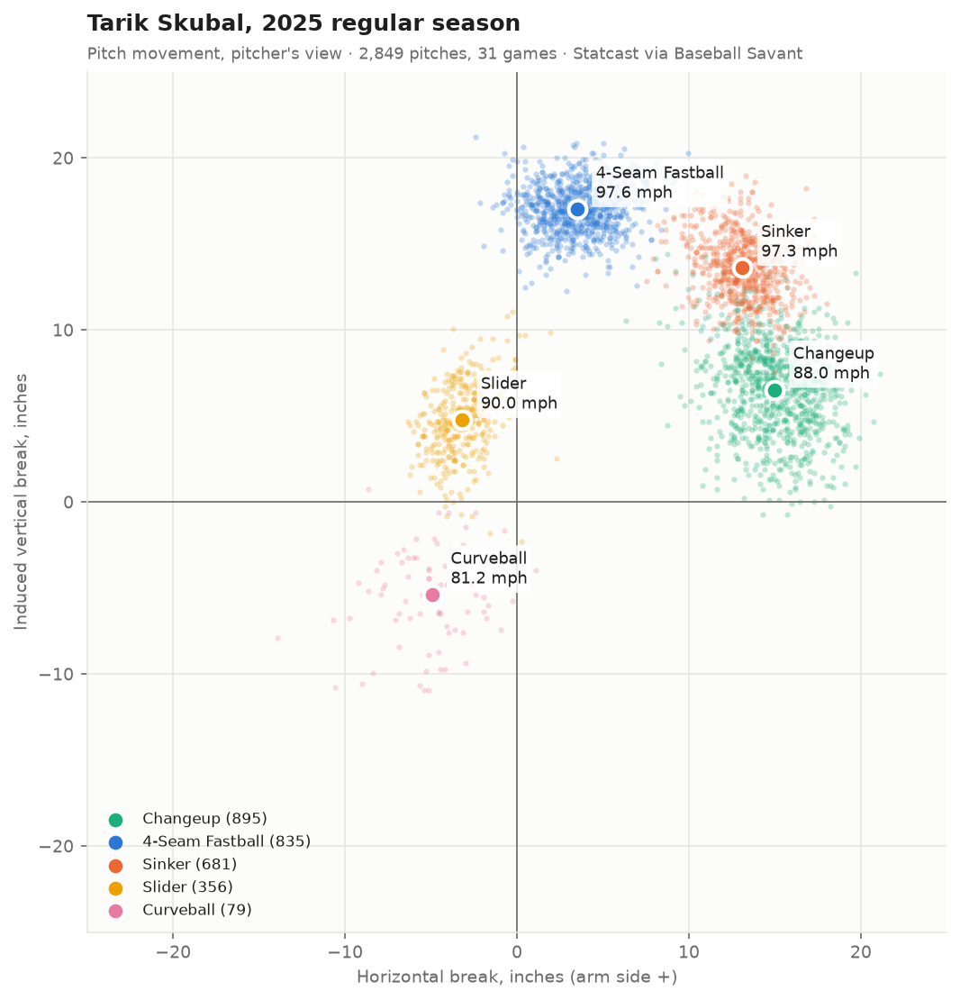</a><br><sub><b>Skubal arsenal</b></sub></td></tr>
</table>

## 2026 postseason snippets

Ten quick charts on the 2026 postseason, from the Wild Card Series through the Brewers' five-game World Series win over the Rays: win probability pitch by pitch, the biggest bats and arms by WPA, contact quality, swing decisions, velocity and exit-velocity leaders, and how deep the starters went. [See them all](reports/2026-postseason-snippets/).

**Hover for the breakdown:** the [interactive version](https://iforsurei.github.io/Dylan-Fanelli-Baseball-Analytics-Portfolio/postseason.html) opens every player's numbers by round, by pitch group and by pitch type.

<table>
<tr><td width="33%"><a href="reports/2026-postseason-snippets/">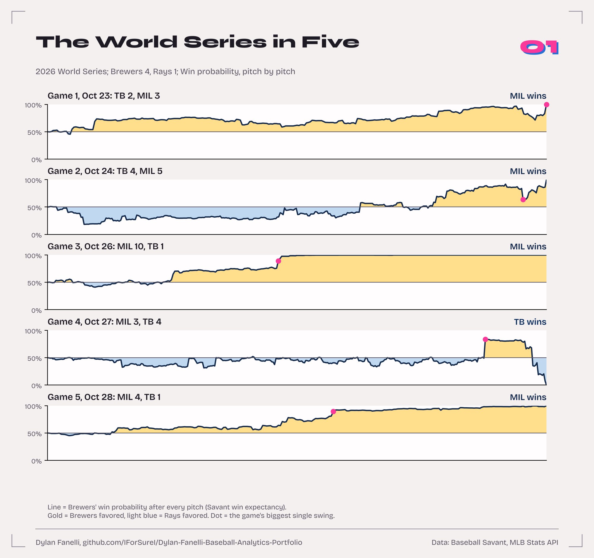</a></td><td width="33%"><a href="reports/2026-postseason-snippets/">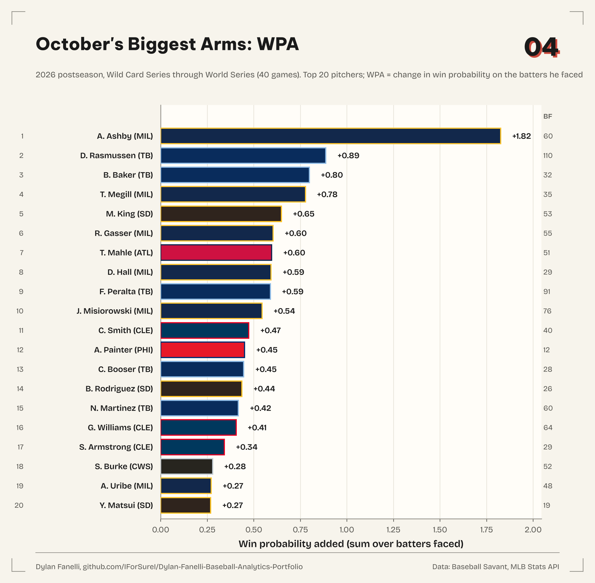</a></td><td width="33%"><a href="reports/2026-postseason-snippets/">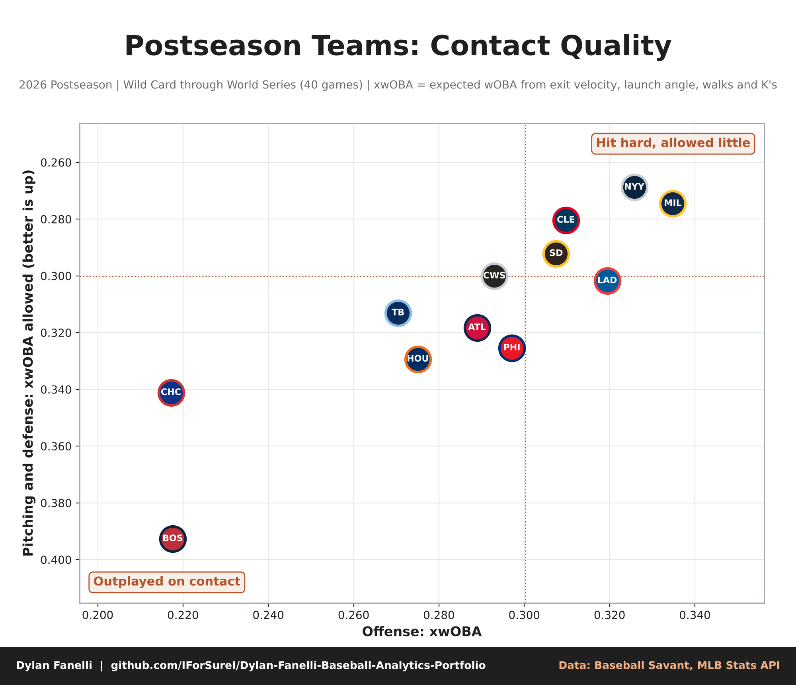</a></td></tr>
</table>

<a id="what-a-club-gets"></a>
## What a club gets

| Department | Question it answers | Work |
|---|---|---|
| GM and pro personnel | Who do we sign, at what price, and where do we walk away? | [Bullpen memo](reports/2026-bullpen-acquisition-memo.md), [hitter evaluation](reports/2026-hitter-evaluation-torres.md), [market board](reports/2027-market-board.md) |
| Front office and payroll | What does the tax bill look like, and what is an extension worth under the next CBA? | [Roster and CBA engine](reports/2026-roster-cba-engine.md) |
| Arbitration | What do we file, where do we settle, when do we go to a hearing? | [Smith](reports/2027-arbitration-brief-smith.md), [Varland](reports/2027-arbitration-brief-varland.md) |
| Pro scouting and trades | Who are the realistic trade partners, and what does a scout write before a bid? | [Trade network](reports/2026-trade-network-rivals.md), [front-office ties](reports/2026-front-office-ties.md), [pro scouting report](reports/2026-morejon-pro-scouting-report.md) |
| Advance scouting and coaches | How do we pitch this lineup, in a page a coach will read (in English or Spanish)? | [Advance packet](reports/2026-advance-packet-tb.md) |
| Player development | Which pitch-design changes stick and pay, and how is a plan tracked? | [Pitch-design levers](reports/2026-pitch-design-levers.md) |
| Medical and performance | Does a velocity drop warn of an injury, and what alert can a trainer live with? | [IL early warning](reports/2026-il-early-warning.md) |
| In-game strategy | Do pitches wear out, and should that change the hook? | [Pitch familiarity](reports/2026-league-pitch-familiarity.md), [exposure-aware hook](reports/2026-exposure-aware-hook.md) |
| Amateur scouting | What is a pick worth, and what does a college line still add? | [Draft analytics](reports/2026-mlb-draft-analytics.md) |
| R&D, every department | How much should we believe this number? | [Reliability Atlas](reports/2026-reliability-atlas.md), [R rebuild](reports/r/README.md), [Bayesian model](reports/bayes/README.md), [shape exposure](reports/2026-shape-exposure.md) |

Every report page opens the same way: the question, the answer and what a club does with it, then the full work. The format is written down in the [report standard](docs/report-standard.md).

<p>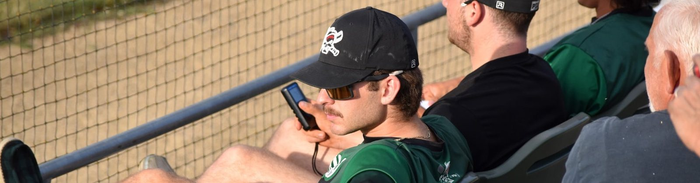</p>
<p align="center"><sub>Radar gun in the stands with the Medford Rogues. The work starts at the park.</sub></p>

## How the work is held up
- **Out of sample where three seasons allow.** The baseline is always a regressed one, never raw last season.
  - **Scored on a season the parameters never saw:** the Atlas (2024 → 2025), the hook study and shape exposure (2026 held out), the pitch-design levers and, since Nov. 14, the whiff projection (both fit on 2024 → 2025 and scored on 2025 → 2026), and the IL early warning (fit on 2024–25, 2026 held out).
  - **Leave-one-out inside the fitting seasons, and labeled that way:** the two-season whiff projection, which has only one target year.
  - **Not forecasts at all:** the contract prices. They are market prices with intervals. The one club win curve here is a 2006 shape, used as a labeled sensitivity in the Skenes memo; a current curve is still open.
- **One evidence standard.**
  - Confirmed means p < 0.05 with enough sample; near 0.05 is borderline.
  - Many tests at once get a Benjamini–Hochberg correction.
  - "No sign of an effect" is claimed only when the interval rules out effects that matter. Otherwise the report says "not detected" and gives the bound.
- **Separate review.** Every finished report gets a separate review pass that checks each number against the saved outputs. Most of those outputs stay on my machine with the data; small tables for the bullpen memo, the Edge Board, pitch familiarity, the IL early warning, the Skenes memo's Nov. 15 checks, catcher framing, bat tracking and the swing lab are in [`reports/outputs/`](reports/outputs/), and `tests/test_report_outputs.py` checks the reports against them. The reviews changed real conclusions:
  - the Skenes price
  - the ranking of pitch-design levers
  - a noise model for pitch physics
  - a free-agent reliever's 2027 status
  - the dating of front-office ties, and which tie results count as confirmed
  - a reliever's changeup history and the cause of his slider's decline
  - [LOG.md](LOG.md) records each one.
- **Hand-checked tests.** About 650, with the arithmetic in comments. The badge at the top shows the latest run.
- **Pooling and regression rules.** Seasons are pooled only with standard errors clustered by player (pitcher, batter or both, as each report states). Small samples are regressed before they're compared.
- **Public data only.** Statcast via Baseball Savant, the Chadwick register for names, MLB Stats API transactions, Baseball-Reference (WAR and front-office listings), Retrosheet, and cited, dated public reporting for contracts, transactions and executive careers. No club's data is in this repository.

## The toolkit (`bb`)

| Job | Commands |
|---|---|
| **Data** | `pull-league`, `slim`, `seq` (every pitch with batter, location, base-out state, bat tracking), `people` (names), `db` |
| **Evaluation** | `arsenal`, `compare` (two seasons, with significance), `reliability` and `regress` (regress any number, with an interval), `compare-relievers` (regressed results, stuff, velocity vs league, workload, platoon, 20-80 grades), `delivery` (slot, extension, release scatter, exact VAA, release offsets against each game's fastballs) |
| **Edge** | `edge`, `board` (release tells, hidden changes, stuff vs results, projections), `familiarity`, `hook`, `hook-card` (one start, hitter by hitter) |
| **Development** | `levers` (what shape changes pay), `idp` (individual development plans in YAML, with a progress engine that issues verdicts and checks statistical power) |
| **Health** | `il-warning` (velocity, spin, shape and release drops against each pitcher's regressed baseline, scored as an injured-list warning on a held-out season, with an alert rule) |
| **Roster** | `cbt` and `cbt-check` (luxury tax, checked against the real 2025 bills), `service` (control, Super Two, arbitration, free agency), `roster-cases`, `bullpen-case`, `trades` (the MLB trade graph in Neo4j, rival and burst analysis), `gm-tree` (whose front offices today's heads came through, in Neo4j), `front-office` (executive careers and the ties model) |
| **Department work** | `advance` (an opponent's hitter cards, figures and plan), `arb-case` (an arbitration case from comps to walk point: `smith` or `varland`), `swing-decisions` (decision value and one hitter's card and price), `predictions` (check, score and render the prediction log), `sql` (twelve named DuckDB queries: `list`, `show`, `run`) |
| **Tracking data** | A TrackMan/Rapsodo loader with sign checks and QC, a TrackMan session-PDF reader, and a portable expected-whiff model for device data |

A dated record of what was built, decided and learned is in [LOG.md](LOG.md). The roadmap is in [Issues](../../issues).

## Under the hood

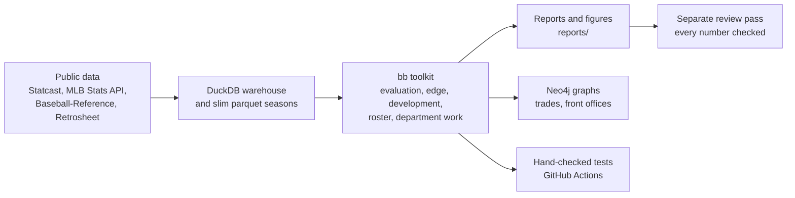

## Run it
Requires [uv](https://docs.astral.sh/uv/).

```bash
git clone https://github.com/IForSureI/Dylan-Fanelli-Baseball-Analytics-Portfolio.git ~/Baseball
cd ~/Baseball
uv sync
uv run pytest                                # the full suite; no data needed
uv run bb people                             # player names
uv run bb pull-league 2026 && uv run bb seq 2026   # every pitch of a season (pulls from Baseball Savant)
uv run bb regress hitter/whiff 0.40 50 --horizon next_season
uv run bb cbt 417.341608 5 --season 2025     # the Dodgers' 2025 tax bill: $169.376M
uv run bb pull-league 2024 && uv run bb seq 2024   # compare-relievers needs 2024, 2025 and 2026
uv run bb pull-league 2025 && uv run bb seq 2025
uv run bb compare-relievers 2026 670970 650556
uv run bb sql run velocity_by_inning -p pitcher=669373 -p season=2026
uv run bb predictions check
```

A monthly job (`scripts/automation/`) pulls new pitches and reruns the studies. The data stays local (`data/` is never committed) and every result rebuilds from it. The season pulls take hours and the studies need all three seasons, so a fresh clone runs the tests and the commands above first.

The prices of a win and the discount rate used across the memos are in [valuation conventions](docs/valuation-conventions.md).

## Reference
- [Glossary](docs/glossary.md): the terms used across the reports, in plain words first.
- [Data dictionary](docs/data-dictionary.md): every source, what it covers, and the key columns.
- [Report standard](docs/report-standard.md): how every report page is built.
- [Photo credits](docs/photo-credits.md): the photographs are of me, from my own playing and scouting years, taken by family and teammates and used with their permission.


<a id="about"></a>
## About
I'm Dylan Fanelli, an M.S. Sport Management candidate at the Isenberg School of Management (McCormack Department of Sport Management), UMass Amherst. I'm working toward a career in baseball operations. [LinkedIn](https://www.linkedin.com/in/dylanfanelli/)

I pitched at Allegheny, Occidental and UMass and for the Medford Rogues, where I also built scouting reports on opposing hitters and pitchers. The questions in this portfolio come from there.

<table>
<tr><td width="25%" align="center" valign="top">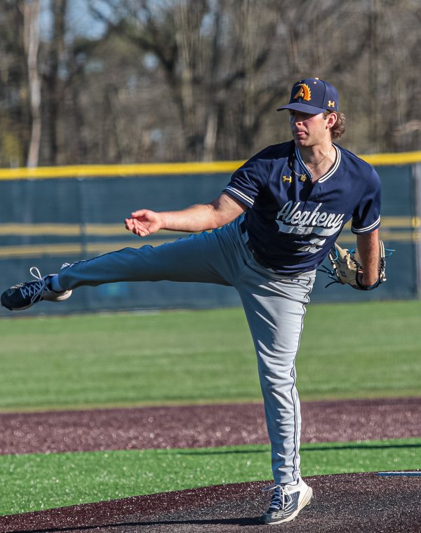<br><sub><b>Allegheny College</b></sub></td><td width="25%" align="center" valign="top">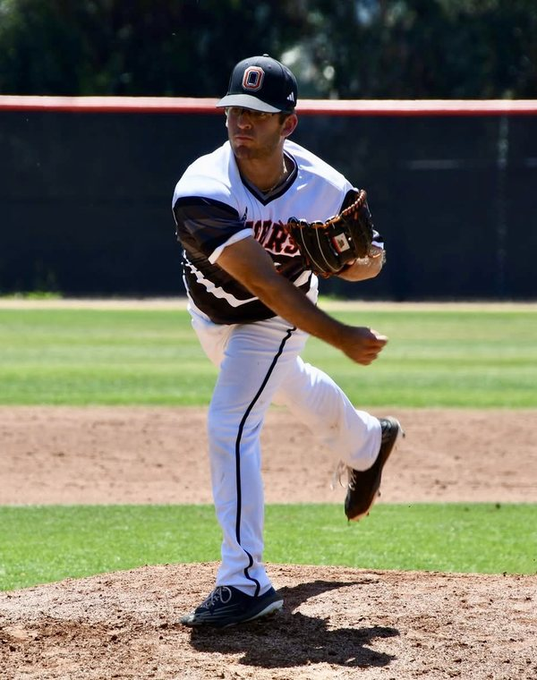<br><sub><b>Occidental College</b></sub></td><td width="25%" align="center" valign="top">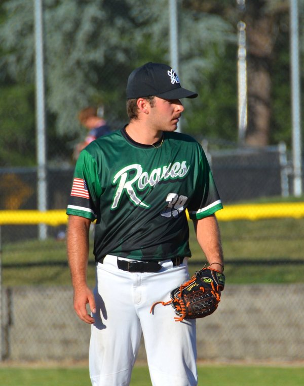<br><sub><b>Medford Rogues</b></sub></td><td width="25%" align="center" valign="top">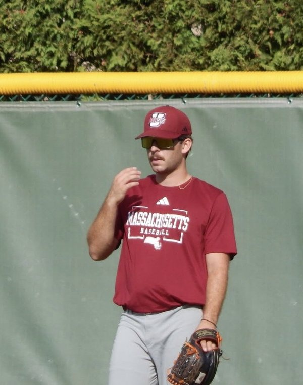<br><sub><b>UMass Amherst</b></sub></td></tr>
</table>

## License
© 2026 Dylan Fanelli. All rights reserved. The code, reports and figures may be viewed here; they may not be copied, modified or used without written permission. See [LICENSE](LICENSE). To cite this work, use the **Cite this repository** button (from [CITATION.cff](CITATION.cff)).
