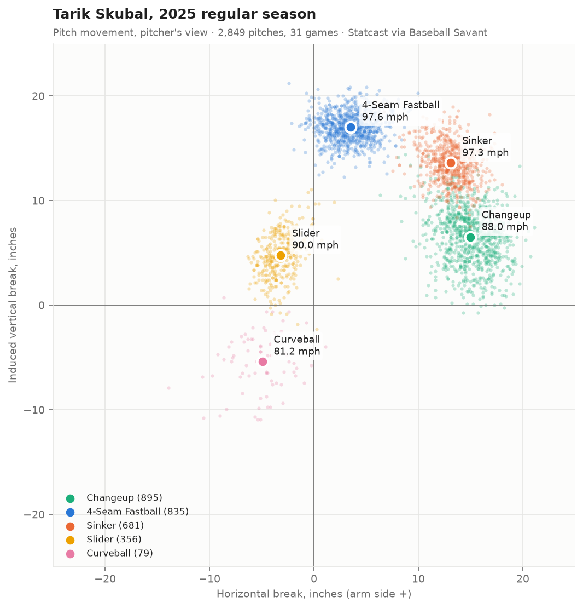

# Tarik Skubal (DET, LHP): 2025 arsenal read

**Data-only arsenal read.** Built from Statcast pitch data, not a live look; no 20-80 grades.
*Tarik Skubal, LHP, Detroit Tigers. B/T R/L, born 1996-11-20. 2025 regular season (age-28 season), with a 2024 comparison.*
*Written 2026-10-12 by Dylan Fanelli; league check added 2026-10-17. Data: Statcast via Baseball Savant (pybaseball), pulled 2026-10-12.*



## Summary
- **The changeup is the pitch the arsenal is built around, and its level is established.** He gets whiffs on 46.6% of swings against it across 2024–25 (997 swings; 95% interval 43.6–49.7%). The usual rate for changeups is about 31%.
- **He leans on the changeup more each year.** Usage went from 27.0% to 31.4%, and it's his most-used pitch and his two-strike finisher.
- **The 2025 jump in velocity and spin was his own.** Against every pitcher who threw the same pitch type in both seasons, his gains sat at the 80th-94th percentile on velocity and the 94th-98th on spin, while the league median barely moved (+21 rpm and -0.1 mph on four-seamers). The open question is the slider: its whiff rate fell from 34.4% to 25.5%, but that isn't confirmed (p = 0.07).

**What to watch in 2026:** slider whiff rate, changeup use against left-handers, and whether the 2025 velocity holds.

## The read
- **Changeup:** the best of his four main pitches on every outcome measure (whiff, CSW, chase, xwOBA on contact, hard-hit, run value), and stable across two seasons.
- **Fastballs:** a 97–98 mph four-seamer and sinker. Both get more whiffs than is usual for their pitch types. Hitters make about equally damaging contact against both (.393 and .382 xwOBA on contact).
- **Pitch mix by batter hand:**
  - Against left-handers he leads with the sinker (42.3%). In 2025 he roughly doubled his four-seamers (2.5×) and nearly doubled his changeups (1.8×) against them.
  - Against right-handers he leads with the changeup and four-seamer (65.4% combined).
- **Slider:** the 2025 version was firmer and flatter and got fewer whiffs. Treat it as a pitch to watch, not a confirmed decline.

## Arsenal (2025 regular season, 2,849 pitches, 31 starts)

| Pitch | Usage | Velo | IVB (in) | Arm-side HB (in) | Whiff% | CSW% | Chase% | xwOBA on contact | Runs saved /100 |
|---|---|---|---|---|---|---|---|---|---|
| Changeup | 31.4% | 88.0 | 6.5 | 15.0 | **46.8** | **38.8** | **48.5** | **.312** | **2.83** |
| 4-Seam | 29.3% | 97.6 | 17.0 | 3.5 | 28.7 | 28.0 | 30.4 | .393 | 1.47 |
| Sinker | 23.9% | 97.3 | 13.6 | 13.1 | 18.3 | 32.3 | 21.4 | .382 | 1.27 |
| Slider | 12.5% | 90.0 | 4.8 | −3.2 | 25.5 | 33.4 | 20.3 | .342 | 1.59 |
| Curveball | 2.8% | 81.2 | −5.4 | −4.9 | 35.7 | 35.4 | 36.0 | n = 6 BIP | −0.52 |

Whole arsenal: 33.3% CSW, 35.2% chase, 33.0% hard-hit on balls in play.

## Evidence, pitch by pitch
League whiff rates below are approximate league-wide figures: changeup ~31%, four-seamer ~21–22%, sinker ~13–14%, slider ~33–34%. They are not matched to 2025. The gaps that matter here are large enough that a difference of a point or two in the norms doesn't change any conclusion.

**Changeup**
- **Whiff rate:** 46.8% in 2025 (252 of 538 swings; 95% interval 42.7–51.1%) and 46.4% in 2024. Even the low end of the two-season interval (43.6%) is far above the usual ~31%.
- **Shape against the four-seamer** fits what a changeup is supposed to do:
  - 9.5 mph slower (the usual target is 8–12)
  - 10.5 inches less rise (the target is at least about 6)
  - 11.5 inches more arm-side run
- **Chase:** hitters chase it 48.5% of the time even though only 43.8% of changeups land in the zone. It gets swings without having to be a strike.
- **The speed gap narrowed.** It was 10.5 mph in 2024 and 9.5 in 2025, because the changeup gained more velocity than the fastball. Whiffs held steady anyway.

**Four-seamer**
- **Whiffs and stuff:** 28.7% whiff rate against ~21–22% for four-seamers. It averages 97.6 mph (102.6 max) with 17.0 inches of rise.
- **Damage on contact:** .393 xwOBA on contact and 12.1% barrels, the highest damage of his pitches. In 2024 it was .345. That rise is not significant (p = 0.34, about 135 balls in play each season).
- **Shape and called strikes:** compared with 2024 it lost 3 inches of arm-side run (6.5 → 3.5). Its CSW fell from 32.3% to 28.0%; at p = 0.0500 that sits right on the line, and given how many comparisons this report makes, it counts as borderline, not confirmed.

**Sinker**
- **His strike pitch:** 66.4% zone rate and a 23.2% called-strike rate. It's his most-used first pitch (36.1% of 0-0 pitches).
- **Whiffs:** 18.3% against ~13–14% for sinkers. Its job is getting strikes, mainly against left-handers.
- **Damage on contact rose more than on the four-seamer:** .308 → .382 xwOBA on contact (p = 0.11, about 120 balls in play each season), while his sinker usage went up. It isn't confirmed, but it's the bigger of the two fastball changes.

**Slider**
- **2025:** 25.5% whiff rate, below the ~33–34% that's typical for sliders. Its 20.3% chase rate is the lowest of his regular pitches. Among his secondary pitches, it gets the fewest whiffs.
- **Still saves runs (1.59 per 100):** hitters take it for strikes (21.9% called-strike rate), and its 2025 xwOBA on contact (.342, on 60 balls in play) is the lowest of his four main pitches after the changeup. Its hard-hit rate (35.0%) matches the four-seamer's, though, and in 2024 its xwOBA on contact was .387, so the soft-contact read is thin.
- **Shape change from 2024:** 1.2 mph harder (88.7 → 90.0), 1.3 inches less rise, 0.9 inches more glove-side break, and used less (14.9% → 12.5%). A firmer, flatter slider trading some whiffs for strikes is a plausible design choice. The whiff drop (34.4% → 25.5%) is not confirmed (p = 0.07).

## 2024 vs 2025 (regular season; 2,838 vs 2,849 pitches with a pitch type)

| Pitch | Usage | Velo | IVB (in) | Arm-side HB (in) | Whiff% 2024 → 2025 | Swings | Verdict |
|---|---|---|---|---|---|---|---|
| Changeup | 27.0 → 31.4% | 86.3 → 88.0 | 6.0 → 6.5 | 14.9 → 15.0 | 46.4 → 46.8 | 459 / 538 | Same level (p = 0.89) |
| 4-Seam | 33.2 → 29.3% | 96.9 → 97.6 | 16.3 → 17.0 | 6.5 → 3.5 | 27.7 → 28.7 | 499 / 492 | Same level (p = 0.73) |
| Sinker | 20.6 → 23.9% | 96.6 → 97.3 | 12.3 → 13.6 | 14.5 → 13.1 | 16.0 → 18.3 | 275 / 339 | Same level (p = 0.46) |
| Slider | 14.9 → 12.5% | 88.7 → 90.0 | 6.1 → 4.8 | −2.3 → −3.2 | 34.4 → 25.5 | 192 / 161 | Down, not confirmed (p = 0.07) |
| Curveball | 4.2 → 2.8% | 78.5 → 81.2 | −7.8 → −5.4 | −5.6 → −4.9 | 17.5 → 35.7 | 40 / 28 | Too few swings to judge |

- **Mix:** he shifted toward the changeup (+4.4 points) and sinker (+3.3), and away from the four-seamer, slider and curveball.
- **Whiffs overall stayed level** (31.9% → 32.5%).
- **Changeup results on contact:**
  - Contact quality improved (.340 → .312 xwOBA on contact), but the change is not significant (p = 0.50, about 150 balls in play each season).
  - Runs saved per 100 rose from 0.96 to 2.83, with no interval calculated.
  - So the sound conclusion is that the changeup held its level while he threw it more. These numbers don't show that it got better.
- **Changeup against left-handers:**
  - He threw it 45 times to lefties in 2024 and 103 in 2025, while total pitches to lefties went from 428 to 527.
  - In 2025 it got 35.1% whiffs against lefties (20 of 57 swings; interval 24.0–48.1%) and 48.2% against righties (232 of 481). That gap is not confirmed (p = 0.06). In 2024 it went the other way (54.2% against lefties on only 24 swings).
  - Worth watching in 2026. The data can't say whether the change was planned.
- **Velocity, spin, extension and arm angle all rose in 2025, and the league check says the change was his.**
  - Velocity rose on every pitch type: +0.7 mph on both fastballs, +1.2 on the slider, +1.7 on the changeup, +2.7 on the curveball.
  - The four-seamer gain wasn't steady through the season. It was about 1 mph in April, May and September, and under half a mph in June through August.
  - Spin rose 128–182 rpm on every pitch, spin per mph rose 4–7% on every pitch, extension rose 0.13 ft, and arm angle rose 1.5°.
  - The arm-angle change, and velocity gains that differ by pitch, fit a real change in his delivery. But a rise in every tracked number on every pitch in the same year also fits a change in how Statcast measured him.
  - **League check (`bb edge` baselines, 2024 → 2025).** For every pitcher with 100+ pitches of the same type in both seasons (1,175 pitcher-pitch pairs), the change on each metric, and where Skubal's change ranks:

    | Pitch | Velo change (league median) | Pctile | Spin change (league median) | Pctile | Extension pctile | Arm angle change (league median) | Pctile |
    |---|---|---|---|---|---|---|---|
    | Four-seam | +0.70 mph (-0.14) | 81 | +128 rpm (+21) | 97 | 87 | +2.5° (-0.8) | 88 |
    | Sinker | +0.69 (-0.03) | 80 | +135 (+19) | 98 | 93 | +3.1° (-1.1) | 92 |
    | Slider | +1.24 (+0.04) | 81 | +128 (+5) | 94 | 91 | +2.3° (-0.4) | 84 |
    | Changeup | +1.73 (0.00) | 94 | +148 (+2) | 95 | 95 | -0.2° (-1.2) | 71 |

  - The league didn't move: median changes are near zero on velocity and extension and about +20 rpm on fastball spin. A camera recalibration would have moved everyone. His changes sit at the 80th-98th percentile, so they are his.
  - He raised his arm slot on every pitch except the changeup, which is why the changeup's release separates from his fastballs more than before.

## Postseason (3 starts, 303 pitches)
- **Four-seamer:** averaged 98.7 mph, 1.2 mph above his regular-season average.
- **Changeup:** whiffs on 31 of 44 swings (70.5%; 95% interval 55.8–81.8%), compared with 46.8% in the regular season (p = 0.003).
- **How much to trust it:**
  - Postseason opponents are a stronger group than a regular-season mix.
  - This number was picked out of many postseason stats.
  - Three starts don't make a new level.

## What would change this read
- ~~Was the 2025 changeup whiff rate a one-year peak?~~ Answered: no. 2024 was the same (46.4%).
- **Slider:** if its whiff rate stays near 25% in 2026, the 2025 drop is real and tied to the firmer, flatter shape. If it returns toward 34%, 2025 was noise.
- ~~Velocity and spin: did the league rise by similar amounts?~~ Answered: no (league check above). The gains are credited to him.
- **Pitches labeled splitters:**
  - Three in each season. The 2025 ones came on 2025-04-27; the 2024 ones on 2024-04-22, 05-22 and 09-18.
  - Their speed and rise are close to his changeup, but their spin (882–995 rpm) is about half of it (his lowest 2025 changeup was 1,417 rpm).
  - They could be mislabeled changeups or a separate low-spin grip he rarely uses.
  - They're below the 20-pitch floor, so they're left out of every table.

## Method
- **Sample:** regular season only (`game_type = 'R'`).
  - The 2025 pull also contains 252 spring training pitches (84 with no pitch type), which are excluded.
  - 30 regular-season pitches in 2024 have no pitch type (2024-07-22, 08-18 and 09-06), so they're dropped from the 2024 rates.
- **Rates:** computed from totals summed by pitch type. Pitch types with fewer than 20 pitches are left out. Chase% uses Statcast zones 11–14 as "outside the zone."
- **Tests:**
  - Year-over-year whiff changes use a two-sided two-proportion z-test. A change counts as confirmed at p < 0.05 with at least 30 swings in each season.
  - Differences in xwOBA on contact use Welch's t-test.
  - No correction is made for running many tests, so any single p-value near 0.05 is borderline.
- **Reproduce with:**
  ```bash
  uv run bb pull skubal tarik 2025
  uv run bb pull skubal tarik 2024
  uv run bb arsenal skubal tarik 2025
  uv run bb arsenal skubal tarik 2025 --phase postseason
  uv run bb compare skubal tarik 2024 2025
  ```

---
© 2026 Dylan Fanelli. All rights reserved. See [LICENSE](../LICENSE).
