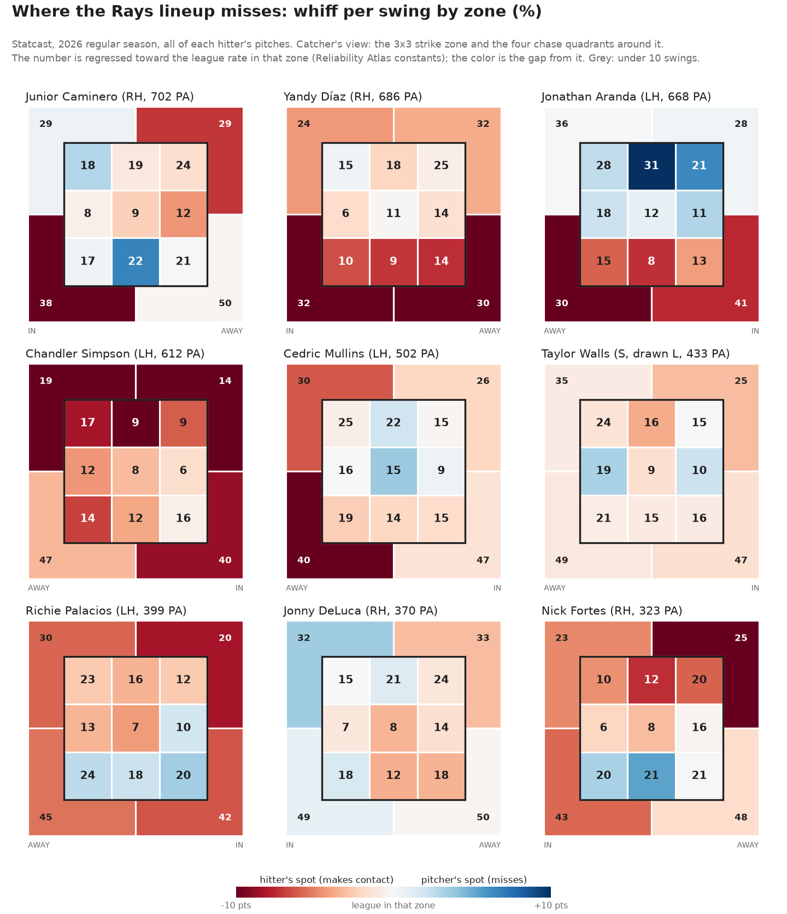
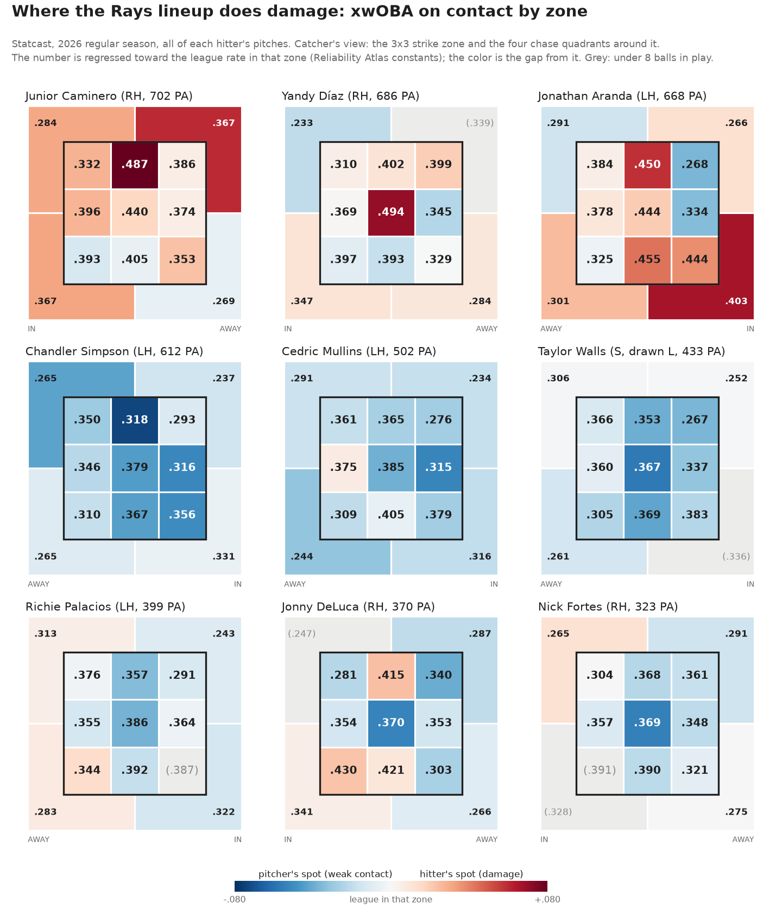

# Advance packet: the Tampa Bay Rays' hitters (2026 ALCS)

**Opponent hitter packet from public pitch data.** The nine Rays with the most 2026 plate appearances for Tampa Bay, scouted the way a club's advance group prepares its pitchers: where each hitter does damage, where he chases and misses, how he handles velocity and spin, what he does on the first pitch and with two strikes, what his swing looks like in bat-tracking numbers, his platoon split, and the plan. Every rate carries its n and is regressed toward the league rate for the same zone or pitch group. A [one-page coach version](2026-advance-packet-tb-coach.md) and a [Spanish coach version](2026-advance-packet-tb-coach-es.md) (my translation, under review) go with it.

*An independent exercise from public data, written as if for the club facing Tampa Bay; not prepared for, with or at the request of the Cleveland Guardians.*

**The series:** Cleveland won Game 1 (7-3) and Game 3 (3-2). Tampa Bay won Game 2 (3-1) and Game 4 (7-3, Oct. 17, after an Oct. 16 rainout). The series is tied 2-2. Game 5 is Sunday, Oct. 18, at Progressive Field; Games 6 and 7, if needed, are Oct. 19-20 in Tampa Bay. In Game 4 the damage came from the three hitters this packet flags: Caminero's go-ahead double, Aranda's two-run single and Díaz's two-run homer in the ninth.

*Update, Oct. 18 night: Tampa Bay won Game 5, 3-1, behind seven innings of one-run ball from Drew Rasmussen, and leads the series 3-2. Game 6 is Oct. 19 at Tropicana Field. The cards below are unchanged; they use the 2026 regular season only.*

*Written Oct. 18, 2026, by Dylan Fanelli. Data: Statcast via Baseball Savant, 2026 regular season, 714,483 pitches (716,792 rows less 2,309 automatic balls and strikes), 2,429 games; the nine hitters saw 17,552 of them. Code: `baseball/advance/packet.py` (`python -m baseball.advance.packet TB 2026`).*





## Summary
- **This lineup puts the ball in play and does little with it.**
  - **Contact:** the nine missed on 19.9% of their swings against a league rate of 25.1% (8,327 swings) and struck out in 17.7% of plate appearances (league 22.1%, 4,695 PA).
  - **Quality of contact:** xwOBA on contact .331 (league .362) and 35% hard-hit (league 39%). Their wOBA (.332) ran ahead of their xwOBA (.305).
  - **What it means for the staff:** strikeouts will come slower than usual, so most outs have to come from weak contact. Pitching in the zone costs less against this lineup than against most.
- **The usual put-away pitch works less well on them.**
  - **Breaking balls below the zone:** they chased 35.5% and missed 49% of those swings, against 38.4% and 60% for the league: 17.4 swinging strikes per 100 such pitches against the league's 23.2 (1,344 pitches).
  - **Changeups and splitters below the zone:** 14.6 swinging strikes per 100 against the league's 20.9 (875 pitches).
  - **The exception:** left-handers' changeups away from the right-handed batters: 19.2 swinging strikes per 100 against the league's 12.7 (156 pitches). Right-handers' changeups away from the lefties were slightly below league (8.2 per 100 against 9.0, 255 pitches).
- **Three hitters carry the damage: Junior Caminero, Jonathan Aranda and Yandy Díaz.**
  - **Caminero:** .406 xwOBA on contact (regressed; league .362), 49% hard-hit, and a 99th-percentile bat (79.4 mph). Nothing up in the zone; he expands with two strikes (48% chase, league 41%).
  - **Aranda:** .401 xwOBA on contact, damage down and in; he misses elevated velocity (28% whiff on fastballs up in the zone, league 21%) and swings at 42% of first pitches (regressed).
  - **Díaz:** rarely strikes out (15% whiff, 14% K) and hits it hard (47% hard-hit) with a flat, opposite-field swing. Fastballs in on the hands produce his weakest contact (.318); a breaking ball at the belt is his best (.441).
- **The bottom of the order is where outs come.** Taylor Walls (.251 xwOBA), Jonny DeLuca (.261), Chandler Simpson (.264), Cedric Mullins (.269) and Nick Fortes (.273). DeLuca and Fortes chase 35-37% of pitches outside the zone and about half with two strikes.
- **Left-handed pitching.** The nine had a .287 xwOBA against left-handers (1,456 PA). For this mix of hitter sides the league would hit .308, so the lineup's makeup explains about 1 point of the gap (against right-handers: .314 against .318 expected). No hitter's regressed split is unusual for his side, so the rest is most likely split noise: expect the usual platoon edge from a lefty, and right-handed pinch-hitters (Vilade, Williamson) when one comes in.

## The team page

**The nine** (plate appearances for Tampa Bay; xwOBA; regressed rates)

| Hitter | Bats | PA | xwOBA | K % | Chase | Whiff | xwOBA on contact | First-pitch swing | Two-strike chase | Bat speed (pctl) |
|---|---|---|---|---|---|---|---|---|---|---|
| Junior Caminero | R | 702 | .364 | 18% | 31% | 24% | .406 | 26% | 48% | 79.4 (99) |
| Yandy Díaz | R | 686 | .346 | 14% | 29% | 15% | .370 | 29% | 41% | 73.5 (74) |
| Jonathan Aranda | L | 668 | .342 | 24% | 29% | 23% | .401 | 42% | 37% | 70.3 (28) |
| Chandler Simpson | L | 612 | .264 | 8% | 31% | 12% | .277 | 35% | 39% | 65.0 (1) |
| Cedric Mullins | L | 502 | .269 | 19% | 31% | 22% | .287 | 33% | 43% | 70.8 (33) |
| Taylor Walls | S | 433 | .251 | 24% | 26% | 22% | .286 | 34% | 37% | 68.0 (6) |
| Richie Palacios | L | 399 | .306 | 17% | 32% | 21% | .318 | 32% | 47% | 69.2 (17) |
| Jonny DeLuca | R | 370 | .261 | 21% | 35% | 25% | .319 | 35% | 47% | 73.4 (71) |
| Nick Fortes | R | 323 | .273 | 14% | 37% | 19% | .303 | 33% | 50% | 72.7 (63) |
| **League** | | | **.315** | **22%** | **30%** | **25%** | **.362** | **32%** | **41%** | **71.8** |

**Lineup tendencies** (the nine pooled; samples are large, so these are raw rates)
- **First pitch:** they swing at 33.1% (league 32.2%, 4,695 first pitches). Aranda (42%) is the only regular who is clearly aggressive; Caminero (26%) is clearly passive.
- **In the zone:** 66.2% swing rate on strikes (league 66.7%). Average.
- **Out of the zone:** 30.8% chase (league 30.5%), with fewer misses when they chase (see the summary).
- **Two strikes:** 42.9% chase (league 41.1%), 20.0% whiff (league 24.3%). Once they reach two strikes, 36.4% of their plate appearances end in a strikeout against the league's 42.0% (2,281 PA). They foul pitches off and battle.
- **By pitch group:** fastballs .324 xwOBA on contact (league .372, 1,770 balls in play), breaking balls 25.3% whiff (league 32.2%, 2,062 swings), changeups and splitters 26.7% whiff (league 32.1%, 1,149 swings).
- **By pitcher hand:** .314 xwOBA against right-handers (league .317, 3,239 PA) and .287 against left-handers (league .309, 1,456 PA).

**Pitch around** (first base open, game on the line)
1. **Junior Caminero:** the one hitter in the lineup who punishes mistakes in the zone with power, and he punishes fastballs most (.421 on contact against fastballs, league .372).
2. **Jonathan Aranda:** .401 on contact, and his damage is in the lower half, where sliders and changeups end up when they don't get below the zone.
3. **Yandy Díaz:** with a base open, make him chase. He hits the middle of the zone harder than anyone in the lineup (.494 regressed in the heart, Statcast zone 5) and almost never strikes out, so a strike-throwing plan just gives him the ball in play.

**Soft spots**
- **Walls, DeLuca, Fortes, Mullins, Simpson:** xwOBA .251 to .273. Attack them in the zone and save the best pitches for the top three.
- **DeLuca and Fortes:** chase 35% and 37% of pitches outside the zone (league 30%), and 47% and 50% with two strikes. Expand on both.
- **Simpson:** 1st-percentile bat speed and a 16% hard-hit rate. Strike him out rarely (8% K), so throw him strikes and play the ball in play.

## Hitter cards

Each card: the plan first (four lines), then the evidence. "Regressed" means shrunk toward the league rate for the same zone, pitch group or count with the Reliability Atlas constants (Method). Locations are from the hitter's side: "in" is the inner third or inside off the plate. Every figure comes from the full tables in the Appendix.

### Junior Caminero (R), 702 PA
**The plan**
- **Strike one:** take the free strike. He swings at 26% of first pitches (regressed; league 32%, 696 first pitches) and 39% of first-pitch strikes (league 46%). A breaking ball on the outer third is the safest strike: .341 on contact there (48 balls in play).
- **Attack:** breaking balls away and changeups down. Changeups down in the zone get misses on 33% of his swings (league 26%, 53 swings).
- **Avoid:** fastballs up and over the middle. .439 on contact on fastballs up in the zone (league .367, 45 balls in play), .487 in the top-middle cell, and .439 against fastballs under 93 mph (54 balls in play).
- **Two strikes:** bury the breaking ball below or off the plate away. He chases 48% of two-strike pitches outside the zone (league 41%, 450 pitches); breaking balls below get misses on 57% of his swings (84 swings), and away 46% with .240 on contact.

**Evidence**
- **Damage:** .406 xwOBA on contact regressed (489 balls in play), 49% hard-hit (490).
- **Velocity:** velocity helps a little and doesn't beat him. Against 96+ fastballs: 22% whiff (league 23%, 171 swings), .378 on contact (74 balls in play).
- **Spin:** he does the least with the middle third of breaking-ball spin (.345 on contact, 63 balls in play) and chases top-third spin 40% (league 35%; 298 pitches in all).
- **Bat tracking:** 79.4 mph bat speed, 8.7 ft swing length (both 99th percentile, 1,066 competitive swings), 24.9° swing path tilt (4th percentile, flat), 8.4° attack angle (32nd), pulled (attack direction +6.5°, 82nd).
  - **What it implies:** a long, fast, flat swing covers the top half of the zone (his damage map is hottest up and middle). The length shows on pitches that dive: changeups down and breaking balls below.
  - **Two strikes:** his bat speed falls 2.1 mph (78.1, 385 swings) against the league hitter's 1.5. He shortens, which fits the expanded chase.
- **Hands:** .347 xwOBA against right-handers (507 PA), .409 against left-handers (195 PA). Regressed with The Book's constants, the split is +.019, close to the league's +.015 for right-handed hitters. Plan him the same way against both.

### Yandy Díaz (R), 686 PA
**The plan**
- **Strike one:** average on 0-0 (29% swing regressed). Get ahead with a fastball in.
- **Attack:** fastballs in on the hands (.318 on contact on the inner third, league .350, 87 balls in play) and fastballs down (.361, league .400, 62 balls in play). With a 1.6° attack angle the contact goes on the ground.
- **Avoid:** breaking balls at the belt (.441 on contact, league .381, 37 balls in play) and anything in the heart (.494).
- **Two strikes:** he won't strike out much (14% K, 16% whiff with two strikes against the league's 24%). Expand with a breaking ball below (47% whiff on swings, 66 swings) or a fastball above the zone (36% whiff, 80 swings).

**Evidence**
- **Contact:** 15% whiff (league 25%, 1,213 swings), 88% zone contact (league 84%).
- **Breaking balls don't fool him:** 16% whiff against them (league 32%, 298 swings) and .410 on contact (157 balls in play). High-spin breaking balls (top third of their type) get hit hardest: .422 on contact (54 balls in play, league .352).
- **Velocity:** 19% whiff against 96+ (league 23%, 202 swings), .351 on contact. Neutral.
- **Bat tracking:** 73.5 mph (74th percentile), 1.6° attack angle (1st), 23.8° tilt (2nd), attack direction 7.5° toward the opposite field (2nd).
  - **What it implies:** a flat swing that drives the ball on a line or the ground to right-center. Pitches that ask him to lift (fastballs down, in on the hands) produce his weakest contact.
  - **Two strikes:** no change in bat speed (73.3 vs 73.7 mph, 386 two-strike swings). He keeps the same swing.
- **Hands:** no split (+.008 observed, +.014 regressed, 202 PA against left-handers).

### Jonathan Aranda (L), 668 PA
**The plan**
- **Strike one:** don't groove it. He swings at 42% of first pitches (regressed; league 32%, 668) and 58% of first-pitch strikes (league 46%). Start him with a changeup away (.327 on contact on the outer third, 22 balls in play) or a fastball at the top of the zone.
- **Attack:** velocity up. Fastballs up in the zone get misses on 28% of his swings (league 21%, 224 swings); 96+ fastballs 28% (league 23%, 225 swings).
- **Avoid:** the lower half, especially down and in, and breaking balls in the zone. .455 and .444 on contact in the low-middle and low-inside cells; breaking balls .423 on contact overall (league .356, 88 balls in play).
- **Two strikes:** he expands less than most (37%, league 41%, 508 pitches). Finish him with a fastball above the zone (44% whiff, 69 swings); a breaking ball only if it's below the zone (49% whiff, 77 swings).

**Evidence**
- **Damage:** .401 xwOBA on contact regressed (423 balls in play), 45% hard-hit.
- **Changeups:** he chases them (42%, league 36%) and misses less than most (20%, league 32%, 173 swings), with league-average contact (.339). A get-ahead pitch more than a put-away pitch.
- **Bat tracking:** 70.3 mph (28th percentile), 7.1 ft (33rd), 8.4° attack angle (32nd), 34.9° tilt (78th, steeper than most), attack direction 4.9° to the opposite field (7th).
  - **What it implies:** a steeper, shorter swing matched to the bottom of the zone. The top of the zone is where his swing and the pitch plane cross least, which is where his misses are.
- **Hands:** .353 against right-handers (478 PA), .315 against left-handers (190 PA); the regressed split (−.034) is the normal one for a left-handed hitter (−.033). A lefty helps by the usual amount.

### Chandler Simpson (L), 612 PA
**The plan**
- **Strike one:** throw a strike. He swings at 35% of first pitches (league 32%) and walks 4% of the time.
- **Attack:** fastballs in the zone, especially up and in. .304 on contact on fastballs up (107 balls in play) and .294 on the inner third (92). Over the middle, .337 (league .420).
- **Avoid:** walks and deep counts. Nothing in the zone gives him a damage spot (no family and location where he beats the league's contact by .020).
- **Two strikes:** he'll put it in play (13% whiff with two strikes, league 24%; 8% K). Stay in the zone with fastballs; a breaking ball below gets misses on 57% of his swings, but he chases only 30% of them.

**Evidence**
- **No power:** .277 xwOBA on contact regressed (524 balls in play), 16% hard-hit (535), 65.0 mph bat speed (1st percentile, 803 competitive swings), 3.0° attack angle (3rd).
- **Fastballs:** 6% whiff (league 19%, 563 swings), .278 on contact. Velocity changes nothing: 9% whiff against 96+ (138 swings).
- **Results ahead of contact:** .322 wOBA against .264 xwOBA (597 PA). Speed is the likely reason weak contact became hits; this data can't separate speed from luck (What this doesn't show).
- **Hands:** .280 against right-handers (401 PA), .232 against left-handers (211 PA); regressed split −.036, normal for his side.

### Cedric Mullins (L), 502 PA
**The plan**
- **Strike one:** he swings at 51% of first-pitch strikes (league 46%). Start him with a breaking ball for a strike.
- **Attack:** breaking balls anywhere (.276 on contact, league .356, 80 balls in play) and fastballs up (22% whiff, .326 on contact, 45 balls in play).
- **Avoid:** nothing clear. His low-middle cell (.405 on contact) is below the league's .411 there; the one gap, changeups down in the zone (.387 against .357), rests on 11 balls in play, too thin to plan on.
- **Two strikes:** breaking ball below: he chases 42% and misses 54% of those swings (57 swings); above-the-zone fastballs get 31% whiffs (107 swings) and .263 on contact.

**Evidence**
- **Role:** he started 122 regular-season games in center but none in the ALDS, where DeLuca played center (MLB.com's ALCS position breakdown).
- **Damage:** .287 xwOBA on contact regressed (343 balls in play), 34% hard-hit.
- **Zone aggression:** 71% swing rate on strikes (league 67%, 898 pitches).
- **Fastballs over the middle:** 19% whiff (league 14%, 160 swings). He misses hittable fastballs more than most.
- **Bat tracking:** 70.8 mph (33rd percentile), 11.8° attack angle (67th), attack direction +5.0° pull (71st). An upward, pull-side swing; elevated fastballs get under it.
- **Hands:** .285 against right-handers (383 PA), .215 against left-handers (119 PA); regressed −.037, normal.

### Taylor Walls (S), 433 PA
**The plan**
- **Strike one:** attack the zone; he takes. 62% swing rate on strikes (league 67%, 814 pitches).
- **Attack:** changeups away (27% whiff on the outer third, league 22%, 34 swings; .300 on contact) and fastballs up (.314 on contact, 57 balls in play).
- **Avoid:** nothing stands out. His best contact is on fastballs on the outer third (.380, league .388, 41 balls in play).
- **Two strikes:** he won't expand much (37%, league 41%, 304 pitches) and barely chases breaking balls (22%, league 32%). Finish him in or near the zone: a changeup at the bottom (55% whiff below the zone, 28 swings) or a fastball above (40% whiff, 73 swings).

**Evidence**
- **Damage:** .286 xwOBA on contact regressed (266 balls in play), 24% hard-hit, .251 xwOBA.
- **Patience:** 26% chase (league 30%, 876 pitches), 10% walks, 24% strikeouts.
- **Bat tracking:** 68.0 mph (6th percentile), 12.8° attack angle (77th). A slow, uphill swing.
- **Hands:** .274 against right-handers (278 PA), .208 against left-handers (155 PA); the switch-hitter split regresses to −.017.

### Richie Palacios (L), 399 PA
**The plan**
- **Strike one:** average on 0-0 (32%). Fastball in the zone (.318 on fastball contact, league .372).
- **Attack:** fastballs early, changeups down (31% whiff in the zone, league 26%, 33 swings).
- **Avoid:** nothing clear. His closest is changeups on the outer third (.348 on contact, league .326), on 15 balls in play: too thin to plan on.
- **Two strikes:** expand. He chases 47% (league 41%, 280 pitches); breaking balls below get 52% whiffs on his swings (56 swings), changeups below 56% (31 swings).

**Evidence**
- **Damage:** .318 xwOBA on contact regressed (275 balls in play), 31% hard-hit.
- **Bat tracking:** 69.2 mph (17th percentile), 26.2° tilt (7th, flat), attack direction +5.1° pull (73rd).
- **Hands:** 64 PA against left-handers all season (335 against right-handers). Tampa Bay platoons him; expect a pinch-hitter when a lefty comes in. His raw split (−.099) regresses to −.037, the normal left-handed split.

### Jonny DeLuca (R), 370 PA
**The plan**
- **Strike one:** he swings at 51% of first-pitch strikes (league 46%). Start with a breaking ball.
- **Attack:** breaking balls and changeups out of the zone. He chases breaking balls 38% (league 32%) and changeups 45% (league 36%).
- **Avoid:** little stands out. Fastballs down are league-average (.401 on contact, league .400, 25 balls in play), and so is the low-middle cell (.421, league .411). The one gap is down and in (.430, league .407), on 9 balls in play: don't leave it there.
- **Two strikes:** breaking ball below. He chases 44% and misses 63% of those swings: 27.7 swinging strikes per 100 such pitches, against the league's 23.2 (116 pitches). His two-strike chase is 47% (219 pitches).

**Evidence**
- **Damage:** .319 xwOBA on contact regressed (272 balls in play), .261 xwOBA against a .329 wOBA.
- **Velocity:** he handles 96+ (17% whiff, league 23%, 98 swings), so velocity alone won't put him away.
- **Bat tracking:** 73.4 mph (71st percentile), 7.8 ft swing length (92nd), 23.8° tilt (1st percentile, flat), 7.2° attack angle (20th). A long swing that chases: the profile that breaking balls below the zone beat.
- **Hands:** .272 against right-handers (215 PA), .247 against left-handers (155 PA); regressed +.012, normal for a right-handed hitter.

### Nick Fortes (R), 323 PA
**The plan**
- **Strike one:** average on 0-0 (33%).
- **Attack:** expand from the first pitch. He chases 37% (league 30%, 590 pitches), and 40% of fastballs out of the zone (league 27%).
- **Avoid:** nothing stands out. His best contact is on fastballs on the outer third (.384, league .388, 24 balls in play).
- **Two strikes:** he chases 50% (regressed; league 41%, 159 pitches). Fastballs above the zone (34% whiff, 56 swings) or in off the plate (.233 on contact), changeups below (57% whiff, 17 swings).

**Evidence**
- **Contact:** 19% whiff (580 swings), 12% on fastballs; .303 xwOBA on contact regressed (250 balls in play).
- **Bat tracking:** 3.6° attack angle (3rd percentile), 19.7° tilt (1st), attack direction +7.8° pull (92nd). A flat, pull-side swing that puts chased pitches on the ground to the left side.
- **Hands:** .258 against right-handers (158 PA), .287 against left-handers (165 PA); regressed +.016.

### Also on the ALCS roster
Four hitters outside the nine have regular roles in this series: Hicks, Williamson and Mesa played in Game 2, and MLB.com's position breakdown has Hicks catching and Vilade in right field against left-handers. The same tables are in the Appendix; one line each:
- **Liam Hicks (L; 554 PA, 145 with Tampa Bay after joining in midseason):** extreme contact (12% whiff, 96% zone contact) with little power (.311 on contact). Steal strike one (26% first-pitch swing); fastballs up (.312). He hit .243 xwOBA against left-handers (118 PA), and his regressed split (−.040) is close to the normal left-handed split (−.033): a lefty helps by the usual amount.
- **Ben Williamson (R, 286 PA):** the most passive first-pitch hitter on the roster (20% regressed, 29% at first-pitch strikes). Free strike one; expand with two strikes (46% chase; breaking balls below 61% whiff, 31 swings).
- **Victor Mesa Jr. (L, 262 PA):** the most aggressive (40% first-pitch swing, 76% zone swing, 34% chase). Velocity up (fastballs above the zone 47% whiff, 28 swings), breaking balls below (chases 50%, misses 51%); his closest damage spot, breaking balls at the belt (.407, 13 balls in play), is too thin to plan on.
- **Ryan Vilade (R, 278 PA; expected in right field against left-handers):** a 96th-percentile bat (76.5 mph) on a flat swing (4.5° attack angle, 5th percentile); .380 xwOBA on contact regressed (181 balls in play). Fastballs on the inner third get his weakest contact (.334, league .350, 41 balls in play); finish with a breaking ball below (58% whiff, 42 swings). He won't expand much with two strikes (36%, league 41%, 201 pitches). Against left-handers .346 xwOBA (170 PA), regressed +.017, a normal split.

## Method
- **Grain.** One row per pitch, 2026 regular season (Statcast's `seq` copy in `data/seq/`). Automatic balls and strikes from pitch-clock violations count toward plate appearances, walks and strikeouts and toward nothing else.
- **The lineup.** The batting team on each pitch is the away team in the top of the inning and the home team in the bottom. The nine are the hitters with the most plate appearances while batting for Tampa Bay. A hitter's tendencies use all his 2026 pitches; for the nine that is the same thing, since none played for another club.
- **Flags once, rates after aggregation.** Swing, whiff (swinging strikes, blocked swinging strikes, foul tips, missed bunts), contact, ball in play, zone and chase are flagged once per pitch, summed by group, then divided.
- **Zones.** Statcast's own 13 zones: 1-9 are the strike zone in thirds, 11-14 the four chase quadrants. Each is relabeled "in" or "away" from the side the hitter stood on, so a switch-hitter's two sides add up. The figures draw each hitter in the catcher's view from the side he batted on most (Walls: left, 278 of 433 plate appearances), with his other side mirrored in.
  - **Pitch-group tables** use overlapping thirds of the zone (up, belt, down; in, middle, away) and four directions outside it: above, below, in and away, by the side on which the pitch was furthest outside (plate edge at 0.83 ft: 8.5 in plus a ball radius).
  - **Pitch groups:** fastballs are four-seamers and sinkers; cutters are their own group; breaking balls are sliders, sweepers, curveballs, knuckle curves and slurves; changeups and splitters together.
  - **Velocity bands:** four-seamers and sinkers under 93, 93-95.9 and 96+ mph. **Spin bands:** thirds of the league's spin rate within each breaking-ball type, so a curveball is compared with curveballs.
- **Regression.** Each hitter rate is shrunk toward the league rate for the same zone, group, band or count: estimate = (n × observed + M × league) / (n + M), with M from the Reliability Atlas (`baseball/evaluation/reliability_params.json`).
  - **The constants:** whiff per swing 55 swings; chase 65 pitches outside the zone; zone swing 63 pitches in the zone; swing rate 97 pitches; zone contact 58 swings; xwOBA on contact 64 balls in play; hard-hit 44 balls in play; bat speed 2.6 and attack angle 10 competitive swings.
  - **Swinging strikes per pitch** (the put-away measure) is the regressed swing rate times the regressed whiff rate.
  - **Platoon splits** (xwOBA against left-handers minus against right-handers) are regressed toward the league split for the hitter's side with The Book's constants: 2,200 PA against left-handers for right-handed hitters, 1,000 for left-handed hitters, and 2,200 for switch-hitters (the conservative choice). The Book built those constants for wOBA; xwOBA splits carry less noise, so this regression is, if anything, too strong.
- **Display minimums.** 10 swings for whiff, 20 pitches for swing rates, 8 balls in play for xwOBA on contact. Below them a number is shown in parentheses or grey and never drives a plan line.
- **Draft plan lines** come from `plan()` and are then edited by hand into the cards:
  - **Put-away:** the out-of-zone pitch group and direction with the most regressed swinging strikes per pitch (25+ pitches).
  - **Get strikes:** the in-zone group and region where his regressed whiff rate beats the league's by 3+ points (15+ swings); if none does, where his contact is weakest against the league's (10+ balls in play).
  - **Avoid:** the in-zone group and region where his regressed xwOBA on contact is furthest above the league's (10+ balls in play), flagged clear only at .020 or more.
  - **First pitch and two strikes:** his regressed swing (chase) rate in that count against the league's, with ±6 and ±4 points as the lines for "aggressive" or "expands".
- **Bat tracking.** Statcast's competitive swings (each hitter's fastest 90% plus any 60+ mph swing with 90+ mph exit velocity). Percentiles are among the 519 hitters with 100+ competitive swings. Attack direction is flipped so that pull is positive for both sides.
- **xwOBA per plate appearance** uses Statcast's expected value on balls in play and the actual wOBA value on walks, hit-by-pitches and strikeouts.

## What this doesn't show
- **Pitch quality faced.** Every rate treats the pitches a hitter saw as league-average. A hitter who saw a lot of plus sliders looks worse against sliders than he is. Video and a pitch-quality adjustment would sharpen the put-away lines.
- **Cleveland's own arsenals.** The plans are written in pitch groups. Matching them to each Cleveland pitcher's actual pitches (a sweeper pitcher and a curveball pitcher execute "breaking ball below" differently) needs the probable pitchers; the matchup grid is the next step.
- **Video.** No plan line here has been checked against film. In a club setting each line gets 10-15 clips per key hitter before it reaches the pitching coach.
- **The running game, positioning and game state.** Stolen bases, bunting and spray charts aren't in this cut; Simpson's speed is the obvious gap.
- **Sequencing and count leverage beyond 0-0 and two strikes.** Ahead and behind counts are pooled.
- **Cells regressed with whole-season constants.** M was measured on season rates; using it inside a zone or pitch group assumes the same spread of true talent there. Where the true spread is narrower, the cells are regressed too little.
- **Postseason pitches.** Excluded. The series itself would be the place to look for in-series changes (a hitter who moved up in the box, a new approach with two strikes).

## Walk me through it
**Why trust 40 swings?**
I don't trust them on their own. Every rate is pulled toward the league rate for that same zone. For whiff, M is 55 swings, so 40 swings carry a weight of 40 / 95 = 42%: a raw 50% whiff where the league misses 30% shows as 38%. Under 10 swings the number is greyed and can't drive a plan line. Most plan lines rest on 50 or more swings or pitches; the few that rest on 10-20 balls in play say so.

**How did you pick the zones?**
Statcast's own 13: nine in the strike zone and four chase quadrants. Anyone can check them against Savant, and four chase quadrants keep enough pitches per hitter. I relabel them in and away by the hitter's side, which also lets a switch-hitter's two sides add up. For the plan I use thirds of the zone and the direction a pitch missed (above, below, in, away), because "breaking ball below the zone" is how a pitcher thinks.

**What would you tell a pitcher in 30 seconds?**
"They put the ball in play, and they don't miss the slider in the dirt like most teams. Get ahead in the zone, don't walk the bottom five. Caminero: nothing up, bury the breaking ball with two strikes. Aranda: velocity up, stay off the bottom of the zone. Díaz: in on the hands, and he'll hit it on the ground."

**Why xwOBA on contact instead of what actually happened?**
It removes the defense and the park and becomes reliable about five times sooner (64 balls in play, about 94 plate appearances, against wOBA's 511 plate appearances). Simpson shows why: his .322 wOBA sits on weak contact (.264 xwOBA), most likely helped by his speed; a pitcher should still attack him in the zone.

**How do you know a platoon split is real?**
I regress it the way The Book does. Palacios's raw split against lefties is −.099 on 64 plate appearances; regressed it's −.037, which is the normal split for a left-handed hitter. The lineup hit lefties worse than expected for its mix of sides, but no one carries an unusual split, so I plan for the usual platoon edge and nothing more.

**What does bat tracking add that the results don't?**
The reason behind a hole, which tells you whether it will hold. Díaz's 1.6° attack angle explains why fastballs down and in produce ground balls. Caminero's 8.7 ft swing at 79 mph explains both the power and why changeups that dive get his misses. Bat speed and attack angle stabilize in a few dozen swings, so these are the most reliable numbers on the card.

**What would make you change a plan line?**
Video that shows the pitches behind a number were unusual (a hitter's breaking-ball whiffs came against elite sweepers), or an in-series change in approach. After the series, each plan line goes in a results log: what we threw there, what happened, keep or revise.

**Why the regular season only?**
Postseason samples are a few dozen pitches per hitter against the best staffs; they're the place to spot a change, and the season is the place to set the plan.

## Reproduce
```bash
uv run python -m baseball.advance.packet TB 2026 --figures reports/figures --name Rays --extra 689414 810938 683748 668723
# -> data/advance/tables-TB-2026.md (every table in the Appendix), profiles-TB-2026.json (every number, plus the
#    pooled team rates), team-TB-2026.csv, and the two zone figures
uv run pytest tests/test_advance.py   # fictional data only
```
Peak memory is about 1.2 GB (one season, 34 columns).

## Sources
- **Pitch data:** Statcast, MLB Advanced Media, via [Baseball Savant](https://baseballsavant.mlb.com/) (2026 regular season, pulled through October 2026).
- **Player names:** the Chadwick Bureau register (`baseball/ingest/people.py`).
- **Regression constants:** this repo's [Reliability Atlas](2026-reliability-atlas.md).
- **Platoon regression:** Tom Tango, Mitchel Lichtman and Andrew Dolphin, *The Book: Playing the Percentages in Baseball* (2007).
- **Bat-tracking definitions:** [Baseball Savant bat-tracking leaderboard glossary](https://baseballsavant.mlb.com/leaderboard/bat-tracking).
- **Series results:** WKBN, "Guardians top Rays 7-3 in Game 1 of ALCS" (Oct. 12, 2026); Suncoast News, "Tampa Bay tops Guardians 3-1 in Game 2" (Oct. 14, 2026); News 5 Cleveland, "Halpin's go-ahead homer flips Game 3 as Guardians beat Rays 3-2" (Oct. 15, 2026); [MLB.com, "Rays slip past Guards in Game 4 to knot up ALCS"](https://www.mlb.com/guardians/news/rays-win-alcs-game-4-2026) (Oct. 17, 2026); [CBS Sports, Game 4 live updates](https://www.cbssports.com/mlb/news/guardians-rays-live-updates-alcs-game-4/live/) (Oct. 17, 2026); [NBC Bay Area, the schedule after the Game 4 postponement](https://www.nbcbayarea.com/mlb/updated-guardians-rays-alcs-schedule/4160429/) (Oct. 16, 2026); [Sports Illustrated, "Rays take control of ALCS after pivotal Game 5 win"](https://www.si.com/fannation/mlb/fastball/news/drew-rasmussen-rays-take-control-alcs-game-5-win-michael3) (Oct. 18, 2026).
- **ALCS roles:** [MLB.com, "Guardians-Rays ALCS position-by-position breakdown"](https://www.mlb.com/news/guardians-rays-alcs-position-by-position-breakdown).

## Appendix: the full tables
Generated by `hitter_markdown()`; numbers in parentheses are under the display minimum. "lg" is the league rate for the same row.

### Junior Caminero (R), 702 PA for the club, 702 PA in all

- **First pitch:** swings 25% (regressed 26%, league 32%, n = 696 first pitches), 39% at strikes (league 46%); takes early: steal strike one in the zone.
- **Get strikes:** changeup/splitter down in the zone: misses on 33% of swings regressed (league 26%, n = 53 swings), xwOBA on contact .349 (league .357, n = 19).
- **Put-away:** breaking ball below the zone: 18.4% swinging strikes per pitch regressed, fewer than the league's 23.2% (chases 32%, misses 57% of those swings; n = 273 pitches, 84 swings).
- **Avoid:** fastball up in the zone: xwOBA on contact .439 regressed (league .367, n = 45 balls in play).
- **Two strikes:** chases 48% regressed (league 41%, n = 450 pitches outside); misses 24% of swings (league 24%, n = 451); expands: bury the put-away pitch.

| Overall | Raw | Regressed | League | n |
|---|---|---|---|---|
| Swing % | 44% | 44% | 48% | 2,711 |
| Chase % | 31% | 31% | 30% | 1,537 |
| Zone swing % | 63% | 63% | 67% | 1,163 |
| Whiff per swing | 24% | 24% | 25% | 1,203 |
| Zone contact % | 85% | 84% | 84% | 731 |
| xwOBA on contact | .411 | .406 | .362 | 489 |
| Hard-hit % | 50% | 49% | 39% | 490 |
| K % / BB % | 18% / 11% | | | 702 PA |
| wOBA / xwOBA | .379 / .364 | | | 684 |

| Pitch family | Pitches | Swings | Whiff (reg.) | Chase (reg.) | BIP | xwOBA con (reg.) |
|---|---|---|---|---|---|---|
| fastball | 1119 | 487 | 18% (lg 19%) | 28% (lg 27%) | 208 | .421 (lg .372) |
| cutter | 229 | 99 | 17% (lg 23%) | 25% (lg 29%) | 41 | .378 (lg .367) |
| breaking | 921 | 421 | 30% (lg 32%) | 34% (lg 32%) | 169 | .381 (lg .356) |
| offspeed | 411 | 187 | 33% (lg 32%) | 32% (lg 36%) | 67 | .367 (lg .335) |

| Location (regressed whiff / xwOBA con; n swings, BIP) | Fastball | Breaking | Changeup/splitter |
|---|---|---|---|
| up in the zone | 20% / .439 (125, 45) | 21% / .380 (39, 15) | (15%) / (.389) (7, 3) |
| at the belt | 9% / .412 (149, 80) | 10% / .395 (94, 55) | 13% / .376 (42, 20) |
| down in the zone | 9% / .367 (57, 35) | 22% / .414 (94, 41) | 33% / .349 (53, 19) |
| in off the inner third | 11% / .383 (123, 66) | 17% / .426 (52, 17) | 21% / .375 (29, 8) |
| over the middle | 14% / .447 (134, 59) | 17% / .444 (90, 46) | 22% / .425 (32, 12) |
| on the outer third | 16% / .385 (74, 35) | 17% / .341 (85, 48) | 25% / .333 (41, 22) |
| above the zone | 38% / .388 (80, 23) | (37%) / (.325) (1, 1) | (24%) / (.285) (2, 1) |
| below the zone | (32%) / (.316) (8, 2) | 57% / .322 (84, 24) | 53% / .324 (48, 10) |
| in off the plate | 16% / .255 (52, 15) | 29% / (.272) (20, 6) | 25% / (.292) (11, 4) |
| off the plate away | 26% / .312 (16, 8) | 46% / .240 (89, 27) | 34% / .276 (24, 10) |

| Fastball velocity | Pitches | Swings | Whiff (reg.) | BIP | xwOBA con (reg.) |
|---|---|---|---|---|---|
| under 93 mph | 251 | 103 | 15% (lg 15%) | 54 | .439 (lg .384) |
| 93-95.9 mph | 515 | 213 | 16% (lg 18%) | 80 | .404 (lg .372) |
| 96+ mph | 353 | 171 | 22% (lg 23%) | 74 | .378 (lg .360) |

| Breaking-ball spin (third of its type) | Pitches | Swings | Whiff (reg.) | Chase (reg.) | BIP | xwOBA con (reg.) |
|---|---|---|---|---|---|---|
| low third | 288 | 127 | 27% (lg 31%) | 31% (lg 31%) | 46 | .401 (lg .359) |
| middle third | 335 | 147 | 30% (lg 32%) | 29% (lg 32%) | 63 | .345 (lg .356) |
| top third | 298 | 147 | 34% (lg 34%) | 40% (lg 35%) | 60 | .375 (lg .352) |

| Pitcher hand | PA | xwOBA | K % | Whiff (reg.) | Chase (reg.) |
|---|---|---|---|---|---|
| vs RHP | 507 | .347 | 20% | 25% | 32% |
| vs LHP | 195 | .409 | 14% | 22% | 26% |

Platoon split (xwOBA vs LHP minus vs RHP): observed +0.063, league for his side +0.015, regressed +0.019 (195 PA vs LHP, M = 2,200).

| Bat tracking (competitive swings) | Value | League | Percentile | n |
|---|---|---|---|---|
| Bat speed | 79.4 mph | 71.8 | 99 | 1066 |
| Swing length | 8.7 ft | 7.3 | 99 | 1066 |
| Attack angle | 8.4 deg | 10.1 | 32 | 1066 |
| Attack direction (pull +) | 6.5 deg | 2.2 | 82 | 1066 |
| Swing path tilt | 24.9 deg | 32.1 | 4 | 1066 |

Two-strike bat speed 78.1 mph (n = 385) vs 80.2 otherwise (n = 681); the league's hitters average a -1.5 mph change.

### Yandy Díaz (R), 686 PA for the club, 686 PA in all

- **First pitch:** swings 28% (regressed 29%, league 32%, n = 682 first pitches), 44% at strikes (league 46%); average on 0-0.
- **Get strikes:** no in-zone spot where he misses 3+ points more than the league; his weakest contact is on the fastball down in the zone: xwOBA on contact .361 regressed (league .400, n = 62 balls in play).
- **Put-away:** breaking ball below the zone: 16.5% swinging strikes per pitch regressed, fewer than the league's 23.2% (chases 35%, misses 47% of those swings; n = 192 pitches, 66 swings).
- **Avoid:** breaking ball at the belt: xwOBA on contact .441 regressed (league .381, n = 37 balls in play).
- **Two strikes:** chases 41% regressed (league 41%, n = 454 pitches outside); misses 16% of swings (league 24%, n = 458); league-average expansion.

| Overall | Raw | Regressed | League | n |
|---|---|---|---|---|
| Swing % | 48% | 48% | 48% | 2,551 |
| Chase % | 29% | 29% | 30% | 1,302 |
| Zone swing % | 67% | 67% | 67% | 1,240 |
| Whiff per swing | 15% | 15% | 25% | 1,213 |
| Zone contact % | 89% | 88% | 84% | 832 |
| xwOBA on contact | .371 | .370 | .362 | 518 |
| Hard-hit % | 48% | 47% | 39% | 520 |
| K % / BB % | 14% / 8% | | | 686 PA |
| wOBA / xwOBA | .357 / .346 | | | 675 |

| Pitch family | Pitches | Swings | Whiff (reg.) | Chase (reg.) | BIP | xwOBA con (reg.) |
|---|---|---|---|---|---|---|
| fastball | 1402 | 658 | 16% (lg 19%) | 26% (lg 27%) | 245 | .353 (lg .372) |
| cutter | 245 | 121 | 17% (lg 23%) | 27% (lg 29%) | 51 | .338 (lg .367) |
| breaking | 637 | 298 | 16% (lg 32%) | 34% (lg 32%) | 157 | .410 (lg .356) |
| offspeed | 258 | 133 | 20% (lg 32%) | 36% (lg 36%) | 65 | .349 (lg .335) |

| Location (regressed whiff / xwOBA con; n swings, BIP) | Fastball | Breaking | Changeup/splitter |
|---|---|---|---|
| up in the zone | 20% / .386 (177, 40) | 15% / .380 (25, 9) | (18%) / (.379) (9, 3) |
| at the belt | 12% / .396 (215, 94) | 7% / .441 (54, 37) | 13% / .361 (24, 11) |
| down in the zone | 7% / .361 (97, 62) | 11% / .387 (91, 57) | 17% / .374 (46, 31) |
| in off the inner third | 9% / .318 (175, 87) | 11% / .427 (32, 21) | 18% / .431 (24, 15) |
| over the middle | 14% / .447 (190, 71) | 8% / .458 (64, 38) | 14% / .376 (25, 16) |
| on the outer third | 19% / .386 (124, 38) | 12% / .343 (74, 44) | 20% / .323 (30, 14) |
| above the zone | 36% / .300 (80, 8) | (39%) / (.299) (1, 0) | (24%) / (.284) (1, 0) |
| below the zone | (29%) / (.311) (8, 3) | 47% / .327 (66, 26) | 39% / .298 (36, 16) |
| in off the plate | 12% / .221 (61, 32) | 29% / (.281) (17, 7) | (29%) / (.286) (9, 3) |
| off the plate away | 27% / (.332) (20, 6) | 35% / .291 (44, 21) | (28%) / (.264) (8, 1) |

| Fastball velocity | Pitches | Swings | Whiff (reg.) | BIP | xwOBA con (reg.) |
|---|---|---|---|---|---|
| under 93 mph | 404 | 165 | 14% (lg 15%) | 80 | .353 (lg .384) |
| 93-95.9 mph | 596 | 291 | 16% (lg 18%) | 96 | .370 (lg .372) |
| 96+ mph | 402 | 202 | 19% (lg 23%) | 69 | .351 (lg .360) |

| Breaking-ball spin (third of its type) | Pitches | Swings | Whiff (reg.) | Chase (reg.) | BIP | xwOBA con (reg.) |
|---|---|---|---|---|---|---|
| low third | 241 | 99 | 19% (lg 31%) | 30% (lg 31%) | 54 | .361 (lg .359) |
| middle third | 201 | 93 | 20% (lg 32%) | 33% (lg 32%) | 49 | .386 (lg .356) |
| top third | 193 | 106 | 22% (lg 34%) | 37% (lg 35%) | 54 | .422 (lg .352) |

| Pitcher hand | PA | xwOBA | K % | Whiff (reg.) | Chase (reg.) |
|---|---|---|---|---|---|
| vs RHP | 484 | .343 | 15% | 16% | 28% |
| vs LHP | 202 | .351 | 12% | 15% | 31% |

Platoon split (xwOBA vs LHP minus vs RHP): observed +0.008, league for his side +0.015, regressed +0.014 (202 PA vs LHP, M = 2,200).

| Bat tracking (competitive swings) | Value | League | Percentile | n |
|---|---|---|---|---|
| Bat speed | 73.5 mph | 71.8 | 74 | 1082 |
| Swing length | 7.6 ft | 7.3 | 76 | 1082 |
| Attack angle | 1.6 deg | 10.1 | 1 | 1082 |
| Attack direction (pull +) | -7.5 deg | 2.2 | 2 | 1082 |
| Swing path tilt | 23.8 deg | 32.1 | 2 | 1082 |

Two-strike bat speed 73.3 mph (n = 386) vs 73.7 otherwise (n = 696); the league's hitters average a -1.5 mph change.

### Jonathan Aranda (L), 668 PA for the club, 668 PA in all

- **First pitch:** swings 43% (regressed 42%, league 32%, n = 668 first pitches), 58% at strikes (league 46%); aggressive early: don't give in on 0-0.
- **Get strikes:** fastball up in the zone: misses on 28% of swings regressed (league 21%, n = 224 swings), xwOBA on contact .354 (league .367, n = 48).
- **Put-away:** breaking ball below the zone: 20.9% swinging strikes per pitch regressed, fewer than the league's 23.2% (chases 43%, misses 49% of those swings; n = 173 pitches, 77 swings).
- **Avoid:** breaking ball in off the inner third: xwOBA on contact .425 regressed (league .384, n = 14 balls in play).
- **Two strikes:** chases 37% regressed (league 41%, n = 508 pitches outside); misses 23% of swings (league 24%, n = 470); league-average expansion.

| Overall | Raw | Regressed | League | n |
|---|---|---|---|---|
| Swing % | 47% | 47% | 48% | 2,675 |
| Chase % | 29% | 29% | 30% | 1,398 |
| Zone swing % | 66% | 66% | 67% | 1,265 |
| Whiff per swing | 22% | 23% | 25% | 1,249 |
| Zone contact % | 82% | 82% | 84% | 837 |
| xwOBA on contact | .407 | .401 | .362 | 423 |
| Hard-hit % | 46% | 45% | 39% | 424 |
| K % / BB % | 24% / 10% | | | 668 PA |
| wOBA / xwOBA | .352 / .342 | | | 661 |

| Pitch family | Pitches | Swings | Whiff (reg.) | Chase (reg.) | BIP | xwOBA con (reg.) |
|---|---|---|---|---|---|---|
| fastball | 1502 | 708 | 22% (lg 19%) | 23% (lg 27%) | 212 | .391 (lg .372) |
| cutter | 219 | 120 | 25% (lg 23%) | 31% (lg 29%) | 42 | .403 (lg .367) |
| breaking | 603 | 239 | 26% (lg 32%) | 32% (lg 32%) | 88 | .423 (lg .356) |
| offspeed | 332 | 173 | 20% (lg 32%) | 42% (lg 36%) | 79 | .339 (lg .335) |

| Location (regressed whiff / xwOBA con; n swings, BIP) | Fastball | Breaking | Changeup/splitter |
|---|---|---|---|
| up in the zone | 28% / .354 (224, 48) | (22%) / (.372) (9, 1) | (16%) / (.401) (5, 2) |
| at the belt | 15% / .405 (223, 76) | 12% / .405 (47, 22) | 14% / .343 (25, 14) |
| down in the zone | 8% / .409 (94, 49) | 15% / .414 (74, 38) | 17% / .375 (49, 24) |
| in off the inner third | 16% / .320 (131, 49) | 15% / .425 (36, 14) | 21% / (.381) (10, 4) |
| over the middle | 19% / .449 (247, 79) | 14% / .433 (60, 31) | 15% / .430 (29, 14) |
| on the outer third | 21% / .382 (163, 45) | 18% / .351 (34, 16) | 17% / .327 (40, 22) |
| above the zone | 44% / (.291) (69, 5) | (38%) / (.299) (2, 0) | (24%) / (.281) (1, 1) |
| below the zone | 30% / .325 (17, 8) | 49% / .324 (77, 17) | 37% / .301 (71, 29) |
| in off the plate | 16% / .317 (44, 18) | 35% / (.300) (16, 5) | (28%) / (.288) (5, 2) |
| off the plate away | 24% / .307 (37, 8) | 45% / (.272) (14, 5) | 26% / (.257) (17, 7) |

| Fastball velocity | Pitches | Swings | Whiff (reg.) | BIP | xwOBA con (reg.) |
|---|---|---|---|---|---|
| under 93 mph | 370 | 160 | 17% (lg 15%) | 62 | .382 (lg .384) |
| 93-95.9 mph | 694 | 323 | 20% (lg 18%) | 96 | .377 (lg .372) |
| 96+ mph | 438 | 225 | 28% (lg 23%) | 54 | .399 (lg .360) |

| Breaking-ball spin (third of its type) | Pitches | Swings | Whiff (reg.) | Chase (reg.) | BIP | xwOBA con (reg.) |
|---|---|---|---|---|---|---|
| low third | 195 | 77 | 25% (lg 31%) | 33% (lg 31%) | 34 | .385 (lg .359) |
| middle third | 221 | 83 | 29% (lg 32%) | 30% (lg 32%) | 22 | .390 (lg .356) |
| top third | 186 | 78 | 29% (lg 34%) | 32% (lg 35%) | 32 | .401 (lg .352) |

| Pitcher hand | PA | xwOBA | K % | Whiff (reg.) | Chase (reg.) |
|---|---|---|---|---|---|
| vs RHP | 478 | .353 | 23% | 22% | 31% |
| vs LHP | 190 | .315 | 27% | 24% | 26% |

Platoon split (xwOBA vs LHP minus vs RHP): observed -0.039, league for his side -0.033, regressed -0.034 (190 PA vs LHP, M = 1,000).

| Bat tracking (competitive swings) | Value | League | Percentile | n |
|---|---|---|---|---|
| Bat speed | 70.3 mph | 71.8 | 28 | 1096 |
| Swing length | 7.1 ft | 7.3 | 33 | 1096 |
| Attack angle | 8.4 deg | 10.1 | 32 | 1096 |
| Attack direction (pull +) | -4.9 deg | 2.2 | 7 | 1096 |
| Swing path tilt | 34.9 deg | 32.1 | 78 | 1096 |

Two-strike bat speed 69.8 mph (n = 393) vs 70.6 otherwise (n = 703); the league's hitters average a -1.5 mph change.

### Chandler Simpson (L), 612 PA for the club, 612 PA in all

- **First pitch:** swings 35% (regressed 35%, league 32%, n = 615 first pitches), 44% at strikes (league 46%); average on 0-0.
- **Get strikes:** no in-zone spot where he misses 3+ points more than the league; his weakest contact is on the fastball over the middle: xwOBA on contact .337 regressed (league .420, n = 108 balls in play).
- **Put-away:** breaking ball below the zone: 17.2% swinging strikes per pitch regressed, fewer than the league's 23.2% (chases 30%, misses 57% of those swings; n = 127 pitches, 33 swings).
- **Avoid:** no in-zone spot where he beats the league's contact by .020; his closest is the breaking ball at the belt (.391 regressed, league .381, n = 25).
- **Two strikes:** chases 39% regressed (league 41%, n = 285 pitches outside); misses 13% of swings (league 24%, n = 273); league-average expansion.

| Overall | Raw | Regressed | League | n |
|---|---|---|---|---|
| Swing % | 49% | 48% | 48% | 1,949 |
| Chase % | 31% | 31% | 30% | 945 |
| Zone swing % | 65% | 65% | 67% | 997 |
| Whiff per swing | 11% | 12% | 25% | 946 |
| Zone contact % | 93% | 92% | 84% | 649 |
| xwOBA on contact | .267 | .277 | .362 | 524 |
| Hard-hit % | 14% | 16% | 39% | 535 |
| K % / BB % | 8% / 4% | | | 612 PA |
| wOBA / xwOBA | .322 / .264 | | | 597 |

| Pitch family | Pitches | Swings | Whiff (reg.) | Chase (reg.) | BIP | xwOBA con (reg.) |
|---|---|---|---|---|---|---|
| fastball | 1082 | 563 | 6% (lg 19%) | 33% (lg 27%) | 336 | .278 (lg .372) |
| cutter | 154 | 79 | 18% (lg 23%) | 31% (lg 29%) | 36 | .323 (lg .367) |
| breaking | 452 | 177 | 24% (lg 32%) | 27% (lg 32%) | 88 | .320 (lg .356) |
| offspeed | 253 | 124 | 26% (lg 32%) | 32% (lg 36%) | 63 | .305 (lg .335) |

| Location (regressed whiff / xwOBA con; n swings, BIP) | Fastball | Breaking | Changeup/splitter |
|---|---|---|---|
| up in the zone | 7% / .304 (167, 107) | 16% / .332 (20, 16) | 13% / .353 (10, 8) |
| at the belt | 5% / .328 (169, 100) | 11% / .391 (44, 25) | 15% / .351 (28, 19) |
| down in the zone | 7% / .345 (69, 40) | 16% / .334 (50, 32) | 23% / .353 (38, 23) |
| in off the inner third | 4% / .294 (133, 92) | 17% / .361 (24, 16) | 26% / (.383) (13, 4) |
| over the middle | 6% / .337 (178, 108) | 11% / .369 (56, 37) | 17% / .382 (25, 17) |
| on the outer third | 11% / .336 (94, 47) | 17% / .336 (34, 20) | 16% / .319 (38, 29) |
| above the zone | 19% / .266 (88, 51) | (37%) / (.295) (2, 1) | (25%) / (.284) (0, 0) |
| below the zone | (32%) / (.323) (5, 1) | 57% / (.308) (33, 4) | 46% / (.280) (28, 6) |
| in off the plate | 10% / .249 (51, 31) | (33%) / (.273) (8, 3) | (29%) / (.296) (3, 1) |
| off the plate away | 25% / (.292) (14, 6) | 47% / (.265) (20, 7) | 34% / (.253) (17, 6) |

| Fastball velocity | Pitches | Swings | Whiff (reg.) | BIP | xwOBA con (reg.) |
|---|---|---|---|---|---|
| under 93 mph | 358 | 188 | 7% (lg 15%) | 113 | .331 (lg .384) |
| 93-95.9 mph | 469 | 237 | 7% (lg 18%) | 147 | .278 (lg .372) |
| 96+ mph | 255 | 138 | 9% (lg 23%) | 76 | .296 (lg .360) |

| Breaking-ball spin (third of its type) | Pitches | Swings | Whiff (reg.) | Chase (reg.) | BIP | xwOBA con (reg.) |
|---|---|---|---|---|---|---|
| low third | 168 | 66 | 22% (lg 31%) | 26% (lg 31%) | 34 | .335 (lg .359) |
| middle third | 174 | 64 | 30% (lg 32%) | 27% (lg 32%) | 34 | .347 (lg .356) |
| top third | 110 | 47 | 28% (lg 34%) | 33% (lg 35%) | 20 | .326 (lg .352) |

| Pitcher hand | PA | xwOBA | K % | Whiff (reg.) | Chase (reg.) |
|---|---|---|---|---|---|
| vs RHP | 401 | .280 | 7% | 11% | 28% |
| vs LHP | 211 | .232 | 10% | 14% | 37% |

Platoon split (xwOBA vs LHP minus vs RHP): observed -0.047, league for his side -0.033, regressed -0.036 (211 PA vs LHP, M = 1,000).

| Bat tracking (competitive swings) | Value | League | Percentile | n |
|---|---|---|---|---|
| Bat speed | 65.0 mph | 71.8 | 1 | 803 |
| Swing length | 6.6 ft | 7.3 | 3 | 803 |
| Attack angle | 3.0 deg | 10.1 | 3 | 803 |
| Attack direction (pull +) | -4.7 deg | 2.2 | 7 | 803 |
| Swing path tilt | 29.2 deg | 32.1 | 25 | 803 |

Two-strike bat speed 63.8 mph (n = 230) vs 65.4 otherwise (n = 573); the league's hitters average a -1.5 mph change.

### Cedric Mullins (L), 502 PA for the club, 502 PA in all

- **First pitch:** swings 33% (regressed 33%, league 32%, n = 506 first pitches), 51% at strikes (league 46%); average on 0-0.
- **Get strikes:** fastball over the middle: misses on 19% of swings regressed (league 14%, n = 160 swings), xwOBA on contact .380 (league .420, n = 67).
- **Put-away:** breaking ball below the zone: 22.8% swinging strikes per pitch regressed, about as many as the league's 23.2% (chases 42%, misses 54% of those swings; n = 128 pitches, 57 swings).
- **Avoid:** changeup/splitter down in the zone: xwOBA on contact .387 regressed (league .357, n = 11 balls in play).
- **Two strikes:** chases 43% regressed (league 41%, n = 338 pitches outside); misses 22% of swings (league 24%, n = 365); league-average expansion.

| Overall | Raw | Regressed | League | n |
|---|---|---|---|---|
| Swing % | 50% | 50% | 48% | 1,968 |
| Chase % | 31% | 31% | 30% | 1,059 |
| Zone swing % | 72% | 71% | 67% | 898 |
| Whiff per swing | 22% | 22% | 25% | 979 |
| Zone contact % | 83% | 83% | 84% | 643 |
| xwOBA on contact | .274 | .287 | .362 | 343 |
| Hard-hit % | 33% | 34% | 39% | 351 |
| K % / BB % | 19% / 9% | | | 502 PA |
| wOBA / xwOBA | .291 / .269 | | | 492 |

| Pitch family | Pitches | Swings | Whiff (reg.) | Chase (reg.) | BIP | xwOBA con (reg.) |
|---|---|---|---|---|---|---|
| fastball | 1060 | 536 | 20% (lg 19%) | 30% (lg 27%) | 192 | .308 (lg .372) |
| cutter | 159 | 75 | 24% (lg 23%) | 27% (lg 29%) | 27 | .317 (lg .367) |
| breaking | 506 | 254 | 27% (lg 32%) | 33% (lg 32%) | 80 | .276 (lg .356) |
| offspeed | 220 | 103 | 26% (lg 32%) | 35% (lg 36%) | 42 | .341 (lg .335) |

| Location (regressed whiff / xwOBA con; n swings, BIP) | Fastball | Breaking | Changeup/splitter |
|---|---|---|---|
| up in the zone | 22% / .326 (160, 45) | 20% / .354 (31, 8) | 13% / (.360) (10, 6) |
| at the belt | 15% / .380 (141, 54) | 9% / .329 (67, 29) | 14% / .360 (17, 9) |
| down in the zone | 8% / .380 (69, 39) | 20% / .329 (66, 21) | 25% / .387 (27, 11) |
| in off the inner third | 12% / .311 (104, 32) | 15% / .343 (40, 12) | (21%) / (.383) (5, 2) |
| over the middle | 19% / .380 (160, 67) | 13% / .378 (68, 24) | 17% / .410 (18, 8) |
| on the outer third | 19% / .380 (106, 39) | 20% / .299 (56, 22) | 21% / .340 (31, 16) |
| above the zone | 31% / .263 (107, 36) | (36%) / (.286) (6, 3) | (25%) / (.284) (0, 0) |
| below the zone | (29%) / (.322) (8, 3) | 54% / .296 (57, 11) | 49% / (.281) (34, 7) |
| in off the plate | 12% / (.234) (25, 7) | (38%) / (.271) (9, 1) | (27%) / (.296) (0, 0) |
| off the plate away | 30% / .294 (26, 8) | 48% / (.262) (18, 7) | 25% / .269 (15, 9) |

| Fastball velocity | Pitches | Swings | Whiff (reg.) | BIP | xwOBA con (reg.) |
|---|---|---|---|---|---|
| under 93 mph | 330 | 174 | 17% (lg 15%) | 63 | .339 (lg .384) |
| 93-95.9 mph | 427 | 194 | 17% (lg 18%) | 77 | .327 (lg .372) |
| 96+ mph | 303 | 168 | 24% (lg 23%) | 52 | .322 (lg .360) |

| Breaking-ball spin (third of its type) | Pitches | Swings | Whiff (reg.) | Chase (reg.) | BIP | xwOBA con (reg.) |
|---|---|---|---|---|---|---|
| low third | 152 | 71 | 26% (lg 31%) | 30% (lg 31%) | 25 | .317 (lg .359) |
| middle third | 171 | 86 | 30% (lg 32%) | 33% (lg 32%) | 31 | .309 (lg .356) |
| top third | 183 | 97 | 28% (lg 34%) | 35% (lg 35%) | 24 | .316 (lg .352) |

| Pitcher hand | PA | xwOBA | K % | Whiff (reg.) | Chase (reg.) |
|---|---|---|---|---|---|
| vs RHP | 383 | .285 | 20% | 22% | 31% |
| vs LHP | 119 | .215 | 18% | 24% | 32% |

Platoon split (xwOBA vs LHP minus vs RHP): observed -0.070, league for his side -0.033, regressed -0.037 (119 PA vs LHP, M = 1,000).

| Bat tracking (competitive swings) | Value | League | Percentile | n |
|---|---|---|---|---|
| Bat speed | 70.8 mph | 71.8 | 33 | 853 |
| Swing length | 7.4 ft | 7.3 | 63 | 853 |
| Attack angle | 11.8 deg | 10.1 | 67 | 853 |
| Attack direction (pull +) | 5.0 deg | 2.2 | 71 | 853 |
| Swing path tilt | 29.9 deg | 32.1 | 31 | 853 |

Two-strike bat speed 70.0 mph (n = 317) vs 71.3 otherwise (n = 536); the league's hitters average a -1.5 mph change.

### Taylor Walls (S), 433 PA for the club, 433 PA in all

- **First pitch:** swings 35% (regressed 34%, league 32%, n = 434 first pitches), 47% at strikes (league 46%); average on 0-0.
- **Get strikes:** changeup/splitter on the outer third: misses on 27% of swings regressed (league 22%, n = 34 swings), xwOBA on contact .300 (league .326, n = 14).
- **Put-away:** changeup/splitter below the zone: 19.2% swinging strikes per pitch regressed, fewer than the league's 20.9% (chases 35%, misses 55% of those swings; n = 88 pitches, 28 swings).
- **Avoid:** no in-zone spot where he beats the league's contact by .020; his closest is the fastball on the outer third (.380 regressed, league .388, n = 41).
- **Two strikes:** chases 37% regressed (league 41%, n = 304 pitches outside); misses 25% of swings (league 24%, n = 273); won't expand: finish him in or near the zone.

| Overall | Raw | Regressed | League | n |
|---|---|---|---|---|
| Swing % | 43% | 43% | 48% | 1,697 |
| Chase % | 26% | 26% | 30% | 876 |
| Zone swing % | 62% | 62% | 67% | 814 |
| Whiff per swing | 22% | 22% | 25% | 733 |
| Zone contact % | 85% | 85% | 84% | 505 |
| xwOBA on contact | .268 | .286 | .362 | 266 |
| Hard-hit % | 22% | 24% | 39% | 277 |
| K % / BB % | 24% / 10% | | | 433 PA |
| wOBA / xwOBA | .285 / .251 | | | 418 |

| Pitch family | Pitches | Swings | Whiff (reg.) | Chase (reg.) | BIP | xwOBA con (reg.) |
|---|---|---|---|---|---|---|
| fastball | 859 | 410 | 18% (lg 19%) | 28% (lg 27%) | 163 | .309 (lg .372) |
| cutter | 165 | 73 | 18% (lg 23%) | 24% (lg 29%) | 31 | .343 (lg .367) |
| breaking | 405 | 126 | 27% (lg 32%) | 22% (lg 32%) | 36 | .299 (lg .356) |
| offspeed | 255 | 117 | 36% (lg 32%) | 32% (lg 36%) | 35 | .296 (lg .335) |

| Location (regressed whiff / xwOBA con; n swings, BIP) | Fastball | Breaking | Changeup/splitter |
|---|---|---|---|
| up in the zone | 18% / .314 (134, 57) | 14% / (.345) (15, 5) | (20%) / (.366) (7, 2) |
| at the belt | 13% / .360 (118, 54) | 11% / .350 (32, 13) | 16% / .337 (22, 10) |
| down in the zone | 5% / .373 (46, 27) | 22% / .341 (37, 13) | 28% / .335 (38, 14) |
| in off the inner third | 11% / .301 (67, 33) | 15% / (.360) (28, 7) | (21%) / (.385) (8, 1) |
| over the middle | 10% / .349 (136, 64) | 14% / .368 (39, 16) | 22% / .376 (25, 11) |
| on the outer third | 19% / .380 (95, 41) | 20% / .318 (17, 8) | 27% / .300 (34, 14) |
| above the zone | 40% / .286 (73, 12) | (36%) / (.299) (3, 1) | (24%) / (.284) (1, 0) |
| below the zone | (30%) / (.317) (3, 1) | 62% / (.312) (26, 1) | 55% / (.293) (28, 3) |
| in off the plate | (14%) / (.246) (9, 2) | (35%) / (.271) (9, 2) | (26%) / (.305) (1, 1) |
| off the plate away | 26% / .316 (27, 10) | (47%) / (.264) (4, 1) | 34% / (.256) (20, 5) |

| Fastball velocity | Pitches | Swings | Whiff (reg.) | BIP | xwOBA con (reg.) |
|---|---|---|---|---|---|
| under 93 mph | 271 | 111 | 12% (lg 15%) | 58 | .331 (lg .384) |
| 93-95.9 mph | 375 | 188 | 19% (lg 18%) | 69 | .328 (lg .372) |
| 96+ mph | 213 | 111 | 23% (lg 23%) | 36 | .339 (lg .360) |

| Breaking-ball spin (third of its type) | Pitches | Swings | Whiff (reg.) | Chase (reg.) | BIP | xwOBA con (reg.) |
|---|---|---|---|---|---|---|
| low third | 145 | 41 | 24% (lg 31%) | 21% (lg 31%) | 12 | .332 (lg .359) |
| middle third | 129 | 45 | 31% (lg 32%) | 29% (lg 32%) | 14 | .320 (lg .356) |
| top third | 131 | 40 | 33% (lg 34%) | 28% (lg 35%) | 10 | .341 (lg .352) |

| Pitcher hand | PA | xwOBA | K % | Whiff (reg.) | Chase (reg.) |
|---|---|---|---|---|---|
| vs RHP | 278 | .274 | 26% | 24% | 26% |
| vs LHP | 155 | .208 | 21% | 20% | 26% |

Platoon split (xwOBA vs LHP minus vs RHP): observed -0.066, league for his side -0.014, regressed -0.017 (155 PA vs LHP, M = 2,200).

| Bat tracking (competitive swings) | Value | League | Percentile | n |
|---|---|---|---|---|
| Bat speed | 68.0 mph | 71.8 | 6 | 619 |
| Swing length | 7.1 ft | 7.3 | 29 | 619 |
| Attack angle | 12.8 deg | 10.1 | 77 | 619 |
| Attack direction (pull +) | 0.1 deg | 2.2 | 32 | 619 |
| Swing path tilt | 32.7 deg | 32.1 | 57 | 619 |

Two-strike bat speed 67.1 mph (n = 236) vs 68.5 otherwise (n = 383); the league's hitters average a -1.5 mph change.

### Richie Palacios (L), 399 PA for the club, 399 PA in all

- **First pitch:** swings 32% (regressed 32%, league 32%, n = 398 first pitches), 43% at strikes (league 46%); average on 0-0.
- **Get strikes:** changeup/splitter down in the zone: misses on 31% of swings regressed (league 26%, n = 33 swings), xwOBA on contact .362 (league .357, n = 9).
- **Put-away:** breaking ball below the zone: 22.0% swinging strikes per pitch regressed, fewer than the league's 23.2% (chases 43%, misses 52% of those swings; n = 125 pitches, 56 swings).
- **Avoid:** changeup/splitter on the outer third: xwOBA on contact .348 regressed (league .326, n = 15 balls in play).
- **Two strikes:** chases 47% regressed (league 41%, n = 280 pitches outside); misses 19% of swings (league 24%, n = 274); expands: bury the put-away pitch.

| Overall | Raw | Regressed | League | n |
|---|---|---|---|---|
| Swing % | 47% | 47% | 48% | 1,535 |
| Chase % | 33% | 32% | 30% | 855 |
| Zone swing % | 64% | 64% | 67% | 673 |
| Whiff per swing | 21% | 21% | 25% | 715 |
| Zone contact % | 85% | 85% | 84% | 432 |
| xwOBA on contact | .308 | .318 | .362 | 275 |
| Hard-hit % | 29% | 31% | 39% | 277 |
| K % / BB % | 17% / 12% | | | 399 PA |
| wOBA / xwOBA | .323 / .306 | | | 391 |

| Pitch family | Pitches | Swings | Whiff (reg.) | Chase (reg.) | BIP | xwOBA con (reg.) |
|---|---|---|---|---|---|---|
| fastball | 718 | 313 | 14% (lg 19%) | 29% (lg 27%) | 145 | .318 (lg .372) |
| cutter | 113 | 63 | 17% (lg 23%) | 33% (lg 29%) | 22 | .361 (lg .367) |
| breaking | 439 | 209 | 27% (lg 32%) | 36% (lg 32%) | 66 | .307 (lg .356) |
| offspeed | 251 | 122 | 33% (lg 32%) | 34% (lg 36%) | 39 | .363 (lg .335) |

| Location (regressed whiff / xwOBA con; n swings, BIP) | Fastball | Breaking | Changeup/splitter |
|---|---|---|---|
| up in the zone | 15% / .338 (97, 53) | 19% / .331 (23, 9) | (18%) / (.371) (9, 4) |
| at the belt | 10% / .354 (84, 49) | 12% / .353 (43, 21) | 13% / .383 (26, 10) |
| down in the zone | 11% / .389 (23, 11) | 22% / .358 (52, 17) | 31% / .362 (33, 9) |
| in off the inner third | 10% / .321 (56, 35) | 19% / .363 (31, 8) | (23%) / (.388) (9, 1) |
| over the middle | 11% / .378 (84, 44) | 14% / .357 (50, 21) | 20% / (.404) (16, 7) |
| on the outer third | 16% / .363 (64, 34) | 20% / .336 (37, 18) | 24% / .348 (43, 15) |
| above the zone | 30% / .306 (68, 24) | (38%) / (.295) (6, 1) | (24%) / (.284) (1, 0) |
| below the zone | (30%) / (.321) (3, 0) | 52% / .311 (56, 14) | 56% / (.292) (31, 4) |
| in off the plate | 14% / (.240) (22, 3) | 32% / (.268) (25, 3) | (26%) / (.296) (1, 1) |
| off the plate away | 26% / (.295) (16, 5) | (47%) / (.266) (4, 1) | 29% / .284 (21, 11) |

| Fastball velocity | Pitches | Swings | Whiff (reg.) | BIP | xwOBA con (reg.) |
|---|---|---|---|---|---|
| under 93 mph | 203 | 82 | 16% (lg 15%) | 37 | .355 (lg .384) |
| 93-95.9 mph | 325 | 150 | 13% (lg 18%) | 80 | .345 (lg .372) |
| 96+ mph | 190 | 81 | 17% (lg 23%) | 28 | .312 (lg .360) |

| Breaking-ball spin (third of its type) | Pitches | Swings | Whiff (reg.) | Chase (reg.) | BIP | xwOBA con (reg.) |
|---|---|---|---|---|---|---|
| low third | 154 | 80 | 26% (lg 31%) | 34% (lg 31%) | 23 | .322 (lg .359) |
| middle third | 164 | 72 | 31% (lg 32%) | 34% (lg 32%) | 24 | .343 (lg .356) |
| top third | 121 | 57 | 29% (lg 34%) | 35% (lg 35%) | 19 | .329 (lg .352) |

| Pitcher hand | PA | xwOBA | K % | Whiff (reg.) | Chase (reg.) |
|---|---|---|---|---|---|
| vs RHP | 335 | .322 | 17% | 21% | 32% |
| vs LHP | 64 | .222 | 19% | 22% | 35% |

Platoon split (xwOBA vs LHP minus vs RHP): observed -0.099, league for his side -0.033, regressed -0.037 (64 PA vs LHP, M = 1,000).

| Bat tracking (competitive swings) | Value | League | Percentile | n |
|---|---|---|---|---|
| Bat speed | 69.2 mph | 71.8 | 17 | 632 |
| Swing length | 7.3 ft | 7.3 | 47 | 632 |
| Attack angle | 7.6 deg | 10.1 | 24 | 632 |
| Attack direction (pull +) | 5.1 deg | 2.2 | 73 | 632 |
| Swing path tilt | 26.2 deg | 32.1 | 7 | 632 |

Two-strike bat speed 68.2 mph (n = 243) vs 69.8 otherwise (n = 389); the league's hitters average a -1.5 mph change.

### Jonny DeLuca (R), 370 PA for the club, 370 PA in all

- **First pitch:** swings 36% (regressed 35%, league 32%, n = 371 first pitches), 51% at strikes (league 46%); average on 0-0.
- **Get strikes:** no in-zone spot where he misses 3+ points more than the league; his weakest contact is on the fastball on the outer third: xwOBA on contact .337 regressed (league .388, n = 31 balls in play).
- **Put-away:** breaking ball below the zone: 27.7% swinging strikes per pitch regressed, more than the league's 23.2% (chases 44%, misses 63% of those swings; n = 116 pitches, 54 swings).
- **Avoid:** no in-zone spot where he beats the league's contact by .020; his closest is the fastball down in the zone (.401 regressed, league .400, n = 25).
- **Two strikes:** chases 47% regressed (league 41%, n = 219 pitches outside); misses 25% of swings (league 24%, n = 235); expands: bury the put-away pitch.

| Overall | Raw | Regressed | League | n |
|---|---|---|---|---|
| Swing % | 53% | 52% | 48% | 1,346 |
| Chase % | 36% | 35% | 30% | 696 |
| Zone swing % | 71% | 70% | 67% | 650 |
| Whiff per swing | 25% | 25% | 25% | 709 |
| Zone contact % | 86% | 86% | 84% | 459 |
| xwOBA on contact | .309 | .319 | .362 | 272 |
| Hard-hit % | 30% | 31% | 39% | 275 |
| K % / BB % | 21% / 5% | | | 370 PA |
| wOBA / xwOBA | .329 / .261 | | | 367 |

| Pitch family | Pitches | Swings | Whiff (reg.) | Chase (reg.) | BIP | xwOBA con (reg.) |
|---|---|---|---|---|---|---|
| fastball | 627 | 338 | 18% (lg 19%) | 29% (lg 27%) | 138 | .325 (lg .372) |
| cutter | 142 | 73 | 22% (lg 23%) | 27% (lg 29%) | 28 | .370 (lg .367) |
| breaking | 394 | 191 | 35% (lg 32%) | 38% (lg 32%) | 68 | .338 (lg .356) |
| offspeed | 180 | 106 | 30% (lg 32%) | 45% (lg 36%) | 37 | .307 (lg .335) |

| Location (regressed whiff / xwOBA con; n swings, BIP) | Fastball | Breaking | Changeup/splitter |
|---|---|---|---|
| up in the zone | 21% / .342 (120, 43) | 19% / .354 (17, 8) | 13% / (.357) (12, 5) |
| at the belt | 10% / .364 (84, 43) | 9% / .358 (42, 22) | 12% / (.348) (12, 7) |
| down in the zone | 8% / .401 (49, 25) | 17% / .360 (44, 25) | 25% / (.356) (23, 7) |
| in off the inner third | 13% / .340 (68, 29) | 14% / .377 (27, 11) | 22% / (.384) (10, 1) |
| over the middle | 13% / .408 (114, 51) | 13% / .391 (29, 15) | 17% / .387 (17, 9) |
| on the outer third | 17% / .337 (71, 31) | 17% / .325 (47, 29) | 17% / .313 (20, 9) |
| above the zone | 37% / .291 (44, 10) | (39%) / (.299) (1, 0) | (25%) / (.284) (0, 0) |
| below the zone | (30%) / (.315) (9, 3) | 63% / (.318) (54, 5) | 48% / .298 (34, 11) |
| in off the plate | 18% / (.234) (11, 4) | (40%) / (.275) (6, 0) | (28%) / (.296) (4, 0) |
| off the plate away | 25% / .300 (21, 10) | 51% / .271 (27, 8) | 35% / (.255) (21, 7) |

| Fastball velocity | Pitches | Swings | Whiff (reg.) | BIP | xwOBA con (reg.) |
|---|---|---|---|---|---|
| under 93 mph | 187 | 94 | 14% (lg 15%) | 43 | .349 (lg .384) |
| 93-95.9 mph | 267 | 146 | 21% (lg 18%) | 56 | .354 (lg .372) |
| 96+ mph | 173 | 98 | 17% (lg 23%) | 39 | .325 (lg .360) |

| Breaking-ball spin (third of its type) | Pitches | Swings | Whiff (reg.) | Chase (reg.) | BIP | xwOBA con (reg.) |
|---|---|---|---|---|---|---|
| low third | 157 | 72 | 36% (lg 31%) | 33% (lg 31%) | 26 | .347 (lg .359) |
| middle third | 126 | 64 | 27% (lg 32%) | 35% (lg 32%) | 26 | .335 (lg .356) |
| top third | 111 | 55 | 39% (lg 34%) | 40% (lg 35%) | 16 | .361 (lg .352) |

| Pitcher hand | PA | xwOBA | K % | Whiff (reg.) | Chase (reg.) |
|---|---|---|---|---|---|
| vs RHP | 215 | .272 | 20% | 24% | 32% |
| vs LHP | 155 | .247 | 23% | 25% | 39% |

Platoon split (xwOBA vs LHP minus vs RHP): observed -0.024, league for his side +0.015, regressed +0.012 (155 PA vs LHP, M = 2,200).

| Bat tracking (competitive swings) | Value | League | Percentile | n |
|---|---|---|---|---|
| Bat speed | 73.4 mph | 71.8 | 71 | 624 |
| Swing length | 7.8 ft | 7.3 | 92 | 624 |
| Attack angle | 7.2 deg | 10.1 | 20 | 624 |
| Attack direction (pull +) | 5.2 deg | 2.2 | 73 | 624 |
| Swing path tilt | 23.8 deg | 32.1 | 1 | 624 |

Two-strike bat speed 72.3 mph (n = 195) vs 73.9 otherwise (n = 429); the league's hitters average a -1.5 mph change.

### Nick Fortes (R), 323 PA for the club, 323 PA in all

- **First pitch:** swings 33% (regressed 33%, league 32%, n = 325 first pitches), 42% at strikes (league 46%); average on 0-0.
- **Get strikes:** changeup/splitter over the middle: misses on 25% of swings regressed (league 20%, n = 22 swings), xwOBA on contact .401 (league .395, n = 8).
- **Put-away:** changeup/splitter below the zone: 18.9% swinging strikes per pitch regressed, fewer than the league's 20.9% (chases 33%, misses 57% of those swings; n = 61 pitches, 17 swings).
- **Avoid:** no in-zone spot where he beats the league's contact by .020; his closest is the fastball on the outer third (.384 regressed, league .388, n = 24).
- **Two strikes:** chases 50% regressed (league 41%, n = 159 pitches outside); misses 19% of swings (league 24%, n = 202); expands: bury the put-away pitch.

| Overall | Raw | Regressed | League | n |
|---|---|---|---|---|
| Swing % | 52% | 51% | 48% | 1,120 |
| Chase % | 37% | 37% | 30% | 590 |
| Zone swing % | 68% | 68% | 67% | 527 |
| Whiff per swing | 18% | 19% | 25% | 580 |
| Zone contact % | 88% | 87% | 84% | 359 |
| xwOBA on contact | .288 | .303 | .362 | 250 |
| Hard-hit % | 36% | 36% | 39% | 255 |
| K % / BB % | 14% / 4% | | | 323 PA |
| wOBA / xwOBA | .304 / .273 | | | 315 |

| Pitch family | Pitches | Swings | Whiff (reg.) | Chase (reg.) | BIP | xwOBA con (reg.) |
|---|---|---|---|---|---|---|
| fastball | 524 | 287 | 12% (lg 19%) | 40% (lg 27%) | 131 | .324 (lg .372) |
| cutter | 113 | 60 | 17% (lg 23%) | 32% (lg 29%) | 26 | .338 (lg .367) |
| breaking | 326 | 147 | 29% (lg 32%) | 29% (lg 32%) | 59 | .311 (lg .356) |
| offspeed | 153 | 84 | 34% (lg 32%) | 39% (lg 36%) | 33 | .321 (lg .335) |

| Location (regressed whiff / xwOBA con; n swings, BIP) | Fastball | Breaking | Changeup/splitter |
|---|---|---|---|
| up in the zone | 11% / .343 (70, 38) | 16% / .340 (16, 12) | (15%) / (.376) (7, 4) |
| at the belt | 10% / .374 (84, 44) | 10% / .348 (35, 22) | (13%) / (.353) (8, 5) |
| down in the zone | 8% / .380 (25, 12) | 25% / .359 (43, 14) | 29% / .353 (29, 13) |
| in off the inner third | 8% / .342 (66, 35) | 17% / (.373) (23, 6) | (19%) / (.385) (5, 2) |
| over the middle | 8% / .362 (67, 35) | 14% / .374 (41, 26) | 25% / .401 (22, 8) |
| on the outer third | 16% / .384 (46, 24) | 21% / .312 (30, 16) | 21% / .319 (17, 12) |
| above the zone | 34% / .297 (56, 16) | (37%) / (.294) (2, 1) | (24%) / (.280) (3, 2) |
| below the zone | (27%) / (.321) (5, 4) | 59% / (.314) (24, 4) | 57% / (.287) (17, 2) |
| in off the plate | 12% / .233 (34, 10) | 36% / (.275) (13, 0) | (27%) / (.296) (3, 0) |
| off the plate away | 26% / (.313) (13, 7) | 48% / (.262) (14, 6) | 32% / (.267) (17, 7) |

| Fastball velocity | Pitches | Swings | Whiff (reg.) | BIP | xwOBA con (reg.) |
|---|---|---|---|---|---|
| under 93 mph | 142 | 72 | 11% (lg 15%) | 39 | .387 (lg .384) |
| 93-95.9 mph | 240 | 131 | 11% (lg 18%) | 60 | .315 (lg .372) |
| 96+ mph | 142 | 84 | 18% (lg 23%) | 32 | .332 (lg .360) |

| Breaking-ball spin (third of its type) | Pitches | Swings | Whiff (reg.) | Chase (reg.) | BIP | xwOBA con (reg.) |
|---|---|---|---|---|---|---|
| low third | 130 | 54 | 28% (lg 31%) | 28% (lg 31%) | 22 | .343 (lg .359) |
| middle third | 107 | 54 | 27% (lg 32%) | 31% (lg 32%) | 22 | .329 (lg .356) |
| top third | 88 | 39 | 35% (lg 34%) | 31% (lg 35%) | 15 | .328 (lg .352) |

| Pitcher hand | PA | xwOBA | K % | Whiff (reg.) | Chase (reg.) |
|---|---|---|---|---|---|
| vs RHP | 158 | .258 | 15% | 20% | 38% |
| vs LHP | 165 | .287 | 13% | 19% | 35% |

Platoon split (xwOBA vs LHP minus vs RHP): observed +0.028, league for his side +0.015, regressed +0.016 (165 PA vs LHP, M = 2,200).

| Bat tracking (competitive swings) | Value | League | Percentile | n |
|---|---|---|---|---|
| Bat speed | 72.7 mph | 71.8 | 63 | 506 |
| Swing length | 7.5 ft | 7.3 | 72 | 506 |
| Attack angle | 3.6 deg | 10.1 | 3 | 506 |
| Attack direction (pull +) | 7.8 deg | 2.2 | 92 | 506 |
| Swing path tilt | 19.7 deg | 32.1 | 1 | 506 |

Two-strike bat speed 71.8 mph (n = 166) vs 73.1 otherwise (n = 340); the league's hitters average a -1.5 mph change.

### Liam Hicks (L), 145 PA for the club, 554 PA in all

- **First pitch:** swings 25% (regressed 26%, league 32%, n = 552 first pitches), 38% at strikes (league 46%); takes early: steal strike one in the zone.
- **Get strikes:** no in-zone spot where he misses 3+ points more than the league; his weakest contact is on the fastball up in the zone: xwOBA on contact .312 regressed (league .367, n = 71 balls in play).
- **Put-away:** changeup/splitter below the zone: 19.8% swinging strikes per pitch regressed, fewer than the league's 20.9% (chases 37%, misses 53% of those swings; n = 132 pitches, 48 swings).
- **Avoid:** no in-zone spot where he beats the league's contact by .020; his closest is the changeup/splitter down in the zone (.370 regressed, league .357, n = 25).
- **Two strikes:** chases 44% regressed (league 41%, n = 292 pitches outside); misses 14% of swings (league 24%, n = 304); league-average expansion.

| Overall | Raw | Regressed | League | n |
|---|---|---|---|---|
| Swing % | 42% | 42% | 48% | 2,035 |
| Chase % | 27% | 27% | 30% | 1,080 |
| Zone swing % | 59% | 59% | 67% | 955 |
| Whiff per swing | 11% | 12% | 25% | 848 |
| Zone contact % | 97% | 96% | 84% | 561 |
| xwOBA on contact | .303 | .311 | .362 | 429 |
| Hard-hit % | 27% | 28% | 39% | 430 |
| K % / BB % | 10% / 10% | | | 554 PA |
| wOBA / xwOBA | .360 / .319 | | | 547 |

| Pitch family | Pitches | Swings | Whiff (reg.) | Chase (reg.) | BIP | xwOBA con (reg.) |
|---|---|---|---|---|---|---|
| fastball | 909 | 406 | 6% (lg 19%) | 26% (lg 27%) | 228 | .311 (lg .372) |
| cutter | 191 | 85 | 14% (lg 23%) | 26% (lg 29%) | 35 | .346 (lg .367) |
| breaking | 579 | 197 | 22% (lg 32%) | 26% (lg 32%) | 88 | .334 (lg .356) |
| offspeed | 351 | 158 | 25% (lg 32%) | 33% (lg 36%) | 76 | .327 (lg .335) |

| Location (regressed whiff / xwOBA con; n swings, BIP) | Fastball | Breaking | Changeup/splitter |
|---|---|---|---|
| up in the zone | 7% / .312 (122, 71) | 16% / .334 (16, 12) | (16%) / (.351) (6, 4) |
| at the belt | 5% / .365 (124, 83) | 7% / .356 (44, 26) | 11% / .346 (32, 18) |
| down in the zone | 5% / .383 (55, 32) | 12% / .361 (55, 29) | 18% / .370 (44, 25) |
| in off the inner third | 5% / .324 (74, 37) | 13% / .371 (27, 9) | (21%) / (.390) (5, 0) |
| over the middle | 5% / .375 (128, 95) | 8% / .380 (51, 34) | 16% / .390 (35, 19) |
| on the outer third | 8% / .336 (99, 54) | 13% / .315 (37, 24) | 14% / .318 (42, 28) |
| above the zone | 25% / .257 (65, 28) | (36%) / (.299) (3, 2) | (24%) / (.289) (1, 1) |
| below the zone | (27%) / (.314) (5, 3) | 56% / .344 (50, 11) | 53% / .309 (48, 16) |
| in off the plate | 15% / (.261) (15, 6) | (35%) / (.274) (7, 1) | (26%) / (.296) (2, 0) |
| off the plate away | 27% / (.308) (20, 5) | 44% / (.259) (22, 7) | 26% / .255 (25, 12) |

| Fastball velocity | Pitches | Swings | Whiff (reg.) | BIP | xwOBA con (reg.) |
|---|---|---|---|---|---|
| under 93 mph | 267 | 107 | 6% (lg 15%) | 59 | .325 (lg .384) |
| 93-95.9 mph | 392 | 186 | 8% (lg 18%) | 111 | .322 (lg .372) |
| 96+ mph | 250 | 113 | 11% (lg 23%) | 58 | .344 (lg .360) |

| Breaking-ball spin (third of its type) | Pitches | Swings | Whiff (reg.) | Chase (reg.) | BIP | xwOBA con (reg.) |
|---|---|---|---|---|---|---|
| low third | 198 | 71 | 25% (lg 31%) | 29% (lg 31%) | 34 | .334 (lg .359) |
| middle third | 189 | 70 | 22% (lg 32%) | 31% (lg 32%) | 32 | .345 (lg .356) |
| top third | 192 | 56 | 29% (lg 34%) | 24% (lg 35%) | 22 | .354 (lg .352) |

| Pitcher hand | PA | xwOBA | K % | Whiff (reg.) | Chase (reg.) |
|---|---|---|---|---|---|
| vs RHP | 436 | .339 | 9% | 12% | 26% |
| vs LHP | 118 | .243 | 14% | 16% | 31% |

Platoon split (xwOBA vs LHP minus vs RHP): observed -0.096, league for his side -0.033, regressed -0.040 (118 PA vs LHP, M = 1,000).

| Bat tracking (competitive swings) | Value | League | Percentile | n |
|---|---|---|---|---|
| Bat speed | 68.3 mph | 71.8 | 9 | 745 |
| Swing length | 6.9 ft | 7.3 | 11 | 745 |
| Attack angle | 7.6 deg | 10.1 | 24 | 745 |
| Attack direction (pull +) | 6.2 deg | 2.2 | 79 | 745 |
| Swing path tilt | 32.1 deg | 32.1 | 50 | 745 |

Two-strike bat speed 67.5 mph (n = 257) vs 68.8 otherwise (n = 488); the league's hitters average a -1.5 mph change.

### Ben Williamson (R), 286 PA for the club, 286 PA in all

- **First pitch:** swings 16% (regressed 20%, league 32%, n = 287 first pitches), 29% at strikes (league 46%); takes early: steal strike one in the zone.
- **Get strikes:** no in-zone spot where he misses 3+ points more than the league; his weakest contact is on the fastball on the outer third: xwOBA on contact .354 regressed (league .388, n = 19 balls in play).
- **Put-away:** breaking ball below the zone: 21.6% swinging strikes per pitch regressed, fewer than the league's 23.2% (chases 36%, misses 61% of those swings; n = 92 pitches, 31 swings).
- **Avoid:** no in-zone spot where he beats the league's contact by .020; his closest is the fastball up in the zone (.357 regressed, league .367, n = 31).
- **Two strikes:** chases 46% regressed (league 41%, n = 187 pitches outside); misses 18% of swings (league 24%, n = 200); expands: bury the put-away pitch.

| Overall | Raw | Regressed | League | n |
|---|---|---|---|---|
| Swing % | 43% | 43% | 48% | 1,109 |
| Chase % | 32% | 32% | 30% | 576 |
| Zone swing % | 55% | 56% | 67% | 529 |
| Whiff per swing | 18% | 18% | 25% | 476 |
| Zone contact % | 90% | 89% | 84% | 292 |
| xwOBA on contact | .311 | .323 | .362 | 205 |
| Hard-hit % | 33% | 34% | 39% | 206 |
| K % / BB % | 19% / 8% | | | 286 PA |
| wOBA / xwOBA | .287 / .286 | | | 282 |

| Pitch family | Pitches | Swings | Whiff (reg.) | Chase (reg.) | BIP | xwOBA con (reg.) |
|---|---|---|---|---|---|---|
| fastball | 533 | 237 | 11% (lg 19%) | 31% (lg 27%) | 107 | .330 (lg .372) |
| cutter | 121 | 48 | 20% (lg 23%) | 30% (lg 29%) | 15 | .354 (lg .367) |
| breaking | 327 | 127 | 30% (lg 32%) | 30% (lg 32%) | 57 | .341 (lg .356) |
| offspeed | 122 | 62 | 30% (lg 32%) | 36% (lg 36%) | 25 | .333 (lg .335) |

| Location (regressed whiff / xwOBA con; n swings, BIP) | Fastball | Breaking | Changeup/splitter |
|---|---|---|---|
| up in the zone | 12% / .357 (83, 31) | (16%) / (.342) (6, 2) | (15%) / (.371) (2, 1) |
| at the belt | 9% / .368 (66, 37) | 8% / .369 (29, 22) | (13%) / (.363) (6, 3) |
| down in the zone | 9% / .375 (13, 10) | 23% / .359 (37, 20) | 25% / .336 (26, 13) |
| in off the inner third | 9% / .335 (61, 31) | 13% / .373 (16, 8) | (23%) / (.392) (7, 1) |
| over the middle | 11% / .403 (56, 28) | 13% / .390 (27, 22) | 19% / .375 (13, 10) |
| on the outer third | 13% / .354 (45, 19) | 20% / .321 (29, 14) | 19% / (.320) (14, 6) |
| above the zone | 29% / .296 (37, 9) | (37%) / (.299) (4, 0) | (24%) / (.284) (1, 0) |
| below the zone | (32%) / (.321) (3, 1) | 61% / (.321) (31, 6) | 52% / (.305) (14, 3) |
| in off the plate | 12% / .262 (28, 17) | (35%) / (.280) (9, 2) | (28%) / (.298) (2, 1) |
| off the plate away | (31%) / (.302) (7, 2) | 48% / (.269) (11, 5) | 33% / (.273) (11, 4) |

| Fastball velocity | Pitches | Swings | Whiff (reg.) | BIP | xwOBA con (reg.) |
|---|---|---|---|---|---|
| under 93 mph | 166 | 69 | 8% (lg 15%) | 44 | .365 (lg .384) |
| 93-95.9 mph | 235 | 103 | 15% (lg 18%) | 41 | .336 (lg .372) |
| 96+ mph | 132 | 65 | 15% (lg 23%) | 22 | .340 (lg .360) |

| Breaking-ball spin (third of its type) | Pitches | Swings | Whiff (reg.) | Chase (reg.) | BIP | xwOBA con (reg.) |
|---|---|---|---|---|---|---|
| low third | 121 | 39 | 25% (lg 31%) | 30% (lg 31%) | 21 | .365 (lg .359) |
| middle third | 112 | 52 | 32% (lg 32%) | 32% (lg 32%) | 22 | .333 (lg .356) |
| top third | 94 | 36 | 35% (lg 34%) | 32% (lg 35%) | 14 | .347 (lg .352) |

| Pitcher hand | PA | xwOBA | K % | Whiff (reg.) | Chase (reg.) |
|---|---|---|---|---|---|
| vs RHP | 153 | .293 | 18% | 18% | 30% |
| vs LHP | 133 | .276 | 20% | 20% | 33% |

Platoon split (xwOBA vs LHP minus vs RHP): observed -0.017, league for his side +0.015, regressed +0.013 (133 PA vs LHP, M = 2,200).

| Bat tracking (competitive swings) | Value | League | Percentile | n |
|---|---|---|---|---|
| Bat speed | 69.4 mph | 71.8 | 18 | 403 |
| Swing length | 6.9 ft | 7.3 | 15 | 403 |
| Attack angle | 2.9 deg | 10.1 | 3 | 403 |
| Attack direction (pull +) | -4.4 deg | 2.2 | 8 | 403 |
| Swing path tilt | 29.0 deg | 32.1 | 23 | 403 |

Two-strike bat speed 68.1 mph (n = 161) vs 70.3 otherwise (n = 242); the league's hitters average a -1.5 mph change.

### Victor Mesa Jr. (L), 262 PA for the club, 262 PA in all

- **First pitch:** swings 43% (regressed 40%, league 32%, n = 262 first pitches), 54% at strikes (league 46%); aggressive early: don't give in on 0-0.
- **Get strikes:** fastball on the outer third: misses on 29% of swings regressed (league 20%, n = 65 swings), xwOBA on contact .365 (league .388, n = 15).
- **Put-away:** breaking ball below the zone: 25.6% swinging strikes per pitch regressed, more than the league's 23.2% (chases 50%, misses 51% of those swings; n = 87 pitches, 51 swings).
- **Avoid:** breaking ball at the belt: xwOBA on contact .407 regressed (league .381, n = 13 balls in play).
- **Two strikes:** chases 43% regressed (league 41%, n = 173 pitches outside); misses 27% of swings (league 24%, n = 172); league-average expansion.

| Overall | Raw | Regressed | League | n |
|---|---|---|---|---|
| Swing % | 55% | 54% | 48% | 941 |
| Chase % | 35% | 34% | 30% | 493 |
| Zone swing % | 77% | 76% | 67% | 448 |
| Whiff per swing | 25% | 25% | 25% | 518 |
| Zone contact % | 81% | 81% | 84% | 346 |
| xwOBA on contact | .376 | .372 | .362 | 183 |
| Hard-hit % | 42% | 42% | 39% | 185 |
| K % / BB % | 20% / 9% | | | 262 PA |
| wOBA / xwOBA | .354 / .329 | | | 260 |

| Pitch family | Pitches | Swings | Whiff (reg.) | Chase (reg.) | BIP | xwOBA con (reg.) |
|---|---|---|---|---|---|---|
| fastball | 500 | 272 | 25% (lg 19%) | 27% (lg 27%) | 88 | .366 (lg .372) |
| cutter | 67 | 35 | 22% (lg 23%) | 31% (lg 29%) | 12 | .388 (lg .367) |
| breaking | 249 | 134 | 28% (lg 32%) | 40% (lg 32%) | 49 | .343 (lg .356) |
| offspeed | 122 | 76 | 29% (lg 32%) | 40% (lg 36%) | 33 | .374 (lg .335) |

| Location (regressed whiff / xwOBA con; n swings, BIP) | Fastball | Breaking | Changeup/splitter |
|---|---|---|---|
| up in the zone | 24% / .362 (90, 27) | (22%) / (.352) (9, 1) | (14%) / (.373) (5, 2) |
| at the belt | 16% / .366 (78, 30) | 10% / .407 (28, 13) | 16% / (.350) (13, 3) |
| down in the zone | 11% / .411 (41, 18) | 16% / .323 (35, 19) | 26% / .380 (24, 10) |
| in off the inner third | 9% / .340 (57, 28) | 12% / (.363) (16, 5) | (20%) / (.400) (2, 1) |
| over the middle | 17% / .420 (87, 32) | 14% / .406 (33, 19) | 20% / (.396) (17, 5) |
| on the outer third | 29% / .365 (65, 15) | 21% / .318 (23, 9) | 23% / .331 (23, 9) |
| above the zone | 47% / (.320) (28, 4) | (37%) / (.301) (1, 1) | (24%) / (.285) (1, 1) |
| below the zone | (29%) / (.337) (5, 2) | 51% / .318 (51, 13) | 49% / .326 (24, 10) |
| in off the plate | 15% / (.242) (10, 6) | (36%) / (.275) (2, 0) | (27%) / (.296) (0, 0) |
| off the plate away | 31% / (.305) (20, 1) | (51%) / (.272) (8, 2) | (29%) / (.277) (9, 7) |

| Fastball velocity | Pitches | Swings | Whiff (reg.) | BIP | xwOBA con (reg.) |
|---|---|---|---|---|---|
| under 93 mph | 149 | 85 | 20% (lg 15%) | 34 | .343 (lg .384) |
| 93-95.9 mph | 210 | 119 | 22% (lg 18%) | 39 | .372 (lg .372) |
| 96+ mph | 141 | 68 | 27% (lg 23%) | 15 | .397 (lg .360) |

| Breaking-ball spin (third of its type) | Pitches | Swings | Whiff (reg.) | Chase (reg.) | BIP | xwOBA con (reg.) |
|---|---|---|---|---|---|---|
| low third | 60 | 35 | 29% (lg 31%) | 37% (lg 31%) | 13 | .365 (lg .359) |
| middle third | 109 | 55 | 29% (lg 32%) | 32% (lg 32%) | 16 | .329 (lg .356) |
| top third | 80 | 44 | 30% (lg 34%) | 42% (lg 35%) | 20 | .356 (lg .352) |

| Pitcher hand | PA | xwOBA | K % | Whiff (reg.) | Chase (reg.) |
|---|---|---|---|---|---|
| vs RHP | 196 | .339 | 22% | 27% | 35% |
| vs LHP | 66 | .302 | 14% | 21% | 32% |

Platoon split (xwOBA vs LHP minus vs RHP): observed -0.037, league for his side -0.033, regressed -0.033 (66 PA vs LHP, M = 1,000).

| Bat tracking (competitive swings) | Value | League | Percentile | n |
|---|---|---|---|---|
| Bat speed | 74.0 mph | 71.8 | 79 | 446 |
| Swing length | 7.9 ft | 7.3 | 95 | 446 |
| Attack angle | 9.9 deg | 10.1 | 49 | 446 |
| Attack direction (pull +) | 2.0 deg | 2.2 | 48 | 446 |
| Swing path tilt | 30.2 deg | 32.1 | 34 | 446 |

Two-strike bat speed 73.7 mph (n = 147) vs 74.2 otherwise (n = 299); the league's hitters average a -1.5 mph change.

### Ryan Vilade (R), 278 PA for the club, 278 PA in all

- **First pitch:** swings 31% (regressed 32%, league 32%, n = 277 first pitches), 47% at strikes (league 46%); average on 0-0.
- **Get strikes:** fastball over the middle: misses on 21% of swings regressed (league 14%, n = 113 swings), xwOBA on contact .429 (league .420, n = 30).
- **Put-away:** breaking ball below the zone: 24.9% swinging strikes per pitch regressed, more than the league's 23.2% (chases 43%, misses 58% of those swings; n = 91 pitches, 42 swings).
- **Avoid:** breaking ball at the belt: xwOBA on contact .415 regressed (league .381, n = 12 balls in play).
- **Two strikes:** chases 36% regressed (league 41%, n = 201 pitches outside); misses 24% of swings (league 24%, n = 201); won't expand: finish him in or near the zone.

| Overall | Raw | Regressed | League | n |
|---|---|---|---|---|
| Swing % | 49% | 49% | 48% | 1,097 |
| Chase % | 27% | 28% | 30% | 559 |
| Zone swing % | 71% | 70% | 67% | 536 |
| Whiff per swing | 24% | 24% | 25% | 534 |
| Zone contact % | 83% | 83% | 84% | 380 |
| xwOBA on contact | .386 | .380 | .362 | 181 |
| Hard-hit % | 40% | 40% | 39% | 182 |
| K % / BB % | 23% / 9% | | | 278 PA |
| wOBA / xwOBA | .347 / .329 | | | 274 |

| Pitch family | Pitches | Swings | Whiff (reg.) | Chase (reg.) | BIP | xwOBA con (reg.) |
|---|---|---|---|---|---|---|
| fastball | 642 | 325 | 21% (lg 19%) | 23% (lg 27%) | 100 | .345 (lg .372) |
| cutter | 80 | 41 | 19% (lg 23%) | 29% (lg 29%) | 16 | .388 (lg .367) |
| breaking | 262 | 114 | 32% (lg 32%) | 33% (lg 32%) | 40 | .390 (lg .356) |
| offspeed | 105 | 49 | 28% (lg 32%) | 35% (lg 36%) | 23 | .373 (lg .335) |

| Location (regressed whiff / xwOBA con; n swings, BIP) | Fastball | Breaking | Changeup/splitter |
|---|---|---|---|
| up in the zone | 25% / .360 (104, 26) | (18%) / (.343) (7, 1) | (16%) / (.370) (0, 0) |
| at the belt | 12% / .392 (109, 40) | 10% / .415 (21, 12) | 13% / (.343) (13, 7) |
| down in the zone | 10% / .382 (46, 16) | 22% / .377 (31, 13) | 24% / .404 (14, 9) |
| in off the inner third | 7% / .334 (83, 41) | 14% / (.377) (13, 7) | (20%) / (.388) (2, 1) |
| over the middle | 21% / .429 (113, 30) | 13% / .442 (22, 9) | 18% / (.416) (12, 7) |
| on the outer third | 22% / .369 (63, 11) | 23% / .335 (24, 10) | 20% / .336 (13, 8) |
| above the zone | 47% / (.298) (22, 0) | (39%) / (.299) (1, 0) | (25%) / (.284) (0, 0) |
| below the zone | (28%) / (.323) (8, 4) | 58% / .331 (42, 9) | 53% / (.301) (12, 3) |
| in off the plate | 18% / .234 (30, 14) | (37%) / (.270) (7, 3) | (27%) / (.296) (0, 0) |
| off the plate away | (32%) / (.308) (6, 0) | (47%) / (.275) (5, 2) | 29% / (.277) (10, 4) |

| Fastball velocity | Pitches | Swings | Whiff (reg.) | BIP | xwOBA con (reg.) |
|---|---|---|---|---|---|
| under 93 mph | 151 | 75 | 19% (lg 15%) | 27 | .337 (lg .384) |
| 93-95.9 mph | 329 | 172 | 22% (lg 18%) | 47 | .389 (lg .372) |
| 96+ mph | 161 | 78 | 21% (lg 23%) | 26 | .338 (lg .360) |

| Breaking-ball spin (third of its type) | Pitches | Swings | Whiff (reg.) | Chase (reg.) | BIP | xwOBA con (reg.) |
|---|---|---|---|---|---|---|
| low third | 103 | 45 | 32% (lg 31%) | 31% (lg 31%) | 14 | .383 (lg .359) |
| middle third | 81 | 41 | 31% (lg 32%) | 35% (lg 32%) | 18 | .367 (lg .356) |
| top third | 77 | 27 | 34% (lg 34%) | 32% (lg 35%) | 8 | .363 (lg .352) |

| Pitcher hand | PA | xwOBA | K % | Whiff (reg.) | Chase (reg.) |
|---|---|---|---|---|---|
| vs RHP | 108 | .304 | 24% | 25% | 27% |
| vs LHP | 170 | .346 | 23% | 23% | 28% |

Platoon split (xwOBA vs LHP minus vs RHP): observed +0.042, league for his side +0.015, regressed +0.017 (170 PA vs LHP, M = 2,200).

| Bat tracking (competitive swings) | Value | League | Percentile | n |
|---|---|---|---|---|
| Bat speed | 76.5 mph | 71.8 | 96 | 465 |
| Swing length | 7.5 ft | 7.3 | 66 | 465 |
| Attack angle | 4.5 deg | 10.1 | 5 | 465 |
| Attack direction (pull +) | 2.7 deg | 2.2 | 53 | 465 |
| Swing path tilt | 30.8 deg | 32.1 | 39 | 465 |

Two-strike bat speed 75.4 mph (n = 172) vs 77.2 otherwise (n = 293); the league's hitters average a -1.5 mph change.

---
© 2026 Dylan Fanelli. All rights reserved. See [LICENSE](../LICENSE).
