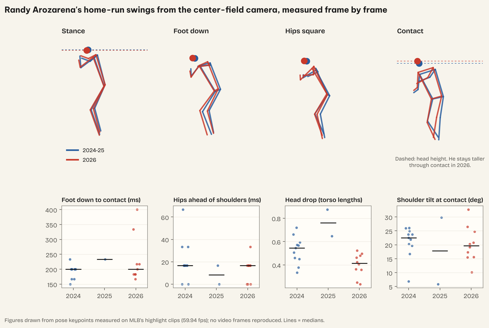

<!-- portfolio:header -->
[← Portfolio](../README.md) &nbsp;|&nbsp; [← Catcher framing](2026-catcher-framing.md) &nbsp;|&nbsp; [Draft analytics →](2026-mlb-draft-analytics.md)
<!-- /portfolio:header -->

# Randy Arozarena, frame by frame: is the 2026 power real?

<!-- portfolio:glance -->

     

**At a glance**

- **The question:** Is Randy Arozarena's 2026 power real, and did his swing change?
- **The answer:** Not as power. The ISO rise is fewer strikeouts (26.9% to 21.6%) with flat damage per contact at-bat (.272 both years), while barrels, hard-hit exit velocity and bat speed fell. The league model chosen on training data puts his 2027 ISO at .169-.180. Frame by frame on MLB's clips, his home-run swing shows no timing change the camera could detect (about 80 ms).
- **For a club:** Video used the way a front office should: to rule a mechanical change in or out, with the camera's limits stated.
<!-- /portfolio:glance -->

Dylan Fanelli. Data: MLB's highlight clips of all 73 of his 2024-26 home runs (MLB Stats API content feed, 1280x720 at 59.94 frames a second), Statcast pitch and bat-tracking data 2024-26; all pulled Nov. 23, 2026.

**The question:** Arozarena posted a 151 wRC+ in 2026 and is one of this winter's top free agents. My [prediction log](2027-prediction-log.md) says his 2027 wRC+ will be 130 or lower (call 6, 0.70), and my [market board](2027-market-board.md) has him at $33.0M a year against MLB Trade Rumors' $25.0M. Did something change that a club should pay for?

**The answer: the ISO rise is fewer strikeouts, not harder contact.**
- **Damage per contact at-bat was flat.** Extra bases per at-bat that didn't end in a strikeout were .272 in both 2025 and 2026 (115 in 422, then 116 in 427). His strikeout rate fell from 26.9% to 21.6%, so more at-bats reached contact, and ISO, which divides by all at-bats, rose.
- **The at-bats fell with playing time:** 709 plate appearances in 2025, 670 in 2026.
- **The inputs that predict power went down:** barrel rate 11.5% to 8.1%, and 90th-percentile exit velocity 106.7 to 104.4 mph. On competitive swings, bat speed fell from 72.3 to 70.9 mph and swing length from 7.4 to 7.2 ft.
- **His home runs were hit softer and higher:** median exit velocity 102.7 mph in 2026 against 104.9 in 2024, and median launch angle 30° against 26.5°.
- **Projection:** the league model chosen on training data alone puts his 2027 ISO at **.169 to .180**, depending on which seasons it's fit on. That's about a 19-27% chance he matches .203.
- **The video:** from the center-field camera, I found no change in his home-run swing's timing or sequence larger than the camera and sample can detect. That limit is about 80 ms at foot down, five frames, so the video rules out a big mechanical overhaul. It can't confirm a small one.

So 2026 reads as a better contact rate with the same damage when he made contact, while the inputs that predict power fell. Fewer strikeouts are worth something, but they don't make him a .200-ISO hitter. That supports call 6. A club paying for his 2026 line is paying for an ISO his inputs don't back, which is a reason to bid below my board's market forecast, not at it.

## The league question first: does bat tracking predict power?

Before reading one hitter's bat speed, I checked what bat speed is worth for anyone.
- **The sample:** every hitter with 300+ PA and 150+ competitive swings in one season and 300+ PA the next.
- **The test:** I fit on 2024 to 2025 (199 hitters) and scored on 2025 to 2026 (194 hitters), pairs the fit never saw.
- **Choosing the batted-ball model:** by 5-fold cross-validation on the training pairs alone. It picks **ISO + barrel rate**.

| Model for next season's ISO | Cross-validated error, training pairs | Out-of-sample R² | Out-of-sample error |
|---|---|---|---|
| ISO alone | .0397 | 0.33 | .0389 |
| **ISO + barrel rate (chosen)** | **.0390** | **0.35** | **.0382** |
| ISO + 90th-percentile exit velocity | .0396 | 0.37 | .0375 |
| Bat speed alone | | 0.29 | .0401 |
| Blast rate alone | | 0.27 | .0406 |

- **ISO + 90th-percentile exit velocity did best on the test pairs,** but it wasn't the training choice. I report both, so the choice of model can't be read as made to fit the answer.
- **Adding bat tracking to the chosen model:** bat speed and swing length help a little.
  - Bat speed cuts the error by .0002 (95% range .0001 to .0004).
  - Swing length cuts it by .0005 (.0001 to .0010).
  - That's about 1% of the error (0.6% for bat speed, 1.4% for swing length). Detectable, too small to change a decision.
  - Attack angle, squared-up rate and blast rate add nothing; their ranges include zero or point the wrong way.
- **Bat speed is among the steadiest numbers in the set.** It correlates 0.94 with itself year to year (swing length 0.95), against 0.61 for ISO and 0.91 for 90th-percentile exit velocity. The hard-hit exit velocities carry most of what it knows.
- **A drop in bat speed doesn't add a warning of its own.** On the 151 hitters with three straight qualifying seasons, a change in bat speed from 2024 to 2025 predicted -0.002 ISO per mph in 2026, 95% range -0.008 to +0.004. That's beyond what 2025's ISO and exit velocity already said.

**For Arozarena:**

| | 2024 | 2025 | 2026 |
|---|---|---|---|
| ISO | .169 | .188 | .203 |
| Plate appearances, at-bats | 648, 549 | 709, 613 | 670, 572 |
| Extra bases | 93 | 115 | 116 |
| Strikeout rate | 26.1% | 26.9% | 21.6% |
| Extra bases per at-bat without a strikeout | .245 | .272 | .272 |
| Barrel rate (per batted ball) | 8.4% | 11.5% | 8.1% |
| 90th-percentile exit velocity | 105.1 | 106.7 | 104.4 |
| Bat speed, competitive swings | 72.7 | 72.3 | 70.9 |
| Swing length (ft) | 7.38 | 7.45 | 7.21 |
| Attack angle, competitive swings | 9.4° | 8.7° | 7.9° |

His 2027 ISO projection from the chosen model, three ways:

| Fit | 2027 ISO | Chance he matches .203 |
|---|---|---|
| The fit scored out of sample (2024 to 2025 pairs) | .180 | 27% |
| Both year pairs | .175 | 23% |
| 2025 to 2026 alone | .169 | 19% |

All three use the same residual spread (.038, from the both-pairs fit).

## What the video shows

**How I measured it:**
1. **The clips:** for each home run, I took MLB's own highlight clip, matched to the play by its Statcast play id.
2. **Finding the pitch view:** I cut each clip into camera shots and kept the center-field shot. That's the shot with grass across the lower half and the pitcher low and centered.
3. **Tracking:** I tracked Arozarena through every frame with a pose model (YOLO pose). Every length is measured in torso lengths, so a near camera and a far one compare.
4. **Contact:** the camera can't see the bat meet the ball, so every timing runs to the moment his shoulders square to the camera, plus a fixed offset.
   - I read contact by eye on seven swings, at the frame where the barrel is out in front of the plate on the ball's line.
   - It came 5 to 7 frames after the shoulders squared (median 6). My frame reads are saved with the outputs.
   - So "foot down to contact" is foot down to shoulders square, plus six frames.
5. **The figures:** drawn from the measured joints. No MLB frame is reproduced; each swing links to MLB.com.

**What I could measure:** 23 of the 73 clips.
- **By season:** 2024 has 11, 2025 has 2, and 2026 has 10.
- **Why 50 dropped out:**
  - 19 clips had no usable center-field pitch view (10 of them in 2025).
  - 27 were tracked, but no clean shoulder rotation was found (12 in 2025).
  - 4 had the batter under 110 pixels tall.
- **The parks are lopsided:** 7 of the 11 measured 2024 swings are at Tropicana Field. The 10 from 2026 come from six parks (BOS, COL, HOU, SEA, TB, TEX).

| His home-run swing, center-field view | 2024-25 | 2026 | Difference (permutation p) | Smallest change detectable |
|---|---|---|---|---|
| Foot down to contact, median (range) | 200 ms (150-234), 11 | 200 ms (167-400), 9 | 0 ms (p = 1.0) | 78 ms |
| Leg lift to contact, clips that open before the lift | 759 ms (584-934), 10 | 717 ms (467-734), 9 | -42 ms (p = 0.07) | 164 ms |
| Hips square ahead of shoulders | 17 ms (0-67), 13 | 17 ms (0-33), 10 | 0 ms (p = 1.0) | one frame (17 ms) |
| Head drop from stance to contact (torso lengths) | 0.57, 13 | 0.41, 10 | -0.15 (p = 0.007) | 0.17 |
| Shoulder tilt at contact (rear shoulder lower) | 22.5°, 13 | 19.7°, 10 | -2.8° (p = 0.37) | 7.9° |

- **"Smallest change detectable":** 2.8 times the bootstrap spread of the median difference, which is the size a test like this would catch about 80% of the time. It never goes below one frame. The values are saved in `arozarena_swing_summary.json`.
- **The 2024-25 column** pools both seasons. 2025 adds only one or two swings to each measure; the per-measure counts are in the same file.

- **Timing:** I found no change. But with 9 to 11 swings and one-frame resolution (16.7 ms), the test only catches a shift in foot-down timing of about 80 ms or more. In 2026 the foot-down times also spread wider, with two late plants (334 and 400 ms) that 2024 didn't have. And the hips squared in the same frame as the shoulders on 3 of the 10 swings.
- **Posture can't be compared across these parks.** Head drop is the one significant difference, and I can't tell whether it's him or the cameras. Three parks have measured swings in both 2024 and 2026:

  | Park | 2024 | 2026 |
  |---|---|---|
  | Tropicana Field | 0.57 (median of 7) | 0.40 (1 swing) |
  | T-Mobile Park | 0.34 (1) | 0.25, 0.52 |
  | Fenway Park | 0.45 (1) | 0.42, 0.48 |

  - **Inside a park:** the gap shows only at Tropicana, on a single 2026 swing.
  - **Outside Tropicana:** the 2024-25 median is 0.50 against 2026's 0.42 (six swings and nine).
  - **The comparison group:** 2024-25 includes two 2025 swings with unusually large drops (0.87 and 0.65).
  - **Why the camera matters:** a camera mounted higher or lower changes how a vertical drop looks.
  - I leave it unresolved, not explained away.

**Statcast on all 73 home runs** (not only the measured 23), medians:

| | 2024 | 2025 | 2026 |
|---|---|---|---|
| Bat speed on the home-run swing | 75.9 | 75.4 | 74.2 |
| Attack angle on the home-run swing | 11.4° | 10.2° | 13.0° |
| Exit velocity | 104.9 | 106.5 | 102.7 |
| Launch angle | 26.5° | 28.0° | 30.0° |

His home-run swings got slightly slower and steeper in 2026, even as his attack angle across all competitive swings got flatter. The home runs themselves came off the bat about 2 mph softer at a higher launch angle.

## What a club should do with this

1. **Price the 2024-25 hitter, not the 2026 line.** The 2026 ISO comes from fewer strikeouts with the same damage per contact at-bat, while the inputs that predict power fell. Credit the contact gain; don't credit it as power. My log's call 6 (130 wRC+ or lower in 2027, 0.70) stands.
2. **On the market board:** my model's $33.0M a year is a forecast of what the market will pay. That call is frozen and scored as made. For a club bidding, the walk-away belongs below it. My log's call 4 threshold was $21.7M a year at two or more years.
3. **Use video as a check, not a source.** A broadcast camera times a swing to within a frame, but a season's worth of home-run clips only detects big changes. It can't measure stride length (it points down the stride), and its posture numbers move with the park. Use it to rule large changes in or out, and say which parks a number came from.

## Limits

- **Sample:** 23 measured swings. Most come from two seasons, and the 2024 swings lean on one park.
- **Pose estimates:** 2-D, from a camera behind the pitcher. Wrists blur during the swing, so nothing here uses them. Every event comes from the shoulders, hips, knees, ankles and head.
- **Contact:** timed by a fixed offset from shoulders square, read by eye on seven swings (spread of about one frame).
- **Home runs only:** they are his best swings. The rest of his 2026 swings are only in the Statcast tables, not the video.
- **The projection depends on the fit:** .169 to .180. I give the range, not one number.

## Sources

- MLB highlight clips, via the MLB Stats API game content feed (/api/v1/game/{game_pk}/content), matched to plays by Statcast play id; each measured swing's MLB.com page is listed in `reports/outputs/arozarena_swings.json`. Pulled Nov. 23, 2026.
- Statcast pitch-level and bat-tracking data, 2024-26 regular seasons, via Baseball Savant; pulled Nov. 23, 2026.
- Pose model: Ultralytics YOLO11 pose (medium for tracking, small for finding the pitch view).

Code: `baseball/video/` (`clips.py`, `pose.py`, `measure.py`, `breakdown.py`) and `baseball/evaluation/bat_power.py`. Outputs: `reports/outputs/arozarena_swings.json`, `arozarena_swing_summary.json`, `arozarena_contact_by_eye.json`, `bat_power_summary.json`. Tests: `tests/test_video_measure.py`, `tests/test_bat_power.py`.

<!-- portfolio:footer -->
---
[← Portfolio](../README.md) &nbsp;|&nbsp; [← Catcher framing](2026-catcher-framing.md) &nbsp;|&nbsp; [Draft analytics →](2026-mlb-draft-analytics.md)

© 2026 Dylan Fanelli. All rights reserved. To cite: Fanelli, D. (2026). *Randy Arozarena, frame by frame: is the 2026 power real?*. Dylan Fanelli Baseball Analytics Portfolio. https://github.com/IForSureI/Dylan-Fanelli-Baseball-Analytics-Portfolio/blob/main/reports/2026-arozarena-swing-breakdown.md
<!-- /portfolio:footer -->
