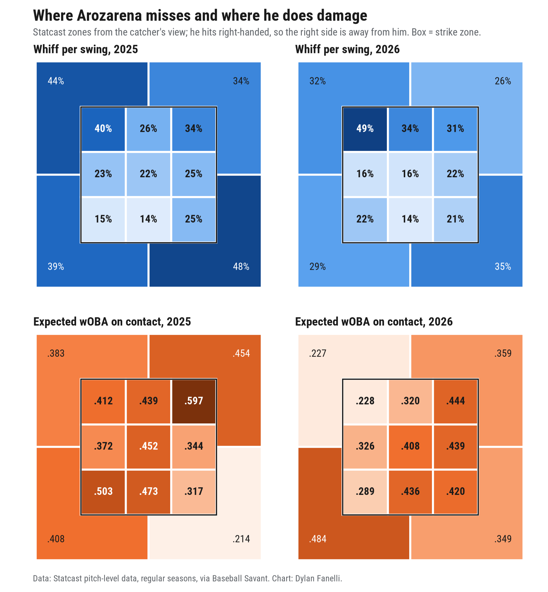

<!-- portfolio:header -->
[← Portfolio](../README.md) &nbsp;|&nbsp; [← Catcher framing](2026-catcher-framing.md) &nbsp;|&nbsp; [Draft analytics →](2026-mlb-draft-analytics.md)
<!-- /portfolio:header -->

# Randy Arozarena, frame by frame: is the 2026 power real?

<!-- portfolio:glance -->

      

**At a glance**

- **The question:** Is Randy Arozarena's 2026 power real, and did his swing change?
- **The answer:** Not as power. The strikeout drop (26.9% to 21.6%) came from contact on two-strike chases (57% to 74%) with a shorter, slower swing, while hard-hit rate, barrels and bat speed fell and his .379 wOBA ran ahead of a .348 xwOBA. The league model chosen on training data puts his 2027 ISO at .169-.180. On 41 swings reviewed frame by frame on MLB.TV, his 2026 failures split among late fastballs, chased spin, and on-time swings with the wrong path; on high fastballs his bat got 4.7 mph slower.
- **For a club:** Price the 2024-25 hitter, pitch him up and in, and make the high fastball the development ask; video used to name the move behind each number, with the camera's limits stated.
<!-- /portfolio:glance -->

Dylan Fanelli. Updated Nov. 27, 2026 with a second video study: 41 of his swings, mostly failures, reviewed frame by frame on MLB.TV's archived broadcasts, and a pitch-by-pitch split of his 2025 and 2026 seasons. Data: Statcast pitch and bat-tracking data 2024-26 via Baseball Savant (pulled Nov. 23 and Nov. 27, 2026); MLB.TV archived game broadcasts; MLB's highlight clips of all 73 of his 2024-26 home runs (MLB Stats API content feed, 1280x720 at 59.94 frames a second).

**The question:** Arozarena posted a 151 wRC+ in 2026 and is one of this winter's top free agents. My [prediction log](2027-prediction-log.md) says his 2027 wRC+ will be 130 or lower (call 6, 0.70), and my [market board](2027-market-board.md) has him at $33.0M a year against MLB Trade Rumors' $25.0M. Did something change that a club should pay for?

**The answer: he traded damage for contact, and the results ran ahead of the contact.**
- **The strikeouts went away with two strikes.** His strikeout rate fell from 26.9% to 21.6%. Once an at-bat reached two strikes, it ended in a strikeout 36.7% of the time in 2026 against 46.8% in 2025. He chased more with two strikes (33.6% to 44.8%) but made contact on 74.4% of those chases, up from 57.1%. Both changes clear the noise after correcting for the 17 tests in this report.
- **The swing that made that contact was shorter, slower and met the ball deeper.** Across all his swings, bat speed fell 1.5 mph and the contact point moved 2.3 inches closer to his body. With two strikes he swung about the same as before: his two-strike swing was 1.6 mph slower than his other swings, against 2.4 mph in 2025. So the contact gain came from his whole swing getting shorter, not from a two-strike swing; on video I see a two-strike adjustment on only 2 of the 17 two-strike swings where I could see his stride.
- **The contact got weaker.** Hard-hit rate fell from 50.7% to 43.5%, barrels from 11.5% to 8.1% of batted balls, and 90th-percentile exit velocity from 106.7 to 104.4 mph. Popups were cut in half (9.1% to 4.4%), which is the one damage-side gain.
- **The biggest hole is the high fastball.** On fastballs above 3 feet, his bat speed fell from 69.1 to 64.4 mph, he met them 3 inches deeper, and the balls he put in play left at 8.6° against 25.6°. Half went on the ground. On video the misses are mixed: late, under the ball, or on top of it and rolled over.
- **The 2026 line ran ahead of its contact.** His wOBA was .379 against an expected .348. On contact, he got .060 more than expected, about 70% of it on line drives and fly balls, with below-median sprint speed. That gap does not usually repeat.
- **Projection:** the league model chosen on training data alone puts his 2027 ISO at **.169 to .180**, depending on which seasons it's fit on. That's about a 19-27% chance he matches .203.
- **The video:** from the center-field camera, I found no change in his home-run swing's timing or sequence larger than the camera and sample can detect. That limit is about 80 ms at foot down, five frames, so the video rules out a big mechanical overhaul. It can't confirm a small one. On the 41-swing sample, his failures in 2026 split into three kinds: late on velocity (6), fooled by spin or speed (7), and on time with the wrong bat path for the pitch's height (8).

So 2026 reads as a better contact hitter with less damage per swing, whose results beat his contact. Fewer strikeouts are worth something, but they don't make him a .200-ISO hitter. That supports call 6. A club paying for his 2026 line is paying for an ISO and a wOBA his inputs don't back, which is a reason to bid below my board's market forecast, not at it.

## How to read these numbers

Every number in this report is one of five kinds. Here is what each measures and why I use it.

**Results: what happened**
- **ISO (isolated power):** slugging minus batting average, so extra bases per at-bat. A single adds nothing; a double adds 1, a home run 3. It's the cleanest single number for power, but it divides by all at-bats, so a hitter who strikes out less gets more chances to add extra bases without hitting the ball any harder. That's the trap this report is about.
- **wOBA (weighted on-base average):** one number for a hitter's offense, with each outcome (walk, single, double, home run) weighted by how many runs it's worth. It reads on the on-base scale: league average is usually around .310 to .320.
- **xwOBA (expected wOBA):** the wOBA a hitter "should" have had from how hard and at what angle he hit each ball (exit velocity and launch angle, plus sprint speed on weakly hit balls), with his real strikeouts and walks. When wOBA runs far above xwOBA, defense, parks, placement or luck helped, and most of that gap doesn't carry into the next season.
- **wRC+ (weighted runs created plus):** runs created per plate appearance, adjusted for park and league, with 100 as league average. His 151 means 51% better than average.

**Contact quality: how hard and at what angle**
- **Exit velocity (EV):** the ball's speed off the bat. **EV90** is the 90th percentile of his batted balls: his top-end contact, steadier than his single hardest ball and one of the best public predictors of next season's power.
- **Hard-hit rate:** the share of batted balls at 95 mph or more.
- **Barrel:** a ball hit at 98 mph or more inside a launch-angle window that widens as exit velocity rises (26-30° at 98 mph). The window is set so barrels have historically hit at least .500 and slugged at least 1.500. Barrel rate is per batted ball.
- **Launch angle (LA):** the vertical angle off the bat. Below 10° is mostly ground balls, 10-25° line drives, 25-50° fly balls, above 50° popups.

**Bat tracking: the swing itself** (Statcast, from 2024; measured on every swing, hit or miss)
- **Bat speed:** how fast the sweet spot of the bat (about 6 inches from the end) is moving at contact, or where contact would have been on a miss. Season averages use "competitive" swings: his fastest 90%, plus any swing of 60+ mph that still hit the ball 90+ mph, so checked and defensive swings don't drag it down.
- **Swing length:** how far, in feet, the end of the bat travels from the start of the swing to contact. Shorter swings get to the ball faster and usually make more contact, at the cost of bat speed.
- **Attack angle:** the angle of the bat's path at contact, up or down. Positive is uphill. Pitches come in on a downward angle, and a bat path 5-20° uphill (Savant's "ideal" range) matches it closely enough to lift the ball.
- **Contact point:** how far in front of his body, in inches, the bat meets (or would meet) the ball. A smaller number means he lets the ball travel deeper. Deeper contact buys time to read the pitch and costs the leverage that drives the ball.
- **Squared-up and blast:** a swing is squared up when it gets at least 80% of the exit velocity that bat speed and pitch speed allow. A blast combines the two: squared-up percentage times 100, plus bat speed, adds to 164 or more. Squared-up is contact quality from the bat's side; blast adds power.

**Decisions: when he swings**
- **Zone:** the strike zone Statcast sets for him on each pitch, from his stance. **Chase rate** is swings at pitches outside it divided by pitches outside it. **Zone contact** and **chase contact** are the shares of those swings that touched the ball. **Whiff rate** is misses per swing.
- **Run value:** the change in the inning's expected runs on each pitch, from the hitter's side. Adding it up by location and by swing or take shows where his decisions gained or cost runs. Savant's **attack regions** split locations by distance from the zone's center: heart (the middle two-thirds), shadow (the edges, just in and just out), chase, and waste. I compute them from each pitch's location and his own zone height.

**Evidence: is a change real?**
- **Percentile:** his rank among the hitters on that season's leaderboard, where 90th means better than 90% of them.
- **p and q:** p is the chance of a difference at least this big if nothing had changed. I ran 17 season-over-season tests here, so I use q, the Benjamini-Hochberg corrected version, and call a change real only when q is below 0.05.
- **Intervals:** where a rate has a range, it's the 95% Wilson interval.

## The season in percentiles

Savant's own figures and percentiles, among the hitters on the leaderboards I pulled (461 to 465 a season on the custom leaderboard, 262 to 268 on bat tracking; both pools are larger than the batting-title qualifiers). Savant's rates can differ by a tenth from my pitch-level counts elsewhere in the report. Higher percentile is better for each row.

| | 2025 | Percentile | 2026 | Percentile |
|---|---|---|---|---|
| wOBA | .332 | 72nd | .379 | 97th |
| xwOBA | .327 | 70th | .348 | 89th |
| Hard-hit rate | 50.6% | 92nd | 43.5% | 74th |
| Barrel rate | 11.5% | 76th | 8.1% | 57th |
| Exit velocity, best half of his batted balls (EV50) | 102.5 | 80th | 100.6 | 67th |
| Bat speed, competitive swings | 72.3 | 57th | 70.9 | 31st |
| Squared-up per swing | 25.5% | 48th | 26.1% | 60th |
| Blast per swing | 13.4% | 73rd | 11.1% | 55th |

The pattern is the whole report in eight rows: his wOBA climbed into the top 3% and his xwOBA to the 89th percentile, both helped by fewer strikeouts and more walks, while every measure of how hard he swings and hits the ball fell 13 to 26 points. The one swing input that rose, squared-up rate, is a contact measure.

## Where the strikeouts went

All rates from his Statcast pitches, regular season. "Clears the noise" means q below 0.05 across the 17 tests.

| | 2025 | 2026 | Change | q | |
|---|---|---|---|---|---|
| Strikeout rate | 26.9% | 21.6% | -5.3 | .031 | clears the noise |
| Plate appearances reaching two strikes | 57.5% | 59.0% | +1.5 | | not tested; about the same |
| Strikeout rate once at two strikes | 46.8% | 36.7% | -10.1 | .008 | clears the noise |
| Two-strike chase rate | 33.6% | 44.8% | +11.2 | <.001 | clears the noise |
| Contact on two-strike chases | 57.1% | 74.4% | +17.3 | <.001 | clears the noise |
| Contact on two-strike pitches in the zone | 78.7% | 81.0% | +2.3 | .46 | within the noise |
| Chase rate, all counts | 25.1% | 30.5% | +5.4 | .003 | clears the noise |
| Whiffs on breaking and offspeed pitches low and away | 44.4% | 34.0% | -10.4 | .029 | clears the noise |

- **His plate appearances reached two strikes just as often.** The gain is all in what happened next.
- **The key number is contact on chases.** He swung at more bad pitches with two strikes, not fewer, and still struck out less, because he touched 74% of them. In-zone contact barely moved.
- **The contact was not damage.** His two-strike balls in play had an expected wOBA of .347 (.354 in 2025), and chased two-strike balls in play .350. He was fouling pitches off and putting them in play softly, which is exactly what a hitter protecting with two strikes should do. It just doesn't add power.
- **Run value on his swings improved.** His swings at chase pitches cost 15.1 runs in 2025 and 6.3 in 2026; his swings in the heart gained 1.7 and 10.4. All his swings together went from -19.7 runs to +0.8. Part of the heart gain is the contact luck in the section after next.

## The swing behind the contact: shorter, slower, deeper

Statcast bat tracking, all tracked swings.

| | 2025 | 2026 | Change | q |
|---|---|---|---|---|
| Bat speed, all swings | 70.1 mph | 68.6 mph | -1.5 | <.001 |
| Bat speed, competitive swings (Savant) | 72.3 mph | 70.9 mph | -1.4 | |
| Swing length, competitive swings (Savant) | 7.44 ft | 7.21 ft | -0.23 | |
| Contact point, all swings | 30.8 in | 28.5 in | -2.3 | <.001 |
| Attack angle, competitive swings (Savant) | 8.7° | 7.9° | -0.8 | |
| Two-strike swing against his other swings, bat speed | 68.7 vs. 71.1 | 67.7 vs. 69.3 | | |
| Two-strike swing against his other swings, length | 7.33 vs. 7.44 ft | 7.02 vs. 7.18 ft | | |

- **Every swing got a little shorter and slower, and met the ball 2 inches deeper.** That's the profile of a hitter letting the ball travel, and it fits the contact gain.
- **He did not build a separate two-strike swing.** In 2026 his two-strike swing was 1.6 mph slower than his others; in 2025 it was 2.4 mph slower. The video agrees: of 18 two-strike swings from 2026, the camera was too far to see his stride on one (swing 3), and on 15 of the other 17 I see the same crouch and toe-tap as in his hitter's counts. The two exceptions: on swing 2 (a 2-2 cutter from Aaron Civale) he barely strides, and on swing 26 (a 2-2 cutter from Mason Fluharty) the stride is smaller and later.
- **What it costs:** the swing is now in the 31st percentile for bat speed, and the hard-hit and barrel rates fell with it.

## The holes: high fastballs and up and in

**The high fastball** (four-seamers, sinkers and cutters above 3.0 ft):

| | 2025 | 2026 | Change | q |
|---|---|---|---|---|
| Swings | 166 | 158 | | |
| Whiff per swing | 38.0% | 32.9% | -5.1 | .39 |
| Bat speed | 69.1 mph | 64.4 mph | -4.7 | <.001 |
| Contact point | 23.9 in | 20.7 in | -3.2 | .006 |
| Launch angle on balls in play | 25.6° (43 balls) | 8.6° (38 balls) | -17.0 | .016 |
| Ground-ball share on balls in play | 18.6% | 50.0% | +31.4 | |
| Expected wOBA on contact | .555 | .354 | -.201 | |

- **He misses them a little less, and hurts them far less.** The high fastball was his best pitch to hit in 2025 (.555 expected wOBA on contact; on every pitch type in the zone's top-away corner, .597). In 2026 he swung 4.7 mph slower at it, met it 3 inches deeper, and put half of them on the ground.
- **On video, the misses are mixed, and the change is speed and depth, not a steeper path.** Of the eight 2026 high fastballs I reviewed (swings 9-13, 24, 26, 27; I picked them as "up" by eye, and three sit just under 3.0 ft), four were late, two swung under on an uphill path (10, 13), and two got on top and rolled it over (24, 27: a 91 mph four-seamer from Jacob Lopez for a 103 mph double-play grounder, and a 95 from Jack Kochanowicz for a -54° roller). Bat tracking doesn't show those two coming down steeper: they were +9.8° and +10.9°, about the same as his 2026 home run off Cole Ragans on a 95.6 mph fastball up (swing 34, +11.5°), and his attack angle on all high fastballs moved only from 8.6° to 7.4°. What the tracking does show is a bat 4.7 mph slower meeting the ball 3 inches deeper. The 2025 version of the pitch, swing 37 (a 92.6 four-seamer from Brandon Walter), went for a 110.5 mph home run.
- **Up and in looks worse, but the sample is thin.** Zone 1 (the top of the zone, inside, all pitch types) went from 40% whiffs to 49% on 65 and 53 swings (p = .32, not significant), and expected wOBA on contact from .412 to .228 on only 11 and 8 balls in play. Above the zone inside (zone 11) rests on 7 and 5. I treat up and in as a lead to watch, not a finding.

**Soft stuff low and away** (breaking balls and offspeed in zones 9 and 14) moved the other way: whiffs fell from 44.4% to 34.0% and expected wOBA on contact rose from .226 to .331, though 57.5% of those balls in play were still on the ground. It fits the two-strike contact gain, but I didn't split two-strike contact by location, so I can't say how much of that gain came from here.

**Breaking balls he puts in play** (these three are elsewhere in the zone, not low and away) show the roll-over on video: on swing 23 (a slider at the knees, middle, from Lucas Erceg) he sinks and the top hand rolls over for a 101.5 mph ground ball, and on swing 25 (a Seth Lugo slider up and away) his front side opens and he rolls over into a double play. Swing 28 (a back-foot slider, down and in, from the left-hander Brock Burke) is a different failure: he's fooled and golfs under it at a 21.9° attack angle for a 38 mph topper. On low breaking balls over the middle, swing 35 (Jacob Webb, a walk-off home run) and swing 41 (Jacob Misiorowski's curveball in 2025, a 104.9 mph double) stay through the ball without the roll.

## The results ran ahead of the contact

| Batted-ball type | 2025 count | wOBA vs. expected | 2026 count | wOBA vs. expected |
|---|---|---|---|---|
| Line drives | 91 | .653 vs. .654 | 101 | .726 vs. .613 |
| Fly balls | 115 | .537 vs. .527 | 102 | .582 vs. .511 |
| Ground balls | 182 | .309 vs. .260 | 209 | .285 vs. .251 |
| Popups | 39 | .000 vs. .031 | 19 | .047 vs. .048 |
| All batted balls | 427 | .416 vs. .395 | 431 | .448 vs. .388 |

- **The gap is on balls in the air.** His line drives returned .113 more than their exit velocity and angle predict, and his fly balls .071 more. In 2025 those were dead even.
- **Speed doesn't explain it.** His 2026 sprint speed was 27.1 ft/s, below the median (27.5) of the 567 players on Savant's sprint-speed leaderboard, and speed mainly helps on ground balls, where his gap shrank.
- **For a projection:** for most hitters the gap between wOBA and xwOBA carries little from one season to the next, so his 2027 baseline should start from the .348 xwOBA, not the .379 wOBA.

## The league question: does bat tracking predict power?

Before reading one hitter's bat speed, I checked what bat speed is worth for anyone.
- **The sample:** every hitter with 300+ PA and 150+ competitive swings in one season and 300+ PA the next.
- **The test:** I fit on 2024 to 2025 (199 hitters) and scored on 2025 to 2026 (194 hitters), pairs the fit never saw.
- **Choosing the batted-ball model:** by 5-fold cross-validation on the training pairs alone. It picks **ISO + barrel rate**.

| Model for next season's ISO | Cross-validated error, training pairs | Out-of-sample R² | Out-of-sample error |
|---|---|---|---|
| ISO alone | .0397 | 0.33 | .0389 |
| **ISO + barrel rate (chosen)** | **.0390** | **0.35** | **.0382** |
| ISO + 90th-percentile exit velocity | .0396 | 0.37 | .0375 |
| Bat speed alone | | 0.29 | .0401 |
| Blast rate alone | | 0.27 | .0406 |

- **ISO + 90th-percentile exit velocity did best on the test pairs,** but it wasn't the training choice. I report both, so the choice of model can't be read as made to fit the answer.
- **Adding bat tracking to the chosen model:** bat speed and swing length help a little.
  - Bat speed cuts the error by .0002 (95% range .0001 to .0004).
  - Swing length cuts it by .0005 (.0001 to .0010).
  - That's about 1% of the error (0.6% for bat speed, 1.4% for swing length). Detectable, too small to change a decision.
  - Attack angle, squared-up rate and blast rate add nothing; their ranges include zero or point the wrong way.
- **Bat speed is among the steadiest numbers in the set.** It correlates 0.94 with itself year to year (swing length 0.95), against 0.61 for ISO and 0.91 for 90th-percentile exit velocity. The hard-hit exit velocities carry most of what it knows.
- **A drop in bat speed doesn't add a warning of its own.** On the 151 hitters with three straight qualifying seasons, a change in bat speed from 2024 to 2025 predicted -0.002 ISO per mph in 2026, 95% range -0.008 to +0.004. That's beyond what 2025's ISO and exit velocity already said.

So his lower bat speed matters for him through what it already did to his exit velocities and barrels, which the model counts, not as a separate red flag.

**For Arozarena:**

| | 2024 | 2025 | 2026 |
|---|---|---|---|
| ISO | .169 | .188 | .203 |
| Plate appearances, at-bats | 648, 549 | 709, 613 | 670, 572 |
| Extra bases | 93 | 115 | 116 |
| Strikeout rate | 26.1% | 26.9% | 21.6% |
| Extra bases per at-bat without a strikeout | .245 | .272 | .272 |
| Barrel rate (per batted ball) | 8.4% | 11.5% | 8.1% |
| 90th-percentile exit velocity | 105.1 | 106.7 | 104.4 |
| Bat speed, competitive swings | 72.7 | 72.3 | 70.9 |
| Swing length (ft) | 7.38 | 7.45 | 7.21 |
| Attack angle, competitive swings | 9.4° | 8.7° | 7.9° |

- **Damage per contact at-bat was flat.** Extra bases per at-bat that didn't end in a strikeout were .272 in both 2025 and 2026 (115 in 422, then 116 in 427). More at-bats reached contact, and ISO, which divides by all at-bats, rose.
- **His home runs were hit softer and higher:** median exit velocity 102.7 mph in 2026 against 104.9 in 2024, and median launch angle 30° against 26.5°.

His 2027 ISO projection from the chosen model, three ways:

| Fit | 2027 ISO | Chance he matches .203 |
|---|---|---|
| The fit scored out of sample (2024 to 2025 pairs) | .180 | 27% |
| Both year pairs | .175 | 23% |
| 2025 to 2026 alone | .169 | 19% |

All three use the same residual spread (.038, from the both-pairs fit).

## What the video shows, part 1: 41 swings on MLB.TV

The home-run study below only sees his best swings. To see the rest, I picked 41 swings from his 2025 and 2026 Statcast pitches and reviewed each one on the archived MLB.TV broadcast of that game.

**How I picked them:** 12 groups chosen before watching, 8 of them failure groups (28 of the 41 swings; one, swing 4, turned out to be a two-strike double), and 4 comparison groups in the same pitch types and locations. 40 came from MLB.TV. For swing 39, the home feed was on a booth shot at the pitch and the road feed showed it only in a small inset, so I used MLB's video clip of the play from the same broadcast.

| Group | 2025 | 2026 |
|---|---|---|
| Two-strike chases fouled off or put in play | | 5 |
| Two-strike whiffs | | 4 |
| Whiffs on 95+ mph fastballs up | 3 | 4 |
| Whiffs chasing low and away | 3 | 3 |
| Hard-hit ground balls | | 3 |
| Weak contact | | 3 |
| Hard air contact (comparison) | 3 | 4 |
| Home runs (comparison) | 3 | 3 |

**How I read them:**
1. **Finding the pitch:** I found each one on the broadcast by the scoreboard (inning, outs, count, pitch speed), never by a fixed time offset, and checked it against Statcast's pitch type and speed.
2. **Frames:** I stepped through each swing at the broadcast's frame rate (1/60 s on most feeds, 1/30 or 1/40 s on a few) from the center-field camera, and logged three times: the pitcher's release, his front foot down, and contact (or where the barrel crosses the plate on a miss).
3. **Second angles:** 5 swings had a replay from another camera (low at plate level, low first-base side, or tight center field): swings 5, 23, 33, 34 and 35.
4. **What I wrote down:** load and stride, when the front shoulder opens, the bat path to the pitch, the head, and whether he was late, fooled, or on time.
5. **Checks:** where release-to-crossing time came out shorter than the pitch's speed allows (swings 17, 19 and 21: two far-camera views and one where the left-hander's arm was hidden), I flag the release time as a few frames late and don't use those for timing.

**What the failures look like:**

| Read | 2025 failures (6) | 2026 failures (21) |
|---|---|---|
| Late on velocity | 3 | 6 |
| Fooled by spin or speed, reaching or lunging | 3 | 7 |
| On time, wrong bat path for the pitch's height (chops, roll-overs, under) | 0 | 8 |

- **The 2025 failure groups were whiffs only.** I didn't sample 2025 ground balls or weak contact, so the zero in the last row is partly the design. Half the 2026 wrong-path failures (swings 23, 24, 25, 27) come from the ground-ball and weak-contact groups; the other four (1, 2, 10, 13) are two-strike chases and high-fastball whiffs, which 2025 has.
- **The fooled swings look the same in both years:** a lean over the plate, front knee giving, barrel above, beyond or under a pitch breaking away (swings 17-22).
- **Timing on high heat: the camera can't settle it.** By eye, his 2025 high-fastball misses (swings 14-16) looked later than two of the 2026 ones (swings 10 and 13), which looked on time and under. Bat tracking on all 305 tracked high-fastball swings says the opposite: in 2026 he met them 3 inches deeper. Deeper can mean later or a chosen contact point, but it isn't earlier. At 95 mph, 3 inches is about 2 ms of ball flight, about an eighth of one broadcast frame. I go with the tracking.
- **Foot down to contact on his good swings:** a median of 133 ms in 2025 (5 swings) and 167 ms in 2026 (8 swings), so his 2025 kick landed later and he fired straight off it. That's two frames on five and eight swings, so I note it as something to check on the next season's video, not a finding.

All 41 swings, with my read and the clip

| # | Date | Pitcher | Pitch, mph | Count | Result | Bat speed, length, attack angle | Foot down to contact | Read | Clip |
|---|---|---|---|---|---|---|---|---|---|
| 1 | 2026-03-30 | Ryan Weathers | CH 86.4 | 2-2 | foul | 72.2 mph, 7.6 ft, 18° | 217 ms | on time, wrong plane | [video](https://baseballsavant.mlb.com/sporty-videos?playId=7e2e8b23-d4b3-342e-befe-384dbfea95a6) |
| 2 | 2026-04-22 | Aaron Civale | FC 90.2 | 2-2 | foul | 69.7 mph, 7.3 ft, 7.7° | 466 ms | on time, wrong plane | [video](https://baseballsavant.mlb.com/sporty-videos?playId=acbd0f84-b4ea-3e24-9c00-aa641616529d) |
| 3 | 2026-07-25 | Nathan Eovaldi | FS 89.7 | 1-2 | foul | 83.5 mph, 7.7 ft, 14.5° |  | late | [video](https://baseballsavant.mlb.com/sporty-videos?playId=cc19ed02-9925-3dff-8e9b-b9fc7397591c) |
| 4 | 2026-06-26 | Joey Cantillo | FF 92.4 | 2-2 | double, 101.8 mph at 19° | 67.9 mph, 7.8 ft, 6.4° | 333 ms | good swing | [video](https://baseballsavant.mlb.com/sporty-videos?playId=e8c7c684-936e-36b0-852a-073dbe6f5123) |
| 5 | 2026-06-23 | Mitch Keller | ST 81.8 | 0-2 | foul | 66.9 mph, 7.7 ft, 11.9° | 266 ms | fooled by spin or speed (second angle) | [video](https://baseballsavant.mlb.com/sporty-videos?playId=d2f179c2-1701-34b2-8ff4-59c0d630bebd) |
| 6 | 2026-04-20 | J.T. Ginn | FF 94.1 | 2-2 | strikeout | 73.1 mph, 6.9 ft, -0.9° | 183 ms | late | [video](https://baseballsavant.mlb.com/sporty-videos?playId=e0ebb54b-8a5c-36ee-ae32-b431c1244a25) |
| 7 | 2026-08-13 | Yerry De los Santos | SL 87.6 | 2-2 | strikeout | 70.7 mph, 8.5 ft, 17.2° | 232 ms | fooled by spin or speed | [video](https://baseballsavant.mlb.com/sporty-videos?playId=b4bfe430-9296-3553-bed0-9c32461f293b) |
| 8 | 2026-06-28 | Gavin Williams | ST 89.4 | 2-2 | strikeout | 59.5 mph, 6.6 ft, -3.6° | 250 ms | fooled by spin or speed | [video](https://baseballsavant.mlb.com/sporty-videos?playId=a877b721-bb05-313d-93a7-dbd8aa557e5c) |
| 9 | 2026-06-01 | Devin Williams | FF 92.9 | 1-2 | strikeout | 67.7 mph, 5.8 ft, 2° | 216 ms | late | [video](https://baseballsavant.mlb.com/sporty-videos?playId=b0086680-bd49-3b71-a5ef-405aed7cdb67) |
| 10 | 2026-08-04 | Troy Melton | FF 97.1 | 1-0 | swinging strike | 78 mph, 7.2 ft, 14° | 267 ms | on time, wrong plane | [video](https://baseballsavant.mlb.com/sporty-videos?playId=cf89f19a-04f1-3cb4-89ad-b8f5804d635e) |
| 11 | 2026-07-17 | Caleb Kilian | FF 96.9 | 3-2 | strikeout | 69 mph, 6.5 ft, -2° |  | late | [video](https://baseballsavant.mlb.com/sporty-videos?playId=984869ce-7c77-3665-8ba9-c2bab15f9e06) |
| 12 | 2026-04-06 | Jacob deGrom | FF 95.6 | 0-0 | swinging strike | 63.6 mph, 5.5 ft, -7.7° | 151 ms | late | [video](https://baseballsavant.mlb.com/sporty-videos?playId=771e9d77-ab37-30d9-96e9-132ea135159a) |
| 13 | 2026-04-12 | Christian Roa | SI 96.7 | 0-0 | swinging strike |  | 183 ms | on time, wrong plane | [video](https://baseballsavant.mlb.com/sporty-videos?playId=48f24d3d-5986-36f9-8b6f-d69c00aaacc4) |
| 14 | 2025-07-31 | Kumar Rocker | SI 96.2 | 0-0 | swinging strike | 70 mph, 6.6 ft, 6.4° | 250 ms | late | [video](https://baseballsavant.mlb.com/sporty-videos?playId=added70e-50d9-30c8-b4df-6fd607807e68) |
| 15 | 2025-06-21 | Cade Horton | FF 96.4 | 2-1 | swinging strike | 75.4 mph, 7 ft, 4.5° | 250 ms | late | [video](https://baseballsavant.mlb.com/sporty-videos?playId=85f86986-60c1-3499-a225-d490664ac458) |
| 16 | 2025-04-04 | Lou Trivino III | FF 96.5 | 1-2 | strikeout | 76.9 mph, 7.4 ft, 12.5° |  | late | [video](https://baseballsavant.mlb.com/sporty-videos?playId=3d2877f0-0ae0-3b93-b3c8-231ed6767603) |
| 17 | 2026-06-12 | Zack Littell | SL 88.2 | 0-0 | swinging strike | 77.7 mph, 8.2 ft, 16.3° | 200 ms | fooled by spin or speed | [video](https://baseballsavant.mlb.com/sporty-videos?playId=cd87806a-446d-312c-bf25-a5aaedf89765) |
| 18 | 2026-08-08 | Casey Legumina | ST 81.2 | 2-2 | strikeout | 68.5 mph, 8.3 ft, 17° | 266 ms | fooled by spin or speed | [video](https://baseballsavant.mlb.com/sporty-videos?playId=50cee719-34cc-31df-8a4c-06c3e63d614d) |
| 19 | 2026-04-07 | Nathan Eovaldi | FS 88.5 | 0-2 | strikeout | 67.1 mph, 6.7 ft, -3.1° | 233 ms | fooled by spin or speed | [video](https://baseballsavant.mlb.com/sporty-videos?playId=1ede8ba3-2a31-3bbd-a7e3-7587d96c7f8d) |
| 20 | 2025-04-20 | Easton Lucas | CH 87.6 | 3-2 | strikeout | 71.5 mph, 8 ft, 12.9° |  | fooled by spin or speed | [video](https://baseballsavant.mlb.com/sporty-videos?playId=86f4724d-a86e-3135-8cba-17fe0feb65d5) |
| 21 | 2025-05-21 | Brandon Eisert | CH 84.4 | 1-2 | strikeout | 72.2 mph, 8.8 ft, 15.8° |  | fooled by spin or speed | [video](https://baseballsavant.mlb.com/sporty-videos?playId=25df1dc7-f757-37d3-bdd4-1414e3376bd9) |
| 22 | 2025-07-04 | Braxton Ashcraft | SL 91.5 | 0-1 | swinging strike | 73.8 mph, 8.4 ft, 15.3° | 167 ms | fooled by spin or speed | [video](https://baseballsavant.mlb.com/sporty-videos?playId=33c23e66-1a93-3157-8ba7-487fedbb508d) |
| 23 | 2026-05-24 | Lucas Erceg | SL 85.3 | 1-2 | double, 101.5 mph at -6° | 73.6 mph, 7.6 ft, 10.1° | 530 ms | on time, wrong plane (second angle) | [video](https://baseballsavant.mlb.com/sporty-videos?playId=030f4600-0c0d-34dc-ac3a-3ddede9d6a61) |
| 24 | 2026-09-13 | Jacob Lopez | FF 91 | 1-2 | double play, 103.2 mph at -8° | 71.7 mph, 7.3 ft, 9.8° | 197 ms | on time, wrong plane | [video](https://baseballsavant.mlb.com/sporty-videos?playId=96f8551e-5783-333f-be63-29e6f310e225) |
| 25 | 2026-05-02 | Seth Lugo | SL 84.2 | 2-1 | double play, 97.1 mph at -13° | 66.7 mph, 6.5 ft, 4° | 200 ms | on time, wrong plane | [video](https://baseballsavant.mlb.com/sporty-videos?playId=c5156c94-05e7-3616-b71e-864290c639fa) |
| 26 | 2026-07-05 | Mason Fluharty | FC 91.6 | 2-2 | single, 71.3 mph at 11° | 65.7 mph, 6.3 ft, 10.5° | 133 ms | late | [video](https://baseballsavant.mlb.com/sporty-videos?playId=b5614870-6d3d-3c5a-b4b3-edbafb8faa00) |
| 27 | 2026-04-04 | Jack Kochanowicz | FF 94.7 | 1-2 | out, 75.6 mph at -54° | 64.6 mph, 6 ft, 10.9° | 183 ms | on time, wrong plane | [video](https://baseballsavant.mlb.com/sporty-videos?playId=c3a18cff-293b-3b0b-8a9f-aaf1d0bb63ac) |
| 28 | 2026-07-22 | Brock Burke | SL 87.7 | 1-1 | out, 38.1 mph at -40° | 71.7 mph, 8.9 ft, 21.9° | 183 ms | fooled by spin or speed | [video](https://baseballsavant.mlb.com/sporty-videos?playId=8fe7ea86-ce36-374b-94f5-dc9ca7bbe6c5) |
| 29 | 2026-09-05 | Geoff Hartlieb | SI 95 | 2-2 | single, 101.8 mph at 14° | 72.3 mph, 6.5 ft, 9.6° | 167 ms | good swing | [video](https://baseballsavant.mlb.com/sporty-videos?playId=b26bfd43-d470-3ec1-8f77-33d6be80a564) |
| 30 | 2026-05-03 | Kris Bubic | FF 92.1 | 2-1 | out, 101.5 mph at 17° | 74.9 mph, 7 ft, 1.2° | 117 ms | good swing | [video](https://baseballsavant.mlb.com/sporty-videos?playId=e9b1589d-dd69-38c6-a947-c6344867e9c8) |
| 31 | 2026-08-05 | Brenan Hanifee | SI 94.8 | 1-2 | double, 103.6 mph at 16° | 74.9 mph, 7.4 ft, 15.5° | 116 ms | good swing | [video](https://baseballsavant.mlb.com/sporty-videos?playId=b1058b87-9d4e-355d-854e-f6238976460d) |
| 32 | 2026-05-23 | Stephen Kolek | ST 78.6 | 0-0 | out, 104 mph at 16° | 71.7 mph, 7.5 ft, 18.8° | 333 ms | good swing | [video](https://baseballsavant.mlb.com/sporty-videos?playId=5d068b8a-94fe-3e42-b043-8b3828dd6c02) |
| 33 | 2026-05-25 | Jack Perkins | FC 92.4 | 3-1 | home run, 104.1 mph at 30° | 80.5 mph, 7.4 ft, 16.1° | 150 ms | good swing (second angle) | [video](https://baseballsavant.mlb.com/sporty-videos?playId=ad46537c-4f16-34ed-8669-a36fa3bf9426) |
| 34 | 2026-05-01 | Cole Ragans | FF 95.6 | 1-1 | home run, 96.5 mph at 26° | 68.2 mph, 6.6 ft, 11.5° | 167 ms | good swing (second angle) | [video](https://baseballsavant.mlb.com/sporty-videos?playId=d7cefdd2-213a-3f25-95e2-5d87f02fc60b) |
| 35 | 2026-08-22 | Jacob Webb | SL 85.1 | 0-1 | home run, 104.4 mph at 29° | 72.7 mph, 7.5 ft, 5.2° | 183 ms | good swing (second angle) | [video](https://baseballsavant.mlb.com/sporty-videos?playId=eb08f099-fc55-3142-ad3a-19eb4f6dd244) |
| 36 | 2025-04-17 | Emilio Pagán | FC 86.4 | 0-1 | home run, 108.2 mph at 22° | 77.9 mph, 7.7 ft, 12.9° | 83 ms | good swing | [video](https://baseballsavant.mlb.com/sporty-videos?playId=5d7cba6d-43bc-362e-9744-69a4fd711ade) |
| 37 | 2025-07-18 | Brandon Walter | FF 92.6 | 0-1 | home run, 110.5 mph at 24° |  | 133 ms | good swing | [video](https://baseballsavant.mlb.com/sporty-videos?playId=3fafaed0-6a48-38a1-9bb3-da2cf5b1e1e4) |
| 38 | 2025-07-09 | Jonathan Loáisiga | SI 96.4 | 0-0 | home run, 98.8 mph at 31° | 70.3 mph, 7.9 ft, 5.3° | 100 ms | good swing | [video](https://baseballsavant.mlb.com/sporty-videos?playId=3db8a033-4433-3858-a55b-2ff07dd6507d) |
| 39 | 2025-05-22 | Lance McCullers Jr. | SI 93.6 | 1-1 | out, 104.7 mph at 17° | 72.6 mph, 7.8 ft, 13.9° | 150 ms | good swing | [video](https://baseballsavant.mlb.com/sporty-videos?playId=2554eeab-39b2-3e50-a928-68b4aec5c433) |
| 40 | 2025-09-08 | Miles Mikolas | SI 91.6 | 1-1 | double, 110.3 mph at 16° | 73.9 mph, 7.9 ft, 15.9° |  | good swing | [video](https://baseballsavant.mlb.com/sporty-videos?playId=74db19f3-a43e-34cf-bb15-e0df9c030568) |
| 41 | 2025-07-22 | Jacob Misiorowski | CU 86.5 | 0-0 | double, 104.9 mph at 16° | 72.9 mph, 7.5 ft, 2.6° | 133 ms | good swing | [video](https://baseballsavant.mlb.com/sporty-videos?playId=2156e445-6c97-3e8b-b38e-ef5840e467d4) |

My full frame-by-frame notes on each swing are in `reports/outputs/arozarena_video_sample.json`.

## What the video shows, part 2: every home run, measured

**How I measured it:**
1. **The clips:** for each home run, I took MLB's own highlight clip, matched to the play by its Statcast play id.
2. **Finding the pitch view:** I cut each clip into camera shots and kept the center-field shot. That's the shot with grass across the lower half and the pitcher low and centered.
3. **Tracking:** I tracked Arozarena through every frame with a pose model (YOLO pose). Every length is measured in torso lengths, so a near camera and a far one compare.
4. **Contact:** the camera can't see the bat meet the ball, so every timing runs to the moment his shoulders square to the camera, plus a fixed offset.
   - I read contact by eye on seven swings, at the frame where the barrel is out in front of the plate on the ball's line.
   - It came 5 to 7 frames after the shoulders squared (median 6). My frame reads are saved with the outputs.
   - So "foot down to contact" is foot down to shoulders square, plus six frames.
5. **The figures:** drawn from the measured joints. No MLB frame is reproduced; each swing links to MLB.com.

**What I could measure:** 23 of the 73 clips.
- **By season:** 2024 has 11, 2025 has 2, and 2026 has 10.
- **Why 50 dropped out:**
  - 19 clips had no usable center-field pitch view (10 of them in 2025).
  - 27 were tracked, but no clean shoulder rotation was found (12 in 2025).
  - 4 had the batter under 110 pixels tall.
- **The parks are lopsided:** 7 of the 11 measured 2024 swings are at Tropicana Field. The 10 from 2026 come from six parks (BOS, COL, HOU, SEA, TB, TEX).

| His home-run swing, center-field view | 2024-25 | 2026 | Difference (permutation p) | Smallest change detectable |
|---|---|---|---|---|
| Foot down to contact, median (range) | 200 ms (150-234), 11 | 200 ms (167-400), 9 | 0 ms (p = 1.0) | 78 ms |
| Leg lift to contact, clips that open before the lift | 759 ms (584-934), 10 | 717 ms (467-734), 9 | -42 ms (p = 0.07) | 164 ms |
| Hips square ahead of shoulders | 17 ms (0-67), 13 | 17 ms (0-33), 10 | 0 ms (p = 1.0) | one frame (17 ms) |
| Head drop from stance to contact (torso lengths) | 0.57, 13 | 0.41, 10 | -0.15 (p = 0.007) | 0.17 |
| Shoulder tilt at contact (rear shoulder lower) | 22.5°, 13 | 19.7°, 10 | -2.8° (p = 0.37) | 7.9° |

- **"Smallest change detectable":** 2.8 times the bootstrap spread of the median difference, which is the size a test like this would catch about 80% of the time. It never goes below one frame. The values are saved in `arozarena_swing_summary.json`.
- **The 2024-25 column** pools both seasons. 2025 adds only one or two swings to each measure; the per-measure counts are in the same file.
- **The two timings differ by method.** The pose model times foot down to shoulders square plus six frames; my MLB.TV reads time foot down to the frame the barrel meets the ball. They don't share a zero, so compare each within its own table.

- **Timing:** I found no change. But with 9 to 11 swings and one-frame resolution (16.7 ms), the test only catches a shift in foot-down timing of about 80 ms or more. In 2026 the foot-down times also spread wider, with two late plants (334 and 400 ms) that 2024 didn't have. And the hips squared in the same frame as the shoulders on 3 of the 10 swings.
- **Posture can't be compared across these parks.** Head drop is the one significant difference, and I can't tell whether it's him or the cameras. Three parks have measured swings in both 2024 and 2026:

  | Park | 2024 | 2026 |
  |---|---|---|
  | Tropicana Field | 0.57 (median of 7) | 0.40 (1 swing) |
  | T-Mobile Park | 0.34 (1) | 0.25, 0.52 |
  | Fenway Park | 0.45 (1) | 0.42, 0.48 |

  - **Inside a park:** the gap shows only at Tropicana, on a single 2026 swing.
  - **Outside Tropicana:** the 2024-25 median is 0.50 against 2026's 0.42 (six swings and nine).
  - **The comparison group:** 2024-25 includes two 2025 swings with unusually large drops (0.87 and 0.65).
  - **Why the camera matters:** a camera mounted higher or lower changes how a vertical drop looks.
  - I leave it unresolved, not explained away.

**Statcast on all 73 home runs** (not only the measured 23), medians:

| | 2024 | 2025 | 2026 |
|---|---|---|---|
| Bat speed on the home-run swing | 75.9 | 75.4 | 74.2 |
| Attack angle on the home-run swing | 11.4° | 10.2° | 13.0° |
| Exit velocity | 104.9 | 106.5 | 102.7 |
| Launch angle | 26.5° | 28.0° | 30.0° |

His home-run swings got slightly slower and steeper in 2026, even as his attack angle across all competitive swings got flatter. The home runs themselves came off the bat about 2 mph softer at a higher launch angle.

## What a club should do with this

1. **Price the 2024-25 hitter, not the 2026 line.** The 2026 ISO comes from fewer strikeouts with the same damage per contact at-bat, the wOBA ran .031 ahead of the contact, and the inputs that predict power fell. Credit the contact gain; don't credit it as power. My log's call 6 (130 wRC+ or lower in 2027, 0.70) stands.
2. **On the market board:** my model's $33.0M a year is a forecast of what the market will pay. That call is frozen and scored as made. For a club bidding, the walk-away belongs below it. My log's call 4 threshold was $21.7M a year at two or more years.
3. **If you sign him, the development ask is the high fastball.** His contact gain is worth keeping. The cost shows on pitches up: get the bat speed back and meet fastballs above the belt farther out front, where he met them in 2025, without giving back the contact on breaking balls. His own 2025 swing on that pitch (swing 37) and his 2026 home run off Ragans (swing 34) are the model swings to show him.
4. **If you're pitching to him:** elevate fastballs. Above 3 feet his expected wOBA on contact fell from .555 to .354 and half the balls in play were on the ground. Up and in may be the best spot, but that rests on too few pitches to lean on yet. Soft stuff low and away is no longer a free strikeout: he makes contact on it, but mostly on the ground, so it's a ground-ball pitch now, not a putaway pitch.
5. **Use video as a check, not a source.** A broadcast camera times a swing to within a frame, but it can't see differences of a few milliseconds that bat tracking measures on every swing, and a season's worth of home-run clips only detects big changes. Use it to name the move behind a number (the roll-over, the lunge, the late start) and to rule large changes in or out.

## Limits

- **Sample:** 23 measured home-run swings and 41 reviewed swings. The 41 were chosen by group, mostly failures, so the tallies describe kinds of failure, not how often each happens. The 2025 groups were whiffs and good swings only.
- **The swing reads are mine, by eye:** one viewer, frame by frame, at 1/60 s (1/30 or 1/40 s on a few feeds). Three swings have release times I flag as late, and six have no foot-down time.
- **Pose estimates:** 2-D, from a camera behind the pitcher. Wrists blur during the swing, so nothing in the home-run study uses them. Every event comes from the shoulders, hips, knees, ankles and head.
- **Contact in the home-run study:** timed by a fixed offset from shoulders square, read by eye on seven swings (spread of about one frame).
- **Small location splits:** the high-fastball launch angles rest on 43 and 38 balls in play; the zone map cells on 32 to 228 swings, and the damage numbers in single cells on as few as 5 balls in play. I give tests for the ones I lean on and call the rest leads.
- **One season of new data per comparison:** every 2025-to-2026 change is two seasons of one hitter. The q-values control false positives across the 17 tests, not whether a real change lasts.
- **The projection depends on the fit:** .169 to .180. I give the range, not one number.

## Sources

- MLB.TV archived game broadcasts, 2025-26 regular season (home or national feed as offered), reviewed Nov. 27, 2026; each swing links to its Baseball Savant video page.
- MLB highlight clips, via the MLB Stats API game content feed (/api/v1/game/{game_pk}/content), matched to plays by Statcast play id; each measured swing's MLB.com page is listed in `reports/outputs/arozarena_swings.json`. Pulled Nov. 23, 2026.
- Statcast pitch-level and bat-tracking data, 2024-26 regular seasons, and the custom, bat-tracking, swing-path, exit-velocity and sprint-speed leaderboards, via [Baseball Savant](https://baseballsavant.mlb.com/); pulled Nov. 23 and Nov. 27, 2026.
- Metric definitions: [Baseball Savant bat-tracking leaderboard glossary](https://baseballsavant.mlb.com/leaderboard/bat-tracking) and the [MLB.com glossary](https://www.mlb.com/glossary).
- Pose model: Ultralytics YOLO11 pose (medium for tracking, small for finding the pitch view).

Code: `baseball/video/` (`clips.py`, `pose.py`, `measure.py`, `breakdown.py`), `baseball/evaluation/bat_power.py`, `baseball/evaluation/approach_splits.py` and `scripts/arozarena_approach_figures.py`. Outputs: `reports/outputs/arozarena_swings.json`, `arozarena_swing_summary.json`, `arozarena_contact_by_eye.json`, `bat_power_summary.json`, `arozarena_approach.json`, `arozarena_video_sample.json`. Tests: `tests/test_video_measure.py`, `tests/test_bat_power.py`, `tests/test_approach_splits.py`.

<!-- portfolio:footer -->
---
[← Portfolio](../README.md) &nbsp;|&nbsp; [← Catcher framing](2026-catcher-framing.md) &nbsp;|&nbsp; [Draft analytics →](2026-mlb-draft-analytics.md)

© 2026 Dylan Fanelli. All rights reserved. To cite: Fanelli, D. (2026). *Randy Arozarena, frame by frame: is the 2026 power real?*. Dylan Fanelli Baseball Analytics Portfolio. https://github.com/IForSureI/Dylan-Fanelli-Baseball-Analytics-Portfolio/blob/main/reports/2026-arozarena-swing-breakdown.md
<!-- /portfolio:footer -->
