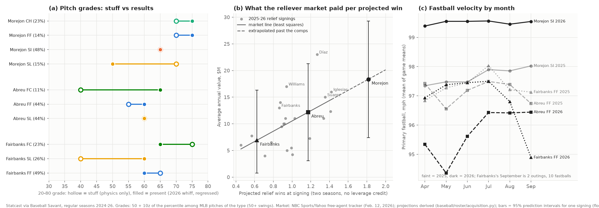

# Bullpen acquisition memo, 2026-27 offseason: three relievers for the Texas Rangers

**Decision memo from public data.** One real offseason decision, made the way a front office makes it: the club's need, three relievers it could sign this winter, a data-informed scouting report on each, what each costs and is worth under the 2022-26 agreement and its December 1 expiration, and a ranked recommendation with a price.
- **The scouting reports are data-informed, not a live look.** Grades come from Statcast shape and results. Health appears only as public injured-list and surgery reporting, cited, with no inference.
- **Closes roadmap issues #13** (acquisition memo: compare three relievers) **and #8** (20-80 scouting report template and first full report).

*Written 2026-10-13 · Dylan Fanelli · Data: Statcast via Baseball Savant (regular seasons 2024-26) · Outside facts: MLB.com, MiLB.com, CBS Sports, AP, MLB Trade Rumors (via NewsBeep and Yardbarker), Spotrac, Texas Rangers On SI, Padres On SI, FanSided, Just Baseball, Roundtable, NBC Sports, RotoWire, Yahoo Sports/NBC tracker, Bleacher Nation, FanGraphs (each dated below) · Code: `baseball/evaluation/reliever.py`, `baseball/roster/acquisition.py`, `baseball/roster/bullpen_case.py` · Independently reviewed 2026-10-13; findings addressed*



## Decision summary

**Compiled:** 2026-10-13 · **On:** Bid on Adrián Morejón to his value; expect Abreu about half the time

**Recommendation.**
- **Bid on Adrián Morejón.** Open at four years, $60M with a 2031 club option. Walk away above four years, $72M ($18M a year), which is his value to us at the reliever market's own price of a win.
  - **If the Padres make him a qualifying offer:** walk away above about $66M.
  - **The odds:** at $72M, we land him a little less than half the time. Paying more is a call on what 2027 wins are worth to this club.
- **If he goes elsewhere, sign Bryan Abreu.** Open at two years, $18M, and walk away above $25M.
- **Pete Fairbanks is no longer a 2027 option.** He is having thoracic outlet surgery with a typical recovery of nine to ten months (MLB.com, Sept. 19, 2026).

**Why.**
1. **The need is late-inning run prevention, and most of the late innings are leaving.**
   - **The fall:** Texas relievers dropped from 4th in run value per 100 pitches in 2025 to 24th in 2026 (+0.42 to −0.26). In late, close spots (7th inning on, within three runs) they fell from 6th to 26th (Statcast, regular seasons; 1 = best).
   - **Who's leaving:** Jakob Junis (mutual option) and Tyler Alexander (free agent) threw 309 of the 1,140 late, close plate appearances (27%; MLB.com free-agent list, Oct. 8, 2026). Chris Martin and Jalen Beeks, also free agents, bring it to 400 (35%).
   - **Win probability added says less.** It moved the other way (23rd → 17th) because it depends on when runs scored.
2. **Morejón projects for the most 2027 wins of any free-agent reliever.**
   - **The projection:** about 2.3 wins in a closer/high-leverage role. That's derived from his run value only, so the interval understates the uncertainty (95% range on the rate alone: 1.3–3.2).
   - **Against the others:** Abreu projects 1.5 in a setup role, or 1.6 in the same job. Fairbanks projects 0.24 for the part of 2027 he's expected to pitch.
   - **His record:** above-average relief run value three straight years (+0.33, +2.11 and +1.39 runs per 100 pitches), 211 games, no injured-list placement in 2024-26 (MiLB.com transactions, read Oct. 13, 2026), and a 58% ground-ball rate in 2026.
3. **His price is uncertain, and $72M is about the middle of the plausible range.**
   - **The market line:** a line fit on the 21 relief signings of 2025-26 puts his expected price at $18.4M a year.
   - **How wide that band is:** a 95% prediction interval runs from $7.4M to $29.3M. His projection is also above every comparable signing's, so that price is an extrapolation.
   - **Our value is close to the expected price:** $18.1M a year on our three-season projection.
   - **Two public guesses:** a rival executive's four years and $60M (FanSided, Sept. 9). Dennis Lin of The Athletic said Morejón "could attract nine-figure offers," which I read secondhand through Padres On SI (Oct. 10).

**Alternatives.**
- **Abreu (2nd):** the best 2027 whiff projection of the three (32.9%), on half the commitment.
  - **The second half of 2026:** his fastball returned from 95.0 to 96.4 mph, and his walk rate fell from 19.7% to 11.3%. The walk-rate drop is borderline (p = 0.058).
- **Raisel Iglesias:** a one-year alternative, about as many 2027 wins as Abreu (1.67 after one year's aging), at 37.
- **Fairbanks (3rd):** at most a two-year rehab contract, about $3M a year.

**Risk.** Morejón's 2026 rested on two new things.
- **A velocity gain:** +1.8 mph on the sinker, net of the league. In the levers study, pitchers mostly kept velocity gains a year later, but the whiff gains from them were not shown to last.
- **A changeup:** it went from 7% to 23% of his pitches and got whiffs 15 points above its physics. The edge engine expects about half of such a gap to carry over.
- **Health:** he had Tommy John surgery in 2021 and a 60-day elbow sprain in 2023 (MLB.com, Apr. 21, 2021; CBS Sports, Mar. 30, 2023).

**What would change the recommendation.**
- **His price above $72M (or $66M with a QO), a fifth guaranteed year, or an opt-out:** switch to Abreu.
- **A relief budget under about $15M a year:** Abreu, or Iglesias on one year.
- **A club decision that 2027 wins near the wild-card line are worth more than the market rate:** raise the walk-away. At $80M we'd land him about 62% of the time, at a market-rate cost of about $6.6M in present value.
- **A club medical review of any of them** (not public, not in this memo).

**Ask.** Approve the offer and the walk-away by the qualifying-offer deadline, a few days after the World Series. Sign before the agreement expires December 1 at 11:59 p.m. ET.
- **Why that date:** MLB's lockout memo ends free-agent negotiations and trades: "No free agent negotiations. No trades." (Bleacher Nation's summary of the memo, Brett Taylor, Oct. 8, 2026).
- **Last winter's timing doesn't help:** the top relievers signed December 9-11 (Díaz: AP, Dec. 9, 2025; Suarez: amNY, Dec. 11, 2025), and a lockout would take that window away.

## The three, side by side

| Rank (tier) | Player | B/T, 2027 age, 2026 club | OFP | Present role (2026) | 2027 role | Risk | Best pitch (present / 2027 grade) | Cost | Projected 2027 wins in his role |
|---|---|---|---|---|---|---|---|---|---|
| 1 (A) | Adrián Morejón | L/L, 28, Padres | 60 | B1 (42.1 save-situation IP; Padres On SI, Oct. 10) | B1 | Moderate | Changeup / four-seamer (75 / 75) | Free agent. Expected market price $18.4M a year (95% band $7.4–29.3M). QO-eligible; the Padres pay the tax | 2.3 (B1; rate-only 95% range 1.3–3.2) |
| 2 (B) | Bryan Abreu | R/R, 30, Astros | 50 | B2 setup (15% walks) | B2; B1 if his walk rate stays at or below about 11% | Moderate to high | Slider and four-seamer (60 / 60-65) | Free agent. Expected price $12.2M ($3.1–21.3M). No public projection found. QO-eligible | 1.5 (B2); 1.6 in the B1 job |
| 3 (C) | Pete Fairbanks | R/R, 33, Marlins | 50 | B2 when active | Out about 9-10 months after surgery; B2 when back | High (health) | Cutter (65 / 75; 86 swings) | Free agent. 2026 deal 1 year, $13M. Rehab-deal value about $4.5M a year over two years | 0.24 in 2027 (about a third of a season) |

- **Roles:** the pro-scouting-ops model system (B1 closer or high leverage, OFP band 55-60; B2 setup, OFP 50).
- **OFP:** my scouting notes' reliever formula, min(60, 0.55 × best pitch + 0.35 × second + 0.10 × control), overridden where stated.
- **Control:** graded from unintentional walk rate, as a stand-in for command, which the formula asks for and public data can't measure.

**Preference list and statements.**
- **Tier A, Morejón:** an impact late-inning arm.
- **Tier B, Abreu (and Iglesias on a one-year deal):** an average-or-better late-inning arm with one open question.
- **Tier C, Fairbanks:** a speculative rehab signing.
- **I prefer Morejón to Abreu for the late-inning job next to Jacob Latz.** He projects for more wins (2.3 vs 1.6 at the same leverage) and has the higher floor (1.3 vs 0.7 at the low end of the rate interval, same leverage). Abreu's bat-missing is intact; his walks are the question.
  - **Morejón moves below Abreu** if his price passes $72M for four years.
  - **If the objective is the most wins per dollar** with no commitment past 2028, Abreu at $25M or less.
- **I prefer Abreu to Fairbanks** because Fairbanks will miss most of 2027 after surgery, and even healthy he projects for fewer wins (0.93 vs 1.64 at the same leverage).
  - **Fairbanks moves above Abreu** only if the club's own medical review expects him back by Opening Day, and that isn't the public timeline.

## Where the tools disagree, and how I weighed them

**Two "regressed run value" numbers appear in this memo, and they measure different things.**
- **The scouting reports** use the Reliability Atlas's `regress()` on 2026 alone: Morejón +0.56, Abreu +0.09, Fairbanks −0.16 runs per 100 pitches. That is his 2026 true level.
- **The projection** pools 2024-26 relief pitches, weighted 5/4/3, and regresses with the same Atlas constant: Morejón +0.83, Abreu +0.37, Fairbanks +0.18. That is the 2027 rate used for wins and value.

| Question | Tool A says | Tool B says | Weighed |
|---|---|---|---|
| Who misses the most bats next year? | **Edge engine** (validated two-season whiff projection, blends results and stuff): Abreu 32.9%, Morejón 30.9%, Fairbanks 29.9% | **The projection** (2024-26 relief run value, regressed; counts walks, contact and grounders): Morejón +0.83, Abreu +0.37, Fairbanks +0.18 | Both are right about different things. Abreu's gap is walks, which a whiff model can't see. Morejón's edge includes a 55% regressed ground-ball rate (Atlas year-to-year persistence 0.92). I rank on run value and use the whiff projection to establish that Abreu's swing-and-miss survived 2026 |
| What is Morejón worth? | **Roster engine** ($/WAR tiers): about $30.7M a year | **Reliever market line:** his value is $18.1M; his expected price is $18.4M | They are on different win scales. This memo's wins use a fringe-arm replacement level that isn't calibrated to fWAR, and FanGraphs' $/WAR is set in fWAR (and excludes relievers). The engine column is an order of magnitude, not a price. I price only with the market line, which uses the same projection on both sides |
| Did Fairbanks's slider get better? | **Levers study:** every confirmed slider lever he moved (drop +3.1 in, speed gap +1.5 mph, slot −1.6°) implies about +2.9 whiff points | **The stuff model** (levers version, fixed hand mix): expected whiff on the slider fell 5.9 points | The levers study's own result is that the single expected-whiff change predicts better than lever lists (pooled +7.5 points of squared error). Its slider-drop and speed-gap gains are also "not shown to last." His slider whiff jump (30.8% → 40.5%, 79 swings) is treated as mostly noise. Usage fell from 40% to 26%, which by itself lowers hitters' familiarity |
| Is Morejón's slider a weakness? | **Stuff grade:** 70 (expected whiff 42%, 98th percentile) | **Present grade:** 50 (30% whiffs, 73 tracked swings) | Slider whiff reaches r = 0.5 at about 41 swings (Atlas), so the regressed rate already carries most of the weight, and it's average. Graded 50 now and 55 for 2027 (the engine's projection). A possible lever, not a flaw |
| Abreu's cutter (new in 2026) | **Stuff:** 40 | **Present:** 65 (36% whiffs, 61 swings) | Results beating stuff carries over between seasons (edge engine, r ≈ 0.55), but 61 swings in one season isn't a pattern. It's 11% of his mix and doesn't drive the grade |

## 1. The need: why the Rangers, why a reliever

**The club.**
- **2026 finish:** 80-82, 4.0 games behind the third AL wild card (White Sox, 84-78; MLB.com standings, last updated Oct. 7, 2026).
- **In July** they were a half-game out of the AL West lead, and the bullpen was already called the problem: "Texas cannot realistically expect to contend throughout the remainder of the season with its current bullpen construction" (Eduardo Solano, Roundtable Sports, July 21, 2026).

**The bullpen, 2025 vs. 2026.**
- **Grain:** relief pitches and plate appearances, regular season. Relief is any pitcher after his team's first; position players pitching count as relief, a negligible share.
- **Ranks:** 1 = best of 30.

| Season | Relief PA | K-BB% (rank) | xwOBA (rank) | Run value /100 pitches (rank) | Late, close run value /100 (rank) | Win probability added (rank) |
|---|---|---|---|---|---|---|
| 2025 | 2,426 | 13.9 (14) | .311 (16) | +0.42 (4) | +0.63 (6) | +1.9 (23) |
| 2026 | 2,641 | 11.4 (23) | .316 (22) | −0.26 (24) | −0.27 (26) | +2.2 (17) |

**Who threw the late, close innings in 2026,** and who is leaving (status: MLB.com free-agent list, Oct. 8, 2026):

| Pitcher | Throws | Late, close PA (of 1,140) | K-BB% | Run value /100 | 2027 status |
|---|---|---|---|---|---|
| Jacob Latz | L | 221 | 22.6 | +1.81 | Arbitration, projected $3.05M (Just Baseball, Oct. 7) |
| Jakob Junis | R | 164 | 8.0 | +0.94 | Mutual option |
| Tyler Alexander | L | 145 | 11.3 | +0.20 | Free agent |
| Peyton Gray | R | 113 | 17.3 | −0.37 | Under control |
| Cole Winn | R | 102 | 15.6 | −0.80 | Under control |
| Robby Ahlstrom | L | 67 | 11.6 | −0.66 | Under control |

- **The job:** a high-leverage arm for the seventh and eighth innings beside Latz.
- **A platoon need is not established.**
  - **The gap against right-handers:** Texas relievers allowed a .318 xwOBA (1,419 PA) against .306 for the league's relievers. The difference, .012 (SE .010), is not significant (p = 0.25).
  - **Against left-handers:** .315 vs .314.
  - **Within the club:** its own right-left split is .318 vs .315. So the memo doesn't screen for handedness.

**Money and the luxury tax.**

| Item | Value | Source |
|---|---|---|
| 2025 CBT payroll | $241.4M, third straight season over | CBS Sports, Dec. 20, 2025; AP |
| 2026 CBT payroll | $206.0M (Spotrac page, no as-of date); $210M (Spotrac via SI, Oct. 2) | Spotrac, read Oct. 13, 2026; Matt Postins, Texas Rangers On SI, Oct. 2, 2026 |
| 2027 committed (tax) | $142.1M to eight players, including mutual options for Pederson, Higashioka and Junis | Postins (SI), Oct. 2, 2026 |
| 2027 arbitration class | $38.2M for ten players (Gore $8.9M ... Latz $3.05M) | Zach Cioffi, Just Baseball, Oct. 7, 2026 (his own comparables) |
| 2027 payroll before additions | about $191M (derived: the two lines above, plus 14 roster spots at the 2026 minimum of $0.78M) | This memo |
| QO status for signing | "Other": a qualified signing costs the 2nd-highest 2027 pick and $500K of international pool | MLB Trade Rumors via NewsBeep, Oct. 12, 2026 |

- **What the $191M leaves out:** player benefits, which count toward the CBT payroll, and 40-man minor-league salaries. Neither is estimated here.
  - **The conclusion survives a generous allowance:** $191M + $20M + an $18M signing = $229M, still under a $244M line.
- **The reset:** being under in 2026 resets the tax clock. If a 2027 threshold exists and they cross it, they pay first-time rates: 20% on the overage instead of 50% (`cbt_bill`).
- **The budget:** Chris Young will know his budget before free agency opens, and Ray Davis's approval decides how active he can be (Postins, SI, Oct. 2). The rotation competes for the same dollars.

## 2. The pool and why these three

**The rule.** Every reliever on MLB.com's free-agent list (Oct. 8, 2026) with no club, player or mutual option or opt-out pending, and 150+ plate appearances in 2026.
- **The count:** 38 qualify.
- **The ranking:** projected wins in the B1 role, the same leverage for everyone, so the column ranks talent.
- **The table shows** the top 12 plus Fairbanks.

| Rank of 38 | Reliever | 2027 age | 2026 G | K-BB% | Run value /100 (2026) | Projection rate (2024-26) | Projected wins, B1 role | 2027 whiff% (engine) |
|---|---|---|---|---|---|---|---|---|
| 1 | **Adrián Morejón** | 28 | 76 | 22.4 | +1.39 | +0.83 | **2.28** | 30.9 |
| 2 | Alex Vesia | 31 | 72 | 17.7 | +1.22 | +0.72 | 1.91 | 30.1 |
| 3 | Raisel Iglesias | 37 | 59 | 19.7 | +1.21 | +0.83 | 1.86 | 27.5 |
| 4 | David Bednar | 32 | 64 | 20.0 | +1.23 | +0.51 | 1.70 | 28.9 |
| 5 | **Bryan Abreu** | 30 | 66 | 14.6 | +0.27 | +0.37 | **1.64** | **32.9** |
| 6 | Steven Okert | 35 | 68 | 20.7 | +1.25 | +0.67 | 1.64 | 30.3 |
| 7 | Taylor Clarke | 33 | 71 | 10.8 | +0.86 | +0.53 | 1.53 | 22.7 |
| 8 | Dennis Santana | 31 | 57 | 9.6 | −0.65 | +0.35 | 1.36 | 25.0 |
| 9 | Paul Blackburn | 33 | 62 | 10.7 | +1.35 | +0.52 | 1.31 | 21.7 |
| 10 | Sean Newcomb | 34 | 60 | 13.4 | +0.80 | +0.35 | 1.30 | 23.4 |
| 11 | JoJo Romero | 30 | 55 | 15.1 | +0.14 | +0.31 | 1.24 | 20.9 |
| 12 | Tyler Kinley | 36 | 64 | 9.5 | +0.17 | +0.17 | 1.23 | 29.4 |
| 25 | **Pete Fairbanks** | 33 | 46 | 19.7 | −0.54 | +0.18 | 0.93 (healthy) | 29.9 |

**Why these three.** They make the comparison hard in three different ways.
- **Morejón** is the best and youngest arm in the pool, at the highest price.
- **Abreu** is a buy-low whose bat-missing is intact and whose problem has a measured, partly reversed cause. He ranks 5th.
- **Fairbanks** was chosen as a case type, not on projection (25th of 38): a cheap arm whose stuff beat his results.
  - **What changed:** his surgery, announced five days after his last outing, ends that case for 2027.
  - **Why he stays:** to show how a durability fact overrides the data.

**Set aside:**
- **Vesia (31, left-handed, 1.91):** a strong alternative and worth a call if Morejón's price runs.
- **Iglesias (37):** a one-year alternative to Abreu at about the same 2027 value.
  - **Aged one year:** 1.67 B1 wins against Abreu's 1.64 in the same job.
  - **Price:** about $12.1M expected, with a one-year value of $13.3M.
  - **Why he's second to Abreu:** the late-inning need runs past 2027, with Junis and Alexander gone and Latz the only established arm, and Abreu covers two seasons at 30. If the club wants no 2028 money, Iglesias is the pick.
- **Bednar:** the market's other closer name.
  - **Velocity:** his four-seamer lost 0.86 mph net of the league (97.1 → 96.1), with 79 rpm less spin.
  - **What the levers study says:** both changes go in directions it confirms cost whiffs (about −1.6 and −1.7 points, as associations).
  - **The rest:** he's 32, and his projection (1.70) trails Morejón's at an expected price of about $14.5M.
- **Clarke, Santana, Blackburn:** their run values outrun their bat-missing (K-BB 9.6–10.8%, engine whiff 21.7–25.0%). That is the profile the projection trusts least.
- **Club options:** Andrés Muñoz and Garrett Whitlock carry 2027 club options, as do others on the list, so they aren't free agents yet (MLB.com, Oct. 8). Their decisions were not checked.

## 3. Scouting reports (data-informed, not a live look)

**How to read the grades.** Each pitch gets three 20-80 grades, against every MLB pitch of the same Statcast type in 2026 with 50+ swings (the stuff model's tracked swings):
- **Present:** 2026 whiff per swing, regressed with that type's Atlas constant.
- **2027:** the edge engine's validated next-season whiff projection.
- **Stuff:** expected whiff from the physics alone.

The mapping is 50 + 10z of the percentile, to the nearest 5 (Method).
- **Control:** graded from unintentional walk rate, as a stand-in for command.
- **Health:** each report lists the same thing for every pitcher: public injured-list placements and surgeries since 2021, with sources. Nothing is inferred beyond them.
- **Limits:** whiff is one job of a pitch, so sinkers and strike-throwing cutters are undergraded, and they are compared only within their own type. The reference pool includes starters. These grades describe the pitch in a relief role.

---

### Adrián Morejón · LHP · Padres · B/T L/L · 5'11", 224 lb · born Feb. 27, 1999 (27 on the report date; 2027 age 28) · free agent

**Basis:** data only (Statcast 2024-26 regular season), not a live look.
- **Measurements:** MiLB.com player page, read Oct. 13, 2026.
- **2026 public line:** 76 G, 86.0 IP (Padres On SI, Oct. 10, 2026). A 2.83 ERA, 1.08 WHIP, 107 K and 28 BB (CBS Sports player page, read Oct. 13, 2026).
- **Statcast counts:** 352 PA, 107 K and 28 BB (7 intentional), which matches.
- **Free agency:** "set to become a free agent after the 2026 season" (Matt Levine, Padres On SI, Aug. 3, 2026). The same piece said The Athletic called him a qualifying-offer candidate.
- **QO eligibility:** he spent all of 2026 with San Diego (game logs, no transactions) and this is his first free agency, so he can't have received a QO before.

**Health (public):**
- **2021:** Tommy John surgery, April 20 (Daniel Guerrero, MLB.com, Apr. 21, 2021).
- **2023:** 60-day IL for a left elbow sprain, Mar. 30 (CBS Sports, Mar. 30, 2023), and 15-day IL for right knee inflammation, July 16 (MiLB.com transactions).
- **2024-26:** no IL placement (MiLB.com transactions, read Oct. 13, 2026).

**Arsenal (2026; whiff% on all swings, grades on tracked swings)**

| Pitch | Usage (vs LHH / RHH) | Velo | IVB / arm-side HB (in) | Whiff% (swings) | Present | 2027 | Stuff | Notes |
|---|---|---|---|---|---|---|---|---|
| Sinker | 47.6% (55 / 43) | 99.5 | 9.2 / 16.0 | 19.3 (311) | 65 | 60 | 65 | His primary pitch. 58% ground balls overall |
| Changeup | 23.1% (2 / 36) | 92.1 | −1.1 / 10.7 | 56.0 (182) | 75 | 75 | 70 | 7% of pitches in 2025, 23% in 2026; almost only to RHH |
| Slider | 15.2% (27 / 8) | 89.4 | −0.5 / −5.7 | 29.9 (77; 73 tracked) | 50 | 55 | 70 | Results trail the physics (small sample) |
| Four-seamer | 14.2% (16 / 13) | 99.3 | 15.2 / 6.0 | 42.3 (123) | 75 | 75 | 70 | A carry four-seamer at 99 |
| Control | uBB 6.0% (BB 8.0% with 7 intentional) | | | | 60 | 60 | | 2024-25 uBB 7.0% and 4.9% |

**Performance, regressed** (Atlas constants; estimate and 95% interval for his 2026 true level; league = all pitchers 2026):

| Metric | Observed (n) | Regressed (95%) | Next season (Atlas) |
|---|---|---|---|
| Whiff per swing | 34.2% (676 swings) | 32.8% (29.6–36.1) | 32.1% |
| Chase | 38.6% | 36.0% (33.1–38.9) | 35.2% |
| xwOBA on contact | .300 (212 BIP) | .347 (.323–.372) | not given (no year-to-year signal) |
| Ground-ball % | 58.0% | 54.8% (48.8–60.7) | 53.8% |
| Run value /100 | +1.39 (1,318 pitches) | +0.56 (−0.21 to +1.33) | not given (persistence too imprecise) |

**The halves of 2026** (through June / July on):
- **K-BB:** 24.9%, then 20.1%.
- **Walks:** all seven intentional walks came in the second half. Unintentional walk rate went 4.6% → 7.3%.
- **xwOBA:** .238, then .236.

**Stuff vs. results (edge engine; swing-weighted expected whiff, then the gap):**
- 2024: 26.5% expected, −0.4 gap.
- 2025: 24.2% expected, −2.5 gap.
- 2026: 28.3% expected, +5.8 gap.
- **The read:** his physics rose in 2026 and his results rose more. Before 2026 his results matched or trailed his physics.
- **Where the 2026 gap sits:** the changeup (+15.1) and four-seamer (+13.6) beat their physics, and the slider (−12.0) trailed it.
- **The changeup regressed:** 51.4% (45.2–57.6) for 2026 and 48.1% for next season. The engine projects 48.8%, still the 99th percentile of changeups.

**Velocity (league baseline):**
- **The gain:** sinker 97.4 (2024) → 97.7 (2025) → 99.5 (2026). The 2026 gain is +1.79, and the league's returning sinkers moved −0.05, so it's +1.85 net.
- **Precision:** the regressed level is 99.5 (99.3–99.7) on 76 games, regressed by games.
- **Through the season:** it held all year. Aug–Sep minus Mar–May: +0.03, against +0.25 for 199 league relievers.
- **Not cameras:** the gain is his, because the league didn't move. The same rise showed on his four-seamer (96.5 → 99.3) and slider (87.5 → 89.4).

**Usage and platoon:**
- **Against right-handers:** he leans on the changeup. 215 PA, 31.6% K, .247 xwOBA, 38.8% whiffs (35.8% regressed).
- **Against left-handers:** 137 PA, 28.5% K, .221 xwOBA, with sinker and slider.
- **The direction:** the xwOBA split runs the normal way. Lefties fared worse, and the gap (.027, p = 0.43) isn't significant. Only his strikeout and whiff rates run in reverse. The three-batter minimum doesn't bind him.

**Workload (game logs):**
- **Appearances:** 60, 75 and 76 in 2024-26.
- **2026 workload:** 18 back-to-backs, 25 outings of four or more outs, and 12 outings that completed three in four days. His longest gap between outings was 5 days.
- **Velocity on no rest:** sinker −0.11 mph on back-to-back days.
- **Leverage proxy:** 1.60 (his mean win-probability swing per PA over the league relief mean).

**Pitch design (levers study, 2025 → 2026, net of the league, beyond the noise threshold; associations, not forecasts):**

| Change | Size | Payoff per unit | Evidence | Implied whiff points | Year two |
|---|---|---|---|---|---|
| Slider spin | +54 rpm | +1.41 per 100 rpm | Confirmed | +0.8 | Unstable across season pairs |
| Slider slot | −2.2° (lower) | +1.22 per 3° higher | Confirmed | −0.9 | Year-two gain, borderline |
| Sinker velocity | +1.85 mph | +0.18 per mph | Not detected (sinkers) | +0.3 | Not followed |

- **The open lever is the slider.** Its physics grade (70) is far ahead of its results (50), and the study can't say which change would close that gap.

**Familiarity:**
- **Low exposure:** as a reliever, hitters had seen almost none of his pitches earlier in the game (0.00 same-type pitches in earlier PAs) and 0.30 changeups in earlier games per changeup.
- **The cost:** at the league study's rates that's about −0.23 whiff points.
- **As a starter**, using the study's starter rates (Finding 7: 3.13 pitches seen in earlier PAs and 2.35 in earlier games per pitch thrown) at 23% changeup usage:
  - Earlier PAs: 0.23 × 3.13 = 0.72 same-type pitches × −1.87 = −1.35 points.
  - Earlier games: 0.23 × 2.35 = 0.54 × −0.77 = −0.42 points.
  - The total, about −1.8 points, is one measured reason to value him as a reliever.

**OFP 60 · Role: B1 now and in 2027 · Risk: moderate.**
- **The formula:** 0.55 × 75 + 0.35 × 75 + 0.10 × 60 = 73.5, capped at 60.
- **The risk** rests on three things: the velocity gain and the changeup's share of his results holding, and an elbow with a 2021 reconstruction and a 2023 sprain behind three healthy seasons.
- **Summary:** a ground-ball, platoon-neutral late-inning lefty at 28, coming off his best season, whose velocity has climbed for two years.
- **The biggest question:** how much of a 15-point changeup gap survives a second look from the league.
- **Action:** pref list #1, tier A.

---

### Bryan Abreu · RHP · Astros · B/T R/R · 6'1", 230 lb · born Apr. 22, 1997 (29 on the report date; 2027 age 30) · free agent

**Basis:** data only (Statcast 2024-26 regular season), not a live look.
- **Measurements and transactions:** MiLB.com player page, read Oct. 13, 2026.
- **Public context:** a 14.73 ERA and a walk rate four times his 2025 rate on April 18.
- **His own explanation:** "a little bit of lack of confidence in my delivery" (Brian McTaggart, MLB.com, Apr. 18, 2026).
- **Free agency:** "slated to become a free agent at the end of the 2026 season" (MLB Trade Rumors via Yardbarker, Mar. 14, 2026).
- **QO eligibility:** with Houston all season (game logs; MiLB.com shows no 2026 trade or assignment) and in his first free agency.

**Health (public):**
- **Injured list:** 2020 IL stints (no injury listed) and 10-day IL May 30, 2021, for a left calf strain. None for 2022-26 (MiLB.com transactions, read Oct. 13, 2026).
- **Not an injury:** three days on the restricted list, June 22-25, 2026, for a personal matter (NBC Sports, June 22 and 25, 2026). The club kept him, so QO eligibility is unaffected.

**Arsenal (2026)**

| Pitch | Usage (vs LHH / RHH) | Velo | IVB / arm-side HB (in) | Whiff% (swings) | Present | 2027 | Stuff | Notes |
|---|---|---|---|---|---|---|---|---|
| Slider | 44.5% (44 / 45) | 86.5 | −5.4 / −6.7 | 39.0 (205) | 60 | 60 | 60 | 46% whiffs in 2025 |
| Four-seamer | 44.0% (40 / 49) | 95.7 | 16.7 / 6.1 | 27.8 (194) | 60 | 65 | 55 | 36% whiffs at 97.3 mph in 2025 |
| Cutter | 11.4% (16 / 6) | 93.0 | 11.3 / −0.1 | 36.1 (61) | 65 | 65 | 40 | New in 2026; mostly to LHH |
| Control | uBB 15.3% (first half 19.7%, second 11.3%) | | | | 20 | 40 | | 2024: 9.8%, 2025: 10.5% |

- **The 2027 control grade (40)** is his 2024-25 rate (about 10%) and his second half of 2026 (11.3%). The first half of 2026 is treated as the outlier, which is the bet itself.

**Performance, regressed:**

| Metric | Observed (n) | Regressed (95%) | Next season |
|---|---|---|---|
| Whiff per swing | 33.8% (460) | 32.0% (28.2–35.8) | 31.4% |
| Chase | 27.6% | 28.6% (25.6–31.6) | 28.8% |
| xwOBA on contact | .363 | .362 (.336–.388) | not given |
| Ground-ball % | 41.5% | 41.8% | 41.8% |
| Run value /100 | +0.27 (1,093) | +0.09 (−0.70 to +0.89) | not given |

**The two halves of 2026** (through June / July on; a conventional calendar split fixed before looking):

| | G | PA | BB% | K% | K-BB% | xwOBA | Run value /100 | Four-seam velo (games) | Four-seam spin |
|---|---|---|---|---|---|---|---|---|---|
| First half | 31 | 127 | 19.7 | 26.8 | 7.1 | .365 | −0.97 | 95.0 (30) | 2,165 |
| Second half | 35 | 141 | 11.3 | 32.6 | 21.3 | .264 | +1.35 | 96.4 (35) | 2,295 |
| 2025 | 70 | 296 | 10.5 | 35.5 | 25.0 | .289 | +1.18 | 97.3 | 2,314 |

- **Walk rate:** the drop (25 of 127 to 16 of 141) has p = 0.058. That is borderline under the repo's standard, not confirmed.
- **Strikeout rate:** the rise has p = 0.30. Not distinguishable.
- **Velocity:** the gain is not noise.
  - **Regressed by games:** 95.0 (94.7–95.3) in the first half and 96.4 (96.2–96.7) in the second.
  - **Against normal movement:** a true pitcher's fastball moves about 0.55 mph between halves (Atlas), so +1.4 is about 2.6 times that.
  - **For the full season:** late minus early was +1.61, against +0.25 for the league's relievers.
- **Still short of 2025:** the second-half four-seamer was 0.9 mph below his 2025 level.

**Stuff vs. results:**
- 2024: 33.1% expected, +0.7 gap.
- 2025: 33.0% expected, +8.4 gap.
- 2026: 28.6% expected, +5.3 gap.
- **The read:** results beat his physics two years running, and that gap is a trait that carries over (edge engine, r ≈ 0.55).
- **The engine's 2027 whiff projection, 32.9%,** is the best of the three.

**Velocity (league baseline):** four-seamer 97.3 → 95.7 for the season, −1.49 net of the league (−0.10).

**Usage and platoon:**
- **Against right-handers:** 125 PA, 14.4% BB, .306 xwOBA, 36.5% whiffs.
- **Against left-handers:** 143 PA, 16.1% BB, .317.
- **The direction:** the xwOBA gap (.011, p = 0.81) isn't significant. The cutter (16% to lefties) is new.

**Workload:**
- **Appearances:** 78, 70 and 66.
- **2026 workload:** 13 back-to-backs (four-seamer −0.32 mph on no rest), 10 multi-inning outings, and a longest gap of 7 days.
- **Leverage proxy:** 1.36.

**Pitch design (every lever beyond the noise threshold with an evidence label of "confirmed"):**

| Change | Size | Payoff per unit | Evidence | Implied whiff points | Year two |
|---|---|---|---|---|---|
| Four-seam velocity | −1.51 mph | +1.81 per mph | Confirmed; placebo fails (selection or recovery not ruled out) | −2.7 | Not shown to last (borderline) |
| Four-seam spin | −72 rpm | +2.09 per 100 rpm | Confirmed | −1.5 | Whiff gain held; run value not shown to last |
| Slider speed gap | −1.58 mph (the fastball slowed) | +1.06 per mph | Confirmed | −1.7 | Not shown to last (borderline) |
| Slider spin | −82 rpm | +1.41 per 100 rpm | Confirmed | −1.2 | Unstable across season pairs |
| Slider slot | +1.4° (higher) | +1.22 per 3° | Confirmed | +0.6 | Year-two gain, borderline |

- **The lever is to get the four-seamer back to 97.**
  - **Half of it already happened:** second half 96.4 and 2,295 rpm, against 97.3 and 2,314 in 2025.
  - **The slider gap would follow:** it is measured from the fastball.
- **The study's caveat cuts both ways.**
  - **For the bet:** the velocity association fails its placebo, which means "pitchers whose velocity comes back get their whiffs back." That is exactly the bet here.
  - **Against it:** the same study found those gains not shown to last a second season (borderline).
- **The walk rate is the bigger risk.** The study doesn't model command, and the data can't say whether the second half will hold.

**Familiarity:** low, as for any reliever: −0.27 whiff points on the slider from earlier-game exposure, −0.20 on the four-seamer.

**OFP 50 (formula 60, overridden) · Role: B2 in 2027; B1 if his unintentional walk rate holds at or below about 11% through his first 150 PA · Risk: moderate to high.**
- **Why the override:** the formula gives control 10% weight. A 15% walk rate costs runs that whiff-based pitch grades can't see.
  - **On the role scale:** a 55 would be a B1 (55-60 band). Until the walks are settled, his role is B2 (50).
- **Action:** pref list #2, tier B, the plan if Morejón's price passes the walk-away.

---

### Pete Fairbanks · RHP · Marlins · B/T R/R · 6'6", 225 lb · born Dec. 16, 1993 (32 on the report date; 2027 age 33) · free agent

**Basis:** data only (Statcast 2024-26 regular season), not a live look.
- **Measurements:** RotoWire player page, read Oct. 13, 2026.
- **2026:** 6.31 ERA, 41.1 IP, 57 K, 21 BB (1 intentional), 19 saves in 23 chances, on a one-year, $13M deal (MLB.com, Sept. 19, 2026; Roundtable Sports, Sept. 16).
- **Statcast counts:** 57 K and 21 BB, which matches.

**Health (public):**
- **Earlier surgery:** Tommy John surgery that cost him 2018 (RotoWire, read Oct. 13, 2026).
- **IL trips:**
  - 2022: a lat injury.
  - 2023: forearm and hip inflammation.
  - 2024: a nerve-related issue (Matt Snyder, CBS Sports, Apr. 22, 2024) and a season-ending lat strain.
  - 2026: three placements, "related to the nerve issue" (right median nerve irritation; Brandon Liguori, Roundtable Sports, Sept. 16, 2026). The 2022-24 trips are from RotoWire.
- **The surgery:** on Sept. 19, 2026 the Marlins announced thoracic outlet syndrome surgery, date to be set. "The typical recovery period for a pitcher is about nine or 10 months" (Christina De Nicola, MLB.com, Sept. 19, 2026).
- **What the memo assumes:** he pitches about a third of 2027. Nothing beyond the reports is inferred.

**Arsenal (2026)**

| Pitch | Usage (vs LHH / RHH) | Velo | IVB / arm-side HB (in) | Whiff% (swings) | Present | 2027 | Stuff | Notes |
|---|---|---|---|---|---|---|---|---|
| Four-seamer | 48.7% (49 / 49) | 97.2 | 18.1 / 1.6 | 27.4 (175) | 60 | 60 | 65 | Ride +1.0 in net of the league |
| Slider | 26.4% (32 / 19) | 83.7 | −8.5 / −6.0 | 40.5 (79) | 60 | 55 | 40 | Physics says worse; results say better |
| Cutter | 23.1% (16 / 32) | 89.6 | 3.3 / −5.6 | 34.9 (86) | 65 | 75 | 75 | 4% of pitches in 2025 (41), 23% in 2026 |
| Control | uBB 10.9% | | | | 35 | 40 | | 2024-25 uBB 8.1% and 7.4% |

- **The 2027 control grade (40)** blends his 2024-25 rate (about 7.7%, a 50) with 2026 (35). It gives the recent year more weight, and his health makes 2027 control uncertain anyway.

**Performance, regressed:**

| Metric | Observed (n) | Regressed (95%) | Next season |
|---|---|---|---|
| Whiff per swing | 31.9% (340) | 30.1% (25.8–34.4) | 29.6% |
| xwOBA on contact | .417 (102 BIP) | .369 (.342–.395) | not given |
| Hard-hit % | 43.6% | 40.0% (35.0–45.0) | 39.9% |
| Ground-ball % | 24.5% | 30.8% (23.1–38.5) | 31.7% |
| Run value /100 | −0.54 (766) | −0.16 (−1.00 to +0.68) | not given |

- **Stuff beat results in 2026.** The 6.31 ERA came mostly from contact.
  - **The contact number is the least trustworthy:** pitchers' xwOBA on contact shows no within-season signal in the Atlas (r = 0.15 at 181 balls in play), so it regresses most of the way to the league.
  - **What holds:** his swing-and-miss and 19.7% K-BB.
  - **Fly balls:** his 31% regressed ground-ball rate keeps hard contact costly.
- **Stuff vs. results:**
  - 2024: 26.8% expected, −6.0 gap.
  - 2025: 27.8% expected, −2.2 gap.
  - 2026: 30.8% expected, +1.6 gap.
  - **The read:** his physics improved every year, mostly through the cutter.

**Velocity:**
- **Season:** four-seamer 97.2, unchanged net of the league.
- **Late season:** −0.80 mph against the league relievers' +0.25.
- **September:** 2 outings and 10 fastballs at 94.4 and 95.4 mph. The second ended after six pitches, when he left with the nerve irritation (Roundtable).

**Usage and platoon:**
- **The split in the data:** right-handers .265 xwOBA (78 PA), left-handers .365 (103 PA). The difference (.100, SE .064, p = 0.11) is not confirmed, on samples near 100 PA each.

**Workload:**
- **2026:** 46 games, zero multi-inning outings, 8 back-to-backs, and 19-day gaps twice (IL stints).
- **Earlier:** 46 and 61 games in 2024-25.

**Pitch design (every confirmed lever beyond the noise threshold, 2025 → 2026):**

| Change | Size | Payoff per unit | Implied whiff points | Year two |
|---|---|---|---|---|
| Four-seam ride | +1.0 in | +1.62 per 2 in | +0.8 | Point estimate held; can't exclude a full fade |
| Slider drop | +3.1 in | +1.30 per 2 in | +2.0 | Not shown in year one in this sample; not shown to last (borderline) |
| Slider speed gap | +1.5 mph | +1.06 per mph | +1.6 | Not shown to last (borderline) |
| Slider slot | −1.6° (lower) | +1.22 per 3° higher | −0.7 | Year-two gain, borderline |

- **The slider total:** about +2.9 points by the levers, against −5.9 expected-whiff points by the physics model. See "Where the tools disagree."
- **No cutter lever:** the cutter had 41 pitches in 2025, below the study's floor, so the study has no pair for it.

**Familiarity:** low: −0.10 to −0.13 whiff points per group.

**OFP 50 (formula 60, overridden) · Role: B2 when healthy · Risk: high (health).**
- **Why the override:** the cutter's 65 present grade rests on 86 swings in its first season, and an 11% walk rate keeps him off the B1 line.
- **Action:** pref list #3, tier C.
  - **2027:** not an option.
  - **If wanted:** a two-year rehab contract at about $3M a year (2y/$6M), with incentives, subject to the club's medical review.

## 4. Cost and value

**The projection.**
- **Method:** derived, not published. Relief run value per 100 pitches, 2024-26 weighted 5/4/3, regressed with the Atlas constant (M = 1,932 pitches) toward the league relief mean (+0.08).
- **Replacement:** fringe arms' −0.70 (pitcher-seasons with 50–399 relief pitches, 2024-26).
- **Wins:** 10 runs per win.
- **Role:** × (1 + LI) / 2 with the leverage of the role each is priced in (assumptions). B1 is 1.6, matching Morejón's 1.60 proxy. B2 is 1.4; Abreu's proxy was 1.36. Depth is 1.1.
- **What the interval covers:** the rate only. It understates the uncertainty, because it leaves out:
  - **Playing time and leverage.**
  - **Next-season persistence:** the Atlas couldn't measure run value's year-to-year persistence, so the regressed rate is used as next season's.
  - **The constant's own range:** the Atlas's M for run value is extrapolated beyond its data (largest measured n 1,024), and these samples run to 2,800.

| | Morejón | Abreu | Fairbanks |
|---|---|---|---|
| Projection rate /100 (95%) | +0.83 (+0.19 to +1.47) | +0.37 (−0.26 to +1.01) | +0.18 (−0.52 to +0.88) |
| Relief pitches, weighted | 1,148 | 1,177 | 811 (healthy) |
| Wins, no leverage | 1.75 | 1.26 | 0.71 |
| Wins in role (rate-only 95%) | **2.28** B1 (1.32–3.23) | **1.51** B2 (0.62–2.41); 1.64 as B1 | **0.75** depth, healthy; **0.24** for 2027 |

**What the reliever market paid in 2025-26.**
- **The comps:** every reliever the NBC Sports/Yahoo free-agent tracker (D.J. Short, Feb. 12, 2026) lists with contract terms. That is 21 signings, with no salary floor and options and opt-outs not priced.
  - **Checked against wire reports:** Díaz three years, $69M (AP, Dec. 9, 2025; the deal includes deferrals, so its present value is below the nominal $23M a year) and Suarez three years, $45M (amNY, Dec. 11, 2025).
- **Projected the comps' way:** each comp from his two pre-signing seasons (2024-25, weighted 5/4) with a 2024-25 replacement level (−0.65), so no post-signing data leaks in. For the market price, the candidates are projected the same way, from 2025-26.
- **The fit:** AAV = $0.93M + $9.60M × wins (no leverage). R² is 0.27, the residual SD is $4.2M, and the slope's SE is $3.6M. The comps' projections run 0.45–1.42 wins.

| | Projected wins, comps' way | Expected AAV | 95% prediction interval | Inside the comps' range? |
|---|---|---|---|---|
| Morejón | 1.82 | $18.4M | $7.4–29.3M | No (extrapolated) |
| Abreu | 1.17 | $12.2M | $3.1–21.3M | Yes |
| Fairbanks (healthy) | 0.62 | $6.9M | minimum–$16.3M | Yes |

- **The low R² is itself a finding.** The market priced relievers loosely on run value; saves, velocity, health and reputation move prices this projection doesn't see. So a price band of ±$10M is honest, not mispricing.
- **The public guesses:** for Morejón, four years and $60M from a rival executive (Pat Ragazzo, FanSided/Friars on Base, Sept. 9) and Lin's "nine-figure offers" (via Padres On SI, Oct. 10). That article raised a rotation role as a way for the Padres to keep him. No public projection was found for Abreu or Fairbanks.

**Value and surplus.**
- **Present value:** 10%. The market line and the price of a win grow 3% a year, and relief value falls 10% a year from age 31. All assumptions are in `acquisition.py`.
- **"Value at the market line"** prices our three-season projection at the line's rate. The engine column is not on the same win scale, so it is shown as an order of magnitude only.

| Contract | PV of salary | Value at the market line | Surplus | Engine value (different scale) |
|---|---|---|---|---|
| Morejón 4 years, $60M (opening) | $52.3M | $63.1M | +$10.8M | $107M |
| Morejón 4 years, $66M (walk-away with a QO) | $57.5M | $63.1M | +$5.6M (less the $5.8M pick and pool = about 0) | $107M |
| Morejón 4 years, $72M (walk-away) | $62.8M | $63.1M | +$0.4M | $107M |
| Morejón 4 years, $80M (stretch) | $69.7M | $63.1M | −$6.6M | $107M |
| Morejón 5 years, $100M ("nine figures") | $83.4M | $74.3M | −$9.1M | $119M |
| Abreu 2 years, $18M (opening) | $17.2M | $24.1M | +$7.0M | $24.5M |
| Abreu 2 years, $25M (walk-away) | $23.9M | $24.1M | +$0.3M | $24.5M |
| Fairbanks 2 years, $6M (rehab: a third of 2027, then 2028) | $5.7M | $8.5M | +$2.8M | $5.6M |

**Break-even AAV** (value at the market line):

| Pitcher | Three-season projection | Comps' way (two seasons) |
|---|---|---|
| Morejón (4 years) | $18.1M | $18.7M |
| Abreu (2 years) | $12.6M | $11.8M |
| Fairbanks (2-year rehab) | $4.5M | $4.0M |

**The walk-away and the odds of landing him.**
- **The walk-away is his value: $18.1M, so four years and $72M.** It is the market's expected price with no premium.
- **His expected price is $18.4M.** Reading the line's prediction interval as the distribution of his price (a rough guide, not a market model):

| Walk-away (4 years) | Chance his price is at or below it |
|---|---|
| $66M ($16.4M a year: the QO case) | 36% |
| $70M | 44% |
| $72M | 47% |
| $80M | 62% |
| $88M | 75% |

- **What the club gives up:** a walk-away at value lands him about half the time. The alternative, Abreu at his own value, carries about zero surplus, so losing Morejón costs his extra wins, not money.
- **Raising the walk-away** is worth it only if 2027 wins are worth more to this club than the market rate. The Rangers missed the wild card by four games, and their win curve isn't modeled here, so it's the GM's call. The table gives the price of each step.

**The qualifying offer.**
- **The rules:** a qualifying offer is the 2022-26 agreement's ($22.025M in 2026; the 2027 figure is set in early November).
  - **Morejón:** eligible (see his report). The Padres paid tax in 2026, so losing him earns them only a pick after Round 4. Whether they make the offer is unknown. Padres On SI (Aug. 3) said he "could be a candidate."
  - **Abreu:** eligible on the same facts, though an offer after his 2026 is less likely.
- **The Rangers' cost:** their 2nd-highest 2027 pick plus $0.5M of pool.
  - **The pick:** a 2nd-rounder near No. 55. That number is an estimate from their 80-82 finish.
  - **Its value:** about $5.3M in 2019 dollars (Craig Edwards, FanGraphs, Apr. 5, 2019).
  - **In total:** about $5.8M in present value. That lowers Morejón's walk-away by $1.66M a year, or $6.7M nominal over four years, to about $16.4M a year, or $66M.
- **The QO may not outlive this agreement.** The union proposed eliminating it (CBS Sports, Dayn Perry, May 28, 2026), and MLB said it would agree (AP, June 25, 2026).
  - **Before December 1:** a signing falls under current rules.
  - **After a lockout:** a signing might fall under rules without the QO. That isn't known.

**The luxury tax.**

| Pre-signing 2027 CBT payroll | +$7M | +$12M | +$18M |
|---|---|---|---|
| ~$191M (this memo's estimate, before benefits) | $0 | $0 | $0 |
| $235M | $0 | $0.6M | $1.8M |
| $244M | $1.4M | $2.4M | $3.6M |

- **The threshold:** $244M, the 2026 line, used as an assumption. The 2022-26 agreement sets no 2027 line.
- **MLB's proposal is a different system:** a $245.3M salary cap including benefits, from 2027 (Dayn Perry, CBS Sports, May 28, 2026).
- **The rate:** first-time payor, 20%.

**Timing and the labor clock.**
- **Current rules run the window.** Qualifying-offer decisions come a few days after the World Series, and the agreement expires December 1 at 11:59 p.m. ET.
- **A lockout ends free-agent negotiation and trades** (MLB's memo, as summarized by Bleacher Nation, Oct. 8, 2026). The window under known rules is about three to four weeks of November, shorter than the December window in which last winter's top relievers signed.
- **What that means:**
  - **Morejón:** if he isn't qualified, move early, before a bidder treating him as a starter sets the price. If he is qualified, the pick's $5.8M is a known cost. Waiting through a lockout to see whether the QO survives trades that for not knowing when, or whether, he can be signed.
  - **Abreu:** his price should fall the longer the market waits, so he is the natural late option. Under a lockout, "late" may mean March.
  - **A signing bonus paid before December 1** survives a stoppage. Salaries are paid by games played and stop in a stoppage; a bonus doesn't (the Skenes memo's logic).
    - **For the player,** that certainty is worth something.
    - **For the club,** it gives up the savings it would get in a stoppage, which makes it a risk transfer, not a free gain.
    - **Use it** to win a close bid rather than to raise the AAV.

## 5. The recommendation

1. **Bid on Morejón, to his value.**
   - **Open:** four years, $60M (2027-30), with a 2031 club option. Use part of it as a signing bonus paid before December 1 to win a close bid.
   - **Walk away:** above four years and $72M, and above about $66M if he carries a qualifying offer. No fifth guaranteed year, no opt-out.
   - **The odds:** expect to land him about half the time.
2. **If his price passes the walk-away, sign Abreu.**
   - **Open:** two years, $18M, with a 2029 club option.
   - **Walk away:** above two years and $25M.
   - **The condition:** the second half of 2026 is the bet. It is borderline evidence (p = 0.058 on walks), so price it like one.
   - **If the club wants no 2028 money:** Iglesias on one year, up to about $13M, is the equivalent.
3. **Fairbanks is not a 2027 answer.** If the club wants him for 2028, a two-year rehab contract up to about $9M total, with incentives, subject to its medical review.

**What changes the call.**
- **Morejón's market:** any bid at starter money (five years, nine figures) puts him above his value by about $9M in present value.
- **The budget:** under about $15M a year for relief means Abreu (or Iglesias) first.
- **A qualifying offer:** it lowers Morejón's walk-away by about $6.7M nominal.
- **The club's view of 2027 wins:** valuing them above the market raises the walk-away. Each step's price and odds are in section 4.
- **New information:** a club medical review of any of the three, or a winter look at Abreu's delivery (team data, outside this public memo).
- **The labor outcome:** if a lockout starts December 2 with Morejón unsigned, the decision moves to whenever free agency reopens, under rules nobody has yet.

**What changed after the independent review.**
- **Ranking:** unchanged.
- **Prices:**
  - Morejón's walk-away rose from $70M to $72M, after the market line was refit with consistent projections and a leak-free replacement level. With a QO it rose from $63M to $66M.
  - Abreu's walk-away rose from $24M to $25M.
- **Fairbanks:** went from a one-year $5M bet to "not a 2027 option," after his Sept. 19 surgery announcement.
- **OFPs:** Abreu's and Fairbanks's fell from 55 to 50, to match the role scale.

## Method

**Grain.** Pitch rows from the sequence copy (regular seasons 2024-26). Lines are pitcher × season, grades are pitcher × pitch type, the market fit is one row per signing, and the team table is one row per club.

**The comparison table** (`reliever.compare_relievers(ids, season)`): every number in section 3, for any list of pitcher ids.
- **Flags:** set once on every row.
- **No-pitch rows** (intentional walks and pitch-clock calls, `automatic_ball`/`automatic_strike`) count toward PA and walks but not pitches, swings, zone or run value.
- **Relief:** any pitcher after his team's first pitcher of the game.
- **Rates:** from summed counts.
- **IP:** from event outs, so it is approximate. Morejón shows 84.2 against an official 86.0.

**The 20-80 mapping** (`grade_from_percentile`, tested).
- **The formula:** grade = 50 + 10z, where z is the normal quantile of the pitch's mid-rank percentile among MLB pitches of the same type with 50+ tracked swings that season. Rounded to the nearest 5, clamped to 20-80.
- **The scale:** the scouting scale's 10 points per SD (the 20-80 convention).
- **The anchors:** percentile 84 → 60, 98 → 70, 16 → 40, 2 → 30.
- **Present** uses the regressed whiff rate (pitch-type M), **2027** the engine's projection, **stuff** the expected whiff.
- **Control** (`control_grade`) interpolates my walk-rate anchors on unintentional walk rate: 4% → 75, 5.75% → 60, 8% → 50, 10.5% → 40, 12% → 30, 15% → 20.
- **OFP** is my reliever formula, with overrides stated.
- **Limits:** whiff-only; the reference includes starters; no command within the zone, deception or delivery.

**Regression.** `reliability.regress` with the shipped 2024-26 constants.
- **Physics:** velocity is regressed by games.
- **Next season:** given only where the Atlas measured year-to-year persistence.

**Tests of differences.**
- **Rates:** two-proportion z-tests.
- **xwOBA:** a two-sample z-test on per-PA values (`xwoba_diff_test`). It treats PAs as independent, which slightly understates the SE.

**Velocity baseline.**
- **Season over season:** his change minus the median change of every pitcher with 100+ pitches of that type in both seasons.
- **In season:** Aug–Sep minus Mar–May (game means), against the median of the same for 199 relievers with 5+ outings in each window.

**Familiarity** (`familiarity_load`): exposures from `edge.familiarity.exposures`, priced with the league study's per-pitch costs. Those costs are contrasts against an earlier pitch of another type, so the totals are approximate.

**Pitch design** (`lever_read`): the levers study's 2025 → 2026 pairs, net of the league, flagged beyond each lever's noise threshold.
- **Each row carries:** the study's per-unit payoff, its evidence label and its year-two label (`LEVER_PERSISTENCE`).
- **The implied whiff change** is the league association, not a forecast for the pitcher.

**Money** (`roster/acquisition.py`):
- **The projection, replacement level and contract values** described in section 4.
- **The market line and its prediction interval:** `market_line`, `market_price_interval`.
- **The landing odds:** `chance_price_at_or_below`.
- **Partial seasons:** `availability` in `contract_value`.
- **Engine values:** `money.dollars_per_war`.
- **QO:** `money.qualifying_offer`.
- **Tax:** `money.tax_cost_of_signing`.

## What this doesn't show

- **No live look, no video, no medical review.** The grades are data-informed, and a scout's look at Abreu's delivery could move his report.
- **The projection's intervals cover the rate only.** Run value's persistence is unmeasured, and the Atlas constant is extrapolated at these sample sizes.
- **The market line is one winter, 21 signings, R² 0.27.** Morejón's price is an extrapolation beyond every comp. The odds table reads a regression's prediction interval as a price distribution, which is an approximation.
- **The win scale isn't calibrated to fWAR.** Engine-$/WAR values are not comparable to the market-line values, and none of the decisions rest on them.
- **Unverified or estimated:**
  - the Rangers' 2027 payroll (derived; benefits excluded)
  - their 2nd-highest pick number (No. 55, estimated)
  - pick value in 2019 dollars (not inflated)
  - 2027 qualifying-offer amounts and decisions (not yet made)
  - whether any 2027 tax threshold exists
  - option decisions for the excluded relievers
  - Lin's quote (read secondhand)
  - Fairbanks's 2027 availability (35%, assumed from the typical recovery time, with the surgery date not yet set)
- **One source error found:** Friars on Base (Sept. 9) gives Robert Suarez's Braves deal as four years and $60M. The NBC/Yahoo tracker and amNY (Dec. 11, 2025) give three years and $45M, and those are used.
- **No causal claims.** The lever effects are associations from an observational study. That Abreu's velocity and walks recovered together is a pattern, not proof the delivery is fixed.
- **No club-specific win value.** The Rangers' revenue per marginal win near the wild-card line isn't modeled. It is the input behind any walk-away above $72M.

## Reproduce
```bash
uv run python -m baseball.roster.bullpen_case        # every number in this memo, and the figure
uv run pytest tests/test_reliever.py tests/test_acquisition.py
# once integrated: uv run bb compare-relievers 2026 670970 650556 664126
```

## Sources
- **Pitch data:** Statcast, MLB Advanced Media, via [Baseball Savant](https://baseballsavant.mlb.com/) (regular seasons 2024-26).
- **Names and ids:** the Chadwick Bureau register.
- **Free-agent class:** MLB.com, "All of the 2026-2027 free agents, position by position" (Oct. 8, 2026).
- **Standings:** MLB.com standings, 2026 (last updated Oct. 7, 2026).
- **Rangers:**
  - Matt Postins, Texas Rangers On SI (Oct. 2, 2026)
  - Spotrac, Rangers 2026 tax page (read Oct. 13, 2026)
  - Zach Cioffi, Just Baseball (Oct. 7, 2026)
  - Eduardo Solano, Roundtable Sports (July 21, 2026)
  - 2025 CBT bill: CBS Sports (Mike Axisa, Dec. 20, 2025)
- **Qualifying offer:**
  - Tiers: MLB Trade Rumors, "Each Team's Penalty For Signing A Qualifying Offer-Rejecting Free Agent," republished by NewsBeep (Oct. 12, 2026)
  - Rules: MLB.com glossary
  - Its future: CBS Sports (Dayn Perry, May 28, 2026) and AP (June 25, 2026)
- **Morejón:**
  - J.P. Hoornstra (Oct. 10, 2026) and Matt Levine (Aug. 3, 2026), Padres On SI
  - Pat Ragazzo, FanSided/Friars on Base (Sept. 9, 2026)
  - CBS Sports player page (read Oct. 13, 2026)
  - MiLB.com player page and transactions (read Oct. 13, 2026)
  - Daniel Guerrero, MLB.com (Apr. 21, 2021)
  - CBS Sports (Mar. 30, 2023)
- **Abreu:**
  - Brian McTaggart, MLB.com (Apr. 18, 2026)
  - Mark Polishuk, MLB Trade Rumors via Yardbarker (Mar. 14, 2026)
  - NBC Sports player news (June 22 and 25, 2026)
  - MiLB.com player page (read Oct. 13, 2026)
- **Fairbanks:**
  - Christina De Nicola, MLB.com (Sept. 19, 2026)
  - Brandon Liguori, Roundtable Sports (Sept. 16, 2026)
  - NBC Sports (Sept. 15, 2026)
  - Matt Snyder, CBS Sports (Apr. 22, 2024)
  - RotoWire player page (read Oct. 13, 2026)
- **2025-26 reliever contracts:**
  - D.J. Short, MLB free agent tracker, NBC Sports/Yahoo Sports (Feb. 12, 2026)
  - AP via CBS (Dec. 9, 2025)
  - amNY (Joe Pantorno, Dec. 11, 2025)
- **Draft-pick value:** Craig Edwards, "An Update on How to Value Draft Picks," FanGraphs (Apr. 5, 2019).
- **$/WAR and valuation:** FanGraphs, Ben Clemens (Feb. 24 and July 2, 2026), via `baseball/roster/money.py`.
- **Labor:**
  - MLB's lockout memo: Brett Taylor, Bleacher Nation (Oct. 8, 2026)
  - MLB's cap proposal: Dayn Perry, CBS Sports (May 28, 2026)
  - The rest of the labor background: [the roster and CBA memo](2026-roster-cba-engine.md)
- **This repo's studies:** [Reliability Atlas](2026-reliability-atlas.md), [pitch familiarity](2026-league-pitch-familiarity.md), [pitch-design levers](2026-pitch-design-levers.md), the edge engine (LOG.md, 2026-10-12).

---
© 2026 Dylan Fanelli. All rights reserved. See [LICENSE](../LICENSE).
