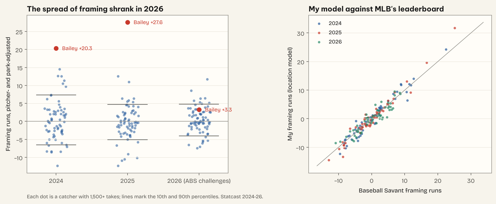

<!-- portfolio:header -->
[← Portfolio](../README.md) &nbsp;|&nbsp; [← Hitter evaluation](2026-hitter-evaluation-torres.md) &nbsp;|&nbsp; [Swing breakdown →](2026-arozarena-swing-breakdown.md)
<!-- /portfolio:header -->

# Catcher framing after the ABS challenge system: what it was worth, what it is worth now

<!-- portfolio:glance -->

     

**At a glance**

- **The question:** How much is catcher framing worth, and did the ABS challenge system change it?
- **The answer:** My public model matches Baseball Savant's framing runs (r 0.92-0.98). In 2026, the first ABS challenge season, calls got clearly more predictable from location. Framing's spread per pitch fell 23% on my model and 10% on Savant's, after an 8-10% drop the year before, so the ABS share can't be pinned down yet. Patrick Bailey went from +27.6 to +3.3.
- **For a club:** Discount a catcher's pre-2026 framing by 10-25% when pricing him, and measure challenge decisions without counting challenge wins twice.
<!-- /portfolio:glance -->

Dylan Fanelli. Data: every regular-season take in Statcast, 2024-26 (1.11 million), and Baseball Savant's catcher framing leaderboard for each season; both pulled Nov. 23, 2026.

**The question:** how much is a good framer worth, does the skill repeat, and did MLB's first season of ABS challenges change the answer?

**The answer: calls got clearly more predictable in 2026. How much framing value that removed is somewhere between 10% and 23%, and part of it was a trend already running.**
- **The calls:** the share of takes where the call was genuinely uncertain from location fell from 21% to 15%. Called balls on pitches well inside the zone nearly disappeared (0.12% to 0.02%).
- **Framing's spread per pitch, two measures:**

  | Season change | My model (per 1,000 takes) | Baseball Savant (per 1,000 pitches) |
  |---|---|---|
  | 2024 to 2025, no challenges | -10% | -8% |
  | 2025 to 2026, first ABS season | **-23%** | **-10%** |

  So the drop is real on both measures, but its size depends on the model. On Savant's numbers, the first ABS season looks much like the season before it.
- **The best framers fell hardest:** Patrick Bailey added 20-28 runs a year through 2025, and 3.3 in 2026 (Savant: 25.1, then 4.1). Part of any drop from an extreme season is regression.
- **The skill still repeats within a season:** odd against even games, a full-season reliability of 0.73 in 2026.
- **In money:** for a full-time catcher (about 7,000 takes), one standard deviation of framing on my numbers was worth about $8-9M a year through 2025, and about $6.2M in 2026.
- **What that means for a club:** discount a catcher's pre-2026 framing by 10-25% when pricing him. Use the low end if you trust Savant's model, the high end if you trust mine. A second ABS season will narrow it.

The spread of season totals fell further, from 5.6 runs to 3.6, about 36%. But that's partly playing time: 77 catchers shared the 2026 takes, against 71 in 2025, so each caught fewer. The per-pitch numbers above take that out.

## What I built, and how I know it's right

- **The call model:** every take, fit separately each season.
  - It works from the pitch's horizontal location, its height as a share of the batter's Statcast strike zone, the batter's side, the pitcher's hand and the count.
  - It is gradient-boosted trees fit out of fold by game, so no pitch is scored by a model that saw its own game.
- **Extra strikes:** each take gets the called strike (1 or 0) minus the model's strike probability.
- **What a strike is worth:** the change in run expectancy after a ball minus after a called strike, measured on each season's own takes, count by count.
  - At 0-0 it is 0.072 runs. At 3-2 it is 0.584 runs. On an average take it is about 0.14 runs.
- **Framing runs:** extra strikes times that value, summed for each catcher.
- **The adjusted version:** a ridge regression with catcher, pitcher and home park all in it.
  - It separates the catcher from his pitchers' command and from park and crew effects.
  - The umpire isn't in the public data, so the park stands in for part of the crew.

**Checks:**

| | 2024 | 2025 | 2026 |
|---|---|---|---|
| Takes | 366,873 | 368,845 | 371,385 |
| Call model: worst calibration gap across ten probability bins | 0.5 pts | 0.5 pts | 0.3 pts |
| Call model: Brier score (lower = calls more predictable from location) | 0.047 | 0.045 | 0.035 |
| Agreement with Baseball Savant's framing runs (r, my unadjusted runs; catchers on Savant's qualified list) | 0.97 (58) | 0.98 (57) | 0.92 (56) |
| Same, my pitcher- and park-adjusted runs | 0.91 | 0.93 | 0.87 |
| Within-season reliability (odd vs even games, stepped up to a full season; catchers with 1,500+ takes) | 0.66 (69) | 0.74 (71) | 0.73 (77) |

The model reproduces MLB's own leaderboard from public data: the season totals line up at r 0.92-0.98. Where it and Savant differ is in how much the spread shrank in 2026, so I report both.

## What changed in 2026

The ABS challenge system began in 2026 (MLB.com, "MLB to use ABS Challenge System starting in 2026," approved Sept. 23, 2025). Each club gets two challenges a game and keeps the successful ones; only the pitcher, catcher or batter can challenge.

| | 2024 | 2025 | 2026 |
|---|---|---|---|
| Takes where the call was uncertain from location (model strike probability 10-90%) | 21.7% | 20.9% | 15.2% |
| Called balls on pitches well inside the zone | 0.17% | 0.12% | 0.02% |
| Called strikes on pitches well outside the zone | 1.9% | 1.3% | 1.0% |
| My spread per 1,000 takes (SD, adjusted; catchers with 1,500+ takes) | 1.14 | 1.03 | 0.79 |
| Savant's spread per 1,000 pitches (SD; its qualified catchers) | 1.10 | 1.02 | 0.92 |
| One SD for a full-time catcher, my numbers (7,000 takes) | 8.0 runs | 7.2 runs | 5.6 runs |
| Spread of season totals (SD, mine, adjusted; 69 / 71 / 77 catchers) | 6.0 | 5.6 | 3.6 |
| Spread of season totals, Savant (SD; 58 / 57 / 56 qualified catchers) | 6.4 | 6.4 | 4.6 |
| Best catcher (my adjusted runs) | Bailey +20.3 | Bailey +27.6 | Dillon Dingler +11.7 |

**Definitions:**
- **Well inside:** at least 3 inches inside both edges of the plate, and in the middle 60% of the batter's zone height. That's about 33,000-36,000 takes a season.
- **Well outside:** more than 3 inches off the plate, or more than 15% of the zone height above or below the zone. That's about 210,000-230,000 takes a season.

**What the table shows:**
- **The calls changed clearly:** the uncertain band shrank by more than a quarter, and the worst misses nearly disappeared. That's consistent with challenges reversing them, and with Statcast's pitch log keeping the call that stood.
- **Framing's value shrank less clearly.** On my model, the per-pitch spread fell 10% the year before ABS and 23% in its first year. On Savant's, it fell 8% and then 10%. I can't separate an ABS effect from the trend on one season.

**The top framers lost the most:**

| Catcher | 2024 | 2025 | 2026 | (Savant 2024 / 2025 / 2026) |
|---|---|---|---|---|
| Patrick Bailey | +20.3 | +27.6 | +3.3 | +22.4 / +25.1 / +4.1 |
| Cal Raleigh | +14.5 | +6.4 | -3.4 | +12.7 / +7.0 / -4.6 |
| Austin Hedges | +7.4 | +12.5 | -0.4 | +7.6 / +10.6 / +1.5 |
| Jose Trevino | +12.6 | +4.0 | +3.7 | +11.3 / +1.5 / +1.7 |

Some of each drop is the ordinary regression of an extreme season.

**The year-to-year correlation fell, but not significantly.**
- **The correlations:** 0.58 from 2024 to 2025, against 0.33 from 2025 to 2026 (adjusted, catchers with 2,000+ takes both years, 47 and 48 catchers).
- **On the same catchers:** the 37 catchers who cleared 2,000 takes in all three seasons give 0.61 against 0.34. A bootstrap over catchers puts the difference at -0.07 to +0.55 (95%). That test accounts for the shared 2025 season.
- **The textbook test:** Fisher's z, treating the two as independent, gives p = 0.14.
- **Either way,** one transition can't show that skill carries over less. A second ABS season will.

## What it's worth in money

At 10 runs a win and FanGraphs' $11.23M per win on the 2025-26 market (Ben Clemens, Feb. 24, 2026), for a full-time catcher (about 7,000 takes), on my numbers:
- **Through 2025:** one standard deviation of framing was 7.2-8.0 runs, about 0.7-0.8 wins, about **$8-9M a year**.
- **In 2026:** one standard deviation was 5.6 runs, about 0.56 wins, about **$6.2M a year**.
- **On Savant's numbers,** the 2026 drop is about 10%, so roughly $7.3M.

**This winter's free-agent catchers** (from my [market board](2027-market-board.md); adjusted runs, 2024 / 2025 / 2026):
- **Tyler Stephenson:** +2.6 / -6.7 / -7.4 (Savant -4.4 / -7.9 / -9.5). Near the bottom of the league the last two seasons.
  - My board's call ($9.0M a year against MLBTR's $7.5M) runs on Baseball-Reference WAR.
  - Its catcher term (runs_catcher) credits him -5, 0 and +1 runs for 2024-26.
  - Across catchers, that term correlates 0.24, -0.03 and 0.26 with my unadjusted framing runs (0.20, 0.04, 0.25 adjusted). So the call carries little of his framing.
  - If a club prices framing, he's worth less than the call. How much less depends on how much of 2026 carries over, which is the open question above.
- **Carson Kelly:** +0.8 / +2.6 / +2.5 (Savant +2.5 / -1.9 / +0.3). About average, and steady.

## What a club should do with this

1. **Discount pre-2026 framing by 10-25%** when pricing a catcher, until a second ABS season shows whether 2026 is the new level.
2. **Don't count challenge wins twice.**
   - If Statcast logs the call that stood after a challenge, a strike a catcher wins on challenge is already in his framing runs here. I believe it does, from the near-disappearance of deep-zone balls, but I haven't confirmed it against Savant's ABS challenge leaderboard.
   - The new skill worth measuring is the decision itself: which pitches and counts a catcher challenges, and what a lost challenge costs his club later in the game.
3. **Keep measuring framing,** because it still repeats within a season.

## Limits

- **The umpire isn't in the public data.** The park term absorbs part of the crew effect, not all of it.
- **One ABS season.** 2026 could be a transition year, as umpires and catchers adjust. The year-to-year comparison isn't significant either way it's tested.
- **Two models disagree on the size of the drop:** 23% on mine, 10% on Savant's, per pitch. Both agree on the direction and on the season totals (r 0.92-0.98).
- **Statcast's calls after a challenge:** that the pitch log records the call that stood is my reading of the data, not a documented field rule. If it records the original call, overturned calls would count against the catchers who lost them, and the 2026 numbers would shift.
- **Different groups:** my spreads cover catchers with 1,500+ takes; Savant's cover its qualified list.

## Sources

- Statcast pitch data, 2024-26 regular seasons, via Baseball Savant; pulled Nov. 23, 2026.
- Baseball Savant, catcher framing leaderboard, 2024, 2025 and 2026 (qualified catchers, runs and pitches); pulled Nov. 23, 2026.
- MLB.com, "MLB to use ABS Challenge System starting in 2026" (approval Sept. 23, 2025; rules).
- FanGraphs, Ben Clemens, "What Are Teams Paying for a Win in Free Agency? 2026 Edition" (Feb. 24, 2026): $11.23M per win overall.
- Baseball-Reference WAR file (war_daily_bat.txt, runs_catcher); pulled Nov. 23, 2026.

Code: `baseball/evaluation/framing.py` (`uv run bb framing`). Outputs: `reports/outputs/framing_summary.json`, `reports/outputs/framing_catchers.json`. Tests: `tests/test_framing.py`.

<!-- portfolio:footer -->
---
[← Portfolio](../README.md) &nbsp;|&nbsp; [← Hitter evaluation](2026-hitter-evaluation-torres.md) &nbsp;|&nbsp; [Swing breakdown →](2026-arozarena-swing-breakdown.md)

© 2026 Dylan Fanelli. All rights reserved. To cite: Fanelli, D. (2026). *Catcher framing after the ABS challenge system: what it was worth, what it is worth now*. Dylan Fanelli Baseball Analytics Portfolio. https://github.com/IForSureI/Dylan-Fanelli-Baseball-Analytics-Portfolio/blob/main/reports/2026-catcher-framing.md
<!-- /portfolio:footer -->
