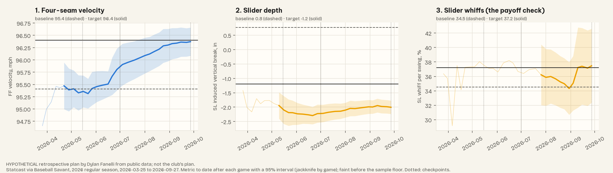

<!-- portfolio:header -->
<sub>[← Portfolio](../README.md) &nbsp;|&nbsp; [← Pitch-design levers](2026-pitch-design-levers.md) &nbsp;|&nbsp; [IL early warning →](2026-il-early-warning.md)</sub>
<!-- /portfolio:header -->

# An individual development plan, graded: Logan Gilbert's 2026 (a hypothetical, retrospective plan)

<!-- portfolio:glance -->
<p>     </p>

**At a glance**

- **The question:** Is a development plan working, and how would a department know?
- **The answer:** On my hypothetical 2026 plan for Logan Gilbert, graded on his season through Sept. 27: four-seam velocity and slider depth are on track. Slider whiffs are inconclusive, as the power check said before the season, and the usage guard is breached.
- **For a club:** A plan with a number, a date, a sample floor and a guard for every priority, and a review that says keep, adjust or stop.
<!-- /portfolio:glance -->

**One pitcher, one plan, graded from public pitch data.** This page is the short version for a player-development reader. The study behind the targets, the engine's rules and the longer worked example are in [the pitch-design levers report](2026-pitch-design-levers.md#the-tool-an-individual-development-plan-with-a-progress-engine).
- **This is my hypothetical plan, written from public data.** It is not his club's plan, and nothing here says what the club or the pitcher worked on.
- **It is retrospective.** The plan is written as if in the 2025-26 offseason and graded on his 2026 regular season, which is over. No plan on this page is live.
- **Hindsight in the choice of pitcher:** I picked him because the levers study flags his 2025 to 2026 changes. That is selection, so the result is not a test of the method.

*Logan Gilbert; right-handed starter; MLBAM id 669302*
*Written 2026-11-15; Dylan Fanelli; Data: Statcast via Baseball Savant, his 2,991 regular-season pitches in 32 games, 2026-03-26 to 2026-09-27, the latest regular-season data on disk; Baselines: his 2025 regular season (Statcast); Code: `baseball/development/idp.py` (`bb idp`); Plan file: [`examples/idp-gilbert-2026.yaml`](../examples/idp-gilbert-2026.yaml); Saved output: [`reports/outputs/idp-gilbert-2026.json`](outputs/idp-gilbert-2026.json); Separate review pass: not yet run*



## The question
A player-development department asks three things of every plan, at every checkpoint:
- **Is each priority moving,** by more than the noise in its own number?
- **Is it moving at a cost** the plan named in advance?
- **Do we keep, adjust or stop?**

The plan below answers them with a number, a date and a sample floor for each priority, so the verdict can't be argued after the fact.

## The answer, as of 2026-09-27
- **Priority 1, four-seam velocity: on track.** 95.4 mph in 2025, 96.4 in 2026 (95% interval 96.1 to 96.7; 1,187 pitches). 97% of the gap closed. It was flat at both earlier checkpoints.
- **Priority 2, slider depth: on track.** +0.8 in of induced vertical break in 2025, -2.0 in 2026 (-2.2 to -1.8; 746 pitches). Past the -1.2 target at every checkpoint.
- **Priority 3, slider whiffs: inconclusive, and its guard is breached.** 34.5% in 2025, 37.5% in 2026 (32.4 to 42.6; 403 swings). The point estimate is past the 37.2 target, but it can't be told from the baseline. Slider usage fell to 25.0% (22.6 to 27.4), under the 28% limit.
- **The engine's recommendation:** review priority 3 with the coach, because the risk the plan named is showing.
- **The as-of date** is the plan's end and the last regular-season game in the data. Run as of today (Nov. 15), the engine returns the same numbers.

## The plan
Three priorities, inside the standard's two to four. Every field is copied from the plan file.

**Priority 1: four-seam velocity**
- **Metric:** four-seam velocity, mph.
- **Baseline:** 95.41 (SE 0.09; 795 pitches, 2025 regular season, Statcast).
- **Target and date:** 96.4 by May 15, 2026. Pace: step, expected from the first start.
- **Floor:** 150 pitches.
- **Mechanism:** offseason lower-half strength and intent block. +1 mph is about the deliberate-change threshold for four-seamers (0.97 mph) and his 2024 level (96.6).
- **Process goal:** three lifts a week in the offseason block; in season, velocity logged every start with a 94.5 mph alert.
- **Owner:** strength coach with the pitching coach.
- **Checkpoints:** May 15, July 1, Sept. 27.
- **Risk and guard:** chasing velocity costs strikes. Four-seam in-zone rate stays above 60% (floor 200 pitches).

**Priority 2: slider depth**
- **Metric:** slider induced vertical break, in.
- **Baseline:** 0.77 (SE 0.28; 760 pitches, 2025 regular season, Statcast).
- **Target and date:** -1.2 by May 15, 2026. Pace: step.
- **Floor:** 150 pitches.
- **Mechanism:** grip and seam orientation that take about 2 in of lift off the slider (more drop), about the deliberate-change threshold for sliders (2.06 in).
- **Process goal:** two design pens a week in the offseason, 20 sliders each with live IVB and spin-axis feedback.
- **Owner:** pitching coach.
- **Checkpoints:** May 15, July 1, Sept. 27.
- **Risk and guard:** depth costs slider strikes. Slider in-zone rate stays above 45% (floor 150 pitches).

**Priority 3: slider whiffs (the payoff check)**
- **Metric:** slider whiffs per swing, %.
- **Baseline:** 34.52 (SE 3.08; 365 swings, 2025 regular season, Statcast).
- **Target and date:** 37.2 by Sept. 27, 2026. Pace: step.
- **Floor:** 250 swings.
- **Mechanism:** follows from priority 2. It is the payoff the study prices for added slider drop.
- **Process goal:** slider usage held near its 2025 level, so the whiff rate isn't bought by throwing it less.
- **Owner:** pitching coach and the PD analyst.
- **Checkpoints:** May 15, July 1, Sept. 27.
- **Risk and guard:** a whiff gain that comes from lower usage and not from the new shape. Slider usage stays above 28% (floor 1,000 pitches).

**What a real plan has that this one can't:** the player's own words. The plan file records that field as not known, because a public-data plan has no player conversation.

## The verdicts at each checkpoint
Each cell is the engine's output on his pitches from the plan's start to that date.

| # | May 15 | July 1 | Sept. 27 |
|---|---|---|---|
| 1. Four-seam velocity, mph (baseline 95.4, target 96.4) | **flat:** 95.3 (95.0 to 95.7), 257 pitches, z = -0.4 | **flat:** 95.8 (95.4 to 96.2), 604 pitches, z = 1.7 | **on track:** 96.4 (96.1 to 96.7), 1,187 pitches, z = 5.6 |
| 2. Slider IVB, in (baseline 0.8, target -1.2) | **on track:** -1.9 (-2.4 to -1.5), 174 pitches | **on track:** -2.2 (-2.5 to -1.9), 370 pitches | **on track:** -2.0 (-2.2 to -1.8), 746 pitches |
| 3. Slider whiffs, % (baseline 34.5, target 37.2) | **insufficient:** 92 swings, floor 250 | **insufficient:** 199 swings, floor 250 | **inconclusive:** 37.5 (32.4 to 42.6), 403 swings, z = 0.7 |

**The guards:**

| Guard | May 15 | July 1 | Sept. 27 |
|---|---|---|---|
| 1. Four-seam in-zone rate above 60% | ok: 63.4 (58.0 to 68.8) | ok: 63.6 (59.3 to 67.9) | ok: 61.8 (58.9 to 64.6) |
| 2. Slider in-zone rate above 45% | ok: 48.3 (39.9 to 56.7) | ok: 48.4 (41.6 to 55.2) | ok: 47.9 (43.1 to 52.6) |
| 3. Slider usage above 28% | insufficient: 819 pitches, floor 1,000 | **breached:** 23.2 (20.3 to 26.1) | **breached:** 25.0 (22.6 to 27.4) |

- **How the verdicts are decided:** a move counts only if it clears the baseline at z of 1.96 or more, with both standard errors counted. Standard errors are a jackknife over games. The full rules are in [the levers report](2026-pitch-design-levers.md#the-tool-an-individual-development-plan-with-a-progress-engine).
- **The usage guard was breached by July 1,** a checkpoint before priority 3 had enough swings to grade. The guard gave the earlier warning.
- **These numbers match the levers report's worked example.** I re-ran the engine on Nov. 15 and every verdict and number it prints there came back the same.

## What the power check says
The engine checks every priority before any 2026 pitch is read.
- **Priorities 1 and 2 pass.** Their planned changes are larger than the smallest change their floors can detect.
- **Priority 3 fails, and no floor would fix it.** The planned change is 2.68 points. The minimum detectable change at its floor of 250 swings is 9.47. The 2025 baseline's own SE is 3.08 points, so even an unlimited 2026 sample could not detect a move this small.
- **What that means for the verdict:** "inconclusive" at season's end was known in advance. At 403 swings only a change of 7.9 points or more is detectable.
- **The engine's advice:** set a bigger target, use a better-measured baseline, or treat it as a monitoring metric.

## What I would do next
- **Keep priorities 1 and 2 and re-baseline them on 2026.** Both landed. The next plan starts from 96.4 mph and -2.0 in, with their 2026 standard errors.
- **Change velocity's pace from step to linear.** It was flat on May 15 and July 1 and on track only by season's end, so the step assumption was wrong for this pitcher. I should have moved the date at the July checkpoint.
- **Do not credit the velocity to the plan.** The target was a return to his 2024 level, and the levers study's velocity placebo says part of a velocity payoff is recovery.
- **Carry slider whiffs as a monitoring metric.** Grade the shape (priority 2) and pair the whiff rate with the expected-whiff read, which the levers report gives for his slider.
- **Take the usage guard to the coach first.** The whiff rate rose while usage fell from 35% to 25%. Fewer sliders can raise whiffs per swing without any change in shape, so the 37.5% can't be read as the payoff.
- **Write the 2027 plan before spring.** It needs his 2026 baselines with standard errors, a power check on every priority, and the player's own words. I have not written it.

## What this doesn't show
- **One pitcher, chosen in hindsight.** It shows the format and the grading. It does not show that plans like this work.
- **Not the club's plan.** I do not know what he or his club worked on.
- **No cause.** The engine says a number moved. It can't say the mechanism in the plan moved it.
- **Regular season only.** The 2026 postseason is not in these numbers.
- **Public pitch data only.** No bullpen, strength or biomechanics data, which is where a real plan's process goals are checked.

## Reproduce
```bash
uv run bb idp examples/idp-gilbert-2026.yaml --json reports/outputs/idp-gilbert-2026.json   # needs the 2026 pitch data
uv run bb idp examples/idp-gilbert-2026.yaml --as-of 2026-07-01                             # any review date
uv run bb idp examples/idp-fictional.yaml                                                   # the fictional example, no data needed
uv run pytest tests/test_idp.py tests/test_development_plan.py
```

## Sources
- **Pitch data:** Statcast, MLB Advanced Media, via [Baseball Savant](https://baseballsavant.mlb.com/) (regular seasons 2025 and 2026).
- **Targets and thresholds:** [the pitch-design levers report](2026-pitch-design-levers.md), recomputed there from 2024-25 data alone.

---
© 2026 Dylan Fanelli. All rights reserved. See [LICENSE](../LICENSE).

<!-- portfolio:footer -->
---
<sub>[← Portfolio](../README.md) &nbsp;|&nbsp; [← Pitch-design levers](2026-pitch-design-levers.md) &nbsp;|&nbsp; [IL early warning →](2026-il-early-warning.md)</sub>

<sub>© 2026 Dylan Fanelli. All rights reserved. To cite: Fanelli, D. (2026). *An individual development plan, graded: Logan Gilbert's 2026 (a hypothetical, retrospective plan)*. Dylan Fanelli Baseball Analytics Portfolio. https://github.com/IForSureI/Dylan-Fanelli-Baseball-Analytics-Portfolio/blob/main/reports/2026-development-plan.md</sub>
<!-- /portfolio:footer -->
