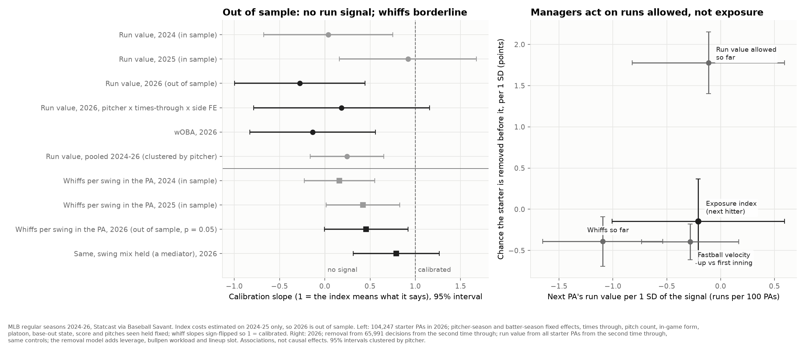

# The exposure-aware hook: should what a hitter has seen decide when the starter comes out? MLB 2024–26

**League study from public pitch data.**
- **Scope:** every regular-season plate appearance by a starting pitcher in 2024–26 (Statcast).
- **Out of sample:** the familiarity costs are re-estimated on 2024–25 only, so 2026 is a true out-of-sample test.
- **Observational:** every number below is an association with fixed effects and controls, not a randomized test of pulling a pitcher.

*Written 2026-10-12 · Dylan Fanelli · Data: Statcast via Baseball Savant; in 2026, 104,249 starter PAs (104,247 in the models) and 66,018 removal decisions (65,991 in the models) across 2,429 games, plus 2024 and 2025 · Code: `baseball/edge/hook.py` · Builds on [Does a pitch wear out?](2026-league-pitch-familiarity.md) · Independently reviewed 2026-10-13; findings addressed*



## Answer
- **No.** The part of a hitter's exposure that is specific to the starter's pitch mix shouldn't move the hook. Managers' removals show no detectable response to it.
- **The index doesn't predict run value out of sample.**
  - **The index:** for each hitter, the familiarity cost the starter's mix should carry against what that hitter has already seen today, in runs per PA.
    - The costs come from 2024–25 only.
    - Times through the order and pitches seen are held fixed, so the index is tested on its mix-specific part.
  - **The test:** if the index means what it says, a PA's run value rises one-for-one with it (slope 1.0).
  - **2026 (out of sample):** slope −0.28 (SE 0.37). Slope 1 is rejected (p < 0.001), and the 95% interval (−1.0 to 0.44) excludes even half of the predicted effect.
  - **The three seasons fitted one by one:** 0.04 (2024), 0.92 (2025), −0.28 (2026).
    - The one calibrated-looking season, 2025, doesn't survive pooling.
    - In one fit across 2024–26, with SEs clustered by pitcher and the controls' coefficients common across seasons, the season slopes are 0.19, 0.36 and 0.16. Equal slopes aren't rejected (p = 0.57). The pooled slope is 0.24 (SE 0.21), and slope 1 is rejected (p < 0.001).
    - Fitting the costs on 2024–25 doesn't explain 2025: 2024 helped estimate them too and sits at 0.04.
  - **As a forecast:** taking the index at face value makes 2026 PA forecasts slightly *worse*: p = 0.002 across games, and p = 0.02 on a forward August–September split.
- **The input holds; the step from pitches to PA runs is what fails.**
  - **Per pitch:** the run-value cost replicates in 2026 on its own. Per earlier same-type pitch, the pitcher loses 0.15, 0.22 and 0.53 runs per 100 pitches on fastballs, breaking balls and changeups/splitters, all p < 0.05.
  - **Whiffs per swing within the PA:** the same index built with whiff costs is borderline.
    - 2026: 0.46 of the predicted drop (SE 0.24, p = 0.05).
    - The in-sample seasons: 0.16 (SE 0.20, p = 0.41) in 2024 and 0.42 (SE 0.21, p = 0.04) in 2025.
    - Holding the PA's swing mix by pitch type fixed gives 0.79 (SE 0.24). The swing mix is itself a response to exposure, so that number is conditional on a mediator, not a forecast.
- **Removal shows no detectable response to exposure.**
  - **The test:** 65,991 decisions from the second time through.
  - **The result:** −0.15 points of removal chance per run/100 PAs of the next hitter's index (SE 0.27). The 95% upper bound is +0.38.
  - **The benchmark:** managers add 2.5 points of removal for the third time through, while the average index rises about 1 run/100 PAs from the second time to the third. Pricing the index at that rate is ruled out.
- **Managers do act on run value allowed so far.**
  - **Removal:** +1.8 points per standard deviation (p < 0.001).
  - **The next PA:** no detectable association with its run value (−0.11 runs/100 PAs per SD, 95% interval ±0.7), among the starters managers left in.
  - **Whiffs so far by contrast:** they are associated with the next PA (−1.10 runs/100 PAs per SD, p < 0.001) and get a smaller removal response (−0.39 points per SD).
- **The tail is small even if the index were right.**
  - **At face value:** third-time-through PAs in the index's top decile are worth 1.6 runs per team-season (69 PAs × 2.3 runs/100 PAs above the median).
  - **The mix-specific part only:** 1.1 runs.
  - **At the 2026 estimate:** −0.4, with a 95% upper bound of 0.7 runs.
  - **What this is:** the size of the tail, not the value of a decision rule.

## What a club can do with it
1. **Keep exposure out of the hook model.**
   - **Where it belongs:** pitch selection and sequencing, where it was measured. A changeup a hitter has seen five times is a weaker changeup.
   - **Where it doesn't:** a forecast of who wins the next PA.
     - The per-pitch cost doesn't show up in PA run value.
     - This PA's pitch mix carries on with what the hitter has already seen, with no sign of steering away (finding 4).
2. **Use the base card: times through and the starter's quality against a reliever baseline.**
   - **It validates out of sample:** slope 0.92 (SE 0.14) on 2026 PAs.
   - **Removal rates rise with it, unadjusted:** from 3.5% when the card favors the starter to 17% when he's 4+ runs/100 PAs worse than an average reliever. This is confounded with times through and pitch count, which drive both.
   - **Adding the index doesn't help:** −0.05 (SE 0.22).
3. **Audit how much the hook leans on run value allowed.**
   - **The pattern:** of the in-game form signals (run value allowed, whiffs, velocity), run value allowed moves removal most. In this data it carries no detectable forward association.
   - **The other side:** whiffs so far carry a forward association and move removal less.
   - **The caveat:** selection limits what this can show (Limits).
4. **Don't buy an exposure-based hook product.** The per-hitter index can be built from public data (`hook_card`), and on a season it never saw it carries no run information.

## Findings

### 1. Calibration: does the index mean what it says? (PA run value on the index, both in runs per 100 PAs)

| Season | Main spec | p (slope = 1) | wOBA version (1 = calibrated) | PAs | Pitchers |
|---|---|---|---|---|---|
| 2024 (costs in sample) | 0.04 (0.36) | 0.008 | 0.09 (0.36) | 106,901 | 370 |
| 2025 (costs in sample) | 0.92 (0.39) | 0.83 | 0.73 (0.37) | 106,704 | 369 |
| **2026 (out of sample)** | **−0.28 (0.37)** | **< 0.001** | **−0.13 (0.35)** | **104,247** | **377** |
| Pooled 2024–26, one fit, clustered by pitcher | 0.24 (0.21) | < 0.001 | | 317,852 | 618 |
| Pooled 2024–25 (in sample only) | 0.47 (0.27) | 0.05 | | 213,605 | 511 |

- **Reading the table:** standard errors, clustered by pitcher, are in parentheses.
- **The wOBA column:** the coefficient divided by what a calibrated index implies. That benchmark uses 0.835 runs per unit of wOBA, the PA-level slope in 2024–25.
- **Between seasons, the evidence for different slopes is weak.**
  - **Separately estimated slopes:** they differ more than noise would usually give, but only if seasons are treated as independent (Cochran's Q p = 0.07, borderline). They aren't independent: the same pitchers recur.
  - **One fit:** with common control coefficients and a clustered Wald test, the season slopes are 0.19 (0.23), 0.36 (0.24) and 0.16 (0.25), and equality isn't rejected (p = 0.57).
  - **What follows:**
    - The out-of-sample season is null, and so is one of the in-sample seasons.
    - 2025's 0.92 depends on letting every control coefficient vary by season.
    - Nine cost parameters estimated on about 1.4 million pitches are not a plausible way to overfit a PA-level slope.
- **2024's index is built a little differently.** There's no 2023 data, so 2024 usage is this season only, with no last-season blend. 4.9% of 2024 starter PAs use the pitcher's earlier pitches that day, against 0.8% in 2026.

**2026 under other specifications.** None is significantly positive. Only the strictest fixed effects fail to reject 1.0, because the standard error grows.

| Specification | Slope (SE) |
|---|---|
| Without the pitches-seen control | 0.01 (0.24) |
| Pitcher-season × times-through fixed effects | −0.25 (0.44) |
| Pitcher-season × times-through × batter-side fixed effects | 0.19 (0.50), p vs 1 = 0.10 |
| One average cost for every pitch type | −0.05 (0.33) |
| + how this hitter does against this pitcher's mix (rest of his season, current game left out) | −0.55 (0.37) |
| After the season's first 30 days (usage settled) | −0.17 (0.40) |
| Second time through only | −0.36 (0.58) |
| Third time through only | −0.24 (0.48) |

### 2. Third time through, by decile of the index (2026)

| Decile | 1 | 2 | 3 | 4 | 5 | 6 | 7 | 8 | 9 | 10 |
|---|---|---|---|---|---|---|---|---|---|---|
| Index (runs/100 PAs) | 0.70 | 1.09 | 1.34 | 1.57 | 1.79 | 2.03 | 2.31 | 2.62 | 3.08 | 4.21 |
| Run value, adjusted (runs/100 PAs) | −2.95 | 0.78 | 0.99 | 1.19 | −0.87 | 0.80 | 2.50 | 0.40 | −1.01 | −0.36 |

- **Adjusted means:** net of pitcher-season and batter-season fixed effects and every control except the index and pitches seen. Each decile has about 2,080 PAs.
- **Top minus bottom:**
  - +2.6 runs/100 PAs (SE 1.2, p = 0.03)
  - raw: +3.3 (p = 0.007)
  - with pitches seen also held fixed: +2.2 (p = 0.054)
- **The "predicted 3.5":** the gap in the index's level between the two deciles. That gap also carries differences in pitches seen. The with-pitches-seen contrast is the fair comparison for the mix-specific part, and it is borderline.
- **No gradient sits behind the gap.**
  - **Where the gap comes from:** all of it is the bottom decile. Hitters who had seen the least costly mix did unusually poorly.
  - **The middle:** deciles 2–9 show no trend; they bounce between −1.0 and +2.5 in no order.
  - **The top:** the top decile is below the decile average.
  - **The fitted slope:** −0.24 within the third time through.
- **Under the repo's one evidence standard:** a contrast that rests on one decile, borderline once pitches seen are held fixed, doesn't outweigh a linear test that rejects calibration. It's reported, not counted as support.

### 3. Out-of-sample forecasting (2026)

| Design | Index slope fitted in training | Index taken at face value | Most the index could buy if calibrated |
|---|---|---|---|
| 5-fold, whole games | +0.0001% MSE (t = 0.08) | −0.017% (t = −3.1) | 0.0066% |
| Forward split, Mar–Jul → Aug–Sep | +0.003% (t = 1.5) | −0.025% (t = −2.3) | 0.0065% |

- **The tests:** paired squared-error differences, clustered by pitcher. Positive means the index helps.
- **The ceiling:** the last column is the index's variance net of controls and fixed effects, the most it could cut MSE if its slope were exactly 1. At that size the forecasting tests can't find a calibrated index. The calibration slope is the informative test.
- **What forecasting can catch:** an index that is wrong. Imposing slope 1 makes forecasts measurably worse.
- **The base model:** fixed effects and controls don't beat the training-set mean on PA run value either (−0.14% and −0.29%). Single-PA run value is close to unforecastable, so small signals are best tested with calibration, not forecast error.

### 4. Why it doesn't aggregate: what was tested (2026; the in-sample seasons where they matter)

| Test | Estimate | What it says |
|---|---|---|
| Per-pitch run value lost per earlier same-type pitch, 2026 alone (pitcher's view, runs per 100 pitches) | FB 0.15 (0.06), BRK 0.22 (0.08), OFF 0.53 (0.11), CUT 0.49 (0.17) | The input holds up out of sample |
| Whiffs per swing within the PA on the whiff index (calibrated = −1) | 2026 −0.46 (0.24), p = 0.05 · 2025 −0.42 (0.21) · 2024 −0.16 (0.20) | Borderline at about half strength; null in 2024 |
| Same, holding the PA's swing mix by pitch type fixed | 2026 −0.79 (0.24) · 2025 −0.78 (0.21) · 2024 −0.49 (0.20) | Conditional on a mediator (the mix responds to exposure) |
| This PA's share of a type on how far the hitter's seen share exceeds usage | +0.123 (0.007) | The mix carries on with what he's seen; no sign of steering away |
| Index split: part usage predicts / hitter-specific part, 2026 | −0.82 (0.52) / 0.31 (0.53) | Neither is associated with run value out of sample |
| Same split, in-sample seasons | 2025: −0.03 (0.50) / **2.06 (0.53), p < 0.001** · 2024: 0.12 (0.52) / −0.07 (0.48) | A strong in-sample result in 2025 that doesn't replicate |

- **Not power:** with 104,000 PAs the 2026 interval excludes 1.0, and so does the pooled interval.
- **Not a weak input:** the per-pitch cost replicates in 2026. The whiff version reaches the PA only borderline (null in 2024, p = 0.05 out of sample), so it is weak support at best.
- **The mix:**
  - **Measured:** for every 10 points by which a hitter's seen share of a type exceeds the pitcher's usage, the pitcher's share of that type in this PA is 1.2 points higher.
  - **What that rules out:** systematic avoidance.
  - **What it doesn't show:** this regression has no game or pitcher × batter terms, so same-day feel or a hitter-specific plan would produce the same persistence. It shows that this PA's mix carries on with what the hitter has seen, not why.
  - **Exposure:** the realized exposure (1.56 runs/100 PAs) runs above the usage-based index (1.44).
- **Not matchup quality:** adding how the hitter does against this pitcher's mix (the rest of his season, current game left out) moves the slope to −0.55, further from 1.
- **The hitter-specific part in 2025:**
  - **The result:** 2.06 (SE 0.53).
  - **Why it isn't counted:** it's in sample, and it doesn't replicate (2024 −0.07; 2026 0.31). One strong in-sample estimate in three seasons isn't evidence.
- **What remains:** the per-pitch cost is estimated holding the count, location and pitch type fixed.
  - Run value per PA lets all three respond.
  - The chase finding in the familiarity study (hitters chase familiar fastballs and breaking balls more) is one offset in that direction.
  - Which offset dominates wasn't isolated. "Pitchers' choices absorb it" is a candidate explanation, not a tested one.

### 5. The manager test: what moves the hook (2026)
Linear probability of removal before the next PA. 65,991 decisions from the second time through (66,018 before dropping fixed-effect singletons); 6.95% end in a removal. Fixed effects are pitcher-season and next-batter-season; standard errors are clustered by pitcher.

| Signal | Change in removal chance (points) |
|---|---|
| **Next hitter's index, per run/100 PAs** | **−0.15 (0.27), p = 0.58** |
| **Next three hitters' index, per run/100 PAs** | **−0.39 (0.45), p = 0.39** |
| Pitch count 80s / 90s / 100s / 110+ (vs. under 60) | +9.0 / +30.5 / +53.8 / +65.8 |
| Third / fourth time through (vs. second) | +2.5 (0.6) / +10.0 (1.7) |
| Run value allowed so far, per run | +0.99 (0.11) |
| Whiffs so far, per whiff | −0.10 (0.04) |
| Fastball velocity up vs. first inning, per mph | −0.40 (0.11) |
| Next hitter same-handed | −3.2 (0.3) |
| Bullpen's pitches in the last 3 days, per 100 | −0.96 (0.13) |
| Leverage proxy, per unit | −0.47 (0.78), p = 0.55 |

- **The model sees what managers do:** pitch-count steps (the largest driver by far), times through, platoon, a tired bullpen. So the null on the index isn't a dead model.
- **How small a response is ruled out:**
  - **Detectable size:** the next-hitter SE of 0.27 gives a minimum detectable effect of about 0.75 points per run/100 PAs (80% power, 5% test).
  - **Upper bound:** +0.38.
  - **Against times through:** managers add 2.5 points for the third time through, while the average index rises about 1.0 run/100 PAs from the second time to the third (1.09 → 2.08). Pricing the index the way managers price times through is ruled out.
  - **Against run value allowed, per SD:** removal moves 1.78 points per SD of run value allowed, and the index's upper bound is +0.37 per SD. A response a fifth that size or larger is ruled out.
- **What "no detectable response" covers:** the mix-specific part of exposure, net of times through and pitches seen. Managers plainly respond to times through.
- **The index across every subset tested:**

| Subset | Next hitter | Next three |
|---|---|---|
| Rested bullpen (below-median load), 2026 | 0.13 (0.41) | −0.46 (0.64) |
| Start of an inning, 2026 | −0.16 (0.65) | −1.28 (1.07) |
| Mid-inning, 2026 | 0.08 (0.26) | −0.04 (0.44) |
| Third time through or later, 2026 | −0.28 (0.42) | −0.13 (0.74) |
| All decisions, 2025 | −0.22 (0.23) | −0.46 (0.40) |
| All decisions, 2024 | −0.16 (0.29) | −0.69 (0.47) |

- **How the table was fit:** the subset rows enter both terms in one model; the 2024 and 2025 rows fit each term separately.
- **Two exceptions, both wrong sign, neither repeating** (the index lowering removal):
  - 2024, start of an inning, next three hitters: −2.45 (1.04), p = 0.02
  - 2025, rested bullpen, next hitter: −0.85 (0.40), p = 0.03
  - 36 index terms were tested (12 per season across the specs and subsets), so about two at p < 0.05 is what chance alone gives.
- **Priced vs. predictive** (both per standard deviation of the signal, 2026):
  - The run-value column comes from all 2026 starter PAs from the second time through, with the outcome model's controls.
  - The removal column comes from the decision sample.

| Signal | Next PA's run value (runs/100 PAs) | Removal (points) |
|---|---|---|
| Exposure index (next hitter) | −0.21 (0.41) | −0.15 (0.26) |
| Run value allowed so far | −0.11 (0.36) | **+1.78 (0.19)** |
| Whiffs so far | **−1.10 (0.28)** | −0.39 (0.15) |
| Fastball velocity up vs. first inning | −0.28 (0.23) | −0.40 (0.11) |

### 6. The tool: `hook_card(game_pk, pitcher)`
At each decision point, the card shows the next three hitters by lineup slot, each one's exposure index, and his expected run cost against the reliever baseline, with and without the index.

**Definitions** (per PA, offense's view):
- **Starter, base:**
  - the league-average starter at this hitter's time through (1st, 2nd, 3rd or later) and platoon, 2024–25
  - plus the starter's own quality: his run value per PA as a starter last season and earlier this season, relative to the league, shrunk by n/(n + 500)
  - The 500 was chosen on 2024 → 2025 so the quality term is calibrated one season ahead. The method-of-moments value, 90, was under-shrunk: slope about 0.6 one season ahead.
- **Why the fourth time is pooled with the third:**
  - **Sample:** only about 1,000 fourth-time PAs a season, all from starters their managers chose to leave in.
  - **The problem:** on its own the fourth-time cell came out below the third (opposite hand +1.1 vs +2.1 runs/100 PAs), which would rate a starter better the fourth time.
- **Starter, with index:** the base, plus the hitter's index minus the average index in his cell.
- **Reliever baseline:** the league-average reliever (not his team's first pitcher) in innings 5–9 facing a hitter for the first time that game.
  - 2024–25: −0.52 runs/100 PAs (133,161 PAs)
  - 2026: −0.24, a different season, for comparison
  - It is pooled over platoon because the reliever's hand isn't known at the decision. Same-hand −1.33, opposite-hand +0.33.
- **Cost:** starter minus reliever. Positive means the average reliever is expected to be better.
- **Composition the card doesn't remove:**
  - **The starter cells:** raw means. Third-time PAs over-represent the top of the order, so a cell carries its hitter mix.
  - **The reliever baseline:** averages a different mix of hitters and states.
  - **Leverage:** high-leverage relievers take high-leverage spots.
  - **The assumption:** batter quality shifts both sides equally holds only approximately.

**Validation on 2026:**
- **The base expectation:** PA run value on it has slope 0.92 (SE 0.14), with batter-season fixed effects, 61,178 PAs.
- **The index on top:** −0.05 (SE 0.22).
- **Changed calls:** at face value the index would flip the sign of the call for the next hitter at 12% of decision points, and Findings 1–4 say those flips aren't supported.

**One real start: Tarik Skubal, Los Angeles Dodgers vs. St. Louis, at home, September 3, 2026** (102 pitches)
- **His quality term:** −4.4 runs/100 PAs, from 1,246 earlier starter PAs. So the base card rates him better than an average reliever against every hitter shown.

| After batter | Inning, outs, runners | Pitches | Next three (time through) | Index (runs/100 PAs) | Cost vs. reliever, base | With index | Removed |
|---|---|---|---|---|---|---|---|
| 16 | 4th, 0 out, empty | 60 | Church (2), Pagés (2), Fermín (3) | 0.9 / 0.8 / 4.0 | −4.2 / −3.1 / −1.7 | −4.3 / −3.5 / 0.0 | No |
| 18 | 4th, 2 out, empty | 69 | Fermín (3), Herrera (3), Walker (3) | 4.0 / 2.6 / 2.8 | −1.7 / −1.7 / −1.7 | 0.0 / −1.5 / −1.3 | No |
| 25 | 6th, 1 out, 1st & 2nd | 97 | Church (3), Pagés (3), Fermín (4) | 1.9 / 2.3 / 5.4 | −3.3 / −1.7 / −1.7 | −3.4 / −1.7 / +1.3 | No |
| 26 | 6th, 2 out, 1st & 2nd | 102 | Pagés (3), Fermín (4), Herrera (4) | 2.3 / 5.4 / 2.8 | −1.7 / −1.7 / −1.7 | −1.7 / +1.3 / −1.2 | **Yes** |

- **The leadoff hitter, José Fermín:**
  - Before his third PA he had seen 5 changeups, 5 fastballs and a slider from Skubal, the highest index in the lineup.
  - At face value the index takes that PA to break-even with an average reliever (−1.7 → 0.0), and his fourth PA to +1.3. That is the only spot in the start where the index would have favored the reliever.
- **The removal:** Skubal was removed at 102 pitches, two outs in the sixth, with two on.
  - At that point the base card still favored him against all three hitters due up.
  - The removal model's pitch-count step (+54 points at 100+) is the largest term that applies.
  - Why the manager made the change isn't in the data.

## Method
**Grain.** One row per plate appearance by a starter, regular season. A starter is the pitcher who threw his team's first pitch, so openers are included (they rarely reach the second time through).
- **Run value:** the sum of Statcast's `delta_run_exp` over the PA, from the offense's side.
- **wOBA:** `woba_value` on PAs with `woba_denom` = 1.
- **Whiffs per swing within the PA:** the PA's whiffs divided by its swings, on PAs with a swing.
- **Excluded:** starter PAs with a mid-PA pitching change (0.023% in 2026) and 45 PAs in 2026 with no usage information at all.

**Sign conventions.**
- **Familiarity study:** reports per-pitch costs from the pitcher's side (negative = the pitcher loses).
- **This report:** gives them as the amount lost, positive.
- **The index and every run value here:** from the offense's side (positive = runs for the hitters).

**The exposure index**, built before each PA:

> index = 3.83 × Σ over pitch types T of usage_T × seen_T × cost_T

- **seen_T:** pitches of type T the hitter saw from this pitcher in earlier PAs today.
- **usage_T:** the pitcher's share of type T to this hitter's batting side in his earlier games this season.
  - It is blended with last season's share at a weight of 150 pitches, so early-season usage leans on last season and fades.
  - With neither (a debut), his pitches earlier in this game are used.
  - Sources in 2026: this season and last 84%, this season only 12%, last season only 4%, today 0.8%.
  - 2024 has no 2023 to blend: this season only 95%, today 4.9%.
- **cost_T:** the runs per pitch the offense gains per earlier same-type pitch, re-estimated on 2024–25 pitches only (`familiarity.by_pitch_type`).
  - Values, in runs per 100 pitches: FF 0.19, SI 0.24, FC 0.22, SL 0.13, ST 0.36, CU 0.55, KC 0.72, CH 0.44, FS 0.33.
  - Knuckle-curve (SE 0.20) and splitter (SE 0.17) are the noisiest. Other types cost 0.
- **3.83:** average pitches per PA in starters' PAs from the second time through, 2024–25.
- **Size:** the index averages 1.09 runs/100 PAs the second time through (SD 0.68), 2.08 the third (SD 1.02) and 2.73 the fourth (SD 1.21).
- **What it measures:** a contrast against having seen the same number of pitches of other types. Its level isn't a total cost, so every model holds pitches seen fixed.

**Outcome model.** PA run value (runs per 100 PAs) on the index.
- **Controls:**
  - times-through dummies and pitch count (and its square)
  - in-game form: run value allowed so far, whiffs, swings, fastball velocity over his last three PAs minus his first inning
  - platoon, the 24 base-out states, score margin, inning, and the pitches the hitter has seen
- **Fixed effects:** pitcher-season and batter-season, absorbed by alternating projections (`baseball.stats.absorb`).
- **Standard errors:** clustered by pitcher.
- **Pooling:** seasons are pooled in one fit with SEs clustered by pitcher, never by averaging independent season estimates.

**Decision points.** After each PA a starter completes, when his defense has another PA in the game.
- **Removed:** someone else throws the next PA's first pitch, between innings or mid-inning.
- **The state:** the next PA's starting state.
- **The upcoming hitters:** taken from the lineup (whoever last batted in that slot), not from who actually batted. A pinch hitter can be a response to the pitching change.
- **Lineup position:** doesn't advance when a PA is cut off by an inning-ending baserunning out and the same batter leads off the next inning. That happened in 387 of 4,858 team-games in 2026. Counting PAs instead would shift every later slot by one.
- **Leverage proxy:** the average absolute swing in home win expectancy over a PA in the state (inning × half × outs × bases × lead, clipped at ±4), divided by the overall average. It follows Tango's leverage index. It is estimated on 2024–25 and shrunk toward the inning × half × lead cell.
- **Bullpen workload:** relievers' pitches on the three calendar days before the game.
- **The model:** linear probability with pitcher-season and next-batter-season fixed effects, pitch-count bins, times through, inning, base-out state, lead, leverage, start of an inning, in-game form, the next hitter's platoon and pitches seen, the next three hitters' average pitches seen and platoon share, lineup slot due up, and bullpen workload. SEs are clustered by pitcher.

**Out-of-sample discipline.**
- **Fit on 2024–25 only:** costs, pitches per PA, the leverage table, the card's starter cells, the reliever baseline, and the quality shrinkage (fit 2024 → 2025).
- **2026 never touches them.**
- **2024 and 2025** are shown as in-sample comparisons.
- **The matchup control** is the one same-season input. It leaves out the current game.

**Tests.** 24 in `tests/test_hook.py`, on hand-built fictional games with the arithmetic in comments. They cover:
- exposure counts, pitcher state before and after a PA, velocity drop
- usage blending, no current-game leakage, the debut fallback
- the index, decision flags, lineup-slot hitters, and the cut-off-PA lineup rule
- leverage shrinkage, the shrinkage constant, the paired forecast test, decile contrasts
- fixed-effect recovery in forecasts, slope recovery under fixed effects
- the clustered covariance and pooled fit
- the card's arithmetic and the pooled third-or-later cell, pitcher quality, bullpen load
- the tail value, the wOBA scale and the leave-one-game-out matchup control

## Limits
- **Observational.** Nothing here is a randomized hook.
  - "No detectable response" means removal isn't associated with the index after controls, within the bounds in finding 5.
  - It doesn't mean managers never weigh what a hitter has seen.
- **Selection in the outcome model.**
  - **The sample:** outcomes exist only for PAs the manager allowed. If managers pull starters on private information (stuff, mechanics, a tweak), the PAs left in high-risk states come from starters they trust.
  - **Direction:** toward zero for any signal managers act on. Run value allowed so far is the clearest case, so its "no detectable forward association" holds *among starters left in*, not for every starter.
  - **For the index:** managers show no detectable response to it, so this channel should bias its slope little.
- **What could hide a response in the removal model.**
  - **Attenuation:** the main risk is measurement error in the regressor. A manager's sense of what a hitter has seen isn't this index. It uses season usage rather than the realized mix, and it prices only one window. Error of that kind pulls the coefficient toward zero.
  - **Outcome noise:** unexplained reasons for removals (a reliever unavailable, a matchup preference) widen the standard error but don't bias the coefficient.
  - **Forced removals** (injuries, ejections) scale the slope by one minus their share. At their rates that is negligible, and mid-PA changes are excluded.
- **The run-value outcome is noisy.**
  - A PA's run value has an SD of about 45 runs/100 PAs. The index's within-cell SD is under 1.
  - The test rejects calibration but can't rule out a true slope of about 0.4.
  - The index is linear. The familiarity study found the first fastball look costs the most.
- **Only one window is priced:** earlier PAs today against this pitcher. Within-PA, earlier-game and cross-pitcher exposure aren't in the index.
- **The card's baselines are league averages,** not the club's actual bullpen, and the composition caveats in finding 6 apply.
- **Lineup slots** miss double switches made before a hitter bats. That's rare for the opponent's lineup before the hook.
- **2026** runs through September 27 (the regular season in the data). Postseason hooks weren't tested.

## Reproduce
```bash
uv run bb hook 2026                    # costs on 2024-25 (cached), every table and the figure -> data/edge/hook/
uv run bb hook-card 823907 669373      # the card for Skubal's September 3, 2026 start
```

## Sources
- **Pitch data:** Statcast, MLB Advanced Media, via [Baseball Savant](https://baseballsavant.mlb.com/) (regular seasons 2024–2026, pulled through October 2026).
- **Player names:** the Chadwick Bureau register (`bb people`, CC BY 4.0).
- **The per-pitch familiarity costs:** this repo's [pitch-type familiarity study](2026-league-pitch-familiarity.md) (2026-10-12), re-estimated here on 2024–25.
- **Times through the order and leverage:** Tom Tango, Mitchel Lichtman and Andrew Dolphin, *The Book: Playing the Percentages in Baseball* (2007).
- **The continuous decline across batters faced:** Ryan Brill, Sameer Deshpande and Abraham Wyner, "A Bayesian analysis of the time through the order penalty in baseball," *Journal of Quantitative Analysis in Sports* (2023).
