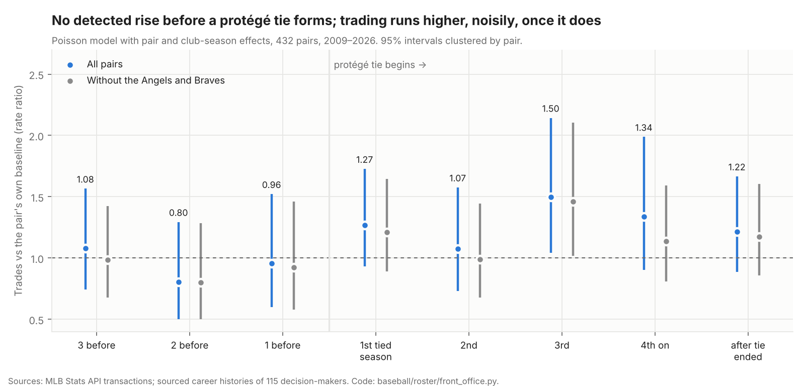

# Do front-office ties predict trade partners? MLB 2009–26

**League study from public data, a follow-up to [Who trades with whom](2026-trade-network-rivals.md).** That study found that the Angels' share of trades made with the Braves tripled after Perry Minasian, Alex Anthopoulos's former assistant GM, took over the Angels. This one tests whether ties like that predict trading across all 30 clubs. It is observational: it counts completed trades, and the main test compares each pair of clubs with itself across seasons.
*Written 2026-10-13, revised 2026-10-14; Dylan Fanelli; Data: MLB Stats API transactions (3,273 two-club trades, Apr. 2009 – Sept. 2026); career histories of 115 club decision-makers (825 front-office stints, each with a source URL, researched Oct. 13, 2026); Baseball-Reference team pages (front-office listings, 1998–2026); Code: `baseball/roster/front_office.py` (`bb front-office`), `baseball/roster/front_office.cypher`, `baseball/roster/executive_careers.json`; Reviewed in a separate pass three times (Oct. 13–14); findings addressed*



## Summary
- **Confirmed: front-office ties go with modestly more trading, about 14–18%.**
  - **The estimate:** a pair of clubs trades 1.18 times as often in seasons when their decision-makers share front-office history as in the same pair's other seasons (95% interval 1.04–1.34, p = 0.009).
  - **The comparison:** it holds each pair's own baseline and each club's trading volume that season fixed.
  - **Permutation check:** rotating each pair's tied seasons to other positions gives an effect at least this far from 1 in 14 of 1,000 draws (two-sided p = 0.015).
  - **Without the Angels and Braves:** 1.16 (1.02–1.31), p = 0.020. It also holds across pairs and on stints with stated years only.
  - **How hires near a season's end are dated moves the size:** 1.14–1.18 (p = 0.009–0.044) across three rules. Under the August rule with the stricter standard errors it reaches p = 0.059. The 18% is the upper end.
- **Borderline at best: the narrowest tie, a protégé facing his old boss.** This is a decision-maker who once worked below the president/GM level in a front office that the other club's current decision-maker ran, as Minasian did under Anthopoulos.
  - **The estimate:** 1.19 (0.997–1.42), p = 0.054.
  - **The permutation check doesn't confirm it:** two-sided p = 0.11.
  - **Stronger in two variants:** with Baseball-Reference's listings added, 1.24 (1.05–1.47), p = 0.013; on stints with stated years only, 1.23 (1.02–1.47), p = 0.029.
  - **Without the Angels and Braves:** 1.13 (0.96–1.33), p = 0.15, which is not significant.
- **No detected rise before a protégé tie forms.** In the three seasons before it starts, the pair trades at 0.80–1.08 times its usual rate (p = 0.37–0.85). The intervals reach 1.29–1.57, so a rise as large as the effect itself can't be ruled out.
- **The kinds of tie can't be told apart.** Former employer (1.18, p = 0.042, borderline: 0.060 under the earlier dating rule), former colleagues (1.13, p = 0.058) and protégé (1.19, p = 0.054) all lean the same way. They overlap too much for a joint model to credit any one of them (each p ≥ 0.18).
- **The broad tie doesn't depend on the Angels and Braves; the protégé tie does.**

## What a club can do with it
1. **Count a front-office tie as a small bump to a partner's prior, not a strategy.**
   - **The size:** about +14% to +18% on how often a pair trades, depending on the dating rule. The main estimate's interval runs from +4% to +34%.
   - **For scale:** division rivalry moves the same rate by −45%.
2. **Rank partners on what moves the rate more first:** each club's trading volume and whether the pair shares a division. Then a tie.
3. **Don't build on one pair's story.** Angels–Braves is one of 107 pairs whose protégé status changed. Without it the protégé estimate falls to 1.13 (p = 0.15).

## Findings

### 1. Ties within each pair of clubs
**The model:** two-club trades per pair-season, Poisson regression with a fixed effect for every pair (432 pairs; the 3 pairs that never traded carry no information) and for every club-season, so each club's trading volume that season is held fixed. Standard errors are clustered by pair. 7,776 pair-seasons, 2009–2026.

| Tie (that season, from history before it) | Tied pair-seasons | Rate ratio (95% interval) | p | Reading | Without the Angels and Braves |
|---|---|---|---|---|---|
| **Any tie** | 1,454 | **1.18 (1.04–1.34)** | **0.009** | Confirmed | 1.16 (1.02–1.31), p = 0.020 |
| Former employer | 1,025 | 1.18 (1.01–1.38) | 0.042 | Borderline (0.060 under the earlier dating rule; 0.057 with stricter standard errors) | — |
| Former colleagues | 907 | 1.13 (0.996–1.29) | 0.058 | Borderline | — |
| Protégé | 395 | 1.19 (0.997–1.42) | 0.054 | Borderline | 1.13 (0.96–1.33), p = 0.15 |

- **The three in one model:** 1.12 (p = 0.18), 1.04 (p = 0.65) and 1.08 (p = 0.51).
- **Why the comparison works:** 229 pairs change tie status at least once as executives move (107 for the protégé tie), which gives the model its within-pair comparisons.
- **The permutation check:** for each pair with any tied season, its pattern of tied and untied seasons is rotated to a random offset and the model refit, 1,000 times.
  - **No built-in lean:** the rotated estimates center on 0.99 for both ties.
  - **Two-sided p:** 0.015 for any tie (14 of 1,000 rotations at least as far from 1) and 0.11 for the protégé tie (106 of 1,000).
  - **Monte Carlo error:** 0.007–0.023 for any tie and 0.087–0.126 for the protégé tie (±2 standard errors).
  - **Any tie:** the permutation p agrees with the cluster-based one (0.009).
  - **Protégé tie:** the permutation p is about twice the cluster-based one (0.054). Of the 106 rotations at least as far from 1, 32 came out at 1.19 or higher and 74 at 0.84 (1/1.19) or lower, so the protégé result is weaker than its cluster p suggests.
  - **Why the two differ:** the rotations are skewed low. On the upper tail alone the two tests nearly agree (one-sided 0.033 by rotation, 0.027 by cluster). The heavy lower tail suggests rotated seasons aren't fully interchangeable; one possible cause is the thinner 2009–11 records.

### 2. Before and after a protégé tie forms
The event-study terms are seasons relative to the first season of a pair's protégé tie. The reference is never-tied pairs, and tied pairs more than three seasons before their tie.

| Seasons from tie onset | Pair-seasons | Rate ratio (95% interval) | p | Without the Angels and Braves |
|---|---|---|---|---|
| 3 before | 89 | 1.08 (0.74–1.57) | 0.69 | 0.98 |
| 2 before | 94 | 0.80 (0.50–1.29) | 0.37 | 0.80 |
| 1 before | 95 | 0.96 (0.60–1.52) | 0.85 | 0.92 |
| First tied season | 107 | 1.27 (0.93–1.73) | 0.13 | 1.21 |
| Second | 80 | 1.07 (0.73–1.58) | 0.72 | 0.99 |
| Third | 64 | 1.50 (1.04–2.14) | 0.028 | 1.46 |
| Fourth on | 144 | 1.34 (0.90–1.99) | 0.15 | 1.14 |
| After the tie ended | 584 | 1.22 (0.89–1.67) | 0.22 | 1.17 |

- **No detected rise before onset; higher after.**
  - Every tied season is above 1.0.
  - Only the third tied season is significant on its own, and the seasons don't form a trend. The figure shows the same comparison.
- **After the tie ends, trading stays about as high as while tied** (1.22, not significant). That fits either a working relationship that outlasts the jobs or a pair-level trend that the tie only marks. The data can't separate the two.
- **What doesn't follow:** this doesn't support timing a call to a protégé's first or third year in charge.

### 3. Ties across pairs
**The model:** the same, without pair fixed effects, adding a same-division indicator (each season's alignment). It asks whether tied pairs trade more than untied pairs, not whether a pair trades more once it becomes tied.

| Term | Rate ratio (95% interval) | p |
|---|---|---|
| Any tie | 1.15 (1.04–1.26) | 0.004 |
| Protégé tie | 1.17 (1.01–1.36) | 0.036 |
| Same division (in the any-tie model) | 0.55 (0.48–0.64) | < 0.001 |

- **The two comparisons agree.** The within-pair and across-pair estimates are about the same size.
- **What the within-pair model rules out:** a fixed closeness between two clubs, which the pair effects absorb.
- **What it doesn't rule out:** something that changes over time along with the tie, such as a hire that coincides with a rebuild.

### 4. Sensitivity
| Version | Any tie | Protégé |
|---|---|---|
| Main (researched decision-makers and careers; September hires count from the next season) | 1.18 (1.04–1.34), p = 0.009 | 1.19 (0.997–1.42), p = 0.054 |
| September hires counted in that season (the earlier rule) | 1.16 (1.02–1.31), p = 0.023 | 1.19 (0.998–1.42), p = 0.053 |
| August hires also counted from the next season | 1.14 (1.00–1.30), p = 0.044 | 1.15 (0.95–1.39), p = 0.14 |
| Adding Baseball-Reference's listings | 1.14 (1.00–1.30), p = 0.042 | 1.24 (1.05–1.47), p = 0.013 |
| Only stints with stated years | 1.18 (1.03–1.35), p = 0.015 | 1.23 (1.02–1.47), p = 0.029 |

- **Adding Baseball-Reference's listings** means its presidents and GMs count as decision-makers (business-side presidents such as Mark Shapiro in Toronto included, owners not), and its 1998–2026 president, GM, farm director and scouting director seasons count as career history.
- **The dating rule:** see Method.
  - **What it changes:** moving September hires changes the any-tie status of 33 pair-seasons and the protégé status of 30.
  - **Any tie:** p < 0.05 under all three rules (0.009–0.044). The size runs 1.14–1.18.
  - **Protégé:** borderline or not significant under each rule.
  - **Former employer:** it depends on the rule (0.042 now, 0.060 under the earlier rule), so it is read as borderline.
- **Wider standard errors:** a stricter small-sample correction, which also counts the fixed effects, widens standard errors by about 7%.
  - **Main results:** any tie p = 0.014, and 0.029 without the Angels and Braves. Protégé p = 0.070.
  - **Former employer:** 0.042 moves to 0.057, past 0.05. Former colleagues: 0.058 to 0.075.
  - **Variants that cross 0.05:**
    - Any tie with Baseball-Reference's listings: 0.042 to 0.057.
    - Any tie under the August rule: 0.044 to 0.059.
    - Any tie without the Angels and Braves under the earlier rule: 0.049 to 0.065.
  - **Protégé variants:** on stated-year stints the protégé tie moves to 0.040; with Baseball-Reference's listings, to 0.020.
  - **Verdicts:** the any-tie verdict stands in the main data. The protégé tie stays borderline, and former employer is borderline.
- **Fixed-effects bias:** with club-season and pair effects, Poisson estimates can carry a small bias, and cluster standard errors tend to run small (Weidner and Zylkin, 2021). The permutation test doesn't rely on those standard errors.

### 5. The data
- **Decision-makers.** Every club's president of baseball operations (or equivalent) and general manager in every season, interim GMs included: 115 people, 181 dated roles.
  - **Who counts in a season:** someone who held the job in that season's trading, by hire and departure dates (see Method).
  - **Offseason-only roles count for no season (13).** Among them:
    - Tony LaCava (Toronto, Nov. 2015)
    - Kevan Graves (Pittsburgh, Nov. 2019)
    - Jared Porter (Mets, Dec. 2020 – Jan. 2021)
    - Jed Hoyer's five weeks as Red Sox co-GM
    - Boston's four-person committee (Sept. 9 – Oct. 25, 2019)
    - John Hart's month as Atlanta's interim GM (Sept. – Oct. 2014)
  - **The independent check:** in 532 of 540 club-seasons, Baseball-Reference's listed president or GM is among the researched decision-makers. The eight differences:
    - Seven are hires in a season's last weeks, which Baseball-Reference credits to that season: David Forst 2015, John Hart 2014, Jeff Bridich 2014, Billy Eppler 2015, David Stearns 2015, Matt Klentak 2015 and Jerry Dipoto (Seattle) 2015.
    - The eighth is LaCava's offseason interim role.
- **Careers.** 825 front-office stints at MLB clubs, each with a source URL (MLB.com, club releases, Baseball-Reference Bullpen, Wikipedia, news reports). They become 2,853 person-club-seasons.
  - **Uncertain years:** 178 stints (22%) have inferred years and are flagged; the stated-years row above drops them.
  - **Excluded from ties:** 15 business-side jobs (public relations, marketing, sales, legal) and 6 consulting stints stay on the record but don't create ties.
  - **The review's check:** a sample of 15 stints checked against their sources found no club or year errors in the 14 it could verify. Two sources supported the role but not one end year, and one didn't support the title as written.
- **Tie errors push toward no effect.** A misdated stint or a missed tie mixes tied and untied seasons, which pulls estimates toward 1.0.

## Method
- **Grain.** A pair-season: two clubs in one baseball year, 2009–2026, with their two-club trades (0 if none). 435 pairs × 18 = 7,830.
- **Seasons.** Trades and jobs use one calendar: October 1 starts the next season.
  - **Trades:** a trade on Dec. 20, 2023 counts toward 2024.
  - **Jobs, from hire and departure dates:**
    - A hire in September or later counts from the next season. Only 2.5% of trades fall in September, so a September hire runs almost none of that season's trading.
    - A departure before April doesn't count that season.
    - Example: a hire on Nov. 12, 2020 counts from 2021, as does one on Sept. 30, 2020.
  - **Why it matters:** this is when a new decision-maker first deals with his old club. An earlier draft dated trades by calendar year, which scored those first-offseason trades as untied and hid the effect.
  - **A disclosed change:** the first revision counted September hires in that season. The second review found the rule handled post-season September hires inconsistently, so it was replaced with the trading-share rule above.
    - **What the new rule overrides:** the researched start year, pushing it one season later, for 30 roles (David Stearns and Jerry Dipoto in 2015, for example).
    - **The effect on the result:** the change moved the any-tie estimate, so Sensitivity gives the earlier rule and an August cutoff alongside it.
- **Ties,** from each club's decision-makers in the season and their seasons of baseball-operations work before it:
  - **Former employer:** one club's decision-maker worked earlier in the other club's front office.
  - **Former colleagues:** the two worked in the same front office in at least two common seasons, or in one common season when neither held a decision role there. A handover from one to the other doesn't count.
  - **Protégé:** one worked in a front office below the president/GM level (holding neither job there that season) in a season when the other held a decision role there.
  - **Not ties:**
    - A GM under his own president in the same season, as a protégé. Jed Hoyer as Theo Epstein's GM in Chicago doesn't make him Epstein's protégé; his years as Epstein's assistant GM in Boston do.
    - Predecessors and successors.
    - Consultants.
    - The same person at both clubs in a mid-season move.
- **Model.** Poisson regression by iteratively reweighted least squares.
  - **Fixed effects:** pair and club-season, with each pair-season carrying both clubs' season effects.
  - **Standard errors:** cluster-robust by pair (G/(G−1) correction). Dyadic clustering by club gave smaller standard errors in the review's check, so pair clustering is the conservative choice.
  - **Check:** the estimator recovers a known effect on simulated data (tests).
- **Divisions** follow each season's alignment (Houston in the NL Central through 2012).
- **Permutation test.**
  - **The rotation:** for each pair with any tied season, its pattern of tied and untied seasons is rotated by a random offset within 2009–2026, and the model is refit. This is repeated 1,000 times (seed 11).
  - **Two-sided p:** (1 + the number of rotations whose estimate is at least as far from 1, in logs, as the real one) / 1,001.

## What this doesn't show
- **Why ties go with more trading.** Familiarity with the old club's players, trust, or simply knowing whom to call all fit. The data counts completed trades, not conversations.
- **Ties below the decision-maker.** Assistant GMs, scouting and analytics staff talk to other clubs every day. This study ties only the president and GM level to each other's careers.
- **Terms rather than counts.** A tie could change which players move or at what price. The first study found Angels–Braves deals no more lopsided than other trades, but that is one pair.
- **Mid-season changes.** A decision-maker hired in June counts for the whole season.
- **Other ties.** Shared agents, schools, analytics firms and ownership groups aren't in the data.

## Reproduce
```bash
uv run bb front-office --permute 1000   # team pages (cached), Neo4j tables, every model in this report (the permutation test takes about 80 minutes)
```
- **The library:**
  - Panels and models: `build_panel()` (`hire_cutoff=10` for the earlier dating rule), `report_tables()` (including the stricter standard errors), `permutation_p()`.
  - Ties: `tie_panel()`, and `role_seasons()` for the season rule.
  - Neo4j tables: `export_graph_tables()`.
- **Load the executives into Neo4j:** run `baseball/roster/front_office.cypher` after `trade_graph.cypher`.

## Sources
- MLB Stats API, `/api/v1/transactions`, read Oct. 13, 2026.
- Baseball-Reference team pages (front-office listings), 1998–2026, read Oct. 13, 2026.
- Career histories: one source URL per stint in `baseball/roster/executive_careers.json` (MLB.com, club press releases, Baseball-Reference Bullpen, Wikipedia, AP, ESPN, The Athletic and others), read Oct. 13, 2026.
- Weidner, M. and Zylkin, T. (2021), "Bias and consistency in three-way gravity models," *Journal of International Economics* 132.

---
© 2026 Dylan Fanelli. All rights reserved. See [LICENSE](../LICENSE).
