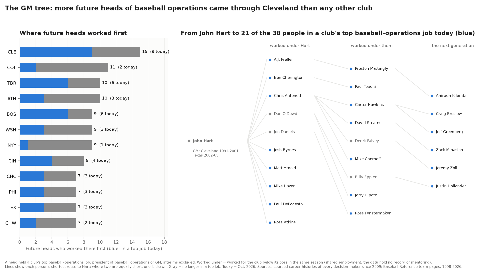

# The GM tree: whose front offices today's heads of baseball operations came through, and the path to the chair

**League study from public data, built as a graph in Neo4j.** Every club decision-maker since 2009 has a sourced career history in this repo, and Baseball-Reference's team pages add each club's GM, scouting director and farm director from 1998. Together they show who worked under whom. This study asks three questions:
- **Bosses:** which bosses had future heads of baseball operations working under them?
- **Clubs:** which clubs did future heads work for first?
- **The path:** how did today's heads get to the chair?

*Written 2026-10-20, revised the same day after a separate review pass; Dylan Fanelli; Data: the front-office graph `bb front-office` exports (391 executives, 1,315 dated jobs, 181 decision-maker stints); Code: `baseball/roster/gm_tree.py` (`bb gm-tree`), Neo4j loader `baseball/roster/gm_tree.cypher`, tests in `tests/test_gm_tree.py`*



## Summary
- **More future heads came through Cleveland than any other club.**
  - **Cleveland:** 15 people worked in its front office before their first head job, and 9 of them hold a club's top baseball-operations job today.
  - **Next:** Colorado with 11, then Tampa Bay and the A's with 10, and Boston, Washington and the Yankees with 9.
  - **Today's top jobs:** 38 people hold them (president of baseball operations or GM) at the 27 clubs with a permanent one. At 11 clubs a president and a GM both count.
- **John Hart's tree is the largest across generations and on PageRank.**
  - **Directly:** 14 future heads worked under him in Cleveland (GM 1991-2001) or Texas (2002-05). Four of them shared a single season with him.
  - **Counting two or more shared seasons:** he and Theo Epstein are tied at 10.
  - **Across generations:** 40 heads descend from him through the people who worked under him and the people who then worked under them. That includes 21 of today's 38.
  - **PageRank:** he ranks first. A boss scores high when the people under him went on to have future heads under them too. Sandy Alderson ranks second, because his tree runs through Billy Beane and Walt Jocketty.
- **Other large trees:**
  - **Epstein's Boston and Chicago:** 10 direct, 21 across generations.
  - **Dan O'Dowd's Colorado:** 9 direct, 20 across generations.
  - **Friedman's Tampa Bay:** 8 direct. Matt Silverman, who worked under Friedman and then succeeded him, is credited with 6, five of them also on Friedman's list.
  - **Jocketty's St. Louis and Cincinnati:** 8 direct.
  - **The overlap:** these trees cross. Ben Cherington worked under Hart, Dan Duquette and Epstein.
- **The path to the chair, for the 60 heads since 2009 with a job on record before it:**
  - **Time:** a median of 14 years from the first recorded front-office job; the middle half took 10-17.
  - **Former major-league players move fastest:**
    - Chris Young and Buster Posey took the top job with no club front-office job before it.
    - Sam Fuld took 3 years.
    - Brandon Gomes and Craig Breslow took 5.
  - **Assistant GM:** 45 of 60 (75%) held an assistant GM title first.
  - **Clubs:** a median of two clubs before the first head job.
    - 27 had worked for only one club. 15 of them got the job there, and the other 12 were hired away.
    - 35 of 60 (58%) were promoted from inside the club they then ran.

## How it's built
- **Head seasons.** The seasons a person held a club's top baseball-operations job:
  - **2009 on:** a non-interim decision role from the researched decision-maker list. A GM who works under a president counts.
  - **Before 2009:** a general manager title also counts.
  - **Interims:** interim, acting and committee roles don't count. A tenure listed as "interim, then permanent" counts from its start.
  - **Baseball-Reference's listings:** they show interim GMs as plain "General Manager". Those rows are dropped where the decision-maker list marks the season interim, and for four pre-2009 interims it doesn't cover (Mike Port 2002, Tom Lasorda 1998, Dave Wallace 2001, Bob Gebhard 2005, with sources in the code).
- **Bosses and heads.** A club's bosses in a season are the people with a head season there. A person became a head in his first head season.
- **Worked under.** A person who worked for a club, below its boss, in a season that boss ran it.
  - **Co-heads:** a president and a GM running a club together aren't each other's juniors.
  - **What the edge keeps:** the club and the first and last shared seasons.
  - **What it records:** shared employment only.
- **Future heads under a boss.** Someone who worked under the boss and later became a head, after their first shared season.
- **Trees and PageRank.** A boss's tree is every head below him, generation by generation.
  - **The PageRank:** it runs on the future-head edges, junior to boss, with damping 0.85.
  - **Two implementations:** `gm_tree.pagerank` in Python and Neo4j Graph Data Science's `gds.pageRank` on the same graph. They give the same top-12 order. GDS reports unnormalized scores; the Python version sums to 1.
- **Tests:** 13, on a fictional front office with the arithmetic in comments. They cover:
  - which titles and interims count, including Baseball-Reference's plain-title interims;
  - "interim, then permanent" tenures;
  - a pre-2009 GM beside a president;
  - who worked under whom, and descendants;
  - PageRank on a three-person chain, solved by hand;
  - the role patterns;
  - internal promotion;
  - today's heads.

## Results

**Bosses with the most future heads working under them**

| Boss | Future heads under him | Of them, 2+ shared seasons | Heads in the tree | PageRank | Who |
|---|---|---|---|---|---|
| John Hart | 14 | 10 | 40 | 0.061 | A.J. Preller, Ben Cherington, Bill Schmidt, Chris Antonetti, Dan O'Dowd, Jon Daniels, Josh Byrnes, Mark Shapiro, Matt Arnold, Mike Hazen, Neal Huntington, Paul DePodesta, Perry Minasian, Ross Atkins |
| Theo Epstein | 10 | 10 | 21 | 0.025 | Ben Cherington, Brian O'Halloran, Craig Breslow, Jared Porter, Jed Hoyer, Jeff Greenberg, Jerry Dipoto, Josh Byrnes, Mike Hazen, Scott Harris |
| Dan O'Dowd | 9 | 7 | 20 | 0.023 | Bill Schmidt, Billy Eppler, Jeff Bridich, Jerry Dipoto, Jon Daniels, Josh Byrnes, Matt Klentak, Michael Hill, Thad Levine |
| Walt Jocketty | 8 | 6 | 12 | 0.024 | Brad Meador, Dick Williams, Jeff Luhnow, Jeremy Zoll, John Mozeliak, Mike Elias, Mike Girsch, Nick Krall |
| Andrew Friedman | 8 | 8 | 12 | 0.023 | Brandon Gomes, Chaim Bloom, Erik Neander, James Click, Jeremy Zoll, Matt Arnold, Matt Silverman, Peter Bendix |
| Dave Dombrowski | 8 | 6 | 10 | 0.013 | Al Avila, Anirudh Kilambi, Brian O'Halloran, Dan Duquette, Jared Porter, Jim Hendry, Paul Toboni, Preston Mattingly |
| Mark Shapiro | 7 | 7 | 18 | 0.019 | Carter Hawkins, Chris Antonetti, Derek Falvey, Mike Chernoff, Mike Hazen, Neal Huntington, Ross Atkins |
| Billy Beane | 6 | 5 | 17 | 0.020 | David Forst, Farhan Zaidi, J.P. Ricciardi, Nick Krall, Paul DePodesta, Paul Toboni |
| Matt Silverman | 6 | 5 | 9 | 0.012 | Anirudh Kilambi, Chaim Bloom, Erik Neander, James Click, Matt Arnold, Peter Bendix |
| Chuck LaMar | 5 | 3 | 15 | 0.029 | Andrew Friedman, Chaim Bloom, Dan Jennings, James Click, Michael Hill |

PageRank's top three are Hart, Sandy Alderson (4 direct, 28 in the tree) and Kevin Towers (4 direct, 23). Alderson and Towers had few future heads under them directly, but those people built large trees of their own: Beane and Jocketty for Alderson, and Epstein for Towers.

**Where future heads worked first** (before their first head job)

| Club | Future heads | In a top job today | Who |
|---|---|---|---|
| CLE | 15 | 9 | Ben Cherington, Bill Schmidt, Carter Hawkins, Chris Antonetti, Dan O'Dowd, David Stearns, Derek Falvey, John Hart, Josh Byrnes, Mark Shapiro, Mike Chernoff, Mike Hazen, Neal Huntington, Paul DePodesta, Ross Atkins |
| COL | 11 | 2 | Bill Schmidt, Billy Eppler, Jeff Bridich, Jerry Dipoto, John Mozeliak, Jon Daniels, Josh Byrnes, Matt Klentak, Michael Hill, Thad Levine, Walt Jocketty |
| TBR | 10 | 6 | Andrew Friedman, Anirudh Kilambi, Chaim Bloom, Dan Jennings, Erik Neander, James Click, Matt Arnold, Matt Silverman, Michael Hill, Peter Bendix |
| ATH | 10 | 3 | Billy Beane, Dave Stewart, David Forst, Farhan Zaidi, J.P. Ricciardi, Nick Krall, Paul DePodesta, Paul Toboni, Sandy Alderson, Walt Jocketty |
| BOS | 9 | 6 | Ben Cherington, Brian O'Halloran, Jared Porter, Jed Hoyer, Jerry Dipoto, Josh Byrnes, Mike Hazen, Paul Toboni, Theo Epstein |
| WSN | 9 | 3 | Alex Anthopoulos, Bill Stoneman, Chris Antonetti, Dana Brown, Dan Duquette, Dave Dombrowski, Larry Beinfest, Mike Rizzo, Neal Huntington |
| NYY | 9 | 1 | Bill Schmidt, Billy Eppler, Brian Cashman, Brian Sabean, Doug Melvin, John Coppolella, Kim Ng, Pat Gillick, Tal Smith |
| CIN | 8 | 4 | Bill Schmidt, Brad Meador, Dan Jennings, Dick Williams, Jeremy Zoll, Matt Arnold, Nick Krall, Tal Smith |

**The path to the chair** (60 heads whose first head job came in 2009 or later, with a job on record before it)

| Measure | Value |
|---|---|
| Years from first recorded front-office job to first head job | median 14 (middle half 10-17; fastest 3, longest 40) |
| Clubs worked for before | median 2 (1: 27 heads; 2: 16; 3: 9; 4 or more: 8) |
| Worked for one club and got the job there | 15 of 60 (the other 12 one-club heads were hired away) |
| Held an assistant GM title first | 45 of 60 (75%) |
| Held a scouting role (area scout to scouting VP) | 32 of 60 (53%) |
| Held a player-development role | 23 of 60 (38%) |
| Was an amateur scouting director | 12 of 60 (20%) |
| Was a pro scouting director | 9 of 60 (15%) |
| Internship or entry-level job on record | 24 of 60 (40%, a floor) |
| Promoted from inside the club he then ran | 35 of 60 (58%) |

Five of the 15 without an assistant GM title came up through Tampa Bay: Bloom, Neander, Click, Silverman and Bendix.

## What it means for someone starting out
- **Today's heads came through a few rooms.** 18 of the 38 worked in Cleveland, Boston or Tampa Bay before their first head job.
  - **What the study can't say:** how much starting in one of those rooms raises anyone's odds. That would need a count of everyone who worked there.
- **The time is long.**
  - **Medians:** 13 years for heads first hired in 2009-17 and 14 for 2018-26.
  - **The exception:** former major-league players.
- **The assistant GM title is the usual step before the chair** (75%).
  - **Inside promotion:** more than half of heads (58%) were promoted from inside the club they then ran.
  - **Hired away:** 12 of the 27 heads who had worked for only one club were hired away by another.

## Limits
- **Worked under records shared employment only.** A person worked at the club, below the boss, in the same season. The data hold no record of mentoring.
  - **Big departments count more:** a big front office puts more people under one boss, so the counts reward large departments and long tenures as well as teaching.
  - **Thin edges count:** one shared season counts, including internships and a clubhouse job. The two-or-more-seasons column shows how much that matters: Hart's lead over Epstein disappears.
- **The sample is people who reached a head job or a director job Baseball-Reference lists.** People who never got that far are mostly missing.
  - **What follows:** this study can say where heads came from. It can't say what share of a club's interns became heads.
- **Coverage before 1998 is uneven.** It rests on the career histories of people who were decision-makers after 2009.
  - **Who that favors:** bosses who were active again after 2009, such as Hart (Atlanta 2015-17), Alderson, Gillick and MacPhail. They carry full careers.
  - **Who it misses:** contemporaries who weren't decision-makers after 2009 have no boss seasons before 1998, so the oldest trees are undercounted at the root.
- **Recent trees haven't had time to grow.** The median path is 14 years, so people now working under Friedman's Dodgers, Stearns or Bendix mostly can't have become heads yet.
- **The president-and-GM structure is newer.**
  - **Bosses per club-season:** 1.05 before 2008, 1.11 in 2008-14 and 1.38 since 2015.
  - **Shared credit:** recent bosses share credit, and a GM can be credited with a former peer. Anirudh Kilambi's line to Hart in the figure runs through one season under Preston Mattingly in Philadelphia.
  - **A lower bar:** "became a head" includes a GM under a president, which is a lower bar for recent hires.
- **Front offices have grown.** Recent biographies list more junior jobs, so recent bosses have more juniors on record. The entry-level share is a floor and isn't comparable across eras.
- **Hire dates follow the career records.** A few late-season hires are counted from the hire year and others from the next season, which can move a path by one year.
- **Trees overlap and aren't additive.** The 21 of today's heads in Hart's tree also appear in other trees.

## Neo4j
The study runs from the CSV tables in Python. The same graph loads into Neo4j next to the trade graph:
- **Load:** `bb gm-tree` writes `data/graph/learned_under.csv` and `heads.csv`. Then run `baseball/roster/gm_tree.cypher` with the import folder pointed at `data/graph`.
- **What it adds:** 927 `LEARNED_UNDER` relationships, 246 of them `produced_head: true`, plus a `first_head` year on 128 executives.

Example queries (also in the `.cypher` file):

```cypher
// Three generations of Hart's tree
MATCH p = (j:Executive)-[:LEARNED_UNDER*1..3 {produced_head: true}]->(:Executive {name: 'John Hart'}) RETURN p

// PageRank with Graph Data Science
MATCH (j:Executive)-[:LEARNED_UNDER {produced_head: true}]->(b:Executive)
WITH DISTINCT j, b WITH gds.graph.project('gmTree', j, b) AS g RETURN g.graphName;
CALL gds.pageRank.stream('gmTree') YIELD nodeId, score
RETURN gds.util.asNode(nodeId).name AS name, score ORDER BY score DESC LIMIT 15;
CALL gds.graph.drop('gmTree');
```

## Reproduce
```bash
uv run bb front-office --no-pull   # the graph tables, if data/graph/ isn't built yet
uv run bb gm-tree                  # tables, figure, and the Neo4j CSVs
```
