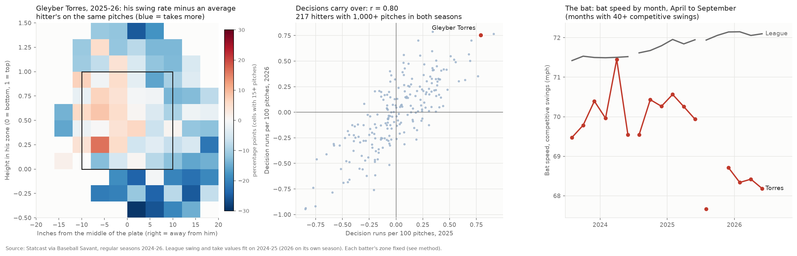

# Gleyber Torres (2B, free agent): a hitter evaluation built on swing decisions and bat tracking

**League study plus one decision, from public pitch data.** A swing-decision value model built on every regular-season pitch of 2024-26, tested for whether it holds from year to year and whether it predicts next season's results, then used to evaluate one hitter with a live 2026-27 decision.
- **The hitter:** Gleyber Torres, a free agent this winter, whose case turns on exactly the two things the model measures: some of the best swing decisions in baseball, and a bat that lost 2 mph in 2026.
- **The evaluation is data-informed, with no live look.** Throwing is NG (no grade); fielding and running are graded from Statcast's leaderboards. Health appears only as public reporting, cited.

*Gleyber Torres; 2B; B/T R/R; born Dec. 13, 1996 (29 on the report date; 2027 age 30); Detroit Tigers in 2026*
*Written 2026-10-18; Dylan Fanelli; Data: Statcast via Baseball Savant, 2,122,518 regular-season pitches a hitter could decide on (2024-26), 905 batters; Outside facts: dated public reporting, listed under Sources; Code: `baseball/evaluation/swing_decisions.py`*

**Status:** free agent. Torres played 2026 on Detroit's one-year qualifying offer of $22.025 million (MLB.com, Nov. 18, 2025). The Detroit Free Press (Sept. 27, 2026) reports him set to become a free agent, with the collective bargaining agreement expiring Dec. 1. A player who has received a qualifying offer can't receive another (MLB.com glossary), so signing him costs no draft pick.



## Summary
**Recommendation: sign Torres for two years, $28-32M guaranteed, with a 2029 club option.**
- **Price shape:** $14-16M a year, a 2029 club option near $16M with a $2M buyout, and plate-appearance escalators worth up to $2M a year.
- **Walk away** above $17M a year or at any third guaranteed year.
- **Value:** 1.50 WAR projected for 2027, worth $29.6M over two years at one price of a win; $25.0-34.2M with fielding two runs either side of his Statcast level.
- **Timing:** the agreement expires Dec. 1 and a lockout would freeze signings, so the offer goes in November.
- **Role:** an average regular at second base (50) if the bat speed comes back; a bat-first part-time second baseman and DH (45) if it doesn't. OFP 50. Risk: moderate to high, all of it health and bat speed.

**What the model found about swing decisions (league study).**
- **Decisions are a stable skill.** Decision value per 100 pitches correlated r = 0.80 from 2025 to 2026 (95% CI 0.75-0.85; 217 hitters with 1,000+ pitches both years) and r = 0.85 from 2024 to 2025 (0.81-0.89; 225 hitters). wOBA correlated 0.41 and 0.49 over the same pairs.
- **It becomes signal fast.** Half of a hitter's observed decision value is signal by 213 pitches, about 55 plate appearances.
- **It adds nothing to next season's wOBA forecast once wOBA and xwOBA are known.** Adding 2025 decision value to 2025 wOBA and xwOBA moved the 2026 wOBA prediction by −.002 per standard deviation (95% CI −.007 to +.002), and leave-one-out error didn't improve. The 2024 to 2025 test agrees (+.003, −.002 to +.007). This is a null, and it stays one.
- **Most of it is chase rate.** Chase and zone-swing rates explain 82-88% of its variance among regulars. The rest is a real skill too: it carries over at r = 0.35-0.53.

**What it says about Torres.**
- **Decisions:** +0.76 runs per 100 pitches in 2026, the 99th percentile of 302 regulars, after the 94th (2024) and 99th (2025). Regressed for 2027: +0.63 (95% interval +0.33 to +0.93), still near the top of the league.
- **Where the value comes from:** taking pitches out of the zone, mostly with two strikes. His decisions inside the zone are about average.
- **The bat:** 68.1 mph on competitive swings in 2026, down from 70.2 in 2025 and the 6th percentile of regulars. Net of the league's own rise it fell 2.3 mph, more than twice the usual year-to-year change (SD 1.0). His 90th-percentile exit velocity fell from 104.6 to 100.3 mph and his ISO to .103.
- **The single biggest question:** whether the 2 mph comes back after a winter without surgery. It fell after core (sports hernia) surgery in October 2025, was already down in April 2026 before either of that season's two oblique strains, and stayed down after both. Across the league, drops this large have mostly stayed.
- **Health:** three left oblique strains in 15 months (March 2025, May 2026, June 2026) plus the hernia surgery. Recurrence is its own risk, separate from the bat speed, and the contract pays for playing time through escalators instead of the guarantee.

## The decision model: findings
**Calibration (out of sample, same rules).** A model fit on 2024 alone, scored on 2025:
- **Swing value:** predicted and actual run value agree within 0.004 runs a pitch in every decile (top decile +0.045 predicted, +0.043 actual).
- **Take value:** within 0.006 in every decile.
- **Swing probability:** within 2.1 percentage points in every decile.

**The 2026 strike zone broke the old baseline, and the fix.**
- **What changed:** MLB defines the challenge-system zone as 53.5% of the batter's height at the top and 27% at the bottom (MLB press release, Sept. 23, 2025). From 2026 Statcast's `sz_top` and `sz_bot` follow it: every 2026 batter's bottom-to-top ratio is 27/53.5 to within rounding, with almost no pitch-to-pitch variation. That switch in the Statcast fields is what the data shows; I found no announcement of it. Before 2026 the zone was set from the batter's stance on each pitch, and its top sat about 0.2 ft higher (3.43 ft on average in 2025, 3.22 in 2026).
- **What it did to a naive model:** scored with each season's own Statcast zone, the 2024-25 model said the whole league made worse decisions in 2026 (−0.32 runs per 100 pitches, against about 0 in 2024 and 2025). That came from a development run; the saved run doesn't reproduce it.
- **The fix, in two steps:**
  - **One fixed zone per batter in every season:** his 2026 challenge-system zone, or for the 243 batters not seen in 2026, his stance zone mapped onto that scale by a line fit on the 545 batters seen in both. That cut the league gap to −0.04.
  - **2026 judged against the 2026 league:** the called zone itself changed (more low strikes, fewer high ones), so 2026 pitches are scored by a model fit on 2026. Its league average is +0.004, as designed.

**Reliability and carryover.**

| Measure | 2024 to 2025 | 2025 to 2026 |
|---|---|---|
| Hitters (1,000+ pitches both years) | 225 | 217 |
| Decision value, r (95% CI) | 0.85 (0.81-0.89) | 0.80 (0.75-0.85) |
| Decision value, true-talent ρ (95% CI) | 0.95 (0.91-0.99) | 0.89 (0.83-0.94) |
| Chase rate, r | 0.84 | 0.83 |
| Zone-swing rate, r | 0.80 | 0.79 |
| Whiff per swing, r | 0.86 | 0.88 |
| xwOBA, r | 0.66 | 0.62 |
| wOBA, r | 0.49 | 0.41 |
| Decision value beyond chase and zone swing, r (95% CI) | 0.53 (0.43-0.62) | 0.35 (0.23-0.47) |

- **Split-half constant:** M = 213 pitches in 2024-25 (210 in 2026). A full season of 2,500 pitches is 0.92 reliable.
- **True-talent spread:** SD 0.31 runs per 100 pitches (0.34 in 2026). Among regulars the observed SD is 0.33-0.35.

**Does it predict next season's wOBA beyond what's already known?** Target: next-season wOBA, weighted by next-season PA. Coefficient per 1 SD of decision value, with a hitter bootstrap (2,000 draws).

| Already in the model | 2024 to 2025 | 2025 to 2026 |
|---|---|---|
| wOBA | +.004 (−.001 to +.008) | −.001 (−.005 to +.003) |
| wOBA, xwOBA | +.003 (−.002 to +.007) | −.002 (−.007 to +.002) |
| wOBA, xwOBA, chase, zone swing, whiff | −.001 (−.010 to +.008) | +.002 (−.007 to +.011) |

- **Leave-one-out error** (wOBA, xwOBA base): .0272 to .0273 in 2024-25 and .0269 to .0270 in 2025-26. Adding decision value made the forecast no better.
- **The one borderline reading** (+.004 over wOBA alone, 2024-25, 95% of the bootstrap above zero by a hair) didn't replicate in 2025-26 and disappears with xwOBA in the model. By the repo's standard it's noise.
- **Why a stable skill can still add nothing:** a hitter's decisions are already in his wOBA, as walks, strikeouts avoided and weak contact avoided. Decision value describes how the line was built. It tells you which part of the line will hold, which matters most when the rest of the line is moving, as it is for Torres.

**Robustness.** Scoring 2025 with a model fit on 2024 alone (so 2025 values are fully out of sample) gives values that correlate 0.999 with the main ones, the same year-to-year r (0.80) and the same null (−.002, −.007 to +.002).

**What it relates to (regulars, 2024-26 pooled).** Decision value correlates −0.84 with chase rate, −0.18 with zone-swing rate, +0.29 with xwOBA, +0.22 with wOBA, −0.05 with bat speed and −0.24 with swing execution (run value on swings beyond the league's for those pitches).

## Gleyber Torres: the evaluation

### Grades
- **Scale:** 20-80 against MLB regulars (hitters with 1,000+ pitches in the season): grade = 50 + 10 × z, rounded to the 5-point scale. Present = 2026; future = his 2027-28 level at ages 30-31.
- **NG:** there's been no look. Run and field are graded from Statcast's sprint-speed and outs-above-average leaderboards; arm is NG because no public reading isolates it.

| Tool | Pres | Fut | The reading |
|---|---|---|---|
| **Hit** | 55 | 50 | **2026:** .260 AVG (z +0.45; league regulars .247) and .252 xBA (z +0.30). **2025:** .256 and .269 (84th percentile xBA). **2024:** .257 and .239 (44th). **Why it holds today:** 19.3% strikeouts, a 51.9% squared-up rate per contact (90th percentile) and the decisions below. **Future 50:** his three-year xBA is .253, about average, and a 6th-percentile bat at ages 30-31 has less time to wait on a pitch, which already shows in his later contact point (bat tracking, below) |
| **Raw power** | 35 | 40 | **2026:** 90th-percentile exit velocity 100.3 mph (z −1.44; 7th percentile) and max 106.9 (5th). **2025:** 104.6 and 110.9, a 50. **Future 40:** a partial return. A full return to 70 mph puts it back near 50; the league's base rate says to expect less (see the biggest question) |
| **Game power** | 40 | 40 | **2026:** .103 ISO (z −1.21), 8 HR in 420 PA, 4.0% barrels per PA (z −0.56). **2024-25:** .121 and .132 ISO, 15 and 16 HR. **Approach caps it:** he pulls fewer balls than almost any regular (28.7% in 2026; 6th percentile in 2024 and 2025) and his attack direction is among the most opposite-field in the league (4th percentile) |
| **Swing decisions** (not a standard tool; graded the same way) | 70 | 70 | +0.76 runs per 100 pitches (z +2.1); regressed +0.68 for 2026, +0.63 for 2027. 99th, 99th and 94th percentiles in 2026, 2025 and 2024 |
| **Run** | 35 | 30 | Sprint speed 25.3 ft/s in 2026, the 7th percentile of 567 players with 10+ competitive runs (26th in 2024, 20th in 2025), z −1.48 on a normal curve; FanGraphs baserunning −3.4 to −4.9 runs a season in 2024-26. **Future 30:** speed falls with age, and his already has. A published percentile, not a timing |
| **Field / Arm** | 40 / NG | 40 / NG | No look. Field from data: −5 outs above average at second base in each of 2024, 2025 and 2026 (−3, −4 and −3 fielding runs), a steady below-average range. Arm: no public reading isolates it, so no grade |

### What the decision model says
**The value is in the takes.**

| 2026, by attack region | Pitches | His swing % | Average hitter's | Decision runs |
|---|---|---|---|---|
| Heart | 405 | 77.8 | 73.8 | +1.1 |
| Shadow | 707 | 49.9 | 55.3 | +1.5 |
| Chase | 432 | 16.9 | 30.0 | +7.8 |
| Waste | 230 | 3.0 | 10.1 | +3.0 |

- **He attacks the heart.** He swings 4 points more often than an average hitter at pitches in the middle of his zone.
- **He gives up little on the edges.** He takes the shadow 5 points more often, and the model scores that as a small gain. Those pitches are close to break-even, so a take costs little.
- **He's at his best with two strikes:** +1.67 runs per 100 pitches with two strikes (562 pitches; 9.4 of his 13.4 decision runs), against +0.32 to +0.34 in every other count group. He swings 51.6% of the time with two strikes; an average hitter on the same pitches swings 60.7%.
- **By pitch family (2026):** +1.27 per 100 against changeups and splitters (188 pitches), +0.82 against breaking balls (527), +0.74 against fastballs (880), +0.09 against cutters (179).
- **Three seasons:** the same shape each year. Chase rate 21.3%, 17.1% and 18.9% (the 9th, 1st and 1st percentiles; lower is better), zone-swing rate 69%, 65% and 67% (about average).
- **Why his results lag his decisions.** His 2026 run value per 100 pitches (+0.12) splits into what an average hitter's choices would have earned on his pitches (+0.07), his decisions (+0.76), his swings' results against the league's on the same pitches (−0.60, 16th percentile) and his takes against their expected value (−0.10). In 2025 the swings cost −0.35 and the line was +0.55. The decisions held; the swing results fell.

### What bat tracking says

| Competitive swings | 2024 | 2025 | 2026 | 2026 percentile |
|---|---|---|---|---|
| Bat speed (mph) | 70.1 | 70.2 | 68.1 | 6 |
| Swing length (ft) | 7.25 | 7.16 | 7.01 | 23 |
| Attack angle (°) | 8.4 | 9.3 | 8.4 | 34 |
| Ideal attack angle rate (5-20°) | 52% | 57% | 54% | 67 |
| Attack direction (pull +, °) | −5.2 | −4.2 | −6.9 | 4 |
| Swing path tilt (°) | 34.5 | 34.1 | 34.7 | 75 |
| Squared-up per contact | 47% | 52% | 52% | 90 |
| Blast rate per contact | 12% | 16% | 10% | 7 |
| Contact point, inches in front of his hips | 30.8 | 30.4 | 28.7 | 24 |

- **The path is intact.** Attack angle, ideal-angle rate and tilt sit where they were. He still squares the ball up as often as ever.
- **The speed is gone, and the contact point moved back.** He met the ball 1.6-2.1 inches deeper in 2026, which fits a slower bat: later contact, fewer pulled balls (28.7% vs 34.7-34.9%), a lower average launch angle (9.4° vs 14.3-14.8°).
- **Contact point direction checked:** across regulars, contact farther out front correlates +0.35 with pull rate.
- **By month (competitive swings, 40+ per month):** 67.7 in April 2026, before either oblique strain; 68.7 in June; 68.3, 68.4 and 68.2 from July through September. In 2025 he held 70.3-70.6 from May to August, including the second half he played with the hernia.

### Where the eye test and the data might disagree
- **"He's passive."** The data says he's selective outside the zone and aggressive in it: he swings more than an average hitter at middle pitches and is about average on zone pitches overall. A scout watching him take borderline two-strike pitches will see passivity; the model scores those takes as his best decisions.
- **"He's declining, so the approach is going too."** The data separates the two. His decisions were elite in 2026 while his bat speed fell to the 6th percentile. The decline is in the bat.
- **"A .727 OPS second baseman is a utility player."** His .364 OBP was the 90th percentile of regulars, built on a 13.6% walk rate (94th). The decisions that produce it are the most stable thing on his card. The slugging is the open question.
- **"He looked healthy late in the year."** The bat speed didn't come back after either return from the injured list. A look can tell you if he moves freely; the bat-speed readings say the output stayed down.
- **Defense:** Statcast has him at −5 outs above average at second in each of the last three seasons (−3, −4 and −3 fielding runs), steady enough to grade from. A 2026 recap that called him three runs above average (*Detroit Tigers On SI*) doesn't match Statcast's own leaderboard. Scouts will grade his hands, first step and arm, and this report can't. The price uses −3.3 runs a season and shows two runs either side.

### Role, recommendation and price
**Projection (2027).**
- **wOBA .324:** his 2024-26 wOBA and xwOBA blended, weighted 5/4/3 by season and plate appearances (.334), regressed with 1,200 plate appearances of league average (.316, FanGraphs Guts 2026), less .003 for age.
- **Wins:** batting runs at a .316 league and 1.238 wOBA scale (+3.6 in the base case), replacement at 0.030 runs per PA (570 position-player wins at 9.82 runs per win over 183,846 PA; +16.7), second base +2.5 runs per 650 PA (+2.1), fielding −3.3 runs, baserunning −4.3 runs, 9.82 runs per win.
  - **Fielding:** Statcast fielding runs prevented at second base, −3, −4 and −3 in 2024-26 (outs above average −5 each year; Baseball Savant leaderboard, read Oct. 18, 2026), weighted 5/4/3 like the bat: −3.3. Range −5.3 to −1.3, two runs either side, because one season of fielding runs is noisy.
  - **Baserunning:** FanGraphs' BsR of −4.6, −3.4 and −4.9 runs in 2024-26 (665, 628 and 420 PA), weighted 5/4/3 like the wOBA blend: −0.0079 runs per PA. His sprint speed fell from 26.6 to 25.3 ft/s over 2024-26, the 7th percentile in 2026. The first version of this report left baserunning out and had the base case at 1.98 WAR; baserunning costs him 0.44 wins.
- **Value:** one price of a win, $11.66M in 2027 dollars (the rate I fit to 46 comparable free-agent contracts; FanGraphs' flat 2026 rate of $11.23M grown 3% gives $11.57M), rising 3% a year, discounted 10% a year, with the repo's aging path (−0.4 wins a year from 29; `baseball/roster/money.py`). One rate, with no tiers: FanGraphs' WAR bands describe average prices paid, and pricing on them puts a cliff at 2.0 WAR where one run of projection moves the value by millions.

| Scenario | wOBA | PA | 2027 WAR | Value, 1 year | Value, 2 years (present value) |
|---|---|---|---|---|---|
| The 2026 bat stays | .312 | 450 | 0.72 | $8.4M | $12.0M |
| Base | .324 | 550 | 1.50 | $17.5M | $29.6M |
| The 2025 bat comes back | .340 | 600 | 2.46 | $28.7M | $51.2M |

- **The two outer scenarios are judgment inputs, not fits:** the 2026 bat staying costs about .012 of wOBA and 100 plate appearances; the 2025 bat coming back adds .016 and 50.
- **The range around the base case, from fielding alone:** $25.0M (−5.3 runs, 1.30 WAR) to $34.2M (−1.3 runs, 1.71 WAR) over two years. The base value of $29.6M anchors the offer; the range is why the offer carries an option and escalators instead of a bigger guarantee.
- **Checks:** on FanGraphs' 2026 tiers the base case is worth $22.2M over two years (1.50 WAR prices at the 1-2 WAR rate). Without baserunning it would be 1.94 WAR and $39.5M at the one rate.
- **Market reference points:** one year, $15M with Detroit for 2025 (signed in December 2024), and the $22.025M qualifying offer he accepted for 2026.

**The recommendation.**
- **Two years, $28-32M guaranteed,** with a 2029 club option near $16M ($2M buyout) and plate-appearance escalators. The guarantee pays for the base case; the escalators pay for the playing time three oblique strains put in doubt; the option buys the 2025 bat if it returns, at a fraction of what that version is worth.
- **Walk away** above $17M a year or at a third guaranteed year. $17M a year for two years is $32.5M in present value, inside the range but above the base case. The low case is worth $12.0M over two years, so a longer guarantee puts the downside on the club.
- **If he insists on one year:** $15-18M, the base case's one-year value.
- **The incumbent's version of the same call:** Detroit faces the same numbers, with the advantage of its own medical file.

### The single biggest question
**Does the bat speed come back?**
- **The health history:** three left oblique strains and a core surgery in 15 months.
  - March 2025: left oblique strain hitting a home run in the second game of the season; 10-day injured list retroactive to March 29.
  - Second half of 2025: played hurt; sports hernia surgery Oct. 31, 2025.
  - May 2026: left oblique strain on May 2; injured list May 6, retroactive to May 4; back in early June.
  - June 2026: another left oblique strain after his June 15 game; injured list June 17; back July 20.
- **The case for a return:** the timing points to the surgery. His bat speed held through the 2025 strain (69.5 mph in April after he came back, 70.3-70.6 from May to August) and through a half-season of playing with the hernia. It was down in April 2026 (67.7), after the surgery and before either 2026 strain. A healthy winter is the thing he hasn't had since 2024.
- **The case against:** of 13 hitters whose bat speed fell 1.5+ mph net of the league from 2024 to 2025 (average −1.8) and who batted 1,000+ pitches in 2026, the average change the next year was +0.07 mph (95% CI −0.45 to +0.60). Over all 165 hitters with three straight seasons, on average about 14% of a year's change came back the next year. Bat speed also declines with age: −0.26 mph a year on average for hitters 29-31 in this sample. And three strains of the same muscle make a fourth more likely, whatever the bat does.
- **What would answer it before the bid:** the medical file on the core and oblique, and a winter session with a bat sensor. **The trigger:** 70 mph or better on competitive swings is the base or high case; 68 or under is the low case.

## Walk me through it
**"How is this different from chase rate?"**
- Chase rate explains about 70% of it on its own, and chase plus zone swing explain 82-88%. The difference is in the weighting: each decision counts by how much it was worth in that count, on that pitch type, at that spot.
- The part that isn't chase rate carries over from year to year (r = 0.35-0.53), so it's skill.
- For Torres the model adds one thing chase rate can't: his edge is two-strike takes, and he isn't passive in the zone.

**"Why should I believe one season?"**
- It's half signal by 213 pitches, and his 2026 season had 1,774 (0.89 reliable). He's also been 94th, 99th and 99th percentile in three straight seasons.

**"If it's that stable, why doesn't it predict next year's wOBA?"**
- It's already in his wOBA. The walks and the weak contact he avoids are in the line. Once wOBA and xwOBA are in the forecast, it adds −.002 per SD (95% CI −.007 to +.002). Its use is telling which part of a line will hold.

**"What does attack angle tell you?"**
- The vertical angle of the bat's path at contact. 5-20° is the range most likely to produce line drives and fly balls.
- Torres sits at 8.4° with 54% of swings in that range (67th percentile), unchanged from 2024. His launch angle fell because he met the ball later, and his path stayed put.

**"Is the bat-speed drop injury or age?"**
- The timing points to the surgery: the bat held through his 2025 oblique strain and was already down before the 2026 ones. The league says drops this size mostly stay. I'd price for both: guarantee the base case, and pay for the 2025 bat only through an option.

**"Why are his swings below average if he picks good pitches?"**
- Swing execution was −0.60 runs per 100 pitches, 16th percentile: on the pitches he swung at, his results trailed what the league gets there. That's the bat speed: 100.3 mph at the 90th percentile of exit velocity, 7th percentile.

**"How did you handle the 2026 strike zone?"**
- Statcast's 2026 zone is the challenge-system zone, fixed to height, so I gave every batter one fixed zone in all three seasons and judged 2026 against the 2026 league. Without that, the model said the whole league got worse at deciding.

**"Why two years?"**
- The base case is worth $29.6M over two years, and fielding alone moves that from $25.0M to $34.2M; the bat moves it from $12.0M to $51.2M. A third guaranteed year adds risk in the scenario we can't rule out. The option keeps the upside.

**"Why one price of a win instead of FanGraphs' tiers?"**
- The tiers are average prices paid by WAR band. Priced on them, a win below 2.0 WAR is worth $8.51M and a win from 2.0 up $12.84M (2026 dollars), so the first version of this report, at 1.98 WAR, was worth $30.3M over two years and the same player at 2.00 WAR $39.6M: a quarter of a run moved the value by $9M. One rate ($11.66M a 2027 win) moves smoothly, and the tiered answer is shown as a check ($22.8M).

## Method
**Grain:** one row per pitch a hitter could decide on, regular season. Removed: automatic balls and strikes, pitchouts, bunts, and unlabeled or rare pitch types (eephus, knuckleball).

**Context:** location in the batter's own zone (inches from the middle of the plate, mirrored so positive is away from him; height as a fraction of his fixed zone), the count, and the pitch family (fastball, cutter, breaking, offspeed).

**League values:** three gradient-boosted tree models (scikit-learn's histogram GBM, 250 rounds, at least 400 pitches a leaf), fit on 2024-25 and separately on 2026:
- **es:** expected run value of a swing (Statcast's `delta_run_exp`, the offense's view);
- **et:** expected run value of a take;
- **p:** the probability an average hitter swings.

**Decision value of a pitch:** (swing − p) × (es − et).
- An average decision-maker scores zero on every kind of pitch. A swing on a pitch worth swinging at earns more when most hitters would take it.
- **The raw sum of "the choice's value minus the alternative's"** equals 2 × decision value + (2p − 1)(es − et). The last term depends only on the pitches he was thrown, so it's kept out of the score.
- **Execution is kept out on purpose:** es values the swing at the league's results for that pitch, so his own contact quality goes into swing execution.

**Per hitter:** decision runs per 100 pitches, regressed toward the season's league mean with weight n / (n + M), M = 213 pitches, from split-half reliability (games split at random, 20 repetitions, `fit_reliability_constant`). Next-season estimates multiply the weight by the true-talent year-to-year correlation (ρ = 0.92, the mean of the two pairs). Intervals use `regress()` from the Reliability Atlas.

**Validation:** year-to-year Pearson r with Fisher intervals; true-talent ρ = r / √(reliability in each year); next-season wOBA by weighted least squares with a hitter bootstrap and leave-one-out error.

**Bat tracking:** Statcast's competitive swings (the fastest 90% of a batter's tracked swings plus any 60+ mph swing with a 90+ mph exit velocity).
- **Squared-up:** exit velocity at least 80% of 1.23 × bat speed + 0.2116 × release speed (Ben Clemens's rough version, via Davy Andrews). **Blast:** squared-up % + bat speed ≥ 164.
- **These two are this repo's calculation,** compared only with the league computed the same way. Savant's published rates will differ.

**Prior work this resembles, and what's different.**
- **Statcast's Swing/Take tool** (Baseball Savant, 2019) splits a hitter's actual run value by heart, shadow, chase and waste. It includes his contact results. This model values the choice at league results and leaves his contact to a separate term.
- **SEAGER** (Robert Orr, *Baseball Prospectus*, fall 2023) classifies each pitch as hittable or not (swing value above take value) and scores selection tendency against hittable pitches taken. Torres was in its 97th percentile in June 2025 (*Bless You Boys*). This model keeps the size of each decision in runs.
- **Swing Decision Run Value** (Drew Haugen, *Down on the Farm*, Feb. 2023) values swing decisions in runs; the post is paywalled, so I haven't checked its method. **SOTO** (Adam Salorio, Sept. 2024) models expected swing and take run values from location and count. It treats all pitch types alike and assumes every hitter has the same damage zone.
- **Discipline Score** (Wuhuan Deng and Scott Nestler, arXiv, Nov. 2025) scores swings at balls against the league's swing probability.
- **What this adds:** the average hitter's swing probability and the run gap in one score, pitch family in the context, a zone fixed per batter that survives the 2026 rule change, a measured regression constant, and a published out-of-sample test of whether it adds to next season's forecast (it doesn't).

## What this doesn't show
- **His own counterfactual.** The model values every swing at league results for that pitch. For a hitter with a slower bat, some of the pitches he takes are worth less to him than to the league, so his decision value is likely a little high. Decision value and swing execution correlate −0.24 among regulars, which is consistent with that.
- **Defense, running, throwing:** no look. Field and run are graded from Statcast leaderboards and arm is NG. The price uses Statcast's fielding runs (−3.3 a season, two runs either side) and FanGraphs' baserunning runs.
- **Medical:** public injured-list and surgery reporting only. The biggest question is a medical one.
- **Base-out state:** run values average over runners and outs; the model doesn't condition on them.
- **Small samples:** whether decision value helps forecast part-time hitters (300-999 pitches), where it should matter most because it stabilizes faster than wOBA, is untested: a development run (not reproduced by the saved run) had 44-52 such hitters a year with full seasons after, too few to say.
- **The 2026 rules are one season old:** one season of the challenge system. The 2026 league model may move as hitters and umpires adjust.
- **Market:** the price comes from the repo's $/WAR and his own past contracts. The next agreement may change the market itself (MLB's June 2026 proposal includes a payroll cap).

## Reproduce
```bash
uv run python -m baseball.evaluation.swing_decisions --figure reports/figures/2026-hitter-evaluation-torres.png
# about 2.5 minutes and 1.5 GB; any hitter: --batter <MLBAM id> --name "First Last"
uv run pytest tests/test_swing_decisions.py
```
**Outputs** in `data/edge/swing_decisions/`: `summary.json` (the study's numbers, the hitter card and the projection and price under `"price"`) and `hitter_seasons.parquet` (decision value, results and bat tracking for every batter-season). Two development runs quoted above (the naive 2026 gap and the part-time hitters) are not in the saved outputs. The projection and price come from `torres_price()` in the same module, which reads the card's season lines and the sourced inputs in `TORRES_INPUTS`; `baseball/roster/money.py` supplies the aging path and the tiered check. The `data/` folder isn't published, so the outputs exist only on a machine that has run the code.

## Sources
- **Pitch data:** Statcast, MLB Advanced Media, via [Baseball Savant](https://baseballsavant.mlb.com/) (regular seasons 2024-2026, pulled through October 2026).
- **League constants:** [FanGraphs Guts!](https://www.fangraphs.com/guts.aspx?type=cn) (2026: wOBA .316, scale 1.238, 9.822 runs per win), read 2026-10-18.
- **Torres's status and health:**
  - Jared Ramsey, "Tigers' Gleyber Torres, Jack Flaherty face free agency uncertainty," *Detroit Free Press* via [Yahoo Sports](https://sports.yahoo.com/articles/tigers-gleyber-torres-jack-flaherty-231138431.html), Sept. 27, 2026.
  - "Tigers' Gleyber Torres Reaches $22 Million Ending," *Heavy* via [Yahoo Sports](https://sports.yahoo.com/articles/tigers-gleyber-torres-reaches-22-145818812.html), Sept. 29, 2026.
  - Jason Beck, "Torres accepts Tigers' 1-year qualifying offer for 2026," [MLB.com](https://www.mlb.com/amp/news/gleyber-torres-accepts-qualifying-offer.html), Nov. 18, 2025 (also the source for his one-year, $15M deal for 2025).
  - Dawn Klemish, "Torres to undergo hernia surgery after playing 2nd half injured," [MLB.com](https://www.mlb.com/news/gleyber-torres-to-have-offseason-hernia-surgery-after-playing-injured), Oct. 11, 2025.
  - Jason Beck, "Gleyber (sports hernia surgery) expected to be ready for spring," [MLB.com](https://www.mlb.com/tigers/news/gleyber-torres-has-sports-hernia-surgery), Oct. 31, 2025.
  - Detroit Tigers transactions, [MLB.com](https://www.mlb.com/tigers/roster/transactions/2025/03), March 2025: placed on the 10-day injured list March 31, 2025, retroactive to March 29, left oblique strain; "Detroit Tigers place Gleyber Torres on injured list," [*Detroit Tigers On SI*](https://www.si.com/mlb/tigers/news/detroit-tigers-place-gleyber-torres-injured-list-recall-slugger-from-triple-a), March 2025 (hurt hitting a home run in the second game of the season).
  - "Tigers place Gleyber (oblique) on 10-day IL, recall Jung from Triple-A," [MLB.com](https://www.mlb.com/tigers/news/gleyber-torres-placed-on-injured-list), May 6, 2026.
  - "Tigers Place Gleyber Torres On IL, Activate Casey Mize," [MLB Trade Rumors](https://www.mlbtraderumors.com/2026/06/tigers-gleyber-torres-injured-list-again-oblique-casey-mize-return.html), June 17, 2026.
  - "Gleyber Torres returns to the Detroit Tigers after being sidelined by an oblique injury," AP via [WTOP](https://wtop.com/sports/2026/07/gleyber-torres-returns-to-the-detroit-tigers-after-being-sidelined-by-an-oblique-injury/), July 2026.
- **Defense and running:**
  - Baseball Savant, [outs-above-average](https://baseballsavant.mlb.com/leaderboard/outs_above_average) and [sprint-speed](https://baseballsavant.mlb.com/leaderboard/sprint_speed) leaderboards, 2024-26, read Oct. 18, 2026 (fielding runs, outs above average, sprint speed and its percentile).
  - Dominic Minchella, "Grading Gleyber Torres' Career with the Detroit Tigers," *Detroit Tigers On SI* via [Yahoo Sports](https://sports.yahoo.com/articles/grading-gleyber-torres-career-detroit-170003986.html), Sept. 28, 2026 (2026 fielding).
  - [FanGraphs player page](https://www.fangraphs.com/players/gleyber-torres/16997/stats/batting), read 2026-10-18 (BsR by season).
- **The 2026 strike zone:** "MLB announces ABS Challenge System coming to the Major Leagues beginning in the 2026 season," [MLB.com press release](https://www.mlb.com/press-release/press-release-mlb-announces-abs-challenge-system-coming-to-the-major-leagues-beginning-in-the-2026-season), Sept. 23, 2025.
- **Qualifying offer rules and 2026 amount:** [MLB.com glossary, "Qualifying Offer"](https://www.mlb.com/glossary/transactions/qualifying-offer), read 2026-10-18.
- **Swing-decision frameworks:**
  - Do-Hyoung Park, "Evaluating Twins' swing/take results from 2019," [MLB.com](https://www.mlb.com/news/twins-swing-take-results-from-2019-season), Jan. 3, 2020 (Statcast's Swing/Take regions).
  - Robert Orr, "SEAGER at the Team Level," [*Baseball Prospectus*](https://baseballprospectus.com/?p=86926), Nov. 29, 2023.
  - Sky Kalkman, ["Simple Seager"](https://skykalkman.substack.com/p/simple-seager), May 9, 2024 (SEAGER's definitions).
  - "Gleyber Torres is hitting like SEAGER in 2025," [*Bless You Boys*](https://www.blessyouboys.com/2025/6/23/24449816/detroit-tigers-analysis-gleyber-torres-corey-seager), June 2025.
  - Drew Haugen, ["Introducing Swing Decision Run Value"](https://downonthefarm.substack.com/p/introducing-swing-decision-run-value), *Down on the Farm*, Feb. 28, 2023.
  - Adam Salorio, ["Introducing My Swing Decision Model"](https://adamsalorio.substack.com/p/introducing-my-swing-decision-model), Sept. 3, 2024, and ["A Closer Look at Swing Decision Metrics"](https://adamsalorio.substack.com/p/a-closer-look-at-swing-decision-metrics).
  - Wuhuan Deng and Scott Nestler, ["Introducing Discipline Score Based on League Overall Swinging Probability"](https://arxiv.org/abs/2511.19672), arXiv, Nov. 26, 2025.
- **Bat-tracking definitions:** MLB.com glossary, ["Blasts"](https://www.mlb.com/glossary/statcast/bat-tracking-blasts), ["Squared-up"](https://www.mlb.com/glossary/statcast/squared-up) and ["Intercept point"](https://www.mlb.com/glossary/statcast/intercept-point), read 2026-10-18; Davy Andrews, ["When Squaring It up Goes Sideways"](https://blogs.fangraphs.com/when-squaring-it-up-goes-sideways), *FanGraphs*, June 14, 2024.
- **Free-agent price of a win:** Ben Clemens, "What Are Teams Paying for a Win in Free Agency? 2026 Edition," *FanGraphs*, Feb. 24, 2026 (the flat rate cross-check and the tiered check, as used in `baseball/roster/money.py`). The $11.66M rate is my own fit to 46 comparable free-agent contracts; the FanGraphs rate is the public cross-check.

---
© 2026 Dylan Fanelli. All rights reserved. See [LICENSE](../LICENSE).
