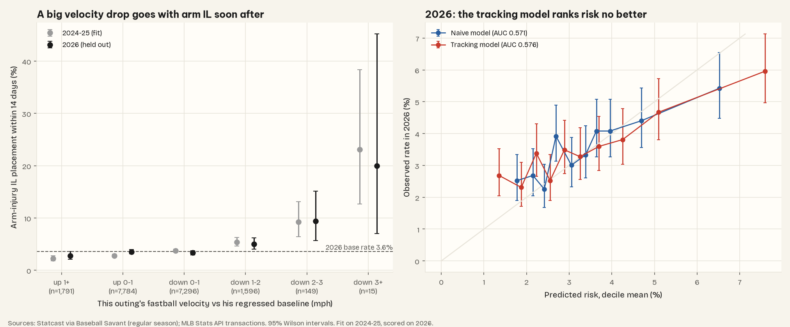
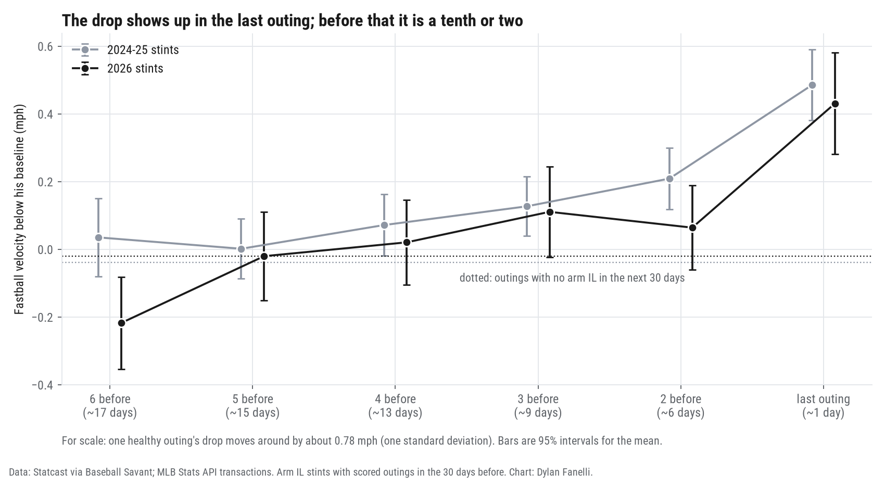

<!-- portfolio:header -->
<sub>[← Portfolio](../README.md) &nbsp;|&nbsp; [← Development plan](2026-development-plan.md) &nbsp;|&nbsp; [Roster and CBA engine →](2026-roster-cba-engine.md)</sub>
<!-- /portfolio:header -->

# Velocity drops as an injured-list warning: what public pitch data can tell a medical staff (MLB 2024–26)

<!-- portfolio:glance -->
<p>     </p>

**At a glance**

- **The question:** Does a drop in a pitcher's velocity or stuff, against his own regressed baseline, warn of an injured-list stint?
- **The answer:** Mostly late. A fastball 2+ mph below his baseline was followed by an arm IL stint within 14 days 10.4% of the time in 2026 (base rate 3.6%). The drop shows up in the last outing before the stint; two or three outings back it averages a tenth or two of a mph, inside one outing's noise. On the broadcast, 4 of the 17 flags that ended in an arm stint looked hurt; on the other 13 nobody left hurt. As a forecast, tracking data adds no detectable gain to role, workload and IL history (AUC +0.006, -0.021 to +0.032); the in-game fade and secondary-pitch velocity add nothing either, and a repeat-flag rule didn't hold on 2026.
- **For a club:** A same-day trainer check that costs about five false alarms per club-season, worth most on the flags that look normal on TV, and a reason not to buy an injury forecast built on public pitch data. A public-data passion project; a club's own data would do better.
<!-- /portfolio:glance -->

**League study from public pitch data, public transactions and the game broadcasts.**
- **Scope:** every regular-season outing by a pitcher in 2024–26 (Statcast), matched to every IL placement in the MLB Stats API transactions, plus 34 flagged outings watched on MLB.TV.
- **Out of sample:** every parameter of the first study (noise model, month curve, the three forecasting models, the alert threshold) is fit on 2024–25 only. 2026 is the test.
- **Observational:** a velocity drop and an IL placement can share a cause the data can't see. Nothing here says a drop causes an injury.

*Written 2026-11-15; updated 2026-11-24 after a separate review pass; rerun and extended 2026-11-28 (the injury-wording and pitch-clock fixes, the run-up, two new signals, repeat flags and the broadcast study); Dylan Fanelli; Data: Statcast via Baseball Savant, 2,141,219 regular-season pitches, 7,288 games, 62,361 pitcher outings, 1,310 pitchers; MLB Stats API transactions 2023–26; MLB.TV archived broadcasts; Code: `baseball/health/il_warning.py` (`bb il-warning 2026`), `baseball/health/il_followup.py`, `scripts/il_figures.py`; Saved outputs: [`il-warning-2026.json`](outputs/il-warning-2026.json), [`il-followup-2026.json`](outputs/il-followup-2026.json), [`il-video-coding-2026.json`](outputs/il-video-coding-2026.json); Builds on [the Reliability Atlas](2026-reliability-atlas.md)*

## Why public data, and what this can't see

A club would run this study better than I can. Its medical and performance staff see bullpen and catch-play velocity, strength and range-of-motion screens, workload from every throw, minor-league outings and what the pitcher tells the trainer. I see the pitches thrown in major-league games, the transaction wire and the TV broadcast. So I don't expect public data to beat a club's own injury model, and the answer below is mostly that it can't.

I did it anyway, as a passion project: to see whether I, with public data of all places, could find something about pitcher injuries that nobody had pinned down. What I found is not a forecast. It's a clear picture of where the public signal lives and why it rarely comes earlier:
- **The velocity drop shows up in the last outing before the IL, not the weeks before.** Two and three outings back, the average drop is a tenth or two of a mph. One healthy outing moves around by about 0.78 mph, so a tenth or two is invisible for any one pitcher. The flag on outings before the last one still ran about twice the base rate in both periods, but that wasn't confirmed on 2026.
- **4 of the 17 flagged outings that ended in an arm stint looked hurt on the broadcast.** A trainer came out or the pitcher left, and the placement followed the next day. On the other 13, nobody left hurt; 12 were coded as looking normal and one as maybe, though announcers raised velocity on three. That's where the public flag tells a viewer something the broadcast doesn't.
- **None of the extra signals I could build from public data adds a confirmed signal:** not spin, shape or release (one release-height lead aside), not the velocity fade within a game, not breaking-ball or changeup velocity, and not a flag that repeats.

## Answer
- **A big velocity drop is a real warning sign, but it comes late.**
  - **The association replicates on 2026.** After an outing whose fastball sat 2–3 mph below the pitcher's own regressed baseline, 9.4% went on the IL for an arm injury within 14 days (14 of 149; 95% interval 5.7% to 15.2%). The 2026 base rate is 3.6%.
  - **Refit on 2026 alone,** each standard deviation of this outing's drop goes with 1.17 times the odds of an arm IL placement within 14 days (1.07 to 1.29, p = 0.001). In the 2024–25 fit the same velocity-only model gave 1.29.
  - **It is mostly the last outing before the IL.** Leave out each stint's final outing and the 2026 association is not detected: 1.01 (0.90 to 1.13). On 2024–25 the same check did find it (1.15 per SD, p = 0.002), and the early version of the flag held its lift in both periods (2.07 times the base rate on 2024–25, 1.94 on 2026, p = 0.07). So the drop mostly flags an injury that is already happening; an early signal of about twice the base rate is possible but not confirmed on 2026.
  - **The run-up shows the same thing in mph** (finding 2). The last outing before an arm stint averaged 0.43 mph below his baseline in 2026 (0.49 in 2024–25). Two outings back it was 0.06 (0.21), and four to six back it was at or below the level of outings with no injury.
- **As a forecast, tracking data adds no detectable gain to what a club already knows.**
  - **The naive model** uses role, age, an IL stint in the last year, pitches thrown, the outing's length against his norm, rest and month. It has a 2026 AUC of 0.568.
  - **The tracking model** adds the drops in velocity, spin, ride, extension, release height and arm angle. AUC 0.574. The gain is +0.006, 95% interval −0.021 to +0.032. Log loss is no better (+0.0002, −0.0014 to +0.0017).
  - **Velocity alone** does the same: +0.009 (−0.013 to +0.032).
  - **Both models are too spread out on 2026** (calibration slopes 0.62 and 0.55, where 1 is calibrated). They rank risk weakly and overstate the gap between high and low.
- **Nothing else I built from public data adds a confirmed signal.**
  - **Spin, ride, extension, release height and arm angle:** none survives the Benjamini–Hochberg correction across its eight tracking terms in the main row; the closest is release height (p = 0.033, q = 0.13). In the 7-day row, release height over the last three outings passes its own row's correction (1.20 per SD, p = 0.002, q = 0.008). Corrected across all 36 non-velocity terms in the six rows it doesn't (q = 0.069), and it isn't tested on 2026, so I treat it as a lead.
  - **The velocity fade within a game** (finding 6): 0.99 per SD on 2024–25 (p = 0.92), 1.15 refit on 2026 (0.99 to 1.32); no AUC gain (-0.0004).
  - **Breaking-ball and changeup velocity** (finding 6): 0.99 per SD on 2024–25 (p = 0.79), 1.01 refit on 2026 (0.87 to 1.17); no AUC gain (-0.0000).
  - **A flag that repeats** (finding 7): two straight outings 2+ mph down hit 8 of 20 (40.0%) on 2024–25 but 2 of 14 on 2026.
- **A simple rule works as a same-day check.**
  - **The rule:** flag any outing whose fastball is 2.0 mph or more below his regressed baseline. The 2.0 was chosen on 2024–25 as the lowest threshold with no more than 10 false alarms per club-season.
  - **2026:** 164 flags, 5.5 per club-season. 17 were followed by an arm IL placement within 14 days: 10.4% (6.6% to 16.0%), 2.9 times the base rate (p < 0.001). False alarms: 4.9 per club-season (0 to 12 by club, median 4).
  - **What it misses:** it caught 15 of 176 arm IL stints (8.5%). The true flags came a median 2 days before the placement took effect and 3 days before it was announced.
- **On the broadcast, 4 of the 17 flags that ended in an arm stint looked hurt, and none of the 17 false alarms did** (finding 8). The four were placed the next day. On the other 13 nobody left hurt (12 coded normal, one maybe), and they were placed a median 6 days later.

## How to read these numbers

**The baseline and the drop**
- **Regressed baseline:** my estimate of a pitcher's true fastball velocity before this outing. It starts from last season's mean (or the league mean for a new pitcher) and moves toward what he has thrown this season, more as the games add up. "Regressed" means a few hot or cold games don't drag it far: each game counts by how noisy it is (Method).
- **The drop:** baseline minus this outing's fastball mean, in mph, after taking out the league's normal rise in velocity from April into summer. Positive means slower than his own normal. "2.0+ mph down" is a drop of 2.0 or more.
- **z-score and "per SD":** the drop divided by how much it would move around by chance, from the league's day-to-day and pitch-to-pitch noise for that fastball type, the number of fastballs in the outing and how settled his baseline is. So a 2 mph drop over 40 fastballs late in the season counts more than over 8 in April. For the velocity terms, an odds ratio "per SD" is the change in odds for a z one unit bigger. The two Nov. 28 signals (finding 6) are scaled by their own spread across outings instead, so their odds ratios aren't on the same scale.

**The outcome**
- **Arm IL within 14 days:** an injured-list placement for an arm injury (elbow, forearm, shoulder, lat and similar; full list in Method) that takes effect in the 14 days after the outing. **Base rate:** the share of all scored outings that were followed by one, 3.6% in 2026. Every rate in this report reads against that number.
- **Stint:** one IL placement. A pitcher can have several outings in the 14 days before one stint, so outings and stints are counted separately.

**How good is a forecast?**
- **AUC:** the chance that the model gives a random outing that was followed by an arm stint a higher risk than a random one that wasn't. 0.5 is a coin flip, 1.0 is perfect.
- **Log loss and Brier score:** how far each forecast probability is from what happened (Brier is the mean squared error). Lower is better. Log loss punishes confident mistakes most; both catch a model that ranks well but states the wrong probabilities.
- **Calibration slope:** whether a model's forecasts are too spread out. 1 is right; below 1 means its high forecasts are too high and its low ones too low.
- **Odds ratio:** how much the odds of an arm stint change with a term. 1.17 means 17% higher odds; 1 means no change. Odds and probability are close at a 3.6% base rate.

**How good is a flag?**
- **Precision:** of the outings flagged, the share followed by an arm stint within 14 days. **Lift:** precision divided by the base rate. **False alarms per club-season:** flagged outings with no arm stint, per club per season, the trainer's real cost.
- **Stints caught (recall):** the share of arm stints with at least one flagged outing in the 14 days before. **Lead time:** days from the flagged outing to the placement's effective date (backdated when the club backdates the move) and to the day it was announced.

**Is a difference real?**
- **Out of sample:** fit on 2024–25, scored on 2026, a season the fit never saw. **Bootstrap interval:** the range of the AUC or log-loss difference across 1,000 resamples of pitchers. If it includes zero, the gain isn't detected.
- **Clustered by pitcher:** a pitcher's outings aren't independent, so the standard errors treat each pitcher as one unit.
- **Wilson interval:** a 95% range for a rate that behaves well when the count is small. **Benjamini–Hochberg q:** a p-value corrected for running many tests at once; I call a term confirmed when q is below 0.05.



## What a club can do with it
1. **Use the 2 mph flag as a same-day trainer check, not a forecast.**
   - When a pitcher's fastball sits 2+ mph below his regressed baseline, the athletic trainer talks to him before his next throwing day.
   - Expect about five flags per club-season. About one in ten will end in an arm IL stint within two weeks. Nine in ten won't.
   - In the 2026 broadcast sample, 4 of the 17 true flags were already obvious (a trainer visit, an exit). The value is in the others: a pitcher who finished his inning without anyone noticing, whose fastball was 2 mph short.
   - In 2026 the flag was sharpest for starters: 9 of 24 flags (37.5%; 21.2% to 57.3%), which were 7 stints, against 8 of 140 for relievers (5.7%; 2.9% to 10.9%). That split was added after the main results and rests on 7 starter stints, so treat it as a lead, not a rule. Relievers make most of the flags (about 4.7 of the 5.5 per club-season), and their 2026 precision wasn't distinguishable from their base rate.
2. **Don't build or buy an injury forecast on public pitch data.** On a season it never saw, a model with every velocity, spin, shape and release drop ranked risk no detectably better than one built on role, workload and IL history. Gains up to about 0.03 AUC aren't ruled out, and at the top 1% it caught 20 stints to the naive model's 19; that is too small a gain to build or buy on.
3. **Don't treat a spin, ride, release, fade or secondary-pitch change as an injury sign on its own.** None carries a confirmed association once velocity is in the model; a release-height drop is the one lead worth scoring on 2027.
4. **Don't wait for a flag to repeat.** Two straight flagged outings looked like a strong rule on 2024–25 and didn't hold on 2026.
5. **For weeks-ahead warning, look past game data.** The public signal lives in the outing where something already went wrong. Earlier warning needs what the club has and the public doesn't: bullpen and catch-play velocity, strength and range-of-motion screens, and what the pitcher reports.

## Findings

### 1. IL rate by this outing's velocity drop (arm injuries, within 14 days)

| Fastball vs his baseline | 2024–25 outings | IL rate (95% interval) | 2026 outings | IL rate (95% interval) |
|---|---|---|---|---|
| 1+ mph above | 3,515 | 2.2% (1.8–2.8%) | 1,791 | 2.7% (2.1–3.6%) |
| 0–1 mph above | 15,708 | 2.8% (2.6–3.1%) | 7,784 | 3.6% (3.2–4.0%) |
| 0–1 mph below | 14,155 | 3.8% (3.5–4.1%) | 7,296 | 3.3% (3.0–3.8%) |
| 1–2 mph below | 2,904 | 5.4% (4.7–6.3%) | 1,596 | 5.0% (4.0–6.2%) |
| 2–3 mph below | 292 | 9.6% (6.7–13.5%) | 149 | 9.4% (5.7–15.2%) |
| 3+ mph below | 39 | 23.1% (12.6–38.3%) | 15 | 3 of 15 (7.0–45.2%) |

- **Reading the table:** the drop is this outing's fastball mean against his regressed baseline, adjusted for the league's month-of-season curve (Method). Intervals are Wilson intervals on outings.
- **The pattern holds on 2026:** for drops of 1 mph or more, the 2026 rates match 2024–25 within their intervals. In 2026, drops under 1 mph sat at the base rate.
- **Outings are not independent:** a pitcher's several outings before one stint all count. The model tests below cluster by pitcher.

### 2. The run-up: when does the drop show up?



| Outing before the stint | Median days before (2024–25, 2026) | 2024–25: stints, mean drop (95% interval), flagged | 2026: stints, mean drop (95% interval), flagged |
|---|---|---|---|
| Last outing | 1, 1 | 344, +0.49 mph (+0.38 to +0.59), 6.1% | 177, +0.43 mph (+0.28 to +0.58), 5.1% |
| 2 before | 6, 6 | 318, +0.21 mph (+0.12 to +0.30), 2.5% | 167, +0.06 mph (-0.06 to +0.19), 2.4% |
| 3 before | 9, 9 | 298, +0.13 mph (+0.04 to +0.21), 1.3% | 153, +0.11 mph (-0.02 to +0.24), 2.0% |
| 4 before | 13, 12 | 273, +0.07 mph (-0.02 to +0.16), 1.1% | 142, +0.02 mph (-0.10 to +0.15), 0.7% |
| 5 before | 15, 14.5 | 243, +0.00 mph (-0.09 to +0.09), 1.6% | 126, -0.02 mph (-0.15 to +0.11), 0.8% |
| 6 before | 17, 16 | 183, +0.04 mph (-0.08 to +0.15), 2.7% | 97, -0.22 mph (-0.35 to -0.08), 0.0% |
| Outings with no arm stint in the next 30 days | | 34,387, -0.04 mph, 0.8% | 17,454, -0.02 mph, 0.8% |

- **The cliff is the last outing.** In both periods the mean drop jumps in the outing right before the stint, a median one day before it takes effect.
- **Before that it's a drift, not a drop.** Two and three outings back, the mean sits a tenth or two above the no-injury level in 2024–25, an average shift whose intervals clear zero across about 300 stints. In 2026 it's about a tenth, and those intervals include zero. One healthy outing moves around by about 0.78 mph, so for any one pitcher it's invisible.
- **The flag rate tells the same story.** 5.1% of last outings were 2+ mph down in 2026, against 0.8% of no-injury outings. Two outings back it was 2.4%.
- **The window:** this table uses every arm stint with scored outings in the 30 days before it (344 in 2024–25, 177 in 2026), so its counts differ slightly from the 14-day tables.
- **Descriptive, added Nov. 28:** this table shows when the drop shows up, not whether it predicts; the models in finding 3 do that.

### 3. Does tracking data improve the forecast? (2026, models fit on 2024–25)

| Outcome | Outings (events) | AUC naive | AUC tracking | Tracking − naive, AUC (95% interval) | Velocity only − naive, AUC | Velocity drop, 2026 refit, odds ratio per SD |
|---|---|---|---|---|---|---|
| **Arm IL within 14 days (main)** | **18,631 (668)** | **0.568** | **0.574** | **+0.006 (−0.021 to +0.032)** | **+0.009 (−0.013 to +0.032)** | **1.17 (1.07 to 1.29)** |
| Arm IL within 7 days | 18,631 (395) | 0.568 | 0.598 | +0.030 (−0.005 to +0.065) | +0.028 (−0.002 to +0.060) | 1.36 (1.18 to 1.55) |
| Arm IL within 30 days | 18,631 (1,177) | 0.578 | 0.584 | +0.005 (−0.015 to +0.026) | +0.012 (−0.005 to +0.028) | 1.09 (1.03 to 1.15) |
| Arm IL within 14 days, stint's last outing left out | 18,455 (492) | 0.564 | 0.556 | −0.009 (−0.031 to +0.014) | −0.003 (−0.022 to +0.016) | 1.01 (0.90 to 1.13) |
| Any IL within 14 days | 18,631 (1,170) | 0.563 | 0.564 | +0.001 (−0.013 to +0.015) | +0.004 (−0.010 to +0.018) | 1.10 (1.02 to 1.19) |
| Lower-body or illness IL within 14 days (specificity check) | 18,631 (253) | 0.624 | 0.624 | −0.000 (−0.014 to +0.013) | −0.001 (−0.006 to +0.003) | 1.00 (0.86 to 1.17) |

- **Intervals:** 1,000 bootstrap resamples of pitchers on the 2026 outings.
- **Log loss** (the tracking model against the naive one) is not better in any row. Across the six rows the smallest Benjamini–Hochberg q is 0.87.
- **The 7-day row is the closest** (+0.030, p = 0.10). It is not confirmed, and it is the row most dominated by the last outing before the stint.
- **The specificity check is mixed:** on 2026 the drop has no association with lower-body or illness placements (1.00, 0.86 to 1.17, 253 events), but in the 2024–25 fit it had one (1.12 per SD, p = 0.029). So part of the signal may be a general "something is off" marker, which is one more reason to treat a flag as a question for the trainer, not an arm diagnosis.
- **The last column** refits the velocity model on 2026 alone. It shows the association is there; the AUC columns show it doesn't rank enough outings to matter as a forecast. Fewer than 200 outings a season have a drop of 2 mph or more (164 in 2026).
- **Calibration on 2026** (main row): slope 0.62 (SE 0.10) naive, 0.55 (SE 0.08) tracking; mean predicted 3.5% and 3.5% against 3.6% observed.

**The tracking model's terms, fit on 2024–25** (main outcome; odds ratio per standard deviation of the drop, clustered by pitcher):

| Term | Odds ratio | p | BH q (8 tracking terms) |
|---|---|---|---|
| **Velocity, this outing** | **1.29** | **< 0.001** | **< 0.001** |
| Release height, last three outings | 1.11 | 0.033 | 0.13 |
| Velocity, last three outings | 1.08 | 0.122 | 0.33 |
| Extension, last three outings | 0.96 | 0.411 | 0.82 |
| Arm angle, last three outings | 0.97 | 0.614 | 0.98 |
| Spin, last three outings | 1.01 | 0.921 | 0.99 |
| Spin, this outing | 1.00 | 0.924 | 0.99 |
| Ride (induced vertical break), last three outings | 1.00 | 0.991 | 0.99 |

- **The naive terms, for scale** (same model): a starter 2.91 times the odds of a reliever, an IL stint in the last 365 days 1.62, and each 100 pitches in the outing 0.23. Fewer pitches go with more risk, so the naive model already catches some injury exits.

### 4. Alert rules on 2026 (arm IL within 14 days)

| Rule (threshold set on 2024–25) | Flags per club-season | Precision (95% interval) | Lift over 3.6% | False alarms per club-season | Stints caught (of 176) | Median days to effective date |
|---|---|---|---|---|---|---|
| Fastball 1.0+ mph below | 58.7 | 5.5% (4.5–6.7%) | 1.5 | 55.4 | 67 | 3 |
| Fastball 1.5+ mph below | 18.1 | 6.1% (4.4–8.4%) | 1.7 | 17.0 | 26 | 2 |
| **Fastball 2.0+ mph below (chosen)** | **5.5** | **10.4% (6.6–16.0%)** | **2.9** | **4.9** | **15** | **2** |
| Fastball 2.5+ mph below | 1.4 | 14.6% (6.9–28.4%) | 4.1 | 1.2 | 6 | 1.5 |
| Fastball 3.0+ mph below | 0.5 | 3 of 15 (7.0–45.2%) | 5.6 | 0.4 | 3 | 1 |
| Tracking model, top 1% of 2024–25 risk | 7.6 | 11.0% (7.6–15.8%) | 3.1 | 6.7 | 20 | 1 |
| Naive model, top 1% of 2024–25 risk | 8.2 | 9.4% (6.3–13.7%) | 2.6 | 7.4 | 19 | 1 |
| Tracking model, top 5% | 34.7 | 6.9% (5.5–8.6%) | 1.9 | 32.3 | 49 | 2 |
| Naive model, top 5% | 36.7 | 6.8% (5.5–8.5%) | 1.9 | 34.2 | 45 | 6 |

- **The chosen rule held its training numbers:** on 2024–25 it gave 5.5 flags and 4.9 false alarms per club-season at 11.2% (8.2% to 15.0%). On 2026: 5.5, 4.9 and 10.4%.
- **At the very top, the tracking list is the velocity flag again.** Its top 1% caught 20 stints against the naive list's 19, a median 1 day before the placement. That comparison is descriptive; the two lists weren't tested against each other.
- **Lower thresholds don't buy warning, they buy noise.** At 1.0 mph a club gets 59 flags a season to catch about 2 of its own arm stints (67 of 176 league-wide), with 1 in 18 flags followed by an arm IL placement.

**Splits of the chosen rule** (exploratory: added after the main results):

| Split | 2024–25 flags, precision | 2026 flags, precision (95% interval) | 2026 median days to effective date |
|---|---|---|---|
| Starters | 64, 17.2% | 24, 37.5% (21.2%–57.3%) | 2 |
| Relievers | 267, 9.7% | 140, 5.7% (2.9%–10.9%), p vs base rate 0.16 | 2.5 |
| Normal-length outing (75%+ of his recent pitch count) | 181, 12.2% | 93, 12.9% (7.5%–21.2%) | 4.5 |
| Short outing | 150, 10.0% | 71, 7.0% (3.0%–15.4%), p vs base rate 0.11 | 1 |
| Stint's last outing left out | 310, 5.2% | 155, 5.2% (2.6%–9.9%), p vs base rate 0.07 | 7 |

- **Starters:** a possible reason, not tested here: a starter's fastball mean comes from more pitches, and his rest is regular, so a drop is less often noise. The starter base rate is 4.0% in 2026.
- **Relievers:** a reliever's drop is noisier (fewer fastballs, back-to-back days), and in 2026 the flag was not distinguishable from his base rate.
- **The flag is not just an injury exit:** in a normal-length outing it ran 12.9% in 2026. It isn't only the pitcher who left the game hurt.
- **Without the last outing,** the rule is borderline on 2026 (p = 0.07), a median 7 days ahead, after 5.2% (lift 2.07, p = 0.006) on 2024–25. That's about twice the base rate in both periods, on 7 and 14 stints.

### 5. Who the study can see
- **2026 arm placements:** 206 took effect between the first and last game of the season for pitchers who pitched in the majors that year. 176 (85%) had a scored outing in the 14 days before. 2024: 175 of 242. 2025: 168 of 232.
- **The rest** were optioned or hurt in the minors, had too few outings for a baseline, or had last pitched more than 14 days earlier.

### 6. Two more signals from the pitch data (added Nov. 28)

Both were written into `baseball/health/il_followup.py` before I computed them and scored the same way as the tracking terms: added to the velocity-only model, fit on 2024–25, scored on 2026, and refit on 2026 alone for the association. I had already seen the first study's 2026 results, so this isn't as clean a held-out test as the first one.

| Signal | What it measures | 2024–25 fit, odds ratio per SD (p) | 2026 refit, odds ratio per SD (95% interval) | 2026 AUC, velocity model vs with the signal |
|---|---|---|---|---|
| In-game fade | Last 10 fastballs minus first 10, against his usual fade | 0.99 (p = 0.92) | 1.15 (0.99 to 1.32) | 0.629 vs 0.629 |
| Secondary-pitch velocity | Breaking-ball and changeup velocity against his earlier outings | 0.99 (p = 0.79) | 1.01 (0.87 to 1.17) | 0.578 vs 0.578 |

- **The fade:** his fastball over the last 10 fastballs of an outing minus the first 10, against his own usual fade this season (league mean by role until he has three outings). Only outings with 20+ fastballs count, so it's mostly starters (10,347 outings in 2024–25, 5,471 in 2026). The idea: a pitcher who's fine early and loses velocity late may be getting hurt during the game. In 2024–25 it carried nothing. In 2026 it leaned the right way but didn't clear the noise, and it barely correlates with the outing's mean drop (r = 0.04).
- **Secondary pitches:** breaking-ball and changeup velocity in the outing against his earlier outings this season, weighted by how many of each he threw. Nothing in either period.
- **Corrected across the two:** q = 0.92 and 0.92.

### 7. Does a flag that repeats mean more? (added Nov. 28)

The broadcast study (finding 8) had Dylan Cease flagged in four of his last five starts before his shoulder stint. So I set three repeat rules before scoring them:

| Rule | 2024–25 flags per club-season, precision (95% interval) | 2026 flags per club-season, precision (95% interval) | 2026 stints caught (of 176) |
|---|---|---|---|
| This outing and his last both 2.0+ mph down | 0.3, 8 of 20 (21.9–61.3%) | 0.5, 2 of 14 (4.0–39.9%) | 1 |
| This outing and his last both 1.5+ mph down | 2.3, 12.5% (8.0–19.1%) | 2.6, 6.5% (2.8–14.3%) | 3 |
| 1.5+ mph down in 2 of his last 3 | 4.6, 8.6% (5.9–12.5%) | 5.8, 5.2% (2.7–9.5%) | 5 |
| One outing 2.0+ mph down (the chosen rule, for scale) | 5.5, 11.2% (8.2–15.0%) | 5.5, 10.4% (6.6–16.0%) | 15 |

- **Two straight 2 mph flags looked like the best rule in the study on 2024–25** (8 of 20) and **didn't hold on 2026** (2 of 14). Twenty flags in two seasons is too few to trust, and the 2026 result says so.
- **The looser repeat rules are worse than one flag.** At 1.5 mph they flag about as often as the single 2 mph rule, or more, with lower precision on 2026.

### 8. What the broadcast shows: 34 flagged outings on MLB.TV (added Nov. 28)

The question I could only answer with video: when the 2 mph flag fires, could someone watching the game already see that something was wrong? If yes, the flag adds nothing a club didn't know. If no, it does.

**How I set it up:**
1. **The sample:** all 17 flagged 2026 outings that were followed by an arm stint within 14 days, and 17 flagged outings that weren't, drawn at random with the same split of starters and relievers.
2. **Blind:** I ran the coding from a shuffled case list (pitcher, game, innings, pitch count and his baseline fastball velocity) with no outcome, and no look-up of any pitcher's injuries, news or transactions. Only what the broadcast showed counted, including what the announcers said during the game.
3. **Watching:** each outing on the MLB.TV archive, usually from the pitcher's own team's broadcast: his first inning briefly, his last inning in full, how he left, and any mound visit. Velocity came from the broadcast's pitch-by-pitch readings.
4. **What was coded:** how he left the game, a trainer visit, visible discomfort (shaking or grabbing the arm, grimacing), announcers raising his velocity or health, a visible delivery change, and one overall call: would an attentive viewer think something was physically wrong? (yes, maybe, no).
5. **Unblinding:** only after all 34 were coded.
6. **Checking:** afterward I watched Woodruff's, Quantrill's and Curvelo's exits and Cease's Sept. 18 start myself; what I saw matches the coding.

**What it found:**

| Coded on the broadcast | Flag followed by an arm stint (17) | False alarm (17) |
|---|---|---|
| A viewer would think something was wrong: yes | 4 | 0 |
| ... maybe | 1 | 1 |
| ... no | 12 | 16 |
| Trainer came to the mound | 4 | 1 |
| Left injured, or removed after a trainer visit | 4 | 0 |
| Visible discomfort | 2 | 0 |
| Announcers raised his velocity or health | 7 | 2 |

- **Four were obvious, and they were placed the next day:** José Buttó (Apr. 1, arm fatigue), Luis Curvelo (Apr. 14, biceps strain), Brandon Woodruff (Apr. 30, fastball 84-87 from the first pitch, shoulder inflammation) and Cal Quantrill (Sept. 19, lat strain). For these, the flag tells the club nothing it didn't see that night.
- **The other 13 looked normal on TV** and were placed a median 6 days later (1 to 13). They finished innings, got pulled on pitch count, or closed the game. That's the part of the flag the broadcast doesn't give you.
- **The announcers caught some velocity drops, not most.** They raised velocity or health on 7 of the 17 that became stints (4 of them the obvious cases) and 2 of the 17 false alarms. Every outing here was 2+ mph down by construction, and on most of them nobody on the broadcast mentioned it.
- **One false alarm drew a trainer:** Franco Aleman (July 24), who stayed in and finished the inning at 94-97.
- **Dylan Cease is the case that made me test repeat flags.** His fastball was flagged on Aug. 28, Sept. 7, Sept. 13 and Sept. 18 (four of his last five starts; Sept. 2 wasn't flagged). On TV he looked fine in the first three (seven strikeouts and praise on Aug. 28). Only on Sept. 18 did his own announcers call his low early velocity a concern after his recent starts. He went on the IL with right shoulder inflammation, effective Sept. 20. One pitcher is a story, not a rule, and finding 7 shows the rule didn't hold.
- **Small sample:** 17 against 17. The 4-to-0 split on "a viewer would see it" has a Fisher exact p of 0.10, and announcer concern (7 to 2) 0.12. I read the table for what it says about these 34 outings, not as a rate.
- **What it implies for the rule:** if none of the 147 false alarms looked hurt (0 of the 17 coded; the 95% interval on that runs to 18%), 13 of the 160 flags where nobody left hurt were followed by an arm stint: about 8%, roughly 2.3 times the base rate. That's the flag's value beyond the broadcast, and it's the same order as everything else here.

<details>
<summary>All 34 outings, with what the broadcast showed</summary>

| Case | Date | Pitcher | Role | Drop (mph) | Outcome | What the broadcast showed | Viewer call | Game |
|---|---|---|---|---|---|---|---|---|
| 1 | 2026-09-07 | Dylan Cease | starter | 2.3 | arm IL in 13 days (right shoulder inflammation) | Five innings, fastball 94-96 start to finish; no trainer, nothing physical said. | no | [Gameday](https://www.mlb.com/gameday/824958) |
| 2 | 2026-04-01 | José Buttó | reliever | 2.4 | arm IL in 1 days (right arm fatigue) | Rough 8th, sinker sagging to 90-91; trainer and manager came out and he walked off with the trainer. | yes | [Gameday](https://www.mlb.com/gameday/823321) |
| 3 | 2026-04-06 | Ken Waldichuk | reliever | 2.6 | arm IL in 7 days (left forearm tightness) | Pulled after a homer in the 8th, a routine change; fastball 89-92 late against 91-93 earlier. | no | [Gameday](https://www.mlb.com/gameday/822755) |
| 4 | 2026-08-28 | Dylan Cease | starter | 2.0 | no arm IL within 14 days | Six strong innings, 7 strikeouts, fastball 93-96; praised on air. | no | [Gameday](https://www.mlb.com/gameday/822769) |
| 5 | 2026-07-24 | Franco Aleman | reliever | 2.8 | no arm IL within 14 days | Trainer came out after a walk; he stayed in and finished the inning at 94-97. | maybe | [Gameday](https://www.mlb.com/gameday/822952) |
| 6 | 2026-09-19 | Cal Quantrill | starter | 2.1 | arm IL in 1 days (right lat strain) | Fastball 87.8 on his first pitch of the 2nd, shoulder stretching drew the trainer, and he left. | yes | [Gameday](https://www.mlb.com/gameday/822843) |
| 7 | 2026-09-12 | Pete Fairbanks | reliever | 2.1 | arm IL in 3 days (right median nerve irritation) | Closed the game at 94-95; no concern. | no | [Gameday](https://www.mlb.com/gameday/823819) |
| 8 | 2026-08-25 | Colin Holderman | reliever | 2.0 | no arm IL within 14 days | Routine one-inning outing at 94-97. | no | [Gameday](https://www.mlb.com/gameday/823989) |
| 9 | 2026-09-18 | Dylan Cease | starter | 3.3 | arm IL in 2 days (right shoulder inflammation) | Pulled in the 3rd on pitch count after five walks; announcers called his low early velocity a concern after recent starts. | maybe | [Gameday](https://www.mlb.com/gameday/822847) |
| 10 | 2026-08-10 | Hunter Dobbins | starter | 2.2 | arm IL in 12 days (right forearm tightness) | Five innings, fastball about 1 mph down late; nothing said about health. | no | [Gameday](https://www.mlb.com/gameday/823018) |
| 11 | 2026-05-12 | Joel Peguero | reliever | 2.5 | no arm IL within 14 days | Routine matchup exit at 96-100. | no | [Gameday](https://www.mlb.com/gameday/823951) |
| 12 | 2026-07-07 | J.T. Ginn | starter | 3.4 | no arm IL within 14 days | Four innings, sinker already below his usual in the 1st; nothing said. | no | [Gameday](https://www.mlb.com/gameday/824254) |
| 13 | 2026-09-26 | Cade Smith | reliever | 2.3 | no arm IL within 14 days | Two-out appearance at 94.5-95.6, under his usual, not mentioned. | no | [Gameday](https://www.mlb.com/gameday/824057) |
| 14 | 2026-05-25 | Aaron Civale | starter | 2.5 | arm IL in 1 days (right shoulder tendinits) | Announcers noted velocity a tick or two down but talked about home runs; finished his inning. | no | [Gameday](https://www.mlb.com/gameday/825005) |
| 15 | 2026-04-04 | Jeremiah Estrada | reliever | 2.3 | arm IL in 6 days (right elbow tendenitis) | A 1-2-3 inning at 93-95, under his usual, not mentioned. | no | [Gameday](https://www.mlb.com/gameday/824782) |
| 16 | 2026-06-15 | J.T. Ginn | starter | 2.3 | no arm IL within 14 days | Six innings at 91-93; nothing physical. | no | [Gameday](https://www.mlb.com/gameday/824993) |
| 17 | 2026-04-21 | Joel Payamps | reliever | 2.0 | no arm IL within 14 days | Rough 8th at 91.5-93.3; nothing physical said. | no | [Gameday](https://www.mlb.com/gameday/822747) |
| 18 | 2026-04-30 | Brandon Woodruff | starter | 6.4 | arm IL in 1 days (right shoulder inflammation) | Fastball 84-87 from the first pitch; trainer came out in the 2nd and he left. | yes | [Gameday](https://www.mlb.com/gameday/823795) |
| 19 | 2026-09-12 | Luis Castillo | reliever | 2.7 | arm IL in 12 days (right shoulder impingement) | Velocity noted as down from his usual 94-95, command off; finished the inning. | no | [Gameday](https://www.mlb.com/gameday/823009) |
| 20 | 2026-09-15 | Kyle Freeland | starter | 2.2 | no arm IL within 14 days | Pulled after a leadoff homer in the 5th; routine. | no | [Gameday](https://www.mlb.com/gameday/824307) |
| 21 | 2026-07-27 | Eddy Yean | starter | 2.1 | no arm IL within 14 days | Opener pulled in the 3rd after three hits; routine. | no | [Gameday](https://www.mlb.com/gameday/822705) |
| 22 | 2026-06-30 | Martín Pérez | starter | 2.2 | arm IL in 6 days (left forearm contusion) | Finished the 5th with sinkers at 87-88; nothing said. | no | [Gameday](https://www.mlb.com/gameday/824907) |
| 23 | 2026-06-27 | Kai-Wei Teng | starter | 2.3 | no arm IL within 14 days | Pulled in the 4th the second time through the order; routine. | no | [Gameday](https://www.mlb.com/gameday/824257) |
| 24 | 2026-06-05 | Martín Pérez | starter | 2.5 | no arm IL within 14 days | Announcers said his pitches were down about 2 mph early; he finished the 5th 1-2-3. | no | [Gameday](https://www.mlb.com/gameday/824914) |
| 25 | 2026-04-22 | Andrew Nardi | reliever | 2.1 | no arm IL within 14 days | Pulled after a leadoff double on a hung slider; routine. | no | [Gameday](https://www.mlb.com/gameday/823878) |
| 26 | 2026-09-13 | Dylan Cease | starter | 2.3 | arm IL in 7 days (right shoulder inflammation) | Five innings with velocity steady; a liner knocked his glove off for the last out; no reaction. | no | [Gameday](https://www.mlb.com/gameday/822764) |
| 27 | 2026-05-21 | Burch Smith | reliever | 2.2 | arm IL in 1 days (right shoulder inflammation) | Pulled after a long at-bat in the 8th; velocity steady, below his usual. | no | [Gameday](https://www.mlb.com/gameday/824274) |
| 28 | 2026-05-18 | Victor Vodnik | reliever | 2.2 | arm IL in 2 days (right ulnar nerve inflammation) | Pulled after a double and two walks in the rain, looking down at the mound; no trainer. | no | [Gameday](https://www.mlb.com/gameday/824357) |
| 29 | 2026-04-14 | Luis Curvelo | reliever | 4.8 | arm IL in 1 days (right biceps strain) | Two pitches, a 90.2 sinker against a usual 95; dropped his glove and left with the trainer. | yes | [Gameday](https://www.mlb.com/gameday/825022) |
| 30 | 2026-04-26 | Sam Bachman | reliever | 2.8 | no arm IL within 14 days | Outing ended by a rain delay. | no | [Gameday](https://www.mlb.com/gameday/824122) |
| 31 | 2026-04-07 | Aroldis Chapman | reliever | 3.2 | no arm IL within 14 days | Closed the game in the cold, fastball a bit below his usual. | no | [Gameday](https://www.mlb.com/gameday/824780) |
| 32 | 2026-08-31 | Clay Holmes | starter | 2.0 | no arm IL within 14 days | Six innings in control; no fastball reading caught. | no | [Gameday](https://www.mlb.com/gameday/824635) |
| 33 | 2026-09-12 | Gage Jump | starter | 2.6 | arm IL in 1 days (left shoulder impingement) | Two innings and 44 pitches, not brought back; no reason given on air. | no | [Gameday](https://www.mlb.com/gameday/824955) |
| 34 | 2026-05-23 | Grant Holmes | starter | 2.2 | no arm IL within 14 days | Came back from a rain delay, finished five innings with 10 strikeouts. | no | [Gameday](https://www.mlb.com/gameday/824920) |
</details>

## Method
**Grain.** One row per pitcher outing (pitcher, game), regular season. Fastball physics are computed per fastball type (four-seamer, sinker, cutter) per game, then combined by pitch count. Pitch-clock automatic balls and strikes aren't pitches and aren't counted.

**The baseline: his own, regressed** (per pitcher, season, fastball type and metric):
- **Month curve:** each game mean is first adjusted by the league's month-of-season curve for that type and metric, fit on 2024–25. The normal rise in velocity into summer isn't counted as a change.
- **Noise per game:** day-to-day plus pitch-to-pitch, γ² + σ²/n. This is the [Reliability Atlas](2026-reliability-atlas.md)'s two-level physics model, re-estimated here on 2024–25 only.
  - Four-seam velocity: σ = 0.94 mph pitch to pitch, γ = 0.65 mph day to day. The Atlas, on all three seasons, has 0.94 and 0.67.
- **Prior:** last season's mean for the type, with variance (its own noise + δ², the year-to-year change in true level; δ = 0.80 mph for four-seam velocity). With no last season, the league mean with the spread between pitchers.
- **Baseline before a window:** the normal–normal posterior from the prior and every earlier game of that type this season.
- **Windows:** this outing (k = 1) and his last three outings with the type (k = 3).
- **The drop:** baseline minus window, in the metric's units, and as z = drop / √(baseline variance + window variance).
- **Metrics:** velocity, spin, induced vertical break, extension, release height and arm angle, each from the fastballs.
- **Model inputs:** the z values, clipped at ±5 (a handful of tracking errors reach 15+). A missing spin or arm-angle reading is set to 0, i.e. at his baseline.

**Scored outings.** 18,631 of 20,800 in 2026 (17,919 in 2024; 18,694 in 2025). An outing is scored when:
- he threw a fastball in it, and in at least two earlier outings this season with that fastball type;
- his baseline has last season as its prior or at least three earlier fastball games this season;
- his fastball baseline is 85 mph or more (this drops position players pitching).

**IL placements.** Every "placed ... on the N-day injured list" record in the Stats API transactions, 2023–26 (2023 for the one-year IL history only).
- **Dropped:** transfers from the 15-day to the 60-day list, and activations.
- **The date:** the effective date, which is the retroactive date when a club backdates the move.
- **Category:** from the reason text.
  - **Arm:** elbow, UCL, ulnar, ulna, Tommy John, forearm, flexor, pronator, extensor, shoulder, rotator cuff, labrum or labral (not hip), capsule, lat or latissimus, teres, biceps, brachialis, triceps, "arm", thoracic outlet, scapula, median or radial nerve, subscapularis, AC joint or acromioclavicular, plus the misspellings in MLB's own text ("should" for shoulder, "elnow", "unar").
  - **The other categories:** hand and finger, trunk, lower body, illness, other, and unspecified (no reason given).
  - **2026 placements by pitchers who pitched in the majors that year, calendar year:** arm 250, lower body 88, trunk 56, unspecified 22, hand 17, other 16, illness 8.

**The label.** 1 if a placement of the category takes effect in the 14 days after the outing's date (from the day after through day 14). A placement effective the same day doesn't count.

**Models.** Logistic regression fit on 2024–25 outings, standard errors clustered by pitcher.
- **Naive:** starter, age, an IL placement effective in the 365 days up to the outing, pitches (per 100), pitches against the mean of his previous five outings in the same role this season, log days of rest, month.
- **Tracking:** the naive model plus the eight drop terms in finding 3.
- **Velocity only:** the naive model plus the two velocity terms.

**Scoring on 2026.**
- **Measures:** AUC, log loss and Brier score.
- **Model differences:** a bootstrap that resamples pitchers (1,000 draws).
- **Calibration:** the slope of the observed outcome on the logit of the forecast.
- **Rules:** Wilson intervals, and an exact binomial test against the base rate (the base rate taken as known). Both treat flags as independent; several flags can precede one stint (the 17 true flags were 15 stints), so these intervals and p-values are somewhat too narrow.
- **Multiple tests:** Benjamini–Hochberg across the six outcome rows and across the eight tracking terms.

**Fixed before the test season was scored (Nov. 15):** the specifications, the 14-day main horizon, the six outcome rows and the threshold rule (lowest threshold on a 0.5 mph grid with at most 10 false alarms per club-season on 2024–25). Added after the first scoring of 2026: the 2026 refit of the velocity term (a check on the association, not a forecast), the rule on the early sample, and the starter, reliever and outing-length splits. Added Nov. 28, after all of that: the run-up, the fade and secondary-pitch terms, the repeat rules and the broadcast study. Everything added after the first scoring is labeled.

**The Nov. 28 rerun.** The Nov. 24 code check found two problems; both are fixed and every number on this page is from the rerun:
- **Five injury wordings were missed** ("brachialis," "ulna," "AC joint," "elnow," "unar"), so those placements were filed as "other." One was a 2026 arm stint (Matt Waldron, May 15).
- **Pitch counts included pitch-clock automatic balls and strikes.**

What moved: 2026 arm stints in the main row went from 175 to 176, the naive and tracking AUCs from 0.571 and 0.576 to 0.568 and 0.574, the 2026 refit from 1.18 to 1.17, the calibration slopes from 0.63 and 0.56 to 0.62 and 0.55, and the naive model's top 1% from 15 stints caught to 19, which narrows the tracking list's edge at the top to 20 against 19. The 2 mph rule's 2026 flags, precision and false alarms didn't change; it caught 15 of 176. No conclusion changed.

**Tests.** `tests/test_il_warning.py` (36 tests on hand-built fictional data with the arithmetic in comments) covers the injury categories, pitch-clock pitches, placements and dates, the baseline by hand, the label window, the logistic fit, AUC, log loss, Brier, recalibration, the bootstrap and the alert rules. `tests/test_il_followup.py` covers the fade, the secondary-pitch drop, the run-up index and the repeat rules on hand-built data, and checks this page's follow-up and broadcast numbers against the saved outputs. `tests/test_report_outputs.py` checks the headline numbers.

## Limits
- **Observational.** A drop and a placement can share a cause the data can't see, and clubs may place a pitcher on the IL partly because they saw the drop.
- **The IL date is the club's choice.** Retroactive dates, roster needs and the 15-day minimum all move it. Some placements may be roster decisions with a mild injury attached, and the data can't tell which.
- **The public sees only major-league games.** Bullpen sessions, catch play, minor-league rehab games and the trainer's notes are where a club would see a problem first. Pitchers optioned and hurt in the minors never get a label here.
- **Lead time is measured to the placement, not to when the club knew.** The flag's median 3 days to the announcement is not 3 days of new information. The club may have known as soon as the outing ended.
- **The broadcast study is small, and each outing was coded once.** 34 outings; the four "obvious" injuries are the only clear split. A viewer's call isn't what the club's own staff saw.
- **The 2024 baselines are weaker.** There's no 2023 pitch data in the study, so 2024 baselines start from the league mean and need three games.
- **One test season.** 176 arm stints in 2026. The starter split rests on 24 flags from 7 stints.
- **Many checks.** Six outcome rows, nine rules, five splits, two new signals and three repeat rules are read off one season; only the model comparisons, the tracking terms and the two new signals carry a multiple-test correction.
- **Nothing here is a diagnosis.** A flag is a reason to ask, and the answer comes from the medical staff.

## Next steps
- **Score 2027 with the rule and the threshold as they stand.** A second held-out season would tighten the 10.4% and test the starter split.
- **Score the release-height lead on 2027,** the one non-velocity term that passed its own row.
- **Watch the 2027 flags on the broadcast as they happen,** to grow the 34-outing sample with the same blind coding.

## Reproduce
```bash
uv run bb il-warning 2026                       # fit on 2024-25, score 2026 -> reports/outputs/il-warning-2026.json
uv run python -m baseball.health.il_followup    # run-up, fade, secondary pitches, repeat rules, broadcast sample
uv run python scripts/il_figures.py             # both figures
uv run pytest tests/test_il_warning.py tests/test_il_followup.py tests/test_report_outputs.py
```
The study reads `data/seq/` (`bb seq` for 2024, 2025 and 2026) and pulls the Stats API transactions into `data/raw/transactions/` the first time it runs. The broadcast coding is in `reports/outputs/il-video-coding-2026.json`.

## Sources
- **Pitch data:** Statcast, MLB Advanced Media, via [Baseball Savant](https://baseballsavant.mlb.com/) (regular seasons 2024–2026).
- **IL placements:** the MLB Stats API transactions endpoint (`statsapi.mlb.com/api/v1/transactions`), calendar years 2023–2026, pulled 2026-11-28.
- **Broadcasts:** MLB.TV archived game broadcasts, watched Nov. 28, 2026; each game links to its MLB.com Gameday page.
- **The two-level noise model for pitch physics:** this repo's [Reliability Atlas](2026-reliability-atlas.md), re-estimated here on 2024–25.

---
© 2026 Dylan Fanelli. All rights reserved. See [LICENSE](../LICENSE).

<!-- portfolio:footer -->
---
<sub>[← Portfolio](../README.md) &nbsp;|&nbsp; [← Development plan](2026-development-plan.md) &nbsp;|&nbsp; [Roster and CBA engine →](2026-roster-cba-engine.md)</sub>

<sub>© 2026 Dylan Fanelli. All rights reserved. To cite: Fanelli, D. (2026). *Velocity drops as an injured-list warning: what public pitch data can tell a medical staff (MLB 2024–26)*. Dylan Fanelli Baseball Analytics Portfolio. https://github.com/IForSureI/Dylan-Fanelli-Baseball-Analytics-Portfolio/blob/main/reports/2026-il-early-warning.md</sub>
<!-- /portfolio:footer -->
