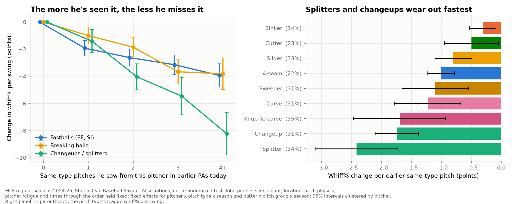

# Does a pitch wear out? Pitch-type familiarity, MLB 2024–26

**League study from public pitch data.** Every regular-season pitch of 2024, 2025 and 2026 (Statcast), not a scouting look. It is observational: every effect below is an association with fixed effects and controls, not a randomized test.
*Written 2026-10-12 · Dylan Fanelli · Data: Statcast via Baseball Savant, 2,141,219 pitches, 7,288 games, 1,310 pitchers, 905 batters · Code: `baseball/edge/familiarity.py` (`bb familiarity 2026`) · Independently reviewed 2026-10-12*



## Summary
- **A pitch gets fewer whiffs the more of that pitch type a hitter has seen from the pitcher, and the drop is specific to the type.**
  - **The comparison:** two earlier pitches in the hitter's earlier plate appearances today, one of the same type and one of another type.
  - **The result:** with the same type, his next swing at that pitch misses less often by 0.70 points on fastballs, 0.91 on breaking balls and 1.87 on changeups and splitters. All three are significant at p < 0.001.
  - **Other types:** earlier pitches of other types in earlier plate appearances go with slightly *more* whiffs (fastballs +0.24, p < 0.001; breaking +0.15, p = 0.02).
- **Changeups and splitters wear out fastest.**
  - **The size:** a hitter who has seen 4+ of them from this pitcher in earlier plate appearances today whiffs 8.2 points less often (95% interval 6.7–9.8) than one who has seen none. That is a quarter of the pitch's 32% whiff rate.
  - **Damage:** each earlier one goes with +11.6 points of xwOBA on contact and −0.45 runs per 100 pitches.
  - **Extremes:** splitters lose 2.4 points per earlier splitter, sinkers 0.3.
- **It accounts for part of the third-time-through penalty on changeups and splitters.**
  - **The decline:** whiffs on them fall 4.6 points from the first to the third time through.
  - **Changeup exposure:** it goes with 3.5 points of that, or 2.3 net of the offsetting effect of having seen more pitches overall.
  - **What's left on the times-through term:** 2.9 points.
  - **Every group:** net of the general effect, what stays on the times-through term is the larger piece.
- **It carries across games, and partly across pitchers.**
  - **Across games:** a hitter who saw this pitcher's changeup 1–3 times in earlier games this season whiffs 3.5 points less on it.
  - **Across pitchers:** each changeup he saw from a same-handed pitcher earlier today goes with 0.79 fewer whiff points on the next pitcher's changeup. That is about 40% of the same-pitcher effect.
- **Familiarity shows up as contact, not discipline.** Hitters chase familiar fastballs and breaking balls *more* (+0.75 and +0.61 points per earlier pitch), and the misses fall anyway.
- **How fast an individual pitch wears out can't be measured reliably from a season of data.**
  - **Noise:** one pitch's season slope carries noise of 3.3–4.4 points, against average effects of 0.7–1.9.
  - **The one trait that predicts it:** fastball stuff. Fastballs with higher expected whiff lose more per look (q < 0.001).
  - **Traits that don't:** there is no sign that release tells, usage, movement separation or a secondary's stuff change it.

## What a club can do with it
1. **Count exposures, not just times through the order.**
   - **Example:** Tarik Skubal's September 3, 2026 start (102 pitches).
     - Before his third plate appearance, the leadoff hitter had seen 5 changeups. At the league rate, that puts Skubal's changeup about 8.7 points below where it would be had those five been other pitches (linear approximation; the direct 4+ estimate is −8.2).
     - The No. 8 hitter had seen none. He was the lineup's only left-handed hitter against a lefty, so that gap is partly platoon usage.
     - The league estimate holds with platoon fixed effects (−1.87 for changeups and splitters).
   - **The tool:** `exposures()` produces this ledger for every hitter.
2. **Sequence the bullpen by pitch type and hand.**
   - **Same type, same hand:** after a hitter has seen a pitcher's changeups, a same-handed reliever's changeup loses 0.79 points per earlier changeup (p < 0.001).
   - **Other hand:** the carryover is smaller (−0.32) and not significant (p = 0.17). The gap between the two hands isn't significant either, so hand is a lean, not a rule.
   - **Other pitches in the family:** a splitter seen earlier from another pitcher goes with a weaker changeup (−0.64 per pitch, either direction within the offspeed family).
   - **Switching families:** a reliever leaning on a breaking ball after a changeup starter faces a much smaller cost. Each earlier pitch from another family costs a breaking ball 0.06 points (p = 0.04), against about 0.28 per earlier same-hand breaking ball on the same absolute basis.
3. **Repetition is a weak reason to hold back a better pitch.**
   - **The measured costs:** all three windows (earlier PAs today, earlier in the PA, earlier games this season).
   - **The thresholds:** shifting usage from the fastball to a better secondary pays once the secondary beats it by −0.18 to +0.43 runs per 100 pitches in the starter cases tested, and about 0.04 for a reliever (Finding 7). At Skubal's 2026 mix (38% four-seamers, 26% changeups) the threshold is 0.13.
   - **What isn't priced:** hitters sitting on a pitch because they know the pitcher's tendencies from scouting reports or past seasons. That cost is real but unmeasured here.
4. **Plan second looks within a season.** Hitters who have seen this pitcher's changeup in earlier games whiff less on it: −3.5 points after 1–3, −4.4 after 4–7. That matters most in intra-division regular-season matchups. The postseason isn't in the data, so applying it there is an untested extrapolation.
5. **Don't build or buy a per-pitch "wear-out" grade from one season of data.** It's mostly noise. Use the pitch-type rates, with one adjustment: better fastballs lose more per look.

## Findings

### 1. The main estimate, by outcome
Each cell is the estimated change associated with one more earlier pitch of the **same type** (instead of another type) in the hitter's earlier plate appearances against this pitcher today. Standard errors, clustered by pitcher, are in parentheses. Bold means p < 0.001.

| Pitch group | Whiff per swing (pts) | Chase, out-of-zone (pts) | Run value per 100 pitches | xwOBA on contact (pts of .001) |
|---|---|---|---|---|
| Fastballs (FF, SI) | **−0.70 (0.09)** | **+0.75 (0.09)** | **−0.15 (0.03)** | +3.9 (1.2), p = 0.001 |
| Breaking balls | **−0.91 (0.12)** | **+0.61 (0.11)** | **−0.23 (0.04)** | **+7.3 (1.7)** |
| Changeups / splitters | **−1.87 (0.16)** | −0.22 (0.15), p = 0.14 | **−0.45 (0.07)** | **+11.6 (2.3)** |
| Cutters | −0.50 (0.23), p = 0.03 | +0.45 (0.23), p = 0.06 | **−0.31 (0.09)** | +7.1 (3.4), p = 0.03 |
| *Base rate* | *19.2% / 32.5% / 31.9% / 22.9%* | *25.2% / 31.5% / 34.7% / 27.8%* | | *.378 / .359 / .341 / .371* |

**Sample:** 1,013,465 swings, 1,076,076 out-of-zone pitches, 2,120,134 pitches with a run value, and 366,793 balls in play.

**The other two windows:**
- **Earlier in the same plate appearance:** the same direction (−0.44 / −0.63 / −0.85 / −1.13 whiff points). Smaller than across plate appearances, except for cutters.
- **Earlier games this season:** −0.22 / −0.36 / −0.77 / −0.37, all p < 0.05.

**Pitches of other types:**
- **In earlier plate appearances:** slightly more whiffs (fastballs +0.24, breaking +0.15).
- **Within the same plate appearance:** more pitches of any type go with fewer whiffs (fastballs −0.75, cutters −0.93).

### 2. By pitch type (earlier PAs today)

| Pitch | League whiff% | Whiff change per earlier same pitch | Run value per 100 per earlier same pitch |
|---|---|---|---|
| Splitter | 34.3 | −2.42 (0.35) | −0.50 (0.14) |
| Changeup | 31.1 | −1.74 (0.18) | −0.45 (0.07) |
| Knuckle-curve | 34.8 | −1.70 (0.39) | −0.53 (0.18) |
| Curveball | 30.8 | −1.23 (0.28) | −0.39 (0.09) |
| Sweeper | 31.4 | −1.10 (0.28) | −0.35 (0.10) |
| Four-seamer | 21.8 | −1.01 (0.11) | −0.19 (0.04) |
| Slider | 33.4 | −0.80 (0.16) | −0.17 (0.06) |
| Cutter | 22.9 | −0.50 (0.23) | −0.31 (0.09) |
| Sinker | 13.7 | −0.31 (0.11) | −0.24 (0.06) |

- **Significance:** every whiff estimate is below zero at p < 0.05.
- **Knuckle-curves:** the estimate comes from only 79 pitchers, so read that row as a range.

### 3. Dose-response
Change in whiff% per swing against a hitter who has seen none of this pitch type, holding total pitches seen fixed.

| Seen in earlier PAs today (same type) | 1 | 2 | 3 | 4+ |
|---|---|---|---|---|
| Fastballs | −1.9 | −2.6 | −3.1 | −3.9 |
| Breaking balls | −1.0 | −1.9 | −3.7 | −3.8 |
| Changeups / splitters | −1.4 | −4.0 | −5.5 | −8.2 |

| Seen in earlier games this season (same type) | 1–3 | 4–7 | 8–15 |
|---|---|---|---|
| Fastballs | −0.9 | −1.6 | −2.2 |
| Breaking balls | −1.4 | −1.5 | −3.3 |
| Changeups / splitters | −3.5 | −4.4 | −6.1 |

- **Fastballs:** the first look costs the most.
- **Changeups and splitters:** the cost keeps climbing with each look.
- **Not estimated:** 16+ in earlier games covers 0.2% of swings or less.

### 4. Carryover between pitchers (whiff per swing, per earlier pitch from a *different* pitcher today)

| Current pitch | Same type, same hand | Same type, other hand | Same family, other type | Other family |
|---|---|---|---|---|
| Fastballs | **−0.43 (0.06)** | **−0.25 (0.07)** | −0.16 (0.05), p = 0.002 | +0.00 (0.03), p = 0.95 |
| Breaking balls | −0.22 (0.09), p = 0.02 | −0.17 (0.12), p = 0.15 | −0.21 (0.07), p = 0.002 | −0.06 (0.03), p = 0.04 |
| Changeups / splitters | **−0.79 (0.16)** | −0.32 (0.23), p = 0.17 | **−0.64 (0.18)** | +0.12 (0.04), p = 0.004 |
| Cutters | −0.03 (0.19), p = 0.86 | −0.18 (0.28), p = 0.52 | n/a | −0.10 (0.04), p = 0.005 |

- **Reference group:** the first three columns compare with an earlier other-family pitch from another pitcher. The last column compares with no pitch, so add it to a cell for the absolute carryover (same-hand changeup −0.79 + 0.12 = −0.67; same-hand breaking ball −0.22 − 0.06 = −0.28).
- **Compared with the same-pitcher effect (Finding 1):** the same type from a different pitcher carries about a fifth of it for breaking balls, two fifths for changeups and splitters, and half or more for fastballs.
- **Not significant:** other-hand carryover for breaking balls and changeups, and both cutter estimates.

### 5. Times through the order (whiff points per swing)
**Two models:**
- **Model A:** the decline at the second and third time through against the first, with count, location, pitch physics and pitcher fatigue already controlled.
- **Model C:** adds exposure. Its parts are:
  - **Type exposure:** the same-type contrast × the average earlier same-type pitches.
  - **General effect:** the effect of any earlier pitch × all earlier pitches seen.
  - **Left on TTO:** what stays on the times-through dummy.
- **Reading the table:** the parts come from model C, so they don't sum to model A's decline.

| Pitch group | Time through | Decline (model A) | Type exposure | General effect of pitches seen | Net exposure | Left on TTO |
|---|---|---|---|---|---|---|
| Changeups / splitters | 2nd | −2.6 (0.5) | −1.7 | +0.6 | −1.1 | −1.8 |
| Changeups / splitters | 3rd | −4.6 (0.9) | −3.5 | +1.2 | −2.3 | −2.9 |
| Breaking balls | 3rd | −3.8 (0.6) | −1.8 | +1.2 | −0.6 | −3.4 |
| Fastballs | 3rd | −1.5 (0.5) | −2.3 | +2.0 | −0.3 | −1.2 |
| Cutters | 3rd | −3.1 (1.0) | −1.0 | +0.2 | −0.8 | −2.4 |

- **Gross type exposure** is the largest single part only for changeups and splitters.
- **Net of the general effect,** what stays on the times-through term is larger for every group.

### 6. Is wear-out speed a property of the pitch?
**Pitch traits.** Each trait is interacted with earlier same-type exposure. Effects are per one standard deviation of the trait. q is the Benjamini–Hochberg-adjusted p across all 13 tests.

| Group | Trait | Change in the per-pitch whiff cost (pts) | p | q |
|---|---|---|---|---|
| Changeups / splitters | Release tell (AUC vs. fastball) | −0.12 (0.14) | 0.40 | 0.61 |
| Changeups / splitters | Speed gap to fastball (smaller gap) | +0.39 (0.17) | 0.02 | 0.14 |
| Changeups / splitters | Movement separation, usage, expected whiff | −0.15 to +0.13 | ≥ 0.39 | ≥ 0.61 |
| Breaking balls | Release tell, speed gap, separation, usage, expected whiff | −0.12 to +0.11 | ≥ 0.28 | ≥ 0.61 |
| Fastballs | Expected whiff (stuff) | **−0.40 (0.08)** | < 0.001 | < 0.001 |
| Fastballs | Velocity / usage | −0.17 / −0.02 | 0.05 / 0.85 | 0.21 / 0.85 |

- **Fastball stuff predicts wear-out speed.**
  - At the mean, a fastball loses 0.67 points per look on a 19.3% base.
  - At +1 SD of expected whiff, it loses 1.07 points.
  - Its base whiff rate is higher too, so the proportional difference is smaller than the gap in points.
- **Firmer changeups:** they appeared to hold up better (p = 0.02), but the result doesn't survive the multiple-testing correction, so it isn't a finding.
- **Release tells:** no sign that they speed wear-out. This is consistent with the Edge Board's result that tells haven't cost whiffs.

**Season-to-season stability.** For each pitch, the slope of whiffs on earlier same-type exposure, after every control:

| Group | 2024→25 | 2025→26 | Pooled | Noise SD of one pitch-season slope (pts) |
|---|---|---|---|---|
| Fastballs | 0.09 (0.06), 239 pitches | 0.11 (0.06), 261 | 0.10 (0.04) | 3.3 |
| Breaking balls | −0.01 (0.08), 165 | 0.08 (0.08), 169 | 0.04 (0.05) | 4.2 |
| Changeups / splitters | −0.05 (0.11), 87 | 0.02 (0.11), 92 | −0.02 (0.08) | 4.4 |

- **The test has little power:** each pitch-season slope carries several times more noise than the average effect.
- **Fastballs:** the pooled correlation is about 2.2 SE from zero (p ≈ 0.03). It is counted as borderline because the expected correlation for a real but small trait is close to zero at this noise level, so a single pooled test is fragile.
- **Breaking balls and changeups/splitters:** nothing.
- **Conclusion:** per-pitch wear-out can't be measured reliably from a season of data. Fastball stuff is the one observable that predicts it.

### 7. Usage: when does wear-out outweigh a better pitch?
**The setup:** each pitch of type T carries an expected exposure of usage(T) × pitches already seen. Shifting usage from pitch A to pitch B pays when B's observed run value beats A's by more than:

> Σ over windows: pitches seen in the window × (cost_B × use_B − cost_A × use_A)

**Windows and inputs:**
- **The three windows:**
  - earlier PAs today, with per-type costs from Finding 2
  - earlier in this PA, with group costs: fastballs 0.10, breaking 0.12, changeups/splitters 0.06 (not significant), cutters 0.38 runs/100
  - earlier games this season, with group costs: 0.05 / 0.05 / 0.13 / 0.15
- **Pitches already seen per pitch thrown:**
  - starters: 3.13 in earlier PAs, 1.92 earlier in the PA, 2.35 in earlier games
  - relievers: 0.23, 1.91 and 1.23
- **Costs:** point estimates, in runs per 100 pitches per earlier same-type pitch.

| Case | Threshold (runs per 100 pitches) |
|---|---|
| Starter, FF 38% → CH 26% (Skubal's 2026 mix) | 0.13 |
| Starter, FF 50% → CH 15% | −0.18 (more changeups lowers total wear-out) |
| Starter, FF 45% → SL 30% | −0.15 |
| Starter, FF 40% → FS 40% | 0.43 |
| Reliever, FF 50% → ST 50% | 0.04 |

- **Why some thresholds are negative:** the fastball wears out too, so moving usage off it freshens the fastballs that remain. The threshold rises as the favored pitch gets more use, and faster for pitches that wear out quickly (splitters at 40%: 0.43).
- **Comparing:** set the threshold against each pitch's own run value, keeping in mind that one season's run value per pitch is noisy.
- **Limits:** the formula is `break_even()`. It is linear in exposure, which fits changeups and breaking balls. For fastballs the first look costs the most.

## Method
**Grain.** One row per pitch, regular season only. Spring training and the postseason are excluded.

**Exposures:**
- **Pitches counted:** those the same pitcher threw the same batter before the current pitch: in earlier plate appearances today, earlier in this plate appearance, and in earlier games this season.
- **Split:** each count is split into the same pitch type versus every other type.
- **Other pitchers:** exposures from other pitchers earlier today are counted separately.
- **Edge cases:** a pinch hitter starts his own count. A pitch with no recorded type counts as an "other" pitch.
- **Checked by hand:** on a hand-built game in `tests/test_familiarity.py`.

**Estimate:**
- **The model:** a linear probability model for whiffs and chases, linear for run value and xwOBA on contact.
- **Reparameterization:** each pair is written as `same` plus `same + other`. The coefficient on `same` is then the same-minus-other contrast, with its own clustered standard error.

**Fixed effects:**
- pitcher × pitch type × season, which absorbs the pitch's quality, shape and usage
- batter × pitch group × season, which absorbs how well this hitter handles, say, breaking balls
- Both are absorbed by alternating projections (`baseball.stats.absorb`).

**Controls:**
- count (11 dummies)
- the batter's plate appearances against the pitcher today
- pitcher pitch count and its square
- same-handedness
- this pitch's velocity, rise, run and spin
- location: Statcast zone dummies, plus horizontal and height-in-zone terms with squares and an interaction

**Standard errors** are clustered by pitcher (from 79 pitchers for knuckle-curves to 1,199 depending on the model), because the same pitchers recur across games and seasons.

**Evidence standard:** confirmed means p < 0.05 with enough sample. The trait screen uses Benjamini–Hochberg q.

**Robustness** (whiff contrast, earlier PAs today, pts):

| Specification | Fastballs | Breaking | Changeups / splitters | Cutters |
|---|---|---|---|---|
| Main | −0.70 | −0.91 | −1.87 | −0.50 |
| Pitcher × type × **month** fixed effects (in-season trends) | −0.75 | −1.00 | −1.93 | −0.60 |
| Pitcher × type × season × **batter side** fixed effects (platoon) | −0.69 | −0.99 | −1.87 | −0.50 |
| Starters only | −0.72 | −0.94 | −1.96 | −0.66 |
| + back-to-back pitch control | −0.70 | −0.91 | −1.87 | −0.50 |
| No location controls (location allowed to respond) | −0.82 | −1.08 | −2.17 | −0.45 |
| 2024 / 2025 / 2026 separately | −0.71 / −0.70 / −0.73 | −1.16 / −0.85 / −0.70 | −1.85 / −2.03 / −1.74 | −0.87 / −0.11 / −0.51 |

- **Every season:** fastballs, breaking balls and changeups/splitters are each significant at p < 0.001.
- **Cutters are the weak group:**
  - significant pooled (p = 0.03) and in 2024
  - not significant in 2025 (p = 0.80) or 2026 (p = 0.16)
  - borderline without location controls (p = 0.06)

**Placebo and selection:**
- **The test:** the same type thrown to the hitter in *later* plate appearances today can't change the current pitch. Yet its coefficient is large and positive: +2.0 / +3.0 / +3.2 / +2.5 points. Pitchers go back to what is working on a hitter.
- **Why it matters:** the same selection could run through earlier exposure, if a hitter who saw many sliders early was struggling with them. That would bias the main estimates toward zero.
- **The measured sensitivity is small.**
  - The placebo only works on batters who come up again (176k / 100k / 58k / 31k swings).
  - In that sample, the estimates are −0.66 / −1.41 / −2.11 / −1.04 without the future terms and −0.75 / −1.53 / −2.12 / −1.04 with them.
  - The larger numbers than the main estimate come mostly from the sample, not the control.
- **Direction of bias:** toward zero, by reasoning more than by measurement. Treat the main estimates as probably not overstated.

## What this doesn't show
- **It's observational.**
  - The fixed effects remove season-level hitter and pitcher quality, and the platoon split.
  - In-game selection remains (placebo).
  - Nothing here is a randomized pitch call, and "wear out" is shorthand for the association.
- **Location and count are partly the pitcher's response to the hitter.** The main specification holds them fixed: the same pitch in the same spot. Letting location vary gives larger effects for every group except cutters.
- **What it measures:** learning from pitches seen against this pitcher (today and earlier this season) and against other pitchers today. It doesn't capture what hitters know from scouting reports or prior seasons, so the usage thresholds price only part of the cost of predictability.
- **Mechanism:**
  - The data can't separate recognition from timing.
  - Higher chase rates on familiar fastballs and breaking balls fit hitters committing earlier and connecting.
  - Changeups show no detectable chase change (−0.22, p = 0.14).
- **What wasn't tested:** whether some hitters adjust faster than others.
- **Postseason:** excluded.
- **Run value:** Statcast's `delta_run_exp`, turned to the pitcher's view.

## Reproduce
```bash
uv run bb seq 2026          # on the Mac: sequence copy (batter ids, location) from the monthly league files -> data/seq/
uv run bb familiarity 2026  # pools 2024-26; tables, page and figure -> data/edge/familiarity/ (this report keeps its reviewed figure)
```

## Sources
- **Pitch data:** Statcast, MLB Advanced Media, via [Baseball Savant](https://baseballsavant.mlb.com/) (regular seasons 2024–2026, pulled through October 2026).
- **Player names in the example:** MLB Stats API (statsapi.mlb.com).
- **Background on the times-through-the-order penalty:** Tom Tango, Mitchel Lichtman and Andrew Dolphin, *The Book: Playing the Percentages in Baseball* (2007); Ryan Brill, Sameer Deshpande and Abraham Wyner, "A Bayesian analysis of the time through the order penalty in baseball," *Journal of Quantitative Analysis in Sports* (2023).
- **Release tells and expected whiffs:** this repo's edge engine (`data/edge/2026/`; Edge Board).
