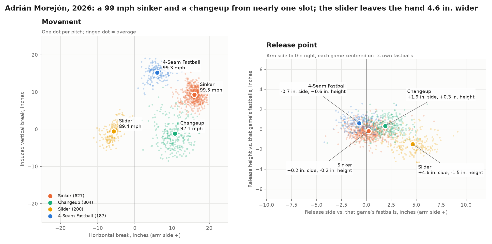

# Adrián Morejón (LHP, pending free agent): pro scouting report

*Adrián Morejón; LHP; B/T L/L; 5'11", 224 lb (listed); born Feb. 27, 1999, Havana, Cuba (27.6 on the report date; 2027 age 28); San Diego Padres*
*Report date 2026-10-14; Scout: Dylan Fanelli; Basis: data (Statcast, all 1,318 regular-season pitches of 2026, with 2024–25 for history and the 2026 postseason as a check) and public reporting. No live or video look: the delivery items that need eyes are NG (no grade).*

**Status:** first free agency after 2026 ("set to become a free agent after the 2026 season," Matt Levine, Padres On SI, Aug. 3, 2026). He's qualifying-offer eligible: with San Diego all season, he can't have received a QO before. Whether the Padres make the offer is their call this offseason.



## Summary
- **OFP 60. Role: B1 now and in 2027 (high-leverage late-inning reliever, closer-capable, four to six outs when needed). Risk: moderate. ETA: established major leaguer.**
- **What he is:** a power sinker/changeup left-hander.
  - **Against right-handers:** a tumbling 92 mph changeup.
  - **Against left-handers:** a 98.5–100.5 mph sinker in on the hands, plus a hard slider.
- **What has to hold for the future grades:**
  - **The velocity:** his sinker is up about 1.8 mph net of the league since 2025.
  - **The changeup:** the 2026 version matches the low-spin tumbler Statcast labeled a knuckleball in 2024 (read here as the same pitch; the grip isn't known). It's 6 mph harder and thrown three times as often.
  - **The elbow:** Tommy John surgery in 2021 and a sprain in 2023, followed by three seasons with no injured-list stint.
- **The biggest question:** how much of the changeup's 56% whiff rate survives a second year of hitters seeing it at 92.
- **Second question:** the slider. It missed bats 38–40% of the time in 2024–25 and 30% in 2026.
  - **What changed:** it got 3.3 mph harder and lost 2.7 in of drop since 2024, so it's moving toward a cutter.
  - **What didn't:** the release has separated it from the fastballs just as much since its best year.
- **Action:** first on the free-agent reliever preference list. Grade the delivery from his 2026 video **before** the bid; the look can't wait for spring (Action).

## Physical
- **Build:** listed 5'11", 224 lb (MLB Stats API). He's 27 and physically mature, so the future grades rest on holding what he has, not on growth.
- **Extension:** 6.23 ft, slightly below average. That's the 33rd percentile of 177 left-handers with 300+ pitches (mean 6.41).

## Arsenal and grades
- **Scale:** 20-80, graded against the major leagues. Present means 2026; future means his peak at ages 28–30.
- **Velocity:** the 10th–90th percentile range of 2026 pitches, with T for his top speed. League averages are the 2026 pitch-weighted means for the pitch type.
- **Fastball base grades:** the 2026-starter reading from `bb grade velo` (75 for the sinker at 99.5 mph, 70 for the four-seamer at 99.3). The Baseball America anchors read 80 for both. Every move off the base is stated in the table.

| Pitch | Velo | Shape (2026) | Usage (vs LHH / RHH) | Pres | Fut | Notes |
|---|---|---|---|---|---|---|
| **Sinker** | 98.5–100.5, T101.7 | 9.2 in IVB, 16.0 in arm-side run, 2,404 rpm; VAA −5.3° (league −5.8°) | 48% (55 / 43) | 70 | 70 | **Grade:** base 75, −5 because it rides more than a heavy sinker (league IVB 7.6). The run is above average (league 15.1 in). **Results:** 58% ground balls overall, and 19.3% whiffs on 311 swings (league sinkers 13.6%). **Use:** in on left-handers' hands; 69% of his 0-0 pitches to them |
| **Changeup** | 91.1–93.0, T93.9 | −1.1 in IVB, 10.7 in arm-side, 1,041 rpm | 23% (2 / 36) | 70 | 70 | **Shape:** splitter-like tumble. The spin is below the league changeup (1,754) and splitter (1,369). It drops 10.4 in more than the sinker and runs 5.3 in less. **Speed:** 7.4 mph off the sinker, under the 8–12 ideal; the separation is vertical. **Results:** 56.0% whiffs on 182 swings (league changeups 31%); 72% thrown below 2 ft. Against right-handers it's 47% of his two-strike pitches. **History:** see below. **Why 70, not 80:** 7.4 mph of separation, under the 8–12 ideal, and the 92 mph version is one season old (see History). His near-absence of changeups to left-handers is a role question, handled in the OFP and role, not in the pitch grade |
| **Four-seamer** | 98.3–100.3, T101.2 | 15.2 in IVB, 6.0 in arm-side; VAA up in the zone −3.8° (league −3.8°) | 14% (16 / 13) | 70 | 70 | **Grade:** base 70, −5 for league-average shape (15.6 / 7.9 in, the "dead zone"), +5 for results. **Results:** 42.3% whiffs on 123 swings (league four-seamers 21.6%), thrown up in the zone off the sinker. 60% come with two strikes. The swing sample is small, so the results bump is the least certain move in the table |
| **Slider** | 87.6–91.0, T92.3 | −0.5 in IVB, 5.7 in glove-side, 2,892 rpm | 15% (27 / 8) | 50 | 55 | **Shape:** a hard, high-spin slider, short and gyro-leaning (league slider spin 2,435). **Results by year:** 40.0% whiffs on 160 swings (2024), 38.3% on 115 (2025), 29.9% on 77 (2026; small sample; league 33%). **Shape by year:** 86.0 → 87.5 → 89.4 mph, IVB −3.2 → −1.2 → −0.5 in, spin 2,752 → 2,892 rpm. It's harder, with 2.7 in less drop, moving toward a cutter. Usage fell from 30% to 25% to 15% over the same span. **Why 55 future:** two years of above-average results and a 70 stuff grade from the physics. The decline lines up with the shape change, so the question is which version he throws in 2027 |
| **Control** | | uBB 6.0% (21 of 352 batters); BB 8.0% with 7 intentional | | 60 | 60 | **Anchor:** a 60 is about 5–6.5%. **First-pitch strikes:** 65.4%, against 61.3% for the league.¹ **History:** 7.0% in 2024, 4.9% in 2025. The second half of 2026 ran 7.3%, so 60 is the three-year level |
| **Command** | | | | NG | NG | Location data shows where pitches went (changeup down and to the arm side against right-handers, four-seamer up, sinker in on left-handers), not where they were meant to go. Needs a look |

¹ 231 of 353 first pitches. The 353 includes one plate appearance that ended without a result (`truncated_pa`), so it's one more than his 352 batters faced.

**The changeup's history.** Statcast labeled 83 of his 2024 pitches "knuckleball."
- **2024 shape:** 86.2 mph, 843 rpm, −1.1 in IVB, 8.5 in arm-side, with 51.4% whiffs on 35 swings.
- **Why it reads as the same pitch:** its spin and movement match the 2026 changeup's low-spin tumble. That's an inference from the data; the grip isn't known.
- **2025:** he threw a conventional changeup instead: 66 pitches, 1,328 rpm, +2.6 in IVB, 14.4 in arm-side.
- **2026:** the tumbler came back at 92 mph and became his second pitch.
- **What this means:** hitters have seen a slower version before, so the pitch has more of a track record than "new in 2026." But no version has carried this share of his pitches for a full season.
- **Postseason check:** in the 2026 postseason (60 pitches) he threw it 33% of the time, with 5 whiffs on 8 swings. The sinker averaged 99.0.

## Delivery
**From tracking data:**
- **Slot:** three-quarters, a little higher than the average left-hander. Statcast's arm angle is 41.2° (59th percentile; mean 36.9°).
  - **Since 2025:** the fastballs came down 2.7° and moved 1.9 in wider, with 0.08 ft less extension.
  - **Against the league:** returning pitchers moved −0.2° on average (SD 3.2°), so this is within normal year-to-year movement. The velocity gain came with it.
- **Release consistency:** his release scatter is tighter than the league's.
  - **Sinker:** 0.09 ft SD in height and 0.13 ft side to side.
  - **League medians** (1,235 pitcher-pitch rows with 200+ pitches): 0.102 and 0.159 ft.
  - **Every pitch:** at or under the median.
  - **One caveat:** neither he nor the league is centered by game, so park-to-park camera calibration is in both numbers.
- **Changeup release:** against the same game's fastballs, it leaves 1.9 in wider and 0.3 in higher, with the arm 0.9° higher.
  - **Release-tell score:** the edge engine's tell score is 0.89. That's how well a model separates the pitch from his fastballs using the release point alone (0.5 = no separation, 1.0 = perfect).
  - **Against the league:** below the median changeup (0.92).
- **Slider release:** against the same game's fastballs, it leaves 4.6 in wider and 1.5 in lower, with the arm 3.5° lower.
  - **Tell score:** 0.997, the top 4% of 324 sliders. It was 0.990 in 2024 and 0.991 in 2025.
  - **Not the cause of the drop.** The separation was there in his best slider year, and it hasn't grown. Against each game's fastballs:
    - **2024:** +4.6 in to the side, −1.9 in in height, arm −4.4° (40% whiffs)
    - **2025:** +4.4 in, −1.2 in, −3.2° (38%)
    - **2026:** +4.6 in, −1.5 in, −3.5° (30%)
  - **The league study points the same way:** the repo's league work found no sign that release tells cost whiffs.
  - **The likelier cause:** the shape change (Arsenal).
  - **Why it's still worth a look:** a release this distinct is something an opposing advance scout could find. Whether it's visible from the box is a video question, not a data one.
- **Within an outing:**
  - **Sinker by pitch number:** 99.5 mph on pitches 1–15 (465 pitches), 99.6 on 16–25 (118), 99.2 on 26+ (44, a small sample).
  - **On no rest:** back-to-back days cost 0.1 mph.
  - **Outing length:** 17 of 76 outings reached 25 pitches, and one reached 40.
- **Running game:** runners tried to steal 18 times in 86 innings (14 safe), about 1.9 attempts per nine innings. The league rate is 0.9 per nine for all pitchers (MLB Stats API team totals, 2026).
  - **Success:** 78%, about the league's 77%.
  - **The signal:** how often they run, which makes time to the plate a priority for the look.

**NG until someone watches him:**
- tempo and time to the plate from the stretch
- effort and head movement
- landing direction
- arm action
- fielding his position

## Performance context
- **2026:** 76 games (0 starts), 86.0 IP (MLB Stats API, read Oct. 14, 2026).
  - **Run prevention:** 2.83 ERA, 1.08 WHIP.
  - **Strikeouts and walks:** 30.4% K, 8.0% BB, K-BB 22.4%.
  - **Contact:** 4 HR, a 1.67 groundout-to-airout ratio; opponents hit .205/.278/.271.
- **Record against stuff:** a 2.15 FIP, below his 2.83 ERA.
  - **How it's computed:** unintentional walks, with the FIP constant (3.13) from 2026 MLB team totals. The published figure, which counts his 7 intentional walks and uses its own constant, is 2.37 (MLB Stats API).
  - **Run value:** +1.39 runs per 100 pitches; the Reliability Atlas regresses that to a true level of +0.56 (95% interval −0.21 to +1.33). Positive is good for the pitcher.
- **Leverage:**
  - **Late leads:** 28 holds, 3 saves in 8 chances and 5 blown saves; 31 of 36 converted.
  - **Save situations:** 42.1 innings (Padres On SI, Oct. 10).
  - **Inherited runners:** 10 of 39 scored.
  - **"Closer-capable":** this rests on his stuff and his leverage, not his save total.
- **Platoon:**
  - **Right-handers:** 215 PA, 31.6% K, .247 xwOBA.
  - **Left-handers:** 137 PA, 28.5% K, .221 xwOBA.
  - The xwOBA gap isn't significant (p = 0.43). Same results, with a different plan against each side.
- **Shape of the season:** 13 earned runs through May 10, then a 1.93 ERA with 81 strikeouts in 65⅓ innings (Sports Illustrated, Oct. 3, 2026).
- **Workload:**
  - **Volume:** a career-high 86 innings, third among MLB relievers.
  - **Multi-inning work:** 25 outings of four or more outs.
  - **Short rest:** 18 back-to-backs and 12 stretches of three outings in four days.
- **Track record:**
  - **Three good seasons:** ERAs of 2.83 (60 games), 2.08 (75) and 2.83 (76) in 2024–26.
  - **Before that:** 2019–23 was 50 games and 75 innings in total, broken up by injuries. He made 9 career starts, the last in 2023.

## Background and health
- **Signing:** Padres, July 2016, at 17, for $11M. He was the No. 2 player on that international market, a starter who sat 89–92 mph and touched 94, projected for three plus pitches (MLB Trade Rumors, July 2016). He debuted July 21, 2019.
- **The bullpen:** the Padres kept him there in 2025 rather than stretch him out (MLB.com, Feb. 2, 2025).
- **Health (public record only):**
  - **2021:** Tommy John surgery, April 20 (MLB.com, Apr. 21, 2021).
  - **2023:** 60-day IL for a left elbow sprain, Mar. 30 (CBS Sports, Mar. 30, 2023), and 15-day IL for right knee inflammation, July 16 (MiLB.com transactions).
  - **2024–26:** no IL placement (MiLB.com transactions, read Oct. 13, 2026).
  - Nothing beyond the record is inferred.

## Makeup
- **Observed:** none. There has been no look.
- **Reported (on the record):**
  - **Mason Miller (teammate):** "He's the most valuable reliever on our team and, I would argue, in baseball too." He credits Morejón's workload to "what he does to prepare for the games."
  - **Craig Stammen (manager):** "He can pitch multiple innings or be dominant for one inning."
  - **A.J. Preller (president of baseball operations):** "one of the best relievers in the league."
  - **Source:** all three come from one in-season piece (Sports Illustrated, Oct. 3, 2026), from people with a stake in praising him. That's reported support, not independent reference checks.
- **Unknown:**
  - how he responds to failure in the moment
  - how he takes coaching (the 2025–26 changeup change is the question to ask about)
  - his clubhouse role beyond public praise
  - These are questions for the look and for background calls to people outside the Padres.

## OFP, role, risk
**OFP 60; Role: B1 now and in 2027 (B1 = closer or high-leverage reliever, OFP band 55–60); Risk: moderate; ETA: established**
- **The roll-up:** `bb grade ofp SI=70 CH=70 FF=70 SL=55 command=50` gives a 60 reliever estimate. The starter estimate is 64 with command entered at 50 and 67 at control's 60. Command is NG, so it's run both ways.
- **Why I grade the reliever:**
  - **No changeup to left-handers:** against them his third pitch would be a 50-now slider.
  - **No starter workload:** his longest 2026 outing was 40 pitches, and 86 innings was a career high.
  - **The elbow:** two injuries behind him.
  - **Familiarity:** the repo's familiarity study prices facing hitters a second and third time at about −1.8 whiff points on his changeup as a starter. That's −1.35 from earlier plate appearances plus −0.42 from earlier games, against about −0.2 in relief.
  - **The upshot:** a move to the rotation would be a conversion project, not a projection.
- **Risk is moderate, not low:**
  - the velocity gain and the changeup's share are recent
  - the slider fell off in 2026
  - there's an elbow history behind three clean seasons
- **Comp:** none given. A name would carry more certainty than the evidence supports.

## Preference and action
**The need and the list.** This report sits under the [bullpen acquisition memo](2026-bullpen-acquisition-memo.md). The need there is Texas's late-inning job next to Jacob Latz; Texas relievers fell from 4th to 24th in run value per 100 pitches. The list there is every 2026–27 free-agent reliever, ranked by projected 2027 wins in a B1 role.

**Preference statement:**
- **The ranking:** I prefer Morejón to Bryan Abreu (#2, Tier B) for that job. He projects for more wins (2.3 vs. 1.6 at the same leverage) and has the higher floor (1.3 vs. 0.7 at the low end of the rate interval). Abreu misses bats as well; his 2026 walk rate is the question.
- **The condition:** a contract at or under his value, which is four years and $72M. If the Padres make him a qualifying offer, the pick and pool cost lowers that to about $60M (the bullpen memo's Oct. 18 update; $66M on the 2019 pick value it first used).
- **The alternative objective:** if the club wants the most wins per dollar with no commitment past 2028, Abreu at $25M or less ranks first instead (the memo's statement).
- **What moves him below Abreu:**
  - a price above that line
  - a medical review that doesn't clear the elbow
  - video showing the harder slider is now hittable in the zone, which would leave left-handers with a two-pitch look

**The next look, before the bid.** The bid can't wait for spring. The memo's timeline runs through the qualifying-offer decision and the Dec. 1 expiration of the labor agreement, and a lockout would freeze free agency. His 2026 regular season and postseason are on video now (Baseball Savant has video of each pitch). The look should grade four things:
1. **Time to the plate** from the stretch, frame-counted. Runners went twice as often as against the average pitcher.
2. **The slider:** does the harder 2026 version still get chased below the zone, or does it flatten into hitters' barrels? Also check whether its release (4.6 in and 3.5° off his fastballs' mean, about 4.4 in and 2.8° off the sinker alone) is visible from the center-field angle.
3. **Effort, landing and arm action** on the second of back-to-back days, against a fresh outing.
4. **Changeup use against left-handers**, including the postseason.

**Medical:** a review of the elbow gates any multi-year deal.

**Spring 2027:** a live look with a gun and a stopwatch, to confirm the velocity and the video grades.

## How these grades relate to the memo's
The [bullpen memo](2026-bullpen-acquisition-memo.md) graded each pitch on whiffs alone: the percentile of its regressed whiff rate among MLB pitches of the same type. That method can't see velocity, shape, ground balls or location. This report grades the way a scout does and counts them.

| | This report (pres / fut) | Memo (present / 2027) | Why they differ |
|---|---|---|---|
| Sinker | 70 / 70 | 65 / 60 | The memo reports his 58% ground-ball rate but doesn't grade on it. Here velocity and ground balls count |
| Changeup | 70 / 70 | 75 / 75 | This report docks it for being thrown to left-handers 2% of the time |
| Four-seamer | 70 / 70 | 75 / 75 | Close. The memo called it "a carry four-seamer," but 15.2 in of IVB is about league average, so this report docks the shape and credits the results |
| Slider | 50 / 55 | 50 / 55 | Same grades. This report adds the 2024–25 record and the shape change |
| Control | 60 / 60 | 60 / 60 | Same measure (unintentional walk rate) |
| Command | NG | Not graded | Neither has a look |
| OFP / role | 60, B1 | 60, B1 | Same conclusion |

The memo's changeup history line ("7% of pitches in 2025, 23% in 2026") leaves out the 2024 pitches Statcast labeled knuckleballs (above).

## Method
- **Data:** Statcast pitch-level data via Baseball Savant (pybaseball), 2024–26.
  - **Regular season:** `game_type = 'R'`, unless a line says postseason.
  - **2026:** 1,318 pitches with a pitch type, which matches MLB's count. 26 automatic balls and strikes have no pitch type; they're dropped from pitch tables and kept in outing lengths.
- **Delivery numbers:** `baseball/evaluation/delivery.py` (`bb delivery`).
  - **VAA:** computed exactly from Statcast's kinematics at the front of the plate.
  - **Arm side:** positive for both hands.
  - **Release and arm-angle offsets:** measured from each game's own fastball (four-seamer and sinker) mean, which removes park calibration.
  - **League percentiles:** pitchers of the same hand with 300+ pitches.
- **Release tells:** the edge engine's detector, `baseball/edge/tells.py`. Within each game, a cross-validated logistic regression predicts the pitch from its release alone; the score is the AUC.
- **Regressed rates, platoon, workload, halves:** the [bullpen memo](2026-bullpen-acquisition-memo.md)'s Reliability Atlas outputs (`bb compare-relievers`).
- **FIP and league rates:** MLB Stats API, 2026 team pitching totals.
  - **FIP:** 13 HR + 3 (uBB + HBP) − 2 K, divided by innings pitched, plus the league constant.
  - **The constant:** league ERA minus the same terms on league totals.
- **Grades:** the 20-80 scale, graded against the major leagues.
  - **Velocity bases:** from `bb grade velo` (`baseball/evaluation/grades.py`).
  - **OFP:** from `bb grade ofp`.
  - **Adjustments:** every move off a measured base is stated in the table.

## What this doesn't show
- **No look:** time to the plate, effort, landing, arm action, fielding, command and any observed makeup are NG. Release consistency is measured, but it isn't command.
- **Velocity readings:** Statcast velocity is release speed from Hawk-Eye, not a stadium gun. A scout's gun will read differently by park.
- **Release tells:** measurable separation doesn't prove hitters see it. The repo's league study found no sign that tells cost whiffs.
- **Pitch labels:** they're Statcast's. The 2024 "knuckleball" label is read here as an early form of the changeup because its speed, spin and movement match; the grip isn't known.
- **Medical:** public injured-list history only. There are no medical records.

## Reproduce
```bash
uv run bb delivery 2026 670970 --figure reports/figures/2026-morejon-pro-scouting-report.png \
  --title "Adrián Morejón, 2026: a 99 mph sinker and a changeup from nearly one slot; the slider leaves the hand 4.6 in. wider"
uv run bb compare-relievers 2026 670970     # regressed rates, platoon, workload, the memo's grades
uv run bb arsenal morejon adrian 2024       # the 2024 "knuckleball" (after: uv run bb pull morejon adrian 2024)
uv run bb edge 2026                         # release tells -> data/edge/2026/tells_2026.parquet
```

The FIP constant and the league steal-attempt rate come from the MLB Stats API's 2026 team totals:
```bash
curl -s "https://statsapi.mlb.com/api/v1/teams/stats?season=2026&group=pitching&stats=season&sportIds=1&gameType=R" | python3 -c '
import json, sys
s = [x["stat"] for x in json.load(sys.stdin)["stats"][0]["splits"]]
t = lambda k: sum(x[k] for x in s)
ip = sum(int(x["inningsPitched"].split(".")[0]) + int(x["inningsPitched"].split(".")[1]) / 3 for x in s)
c = 9 * t("earnedRuns") / ip - (13 * t("homeRuns") + 3 * (t("baseOnBalls") - t("intentionalWalks") + t("hitBatsmen")) - 2 * t("strikeOuts")) / ip
att = 9 * (t("stolenBases") + t("caughtStealing")) / ip
print(f"FIP constant {c:.3f}; steal attempts per 9 {att:.2f}")
print(f"Morejon FIP {(13 * 4 + 3 * (28 - 7 + 5) - 2 * 107) / 86 + c:.2f}")'
```

## Sources
- **Pitch data:** Statcast via Baseball Savant (pybaseball), 2024–26 regular season and postseason, pulled through Oct. 2026.
- **Stats API:** MLB Stats API, `statsapi.mlb.com/api/v1/people/670970` (season, year-by-year, bio) and `/api/v1/teams/stats` (2026 team pitching totals), read Oct. 14, 2026.
- **Status:** Matt Levine, Padres On SI (Aug. 3, 2026). Save-situation innings: J.P. Hoornstra, Padres On SI (Oct. 10, 2026).
- **Makeup and season split:** Ryan Phillips, ["Meet Padres Fireman Adrián Morejón, MLB's Most Underrated Reliever,"](https://www.si.com/mlb/playoffs/meet-padres-fireman-adrian-morejon-most-underrated-reliever) Sports Illustrated (Oct. 3, 2026).
- **Workload context:** Zach Carver, ["Padres' Reliever Continues To Deliver Despite Increased Workload,"](https://roundtable.io/sports/mlb/padres/players/padres-reliever-continues-to-deliver-despite-increased-workload) Roundtable (Sept. 9, 2026).
- **Role history:** AJ Cassavell, ["Morejón permanecerá como pieza clave del bullpen de Padres,"](https://www.mlb.com/es/news/morejon-permanecera-como-pieza-clave-del-bullpen-de-padres) MLB.com (Feb. 2, 2025).
- **Signing:** ["Padres Sign Adrian Morejon For $11 Million,"](https://mlbtraderumors.com/2016/07/padres-sign-adrian-morejon-11-million.html) MLB Trade Rumors (July 2016).
- **Health:**
  - Daniel Guerrero, MLB.com (Apr. 21, 2021)
  - CBS Sports (Mar. 30, 2023)
  - MiLB.com transactions (read Oct. 13, 2026)
- **Grading scale and 2026 pitch-type norms:** the traditional velocity anchors Baseball America publishes, and Baseball Savant 2026 leaderboards (pulled Sept. 30, 2026) for the starter distribution and pitch-type norms. Both are coded in `baseball/evaluation/grades.py`.
- **This repo:**
  - [bullpen acquisition memo](2026-bullpen-acquisition-memo.md)
  - [Reliability Atlas](2026-reliability-atlas.md)
  - [pitch familiarity](2026-league-pitch-familiarity.md)
  - the edge engine (release tells, stuff model)

---
© 2026 Dylan Fanelli. All rights reserved. See [LICENSE](../LICENSE).
