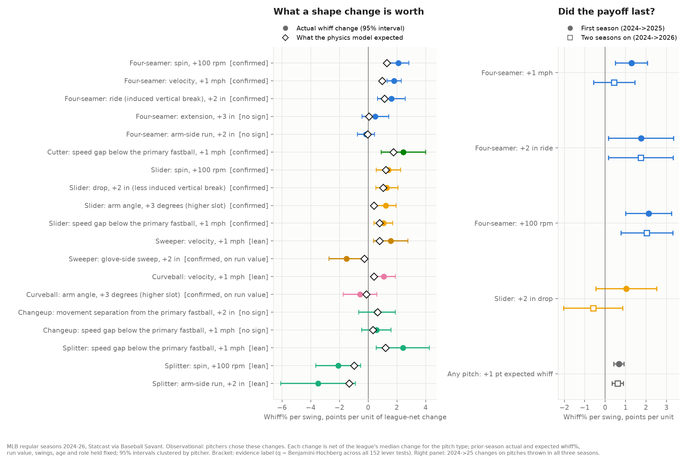
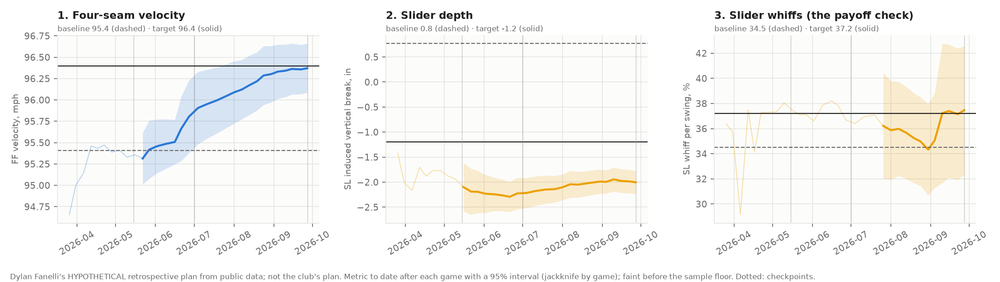

# What pitch-design changes stick and pay, MLB 2024–26

**League study from public pitch data.** Every regular-season pitch of 2024, 2025 and 2026 (Statcast), not a scouting look and not any club's data. It is observational: pitchers chose these changes, so every number below is an association with controls, matching and a placebo, not the result of a randomized pitch-design program.
*Written 2026-10-12, revised 2026-10-13; Dylan Fanelli; Data: Statcast via Baseball Savant, 2,141,219 pitches, 11,839 pitcher-season-pitch types, 1,822 season-over-season pitch pairs from 481 pitchers; Code: `baseball/development/levers.py` (`bb levers 2026`), `baseball/development/idp.py` (`bb idp`); Reviewed in a separate pass 2026-10-13; findings addressed*



## The answer: which levers pay
Each row is the change in a pitch's results per unit of shape change from one season to the next.
- **What the change is net of:** the league's own change for that pitch type that year.
- **What's held fixed:** the previous season's actual whiff%, expected whiff%, run value, swings, age and role. That is how regression to the mean is handled (see Method).
- **Statistics:** standard errors clustered by pitcher, with p-values from a t distribution with (pitchers − 1) degrees of freedom. q is Benjamini–Hochberg across all 152 lever tests (76 levers × whiff and run value).
- **Columns:** the "any change" column is the |change| term from a model that lets increases and decreases differ (positive = a change in *either* direction went with better results; see Method). The placebo is next season's change regressed on last season's results, which it can't have caused.

| Pitch | Change | Whiff% per swing (pts) | Run value per 100 pitches | Physics expected (whiff pts) | Any-change term | Placebo (whiff / run value) | Pairs | Evidence |
|---|---|---|---|---|---|---|---|---|
| Four-seamer | Ride (IVB), +2 in | **+1.62 (0.49)**, q = 0.02 | +0.21 (0.13) | +1.14 | +1.55 (0.72), p = 0.03 | −0.15 / +0.22, p ≥ 0.44 | 545 | Confirmed (whiffs) |
| Four-seamer | Spin, +100 rpm | **+2.09 (0.38)**, q < 0.001 | **+0.42 (0.10)**, q = 0.001 | +1.28 | +0.52 (0.61) | −0.24 / +0.27 (0.17), p = 0.12 | 545 | Confirmed; works mostly through ride and velocity |
| Four-seamer | Velocity, +1 mph | **+1.81 (0.25)**, q < 0.001 | **+0.33 (0.05)**, q < 0.001 | +0.98 | −0.35 (0.39) | **−0.83 (0.40), p = 0.04 / −0.22 (0.11), p = 0.04** | 545 | Association confirmed; selection or recovery not ruled out |
| Slider | Drop, +2 in (less IVB) | **+1.30 (0.39)**, q = 0.02 | +0.01 (0.08) | +1.05 | **+1.98 (0.64), p = 0.002** | −0.10 / +0.05, p ≥ 0.70 | 266 | Confirmed (whiffs); part of the gain looks like "any change" |
| Slider | Speed gap below the fastball, +1 mph | **+1.06 (0.34)**, q = 0.03 | +0.03 (0.07) | +0.80 | +0.19 (0.51) | +0.04 / +0.02, p ≥ 0.87 | 266 | Confirmed (whiffs) |
| Slider | Spin, +100 rpm | **+1.41 (0.44)**, q = 0.03 | +0.13 (0.09) | +1.22 | +0.25 (0.83) | −0.11 / +0.29 (0.17), p = 0.08 | 266 | Confirmed (whiffs); not stable across season pairs |
| Slider | Arm angle, +3° (higher slot) | **+1.22 (0.36)**, q = 0.02 | +0.13 (0.07) | +0.39 | −0.38 (0.58) | −0.13 / −0.16, p ≥ 0.28 | 266 | Confirmed (whiffs) |
| Cutter | Speed gap below the fastball, +1 mph | **+2.45 (0.79)**, q = 0.03 | −0.18 (0.13) | +1.75 | **+1.77 (0.73), p = 0.02** | +0.96 (1.02) / +0.29, 25 pitches | 102 | Confirmed (whiffs), small sample; part looks like "any change" |
| Sweeper | Glove-side sweep, +2 in | −1.50 (0.63), q = 0.15 | **+0.39 (0.12)**, q = 0.03 | −0.27 | +1.24 (1.06) | +2.00 / +0.23, p ≥ 0.15 | 144 | Confirmed on run value only; fewer whiffs |
| Curveball | Arm angle, +3° (higher slot) | −0.56 (0.60) | **−0.31 (0.10)**, q = 0.03 | −0.12 | −0.63 (0.69) | +0.99 / +0.08, p ≥ 0.36 | 163 | Confirmed on run value (a cost) |

Ten levers are confirmed (12 tests at q < 0.05; four-seam velocity and spin pass on both outcomes). Benjamini–Hochberg controls the false-discovery rate under independence or positive dependence among tests (PRDS). Correlated levers within a pitch type plausibly meet that, but it isn't guaranteed.

**Not confirmed** (p < 0.05 alone, not after the correction; 15 rows):
- **Velocity on other pitches:** sweeper velocity +1.57 (0.61) and curveball velocity +1.09 (0.41), both q = 0.11. Curveball velocity also fails its placebo (p = 0.02).
- **Splitters (67 pairs, 44 pitchers):** speed gap +2.41 (0.94), arm-side run −3.48 (1.33), spin −2.09 (0.80), velocity −1.66 (0.67), and separation on run value +0.36 (0.18).
- **Changeups:** arm-side run −1.67 (0.68), so *less* run went with more whiffs; arm angle +0.91 (0.41).
- **Sliders:** release height +1.57 (0.73), separation +1.01 (0.49).
- **Cutters:** separation +1.70 (0.75).
- **Curveballs:** sweep +1.04 (0.52), release side +0.62 (0.31).
- **Sinkers:** ride on run value, −0.22 (0.11) per 2 in.

**No sign of payoff** (both 95% intervals inside ±1 whiff point and ±0.15 runs per 100 per unit; each unit is close to that lever's deliberate-change threshold, and the margins sit below the smallest confirmed effects, +1.06 whiff points and −0.31 runs):
- **Four-seam arm angle:** −0.53 to +0.18 whiff points, −0.08 to +0.11 runs.
- **Sinker release side:** −0.15 to +0.47 points, −0.06 to +0.14 runs.

**Not detected** (49 rows). No detectable effect, but the intervals can't rule out one as large as a confirmed lever. The ones a department asks about:
- **Changeup speed gap:** +0.58 (0.52) whiff points per mph, interval −0.45 to +1.61. The upper end is larger than the confirmed slider gap effect.
- **Other changeup shape:** drop +0.88 (−0.21 to +1.97) and separation +0.62 (−0.68 to +1.91).
- **Four-seam arm-side run and extension:** run −0.75 to +0.45 points; extension −0.43 to +1.43 points and −0.06 to +0.39 runs.
- **Sinker velocity:** +0.18 whiff points (−0.35 to +0.71), but +0.16 runs per 100 (0.08), p = 0.054. That's about half the confirmed four-seam run-value effect and not ruled out. Its placebo also fails (below).
- **Cutter sweep:** −0.72 to +1.98.

**What a player-development department can do with it:**
1. **Four-seamers: ride first, then velocity.**
   - **Ride:** +1.62 whiff points per 2 in. It keeps its size with the other levers held fixed (+1.87 (0.54)), and it passes the placebo.
   - **Spin:** pays mostly through ride and velocity. With the other levers held fixed it falls to +0.81 (0.42), p = 0.06.
   - **Velocity:** the strongest association, +1.81 per mph, but it's the one confirmed lever that fails the placebo on both whiffs and run value. Pitchers who gained velocity *the next year* had lost 0.83 whiff points per later mph the year before, beyond what that year's own velocity explains. That is about 46% of the main effect on whiffs and 67% on run value.
   - **The same pattern on other pitches:** velocity placebos are negative for sinkers (−1.29, p = 0.02) and curveballs (−2.16, p = 0.02), and for six of the eight pitch types overall.
   - **Other signs of recovery in the velocity number:**
     - The actual gain is about twice what the physics predicts (+0.98).
     - Matched velocity gainers show only +0.94 (0.86).
     - Most of the velocity "gain" faded in year two (below).
   - **Read velocity as:** "pitchers whose velocity comes back get their whiffs back," plus some real shape effect the data can't separate from recovery.
2. **Sliders: slower and from a higher slot; drop with a caution.**
   - **Speed gap and arm angle** keep their size in one model (+1.28 (0.50), +1.13 (0.58)) and show no "any change" pattern.
   - **Drop** correlates with speed gap (0.66) and falls to +0.41 (0.69) in the joint model. It also carries a strong any-change term: sliders changed by 2+ inches in either direction gained whiffs.
   - **What the drop number means:** its per-unit slope survives the any-change term (+1.25 (0.41)), so the direction is real, but some of the raw "drop" gain is "redesigned after a bad year."
3. **Sweepers: more sweep bought run value, not whiffs.** +0.39 runs per 100 pitches per 2 in (q = 0.03) with −1.50 whiff points (q = 0.15). Grade wider sweepers on run value. The run-value gain is not shown to last (below).
4. **A changeup redesign has no demonstrated payoff here, which isn't the same as no payoff.**
   - **What the data show:** no changeup lever was detected, and the stuff model predicts small changeup gains (+0.33 per mph of gap) that arrive at 41%.
   - **What can't be ruled out:** an effect as large as the confirmed slider levers.
   - **Where the answer probably is:** changeup results depend on what this study doesn't measure (location, sequencing, deception; see the familiarity study's wear-out results).
5. **Score a specific design with the expected-whiff model, and use this table for direction.**
   - **Pooled:** the stuff model's single expected-whiff change predicts next season's whiff change better than the lever-by-lever model, by 7.5 points of squared error (3.6 to 11.4).
   - **By pitch type:** only sinkers separate (+15.4, 2.1 to 26.9). Four-seamers tie (−1.8, −6.6 to +3.4), and every other type's interval spans zero.

## Method

**Grain.**
- **Pitch-season:** one row per pitcher × season × pitch type (Statcast's label; knuckle-curves pooled with curveballs), regular season only.
- **Pair:** the same pitcher and pitch type in two consecutive seasons, both with at least 150 pitches and 50 swings: 886 pairs for 2024→25 and 936 for 2025→26.

**The levers.**
- **Shape:** per pitch-season means of velocity, induced vertical break, horizontal break in the pitch's own direction (arm side for four-seamers, sinkers, changeups and splitters; glove side for the rest), spin, release height and side (arm side +), extension and arm angle.
- **Relative levers for secondaries:** speed gap and movement separation (inches, IVB × break plane) from the pitcher's primary fastball.
  - **The reference:** his most-thrown four-seamer, sinker or cutter over *both* seasons compared, so it's the same pitch in both years.
  - **Not levers for four-seamers and sinkers.**

**Net of the league.** Each change is minus the median change of every returning pitch of that type in the same season pair. The league moved:
- **Four-seam spin:** +21 rpm in 2024→25 and −12 rpm in 2025→26.
- **Arm angle:** −0.6° on four-seamers in 2024→25.

Those are camera and ball changes or league-wide training trends, not one pitcher's work.

**A deliberate change, defined from noise.**
- **The noise reference:** how far a pitch's shape moves between the first and second half of one season (split where half its pitches had been thrown), net of the league's half-to-half shift.
- **The threshold:** the 90th percentile of that movement, by pitch type and lever. Examples: four-seam velocity 0.96 mph, four-seam IVB 1.13 in, four-seam spin 66 rpm, slider IVB 2.09 in, slider speed gap 1.18 mph, changeup speed gap 0.96 mph, sweeper sweep 2.37 in, arm angle 2.8–3.3°.
- **Why it's conservative:** a half-season mean has twice the sampling variance of a full-season mean, and the halves also carry in-season drift.
- **What it found:** 19–28% of pitch pairs changed beyond the threshold on each lever (horizontal break 19.4%, spin 19.9%, separation 19.8%, velocity 23.2%, arm angle 28.2%), against at most 10% if seasons moved only as much as halves do. Season-to-season shape change is mostly real change.
- **Its limit:** with ten levers per pitch, 79% of pitch pairs cross at least one threshold. "Deliberate" means beyond within-season noise on that lever; the data can't show intent.

**Expected whiffs (the physics check).**
- **One model for all three seasons:** the edge engine's expected-whiff model (gradient boosting on velocity, movement, spin, release, extension, arm angle, differences from the pitcher's primary fastball, and batter hand).
- **Cross-fitted by pitcher:** trained on 2024–26 pooled, so every pitch of a pitcher, in every season, is scored by a model that never saw him. AUC 0.634 on 1,014,222 swings (stored in `data/edge/levers/summary.json`).
- **Batter-hand mix fixed within each comparison:** every pitch is scored against a same-handed and an opposite-handed hitter, then weighted by that pitch's same-hand share over the two seasons being compared. A change in expected whiff is then a change in physics, not in the mix of hitters. Because the weight belongs to the pair, the same pitch-season can carry a slightly different expected whiff in different pairs (Gilbert's 2025 slider: 38.51 in the 2024→25 pair, 38.36 in 2025→26).

**Payoff per unit (the table above).**
- **The model:** change in whiff% (or run value per 100 pitches, or expected whiff%) on one lever's net change.
  - **Weights:** the harmonic mean of the two seasons' swings (the inverse variance of a change in a rate).
  - **Intercepts and errors:** an intercept per season pair; SEs clustered by pitcher (CR1; 481 pitchers, the same ones in both pairs); p-values from t with G − 1 df.
- **Regression to the mean:** a pitch that had an unlucky season improves the next with no change at all, and pitchers redesign pitches after bad seasons.
  - **The controls:** the prior season's actual whiff%, expected whiff% (a stable read of the pitch's true level), run value, log swings, age, prior role and a role-change flag.
  - **Tested on fictional data built with exactly this selection:** a lever with no effect shows a spurious +1.1 points per unit without the controls and about zero with them (`tests/test_levers.py`).
- **One lever at a time, then all together:** the table is each lever alone (the payoff of changing it, including what usually changes with it). The joint model puts every lever in one regression per pitch type.
- **The any-change term (gains vs. losses):** the net change is split into increases and decreases, which is the same as a model with net change and |net change|.
  - **What the |change| coefficient means:** it is half the gap between the two slopes, with its covariance counted. If it's positive, a change in *either* direction went with better results: the signature of "pitchers who change something after a bad year improve," selection the controls missed.
  - **How often:** 6 of 76 levers have a significant one, all positive, and the average across levers is +0.54.
  - **Where it touches the confirmed levers:** ride, slider drop and cutter gap. Their symmetric slopes are unchanged (ride +1.62, drop +1.25, cutter gap +2.40, from the same model), so the per-unit numbers stand. "Increase only" slopes, by contrast, are inflated by the V shape, which is why this revision drops them.
  - **No gain/loss asymmetry anywhere else.** The earlier draft's "losing velocity costs more than gaining it pays" (−2.22 vs. +1.51 per mph) isn't distinguishable: the difference is −0.71 (0.78), p = 0.37.
- **Multiple testing:** Benjamini–Hochberg across all 152 tests. Confirmed = q < 0.05; lean = q < 0.10 (no lever lands there in this revision).

**Matching (the second design).**
- **Treated:** a deliberate change in one direction on one lever (e.g., four-seam velocity down at least 0.96 mph). **Controls:** the same pitch type with that lever within half the threshold.
- **Coarsened exact matching** on season pair, prior role, role change, and terciles of prior actual and expected whiff% within the pitch type. Then the same weighted regression with the continuous controls, SEs clustered by pitcher.
- **Balance** (median standardized difference across the 84 comparisons, before → after):
  - **On what was matched:** prior whiff% 0.19 → 0.07; prior expected whiff% 0.14 → 0.09; starter share exact.
  - **Not balanced by matching:** prior run value 0.19 → 0.21, age 0.37 → 0.33, log swings 0.19 → 0.19. These rest on the regression adjustment, and in small groups the worst cases exceed 1 SD (age, run value).
- **Results** (84 comparisons, Benjamini–Hochberg across all 168 whiff and run-value p-values): two at q < 0.05, one more at q < 0.10.
  - **Four-seam velocity loss** (mean −1.29 mph): −3.05 (0.78) whiff points against matched controls, q = 0.015. The raw matched difference is −3.07, so the regression adjustment barely moves it. The changers' own average change (−4.57) is a level, not a comparison, and isn't a measure of regression.
  - **Slider drop** (mean +3.1 in more drop): +5.36 (1.38), q = 0.015 (raw matched difference +5.25).
  - **Changeup separation** (+3.35 in): +4.86 (1.47), q = 0.08 (raw +4.74). It doesn't hold in the per-unit model (+0.62 (0.65) per 2 in), so it is a lean at most.
  - **The rest point the same way as the per-unit table but are noisier:** four-seam ride up +2.30 (0.97), spin up +2.46 (0.85), velocity up +0.94 (0.86).

**Placebo: does next year's change "predict" last year's results?**
- **The test:** regress the 2024→25 results change on the 2025→26 net lever change, with 2024 priors and the 2024→25 change in the same lever controlled. A 2025 velocity dip lowers 2025 whiffs and is followed by a 2026 rebound; that is mechanics, not selection.
- **Overall:** 18 of 152 tests at p < 0.05, against 7.6 expected; binomial p = 0.0006 if the tests were independent (they're correlated, so that overstates it). Selection into changing is left after the controls, and it is concentrated in velocity, where the velocity placebos run negative.
- **The test is a falsification check, so failures aren't multiple-testing corrected away.** A placebo that fails at p < 0.05 is reported as a caveat on that lever (the table's Evidence column).
- **Power:** the placebo runs only on pitches thrown in all three seasons (four-seamers 176, sinkers 105, sliders 80, changeups 62, curveballs 53, sweepers 43, cutters 39 and 25 for cutter gap, splitters 23). A "pass" mostly means the test couldn't see much.
  - **Cutter gap:** the placebo is +0.96 (1.02), 39% of the effect.
  - **Four-seam spin's run value:** +0.27 (0.17), 64% of its +0.42.
  - **Sweeper sweep (run value):** +0.23 (0.21), p = 0.28. **Curveball slot (run value):** +0.08 (0.18), p = 0.66.

**Robustness** (whiff points per unit; the last row is from the any-change model):

| Specification | FF velo | FF ride | FF spin | FC gap | SL drop | SL gap | SL spin | SL slot |
|---|---|---|---|---|---|---|---|---|
| Main | +1.81 | +1.62 | +2.09 | +2.45 | +1.30 | +1.06 | +1.41 | +1.22 |
| + usage and platoon-mix change | +1.82 | +1.63 | +2.10 | +2.46 | +1.27 | +1.01 | +1.43 | +1.15 |
| No role changers (92% of pairs) | +1.62 | +1.44 | +2.08 | +2.17 | +1.12 | +0.94 | +1.35 | +1.31 |
| 100+ swings in both seasons | +1.93 | +1.63 | +2.18 | +1.62 | +1.03 | +0.89 | +1.44 | +0.97 |
| 2024→25 only | +1.38 | +1.96 | +2.31 | +2.43 | +1.05 | +0.98 | +2.49 | +1.00 |
| 2025→26 only | +2.16 | +1.36 | +1.91 | +2.84 | +1.54 | +1.26 | +0.24 | +1.36 |
| Without prior-season controls | +2.03 | +1.97 | +2.31 | +2.73 | +1.13 | +1.08 | +1.45 | +1.02 |
| Symmetric slope, any-change term in | +1.86 | +1.62 | +2.10 | +2.40 | +1.25 | +1.06 | +1.35 | +1.23 |

- **Every row keeps its sign and rough size** except slider spin, which is +2.49 in 2024→25 and +0.24 (p = 0.62) in 2025→26. Treat slider spin as unstable.
- **Run-value rows:** sweeper sweep +0.30 to +0.49 runs per 100 across specifications (p ≤ 0.09); curveball slot −0.18 to −0.41 (not significant in 2025→26 alone, p = 0.34).

## Does the physics show up?
How much of a predicted whiff change arrives: the change in actual whiff% on the change in expected whiff% (fixed hand mix), same controls.

| Pitch | Four-seamer | Sinker | Cutter | Slider | Sweeper | Curveball | Changeup | Splitter | All |
|---|---|---|---|---|---|---|---|---|---|
| Actual points per expected point | 0.89 (0.11) | 0.87 (0.29) | 0.63 (0.24) | 1.05 (0.14) | 0.64 (0.29) | 0.20 (0.26) | 0.41 (0.22) | 0.88 (0.25) | **0.74 (0.07)** |

- **About three quarters of a physics-predicted change arrives,** in full for sliders and nearly so for four-seamers.
- **Curveballs and changeups:** a shape change the model likes gets 20–41% of it, and the curveball slope isn't distinguishable from zero.

**Out-of-sample prediction, given the realized shape.** Every model is fit on 2024→25 pairs and scored on 2025→26.
- **What the figures are:** the share of a controls-only baseline's squared error removed (regression to the mean, role, age, sample), with 95% intervals from resampling 2025→26 pitchers.
- **Not a forecast:**
  - It predicts the 2025→26 results change from the 2025→26 shape change, which is known.
  - The expected-whiff model behind both the predictor and the prior-season control was trained on 2024–26, including other pitchers' 2026 outcomes (never the pitcher's own).
  - The league adjustment uses the 2026 league median.
- **The intervals are too narrow:** they hold the fitted models fixed and leave out the training pair's estimation noise.

| Pitch | Pairs (train / test) | RMSE: no change / baseline / every lever / expected whiff | Baseline vs. no change | Every lever | Expected-whiff change only | Expected whiff minus levers |
|---|---|---|---|---|---|---|
| Four-seamer | 267 / 278 | 5.09 / 4.49 / 4.13 / 4.18 | 22.3% (14.7 to 29.5) | **15.1% (7.4 to 22.5)** | **13.3% (7.7 to 18.4)** | −1.8 (−6.6 to 3.4) |
| Sinker | 141 / 157 | 4.16 / 3.45 / 3.60 / 3.33 | 31.3% | −8.7% (−17.6 to 0.2) | 6.7% (−2.3 to 14.6) | **+15.4 (2.1 to 26.9)** |
| Cutter | 47 / 55 | 7.04 / 6.49 / 7.36 / 6.67 | 14.9% (−15.3 to 40.6) | −28.7% (−81.1 to 0.5) | −5.6% (−38.2 to 13.2) | +23.0 (−9.3 to 67.7) |
| Slider | 135 / 131 | 5.89 / 5.23 / 5.31 / 5.00 | 21.2% | −3.1% (−29.2 to 16.3) | 8.6% (−6.0 to 22.1) | +11.6 (−7.6 to 34.9) |
| Sweeper | 64 / 80 | **6.24** / 6.40 / 6.77 / 6.27 | −5.0% (−52.6 to 25.2) | −12.1% (−42.7 to 10.5) | 4.0% (0.2 to 7.5) | +16.1 (−5.7 to 45.2) |
| Curveball | 80 / 83 | 6.88 / 6.83 / 6.44 / 6.78 | 1.4% | 11.0% (−3.9 to 23.7) | 1.5% (−1.5 to 4.1) | −9.5 (−21.4 to 4.3) |
| Changeup | 98 / 104 | 6.04 / 5.35 / 5.46 / 5.28 | 21.5% | −4.1% (−30.2 to 15.1) | 2.7% (−7.8 to 11.9) | +6.8 (−11.4 to 31.1) |
| All pitches pooled | 886 / 936 | 5.53 / 4.86 / 4.83 / 4.64 | 22.7% (18.1 to 27.0) | 1.2% (−2.0 to 4.4) | **8.7% (5.0 to 12.5)** | **+7.5 (3.6 to 11.4)** |

- **Splitters aren't validated:** fewer than 40 pairs in a season pair.
- **Sweepers:** the controls-only baseline and the expected-whiff model are both *worse* than predicting no change at all (RMSE 6.40 and 6.27 against 6.24). Nothing here predicts sweeper whiff changes.
- **Four-seamers:** the levers and the physics summary help about equally (each removes 13–15% of the baseline's error).
- **Everything else:** eight or ten lever coefficients fit on about 100 pairs overfit. The one-number physics summary is better pooled (+7.5) and for sinkers; for the other types the difference isn't distinguishable.

## Persistence: did the shape and the gain last?
For 2024→25 changes, followed into 2026.

**Shape mostly held.**

| Lever | Deliberate 2024→25 changes | Still thrown in 2026 (changers / within noise) | Median share of the change kept | Kept half or more | Reversed past the start |
|---|---|---|---|---|---|
| Velocity | 211 | 61% / 65% | 0.99 | 75% | 7% |
| IVB | 193 | 62% / 65% | 0.86 | 74% | 8% |
| Horizontal break | 181 | 64% / 67% | 0.85 | 67% | 9% |
| Spin | 181 | 62% / 69% | 0.92 | 71% | 8% |
| Speed gap | 120 | 58% / 67% | 0.93 | 77% | 7% |
| Separation | 102 | 67% / 62% | 0.99 | 74% | 12% |
| Arm angle | 248 | 63% / 67% | 0.95 | 68% | 10% |

- **Retention:** across these levers the median pitch kept 85–99% of its change a year later, net of the league's two-year shift (release height, not shown: 82%). The slope of 2024→26 change on 2024→25 change across all pitches is 0.85–0.94.
- **Attrition:** changed pitches were usually somewhat less likely to still be thrown above the floors in 2026 (57.5–66.7% against 62.1–68.8%; separation is the exception). The payoff tables describe pitches that survived.

**Results: the year-two evidence is thin.**
- **The setup:** the same per-unit model on the 581 pitches thrown in all three seasons, with the 2024→25 shape change as the treatment at each horizon.
- **"Fade":** the 2025→26 results change on that same 2024→25 change.
- **"Fade, shape held":** the same fade with the 2025→26 change in that lever held fixed, which separates results fading from the shape reverting.
- **The expected-whiff column:** the shape's own reversion as the physics model reads it.

| Change (2024→25) | Whiff pts 2024→25 | Whiff pts 2024→26 | Fade | Fade, shape held | Expected whiff 2024→25 → 2024→26 | Pitches | Label |
|---|---|---|---|---|---|---|---|
| Four-seam ride, +2 in | +1.75 (0.81) | +1.74 (0.81) | −0.02 (0.92) | −0.13 (0.96) | +1.02 → +0.73 | 176 | Point estimate held; the interval can't exclude a full fade (±1.8) |
| Four-seam spin, +100 rpm | +2.13 (0.57) | +2.04 (0.65) | −0.09 (0.64) | −0.11 (0.65) | +1.31 → +1.16 | 176 | Whiff gain: point estimate held. Run value: +0.46 (0.17) → −0.13 (0.19), fade −0.60 (0.23), p = 0.01: not shown to last (borderline) |
| Four-seam velocity, +1 mph | +1.28 (0.40) | +0.44 (0.52) | −0.85 (0.42), p = 0.05 | −0.43 (0.32), p = 0.18 | +0.90 → +0.65 | 176 | Not shown to last (borderline); about half the fade is velocity reverting |
| Slider drop, +2 in | +1.03 (0.76), p = 0.18 | −0.59 (0.74) | −1.62 (0.77), p = 0.04 | −1.08 (0.74), p = 0.15 | +1.12 → +0.77 | 80 | Not shown in year one in this sample; not shown to last (borderline) |
| Slider speed gap, +1 mph | +0.62 (0.62) | −0.89 (0.67) | −1.51 (0.59), p = 0.01 | −1.21 (0.54), p = 0.03 | +0.50 → +0.32 | 80 | Not shown to last (borderline) |
| Slider slot, +3° | +0.57 (0.67) | +1.55 (0.66) | +0.98 (0.70) | +1.45 (0.72), p = 0.05 | +0.26 → −0.06 | 80 | Year-two gain, borderline |
| Expected-whiff change, +1 pt (all pitches) | +0.67 (0.13) | +0.61 (0.14) | −0.06 (0.14) | +0.10 (0.12) | | 581 | Held (the one clear persistence result) |

- **One label for the year-two results:** "not shown to last (borderline)" for every fade at p = 0.01–0.05, run value included. Dozens of persistence tests were run, and this sample is a third the size of the main one.
- **Four-seam ride:** the point estimate held, but the fade's interval (−1.8 to +1.8) can't tell full retention from losing the whole +1.75.
- **Slider drop:** the year-one gain isn't significant in this smaller sample (p = 0.18), and part of its expected-whiff gain reverted (+1.12 → +0.77).
- **What clearly lasted is the physics-predicted gain, pooled:** gains the expected-whiff model predicted for 2024→25 changes were still there in 2026 (+0.61 per point).
- **Sweeper sweep's run value:** +0.50 (0.20) → −0.01 (0.26), fade p = 0.12. Not shown to last.

## The tool: an individual development plan with a progress engine
`baseball/development/idp.py` turns the study into the plan a coordinator writes and the review a front office reads.

**The plan.** It follows the player-development standard: 2–4 priorities, each with:
- a metric, a dated and sourced baseline, a target and date, and a sample floor
- the mechanism, a weekly process goal and an owner
- checkpoints, and the risk with its own guard metric

Plans are YAML (`examples/`), validated before anything runs, and checked for power. `power_check()` warns when the planned change is smaller than the minimum detectable change at the floor, and says what floor would detect it, or that none would.

**The engine.** For each priority it computes the metric from the plan's start to the as-of date from pitch data:
- **Uncertainty:** an SE by jackknife over games, because pitches in one game share a body, a mound and a day.
- **Metrics:** shape, speed gap and separation, whiff, CSW, zone, chase, usage and run value.
- **Verdicts:**
  - **Insufficient:** under the floor.
  - **On track:** a move toward the target clear of the baseline (z ≥ 1.96, both SEs counted), not clearly short of pace.
  - **Behind:** a real move, but short of pace.
  - **Inconclusive:** no detectable move, and the sample couldn't have detected one of the planned size.
  - **Flat:** no detectable move, though one of the planned size would have shown.
  - **Wrong way:** a real move away from the target.
- **Guards** read ok / watch / breached.
- **Two notes from the same numbers:** one for the coach, and one for the front office with n, intervals, keep / adjust / stop and a recommendation with the condition that would reverse it.
- **Fictional example:** `examples/idp-fictional.yaml` runs the whole flow on fictional pitches.

### Worked example: Logan Gilbert, 2026 (a hypothetical, retrospective plan)
**This is my hypothetical plan written from public data. It is not my club's plan, and nothing here says what the club or the pitcher actually worked on.**

**How the plan was built.** It is written as if in the 2025–26 offseason:
- **Baselines:** his 2025 Statcast data.
- **Targets, recomputed from 2024–25 data alone:**
  - the 2024→25 pairs
  - an expected-whiff model trained on 2024–25 only (his 2025 slider: 36.2%, against 38.4% in the study's pooled model)
  - thresholds from 2024–25 half-seasons: four-seam velocity 0.97 mph, slider IVB 2.06 in. The pooled 2024–26 values (0.96, 2.09) round to the same targets.

**Hindsight in the choice of pitcher:** he was picked *because* the study flags his 2025→26 changes (four-seam velocity +1.04 mph net of the league, slider drop +2.75 in, slider spin +308 rpm). That is selection, and the result can't be read as a test of the method.

**Where he was:**
- **2025 regular season, 25 games:**
  - Four-seamer: 95.4 mph (n = 795), 20.6% whiffs.
  - Slider: +0.8 in IVB (n = 760), 34.5% whiffs on 365 swings, thrown 35% of the time.
- **2024:** his four-seamer averaged 96.6 mph, so 2025 was −1.07 mph net of the league. The velocity target below is a *return* to his 2024 level: exactly the recovery pattern the velocity placebo flags. The data alone don't say why 2025 was lower.

**The plan and its targets** (`examples/idp-gilbert-2026.yaml`):

| # | Priority | Baseline | Target | Where the target comes from | Guard |
|---|---|---|---|---|---|
| 1 | Four-seam velocity | 95.4 mph | 96.4 by May 15 (step), floor 150 pitches | About the deliberate-change threshold and his 2024 level; 2024–25 data priced it at +1.42 (0.33) whiff points per mph | Four-seam zone% stays above 60 |
| 2 | Slider depth | +0.8 in IVB | −1.2 by May 15 (step) | About the slider threshold | Slider zone% stays above 45 |
| 3 | Slider whiffs | 34.5% | 37.2% by season's end | 34.5 + 1.5 expected drift (pre-2026 expected whiff 36.2 against 34.5 actual) + 1.1 for 2 in of drop (2024–25 data: +0.56 per inch, SE 0.33, *not* significant at the time) | Slider usage stays above 28%, so the gain isn't bought by throwing it less |

**The power check, before any 2026 data:**
- **Priority 3 can't be graded.** Its planned change (2.7 points) is far below the minimum detectable change at its floor (9.5), and no floor would fix that: the 2025 baseline's own SE is 3.1 points.
- **A real plan would carry it as a monitoring metric,** or pair it with the physics read.

**Checkpoints, run on his actual 2026 pitches:**

| # | May 15 | July 1 | Season's end (Sept. 27) |
|---|---|---|---|
| 1. Four-seam velocity | flat (95.3, 257 pitches, z = −0.4) | flat (95.8, z = 1.7) | **on track:** 96.4 (96.1 to 96.7), 1,187 pitches; the 96.4 target is inside the interval (97% of the gap) |
| 2. Slider depth | on track (−1.9, 174 pitches) | on track (−2.2) | **on track:** −2.0 in (−2.2 to −1.8), 746 pitches |
| 3. Slider whiffs | insufficient (92 swings) | insufficient (199 swings) | **inconclusive:** 37.5% (32.4 to 42.6), 403 swings; only a change of 7.9 points or more is detectable. Guard **breached:** usage 25.0% (22.6 to 27.4) |



**The front-office note the engine wrote** (season's end, trimmed to the priorities and the call):
> **Priority 1: Four-seam velocity.** 95.4 (2025) → 96.4 (95% interval 96.1 to 96.7; n = 1,187 pitches, 32 games). Target 96.4 by 2026-05-15. Trend up (z = 5.6); 97% of the gap closed. **On track. Keep.** Guard: four-seam zone% 61.8 (58.9 to 64.6), limit 60: ok.
> **Priority 2: Slider depth.** 0.8 → −2.0 in (−2.2 to −1.8; n = 746). **On track. Keep.** Guard: slider zone% 47.9 (43.1 to 52.6), limit 45: ok.
> **Priority 3: Slider whiffs.** 34.5% → 37.5% (32.4 to 42.6; n = 403 swings). The point estimate is past the target but not distinguishable from the baseline; at this sample only a change of 7.9 or more is detectable. **Inconclusive. Hold.** Guard: slider usage 25.0% (22.6 to 27.4), limit above 28: breached.
> **Recommendation:** review priority 3 with the coach: its guard is breached, so the risk the plan named is showing.

**What an analyst adds to the engine's call:**
- **Both shape priorities landed; velocity landed late.** It sat at 95.3 in mid-May and climbed all summer (figure), so the "step" assumption was wrong for this pitcher. A real plan would have moved the date at the July checkpoint.
- **This is a velocity return, not a new gain.** By the study's placebo, part of a velocity payoff is recovery, so the four-seamer's whiff gain shouldn't be credited to the plan. His four-seam whiffs went from 20.6% to 22.7%, against +0.6 predicted (−0.8 drift + 1.4 for the mph); on one pitcher-season that isn't evidence of anything.
- **The slider whiff priority was underpowered by design.**
  - **The physics read:** his slider's expected whiff rose 3.0 points (38.4% → 41.4% in the study's pooled model at a fixed hand mix), so the shape moved the right way.
  - **The guard says the whiff number is confounded.** Slider usage fell from 35% to 25%. By the familiarity study's wear-out results, fewer sliders means hitters have seen fewer of them, which by itself raises whiffs per swing.
  - **The study's own result:** slider-drop gains are not shown to last a second season.
- **His 2026 mix changed in ways a reader should know, from the data alone.**
  - **Cutter:** 152 cutters (5.1%) after none in 2025, but he threw 320 (10.5%) in 2024. It's a return, not a new pitch.
  - **"Changeup":** 215 of them at 85.9 mph and +2.0 in of IVB, beside his splitter (82.0 mph, −2.1 in). That may be a separate grip or a Statcast label split of one pitch; the data can't say which.

## What this doesn't show
- **It's observational.** Changes are chosen, not assigned.
  - **What the design handles:** league drift, regression to the mean (prior actual and expected whiffs), role changes, age and sample. The placebo, the any-change term, matching and the out-of-sample check each probe the known selection.
  - **What two of them find:** the placebo (velocity) and the any-change term (ride, slider drop, cutter gap) both find selection left over.
  - **What it can't handle:** a pitcher who changes a pitch *and* changes something unseen at the same time (health, conditioning, a new pitching coach or organization) gets credited to the shape.
- **Injuries are unseen.** Velocity losses after an injury and gains on the way back sit in the same velocity coefficient, and the velocity placebo says some of that is in there.
- **Location, count and sequencing are not controlled.** They are partly how a pitcher uses a new shape (a mediator). Usage and platoon-mix changes barely move the estimates.
- **Survivorship.** A pair needs 150 pitches and 50 swings in both seasons, so pitches that were changed, failed and were shelved early are missing.
- **Statcast's labels.** A slider that Statcast relabeled as a sweeper (or a new grip that kept its old label) falls out of, or mixes into, a pitch type's pairs. Labels weren't corrected.
- **"Deliberate" means beyond within-season noise on that lever,** not proven intent.
- **The levers are correlated.** Slider drop, speed gap and spin move together; four-seam spin rides on velocity and ride. The data can't hand a coach ten independent dials.
- **Small samples:** splitters (67 pairs, 44 pitchers), cutters as a secondary (102 pairs), and every persistence and placebo test (three-season pitches only).
- **Expected whiff is a whiff-per-swing model,** trained on all three seasons. It doesn't price chase, called strikes or contact quality, which is why the sweeper's run-value gain doesn't show up in it.

## Reproduce
```bash
uv run bb levers 2026                                       # tables -> data/edge/levers/, figure (pools 2024-26)
uv run bb idp examples/idp-gilbert-2026.yaml --figure out.png  # the worked plan on his 2026 pitches (sequence copy needed)
uv run bb idp examples/idp-fictional.yaml                   # the fictional example, no data needed
```

## Sources
- **Pitch data:** Statcast, MLB Advanced Media, via [Baseball Savant](https://baseballsavant.mlb.com/) (regular seasons 2024–2026, pulled through October 2026).
- **Player names and ids:** the Chadwick Bureau register (github.com/chadwickbureau/register, CC BY 4.0), via `bb people`.
- **Multiple testing:** Yoav Benjamini and Yosef Hochberg, "Controlling the False Discovery Rate," *Journal of the Royal Statistical Society, Series B* 57(1), 1995; Yoav Benjamini and Daniel Yekutieli, "The Control of the False Discovery Rate in Multiple Testing under Dependency," *Annals of Statistics* 29(4), 2001 (the PRDS condition).
- **Matching:** Stefano Iacus, Gary King and Giuseppe Porro, "Causal Inference without Balance Checking: Coarsened Exact Matching," *Political Analysis* 20(1), 2012.
- **Clustered standard errors and few-cluster t critical values:** A. Colin Cameron and Douglas Miller, "A Practitioner's Guide to Cluster-Robust Inference," *Journal of Human Resources* 50(2), 2015.
- **Expected whiffs, league baselines and the familiarity results cited:** this repo's edge engine and `reports/2026-league-pitch-familiarity.md`.

---
© 2026 Dylan Fanelli. All rights reserved. See [LICENSE](../LICENSE).
