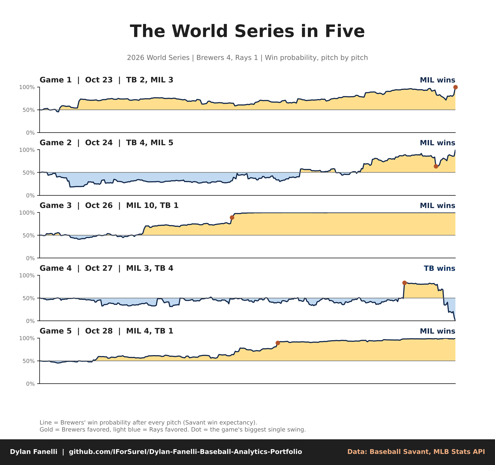
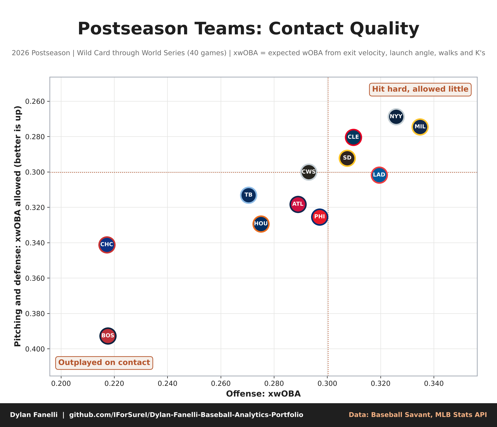
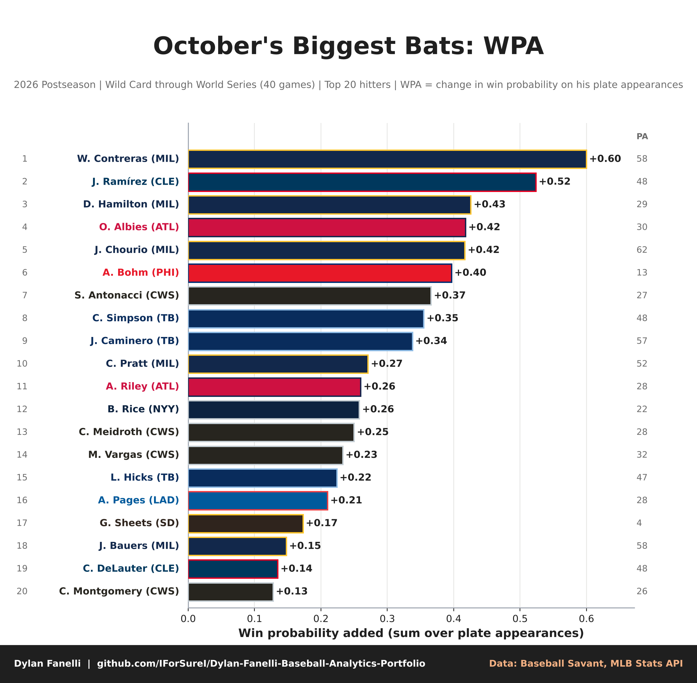
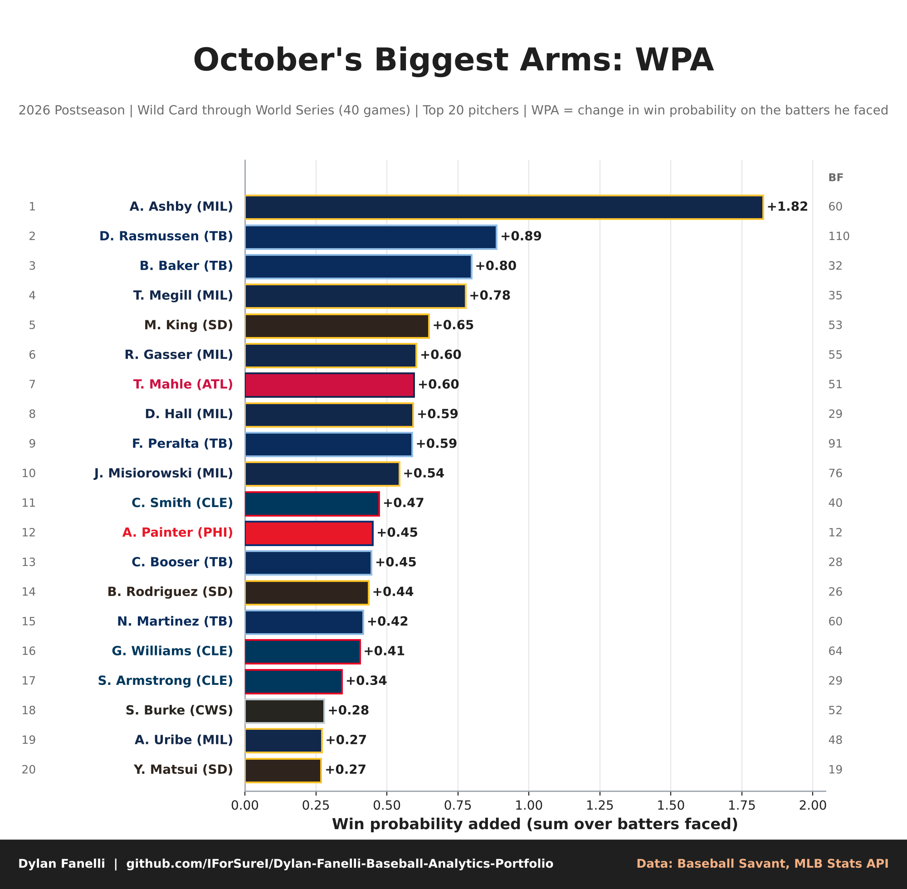
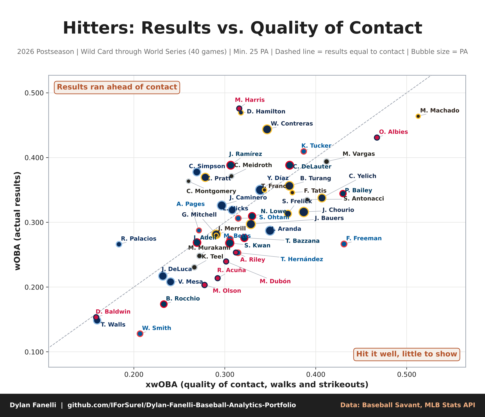
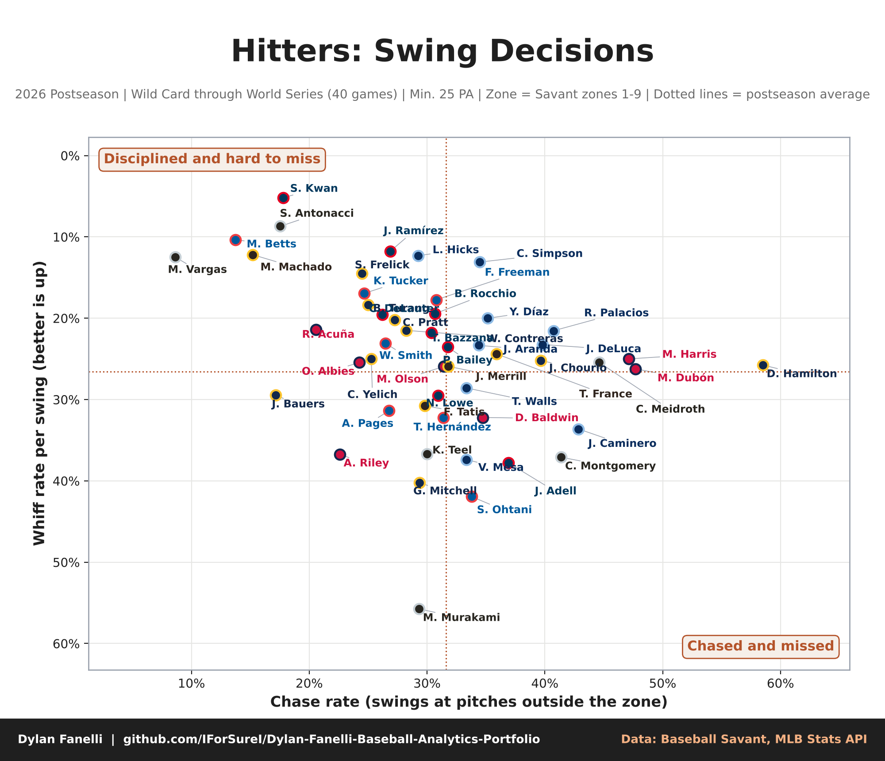
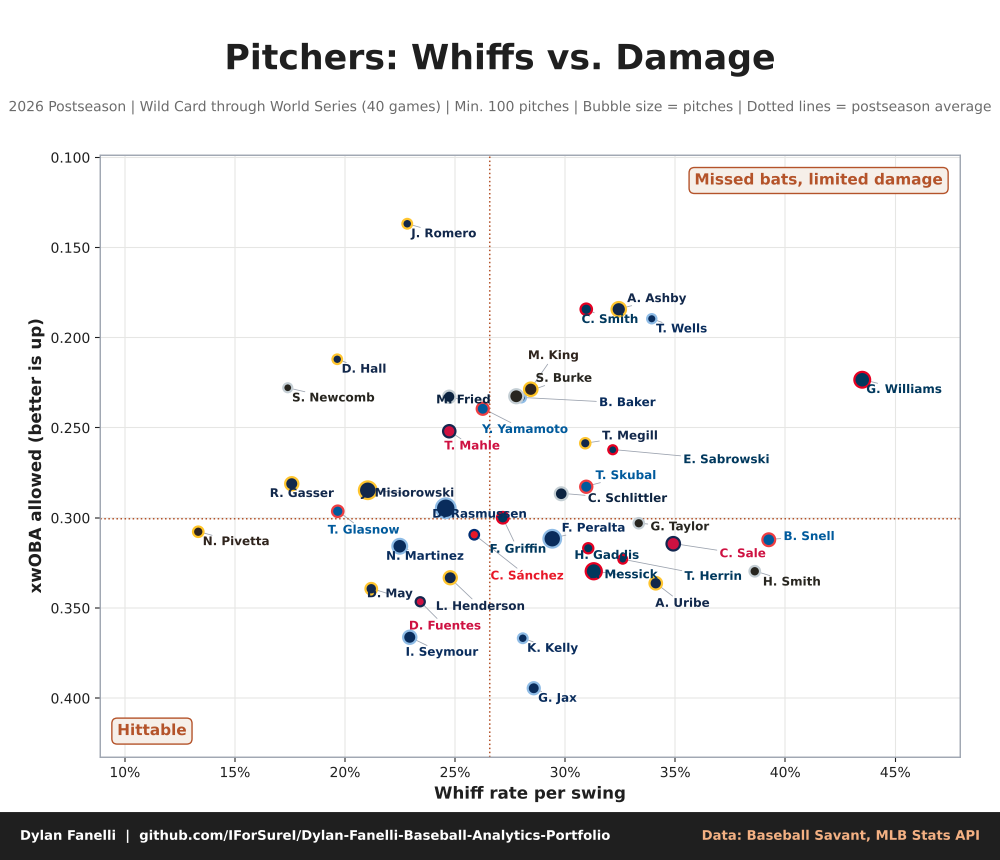
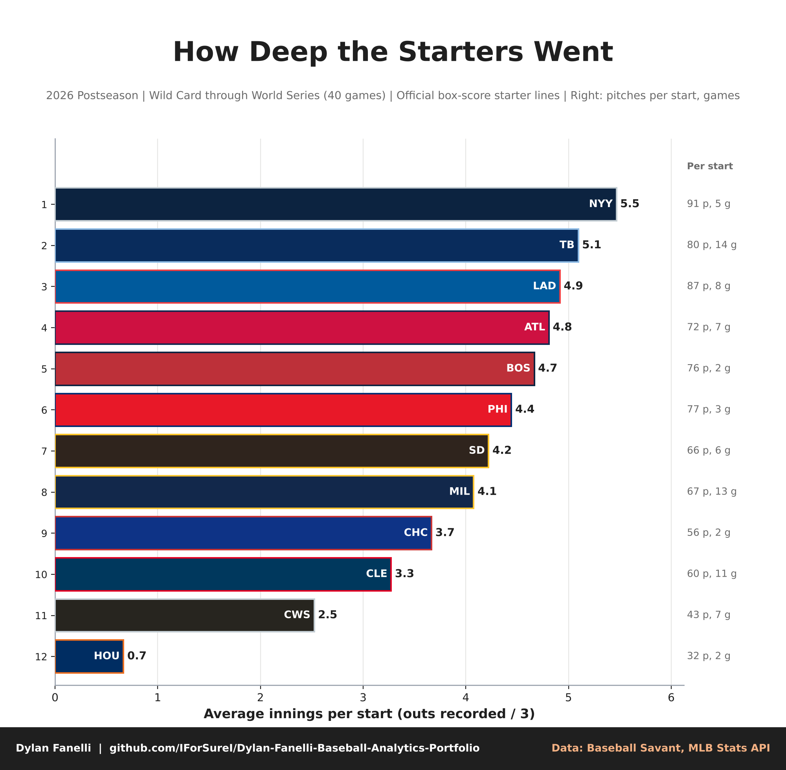
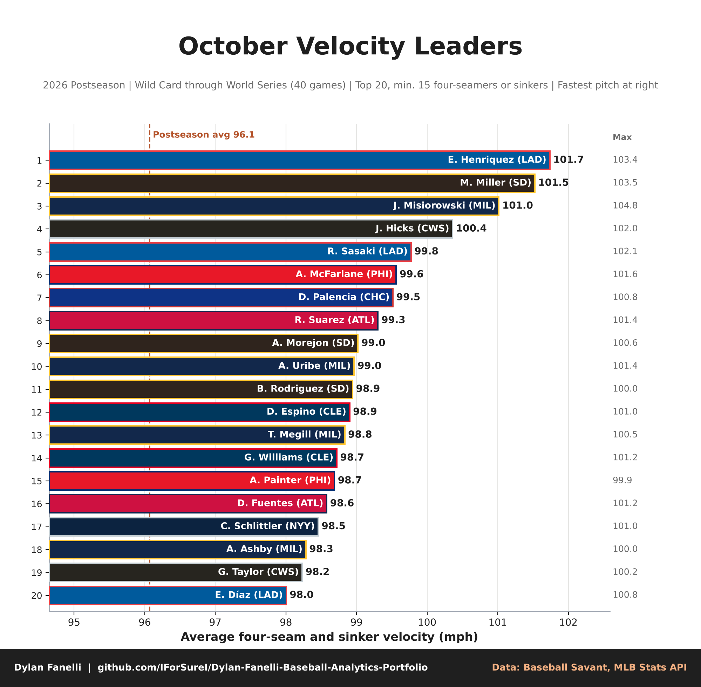
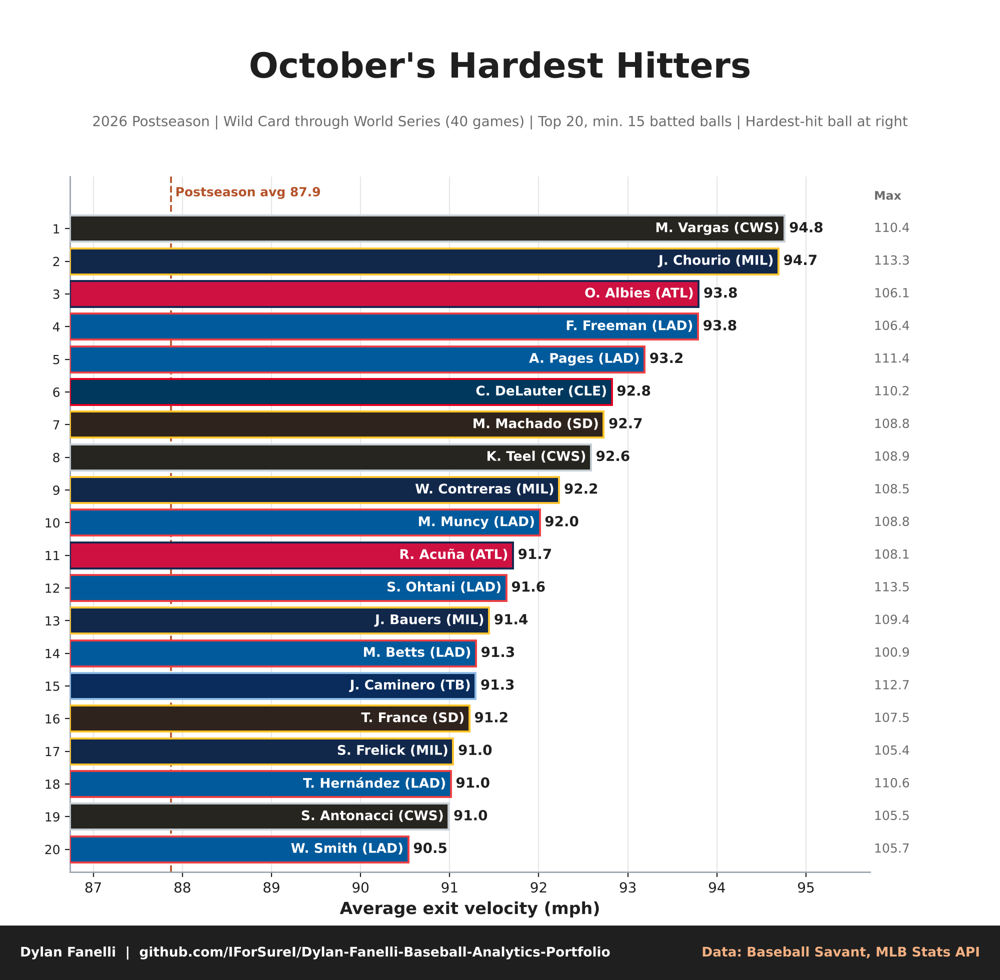

# 2026 Postseason Snippets

Ten quick charts on the 2026 postseason, the kind a front office passes around the morning after the World Series. Every pitch from the Wild Card Series through the World Series: 40 games, 11,513 thrown pitches and 2,928 plate appearances (2026-09-29 to 2026-10-28). Small samples by design: these describe October; they don't project 2027.

| | |
|---|---|
|  |  |
|  |  |
|  |  |
|  |  |
|  |  |

## What each one says

1. **The World Series in Five** ([chart](world_series_wp.png)). The Brewers beat the Rays 4 games to 1 (Game 1 MIL 3-2, Game 2 MIL 5-4, Game 3 MIL 10-1, Game 4 TB 4-3, Game 5 MIL 4-1). Tampa Bay's only win was Game 4, which went 12 innings: Milwaukee scored in the top of the 12th to lead 3-2, and the Rays answered with two in the bottom half.
2. **Teams: Contact Quality** ([chart](team_contact.png)). MIL had the best gap between the contact it made and the contact it allowed: 0.335 xwOBA on offense, 0.275 allowed. The postseason average was 0.300.
3. **October's Biggest Bats: WPA** ([chart](hitter_wpa.png)). W. Contreras (MIL) added +0.60 WPA over 58 plate appearances, ahead of J. Ramírez (CLE) (+0.52).
4. **October's Biggest Arms: WPA** ([chart](pitcher_wpa.png)). A. Ashby (MIL) led every pitcher at +1.82 over 60 batters in relief, most of them from the seventh inning on; next was D. Rasmussen (TB) (+0.89).
5. **Hitters: Results vs. Quality of Contact** ([chart](hitter_xwoba_woba.png)). Among 50 hitters with 25+ plate appearances, F. Freeman (LAD) had the biggest gap the wrong way: 0.431 xwOBA, 0.267 wOBA. M. Harris (ATL) ran furthest ahead of his contact (0.476 vs 0.316).
6. **Hitters: Swing Decisions** ([chart](hitter_swing_decisions.png)). M. Vargas (CWS) chased 8.6% of pitches outside the zone (postseason average 31.6%); S. Kwan (CLE) missed on 5.2% of swings (average 26.6%).
7. **Pitchers: Whiffs vs. Damage** ([chart](pitcher_whiff_xwoba.png)). G. Williams (CLE) got a whiff on 43.5% of swings over 280 pitches and allowed a 0.223 xwOBA.
8. **October Velocity Leaders** ([chart](velo_leaders.png)). E. Henriquez (LAD) averaged 101.7 mph on his four-seamers and sinkers; the fastest pitch of the postseason was J. Misiorowski's 104.8. The postseason average was 96.1.
9. **October's Hardest Hitters** ([chart](ev_leaders.png)). M. Vargas (CWS) averaged 94.8 mph on 16 batted balls, with J. Chourio (MIL) right behind (94.7 on 47). The hardest-hit ball was Y. Díaz's 115.5.
10. **How Deep the Starters Went** ([chart](starter_depth.png)). NYY starters averaged 5.5 innings a start (16.4 outs); HOU starters averaged 0.7 (2.0 outs) over 2 games. The lines come from the official MLB box scores.

## Method notes

- Data: Baseball Savant pitch-level search for 2026 game types F, D, L and W (Wild Card, Division Series, League Championship Series, World Series), pulled one day at a time; names from the MLB Stats API. The official schedule lists 40 completed postseason games, and all 40 are in the pull.
- Win probability is Savant's win expectancy. A plate appearance's WPA is the sum of Savant's pitch-by-pitch changes during it, credited to the batter and to the pitcher who threw the last pitch (Savant's convention). Changes between pitches, such as pickoffs and caught stealings, aren't in Savant's pitch deltas and aren't credited to anyone, so a game's changes fall short of its result by up to about 0.06 and a club's total by up to about 0.08.
- Plate appearances cut short by the end of an inning (Savant's `truncated_pa`) are left out, and automatic balls (intentional walks, pitch-clock violations) are left out of pitch counts and pitch rates.
- xwOBA uses Savant's expected wOBA on balls in play and the actual value on walks, hit-by-pitches and strikeouts.
- Zone = Savant zones 1-9. Whiff rate = swinging strikes and foul tips per swing.
- Starter depth uses the official MLB box scores (outs recorded and pitches thrown by each club's first pitcher). Houston's starters recorded two outs in each of its two games. Innings are shown as outs divided by three (5.5 = 16.5 outs), not box-score notation.
- Velocity and exit-velocity bars start near the leaders' range, not at zero, so read the numbers, not the bar lengths.

## Reproduce

```bash
uv run python -m baseball.postseason --refresh   # re-pulls from Savant and the Stats API
```

Code: [`baseball/postseason.py`](../../baseball/postseason.py). Numbers: [`findings.json`](findings.json).
