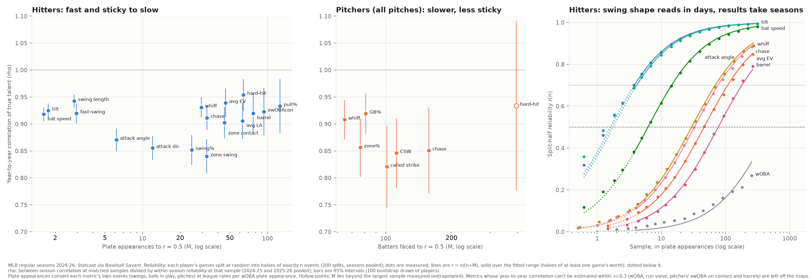

# The Reliability Atlas: which numbers to trust, and when (MLB 2024–26)

**League study from public pitch data.** Every regular-season pitch of 2024, 2025 and 2026 (Statcast), not a scouting look. For 29 pitcher and hitter metrics (157 metric groups once pitcher metrics are split by pitch type) it measures:
- how fast each metric becomes signal
- how much of it carries into the next season
- how much a player's true level moves within a season
- how far to regress it

**Validation.** The regression function was tested on seasons its parameters never saw.
- **2026 was also the development test set,** so it isn't a clean holdout: one design choice was dropped after it failed there.
- **The clean holdout is a replication,** fit on 2024 and tested on 2025, run once after every choice was fixed. It agrees.

*Written 2026-10-13; Dylan Fanelli; Data: Statcast via Baseball Savant, 2,134,079 pitches (the 2,141,219 rows in the other studies, less 7,140 automatic balls and strikes with no pitch thrown), 7,288 games, 1,310 pitchers, 905 batters; Code: `baseball/evaluation/reliability.py`; Reviewed in a separate pass 2026-10-13; findings addressed*



## The answer
**How to read the tables.**
- **M** is the sample, in the metric's own events, at which split-half reliability reaches 0.5. At that point signal and noise are equal, so you regress halfway. It is also the regression constant: estimate = (n × observed + M × league) / (n + M).
  - **"Beyond data"** means M is larger than the largest sample measured, so it is an extrapolation of the fitted curve.
  - **"Measured 0.5 at"** appears where the measured curve crosses 0.5 more than 25% away from M.
- **n for r = 0.7** is 7M/3 under the fitted curve. The measured crossing is shown where it differs by more than 25% or wasn't reached.
- **ρ (rho)** is the year-to-year correlation of true talent: same players, same sample size, between-season correlation divided by within-season reliability. 1.0 means the skill carries over completely.
  - **When it's "too imprecise":** its SE is above 0.15, and `regress()` won't use it.
- **Drift** is the standard deviation of a player's true change from the first calendar half of a season to the second, net of sampling noise, with a 95% interval.
  - **"n.s."** means the interval includes 0. Such drift is not used to widen intervals.
- **Intervals** are 95%, from a bootstrap of players.
- **"No signal"** means within-season reliability stayed under 0.2 at the largest sample the data allow.

**Hitters**

| Metric | n counts | M (95% CI) | M in PA | n for r = 0.7 | ρ year to year (95% CI) | Drift SD (95% CI) |
|---|---|---|---|---|---|---|
| Bat speed | competitive swings | 2.6 (2.4–2.9) | 1.6 | 6.1 | 0.92 (0.90–0.93) | 0.66 mph (0.61–0.72) |
| Swing path tilt | competitive swings | 2.9 (2.6–3.2); measured 0.5 at 2.2 | 1.8 | 6.7 | 0.92 (0.91–0.94) | 1.03° (0.96–1.10) |
| Swing length | competitive swings | 4.6 (4.1–5.2) | 2.8 | 11 | 0.94 (0.93–0.95) | 0.11 ft (0.10–0.12) |
| Fast-swing rate (75+ mph) | competitive swings | 4.8 (4.2–5.4) | 3.0 | 11 | 0.92 (0.90–0.94) | 5.6 pts (4.9–6.1) |
| Attack angle | competitive swings | 10 (9–11) | 6.2 | 23 | 0.87 (0.85–0.89) | 1.51° (1.35–1.66) |
| Attack direction | competitive swings | 19 (18–21) | 12 | 45 | 0.86 (0.83–0.88) | 1.92° (1.63–2.18) |
| Whiff per swing | swings | 55 (49–63) | 30 | 129 | 0.93 (0.91–0.95) | 2.4 pts (0.7–3.3) |
| Zone contact | swings in the zone | 58 (51–67) | 45 | 136 | 0.90 (0.87–0.93) | 1.9 pts (0–2.7), n.s. |
| Zone swing | pitches in the zone | 63 (56–71) | 33 | 147 | 0.84 (0.81–0.87) | 3.0 pts (2.4–3.5) |
| Chase | pitches outside the zone | 65 (59–72) | 33 | 152 | 0.91 (0.89–0.93) | 2.7 pts (2.0–3.3) |
| Swing % | pitches | 97 (88–107) | 25 | 227 | 0.85 (0.82–0.88) | 2.9 pts (2.5–3.3) |
| Average exit velocity | balls in play | 32 (28–36) | 46 | 74 | 0.94 (0.91–0.97) | 0.29 mph (0–1.08), n.s. |
| Hard-hit % (95+) | balls in play | 44 (39–50) | 64 | 102 | 0.95 (0.92–0.98) | 2.2 pts (0–3.9), n.s. |
| Average launch angle | balls in play | 43 (38–49) | 63 | 101 | 0.91 (0.87–0.94) | 2.09° (0.33–2.93) |
| Barrel % | balls in play | 53 (46–61) | 77 | 123 | 0.92 (0.88–0.96) | 1.7 pts (0.7–2.4) |
| xwOBA on contact | balls in play | 64 (55–74) | 94 | 149 | 0.92 (0.88–0.97) | .016 (0–.029), n.s. |
| Pull % | balls in play | 86 (76–98) | 126 | 201, beyond data (r = 0.69 at 181) | 0.93 (0.88–0.98) | 2.7 pts (0–4.0), n.s. |
| wOBA | PA | 511 (374–699); beyond data (largest n 256, r = 0.27) | 511 | 1,192, beyond data | too imprecise (0.92, 0.55–1.30) | .019 (0–.032), n.s. |
| Run value per 100 pitches | pitches | 1,985 (1,482–2,659); beyond data (largest n 1,024, r = 0.28) | 506 | 4,632, beyond data | too imprecise (0.90, 0.54–1.26) | 0.52 (0–0.78), n.s. |

**Pitchers, all pitches**

| Metric | n counts | M (95% CI) | M in BF | n for r = 0.7 | ρ year to year (95% CI) | Drift SD (95% CI) |
|---|---|---|---|---|---|---|
| Ground-ball % | balls in play | 56 (48–65) | 81 | 130; measured: not reached (r = 0.68 at 181) | 0.92 (0.88–0.96) | 1.5 pts (0–3.0), n.s. |
| Whiff per swing | swings | 121 (108–137) | 65 | 283 (measured 456) | 0.91 (0.87–0.94) | 2.0 pts (1.1–2.6) |
| Zone % | pitches | 300 (264–341) | 77 | 700 (measured 1,005) | 0.86 (0.80–0.91) | 1.7 pts (1.2–2.0) |
| Chase | pitches outside the zone | 313 (271–362); measured 0.5 at 429 | 157 | 731, beyond data (r = 0.54 at 724) | 0.85 (0.77–0.93) | 1.5 pts (0–2.1), n.s. |
| Called-strike % | pitches | 396 (343–458); measured 0.5 at 606 | 101 | 925; measured: not reached (r = 0.62 at 1,024) | 0.82 (0.75–0.90) | 0.7 pts (0–1.0), n.s. |
| CSW | pitches | 438 (384–500) | 112 | 1,023; measured: not reached (r = 0.62 at 1,024) | 0.85 (0.78–0.91) | 1.2 pts (0.5–1.6) |
| Hard-hit % (95+) | balls in play | 271 (229–320); beyond data (largest n 181, r = 0.39) | 396 | 632, beyond data | 0.93 (0.78–1.09) | none detected |
| Run value per 100 pitches | pitches | 1,932 (1,560–2,394); beyond data (largest n 1,024, r = 0.27) | 493 | 4,508, beyond data | too imprecise | 0.29 (0–0.60), n.s. |
| xwOBA on contact | balls in play | no signal (r = 0.15 at 181) | | | too imprecise | none detected |
| Barrel % | balls in play | no signal (r = 0.18 at 181) | | | too imprecise | 1.2 pts (0–2.0), n.s. |

**Pitchers, by pitch type: M** (in swings, pitches, out-of-zone pitches or balls in play of that type; * = beyond data)

| Metric | FF | SI | FC | SL | ST | CU | CH | FS |
|---|---|---|---|---|---|---|---|---|
| Whiff per swing | 77 | 92 | 75 | 41 | 57 | 53 | 42 | 38 |
| Ground-ball % | 52 | 40 | 49* | 60* | 66* | no signal | 40 | 53* |
| Chase | 128 | 69 | 103* | 90 | 101* | 78 | 64 | 113* |
| Zone % | 149 | 112 | 101 | 78 | 82 | 65 | 54 | 52 |
| Called-strike % | 139 | 110 | 131 | 105 | 62 | 50 | 112 | 97 |
| CSW | 232 | 194 | 200* | 109 | 123 | 125 | 89 | 108 |
| Hard-hit % | no signal | 92* | no signal | 101* | no signal | 57* | 57* | 73* |
| xwOBA on contact | no signal | 163* | no signal | no signal | no signal | no signal | no signal | no signal |
| Barrel %, run value | no signal | no signal | no signal | no signal | no signal | no signal | no signal | no signal |

**Pitch physics: reliability of one game** of a typical outing's pitches of the type (two-level model, Finding 5)

| Metric | FF | SI | FC | SL | ST | CU | CH | FS |
|---|---|---|---|---|---|---|---|---|
| Arm angle | 0.97 | 0.98 | 0.97 | 0.97 | 0.97 | 0.97 | 0.97 | 0.96 |
| Extension | 0.93 | 0.93 | 0.91 | 0.91 | 0.91 | 0.91 | 0.90 | 0.91 |
| Velocity | 0.90 | 0.91 | 0.89 | 0.87 | 0.89 | 0.93 | 0.92 | 0.91 |
| Spin rate | 0.85 | 0.82 | 0.89 | 0.90 | 0.91 | 0.93 | 0.89 | 0.89 |
| Induced vertical break | 0.81 | 0.92 | 0.77 | 0.79 | 0.78 | 0.88 | 0.86 | 0.73 |
| Horizontal break | 0.87 | 0.72 | 0.72 | 0.82 | 0.65 | 0.87 | 0.69 | 0.69 |

**By pitch type: ρ year to year** ("–" = too imprecise; `regress()` clips ρ at 1, so splitter whiff's 1.02 is used as 1.00)

| Metric | FF | SI | FC | SL | ST | CU | CH | FS |
|---|---|---|---|---|---|---|---|---|
| Arm angle | 0.97 | 0.98 | 0.97 | 0.97 | 0.97 | 0.96 | 0.96 | 0.96 |
| Extension | 0.97 | 0.97 | 0.96 | 0.97 | 0.97 | 0.95 | 0.96 | 0.97 |
| Velocity | 0.94 | 0.95 | 0.91 | 0.89 | 0.92 | 0.94 | 0.95 | 0.95 |
| Spin rate | 0.93 | 0.94 | 0.94 | 0.95 | 0.95 | 0.97 | 0.91 | 0.92 |
| Induced vertical break | 0.94 | 0.95 | 0.83 | 0.78 | 0.86 | 0.94 | 0.90 | 0.89 |
| Horizontal break | 0.93 | 0.91 | 0.81 | 0.90 | 0.78 | 0.91 | 0.86 | 0.88 |
| Whiff per swing | 0.86 | 0.91 | 0.69 | 0.94 | 0.86 | 0.92 | 0.83 | 1.02 |
| Chase | 0.88 | 0.85 | 0.61 | 0.85 | 0.89 | 0.77 | 0.85 | – |
| Zone % | 0.82 | 0.72 | 0.79 | 0.75 | 0.86 | 0.84 | 0.73 | 0.85 |
| CSW | 0.73 | 0.81 | 0.65 | 0.89 | 0.84 | 0.83 | 0.90 | – |
| Ground-ball % | 0.98 | 0.91 | 0.88 | 0.78 | – | – | 0.81 | – |

The full tables are in `data/edge/reliability/`:
- `params.parquet`: every metric, with CIs, τ, the two-level components, M among full-time players, and per-season-pair ρ
- `cohort_summary.parquet`
- `simulation_checks.json`

The shipped constants are in `baseball/evaluation/reliability_params.json`.

## Summary
- **Regressing helps out of sample, and never made a metric significantly worse.**
  - **Within the season** (2026 first half → second half, parameters fit on 2024–25):
    - regressing cut the error for 135 of the 147 metric groups that could be scored this way (of 157)
    - 103 are significant after a Benjamini–Hochberg correction (106 by bootstrap interval)
    - median RMSE cut 26.8%
  - **The next season** (2025 → 2026): better for 91 of 96 metrics, 68 significant after correction; median cut 15.6%.
  - **The clean replication** (fit on 2024, test 2025): better for 140 of 145, 109 significant after correction; median cut 25.8%.
  - **Got worse:** 1 of 595 metric × sample-size cells in the 2026 tests (splitter zone%, largest-sample bucket), and none of 353 in the replication.
- **Honest intervals need two more numbers:** year-to-year persistence (ρ) and in-season drift.
  - **Next season, with ρ:** 95% predictive intervals covered a median 94% of outcomes (80% intervals: 80%).
  - **Using the within-season weight alone:** 74% and 54%.
  - **Within the season:** significant drift raised the 10th-percentile metric's 95% coverage from 70% to 92%.
- **Five results:**
  1. **Swing tracking reads faster than anything else measured on a hitter, and it carries over.**
     - **Speed:** bat speed reaches r = 0.5 at 2.6 competitive swings and r = 0.7 at about 6, one game. Swing path tilt and swing length are almost as fast.
     - **Persistence:** all carry over at ρ = 0.92–0.94.
     - **The exception:** attack angle and attack direction take 10 and 19 swings, carry over less (0.87, 0.86), and drift about 0.44 talent-SDs within a season against 0.25 for bat speed.
     - **A leak check:** a leak-free version of Statcast's competitive-swing rule, with the cut taken from the previous season, gives the same answer (M = 2.8 vs 2.7 on the same batters).
  2. **Pitch physics are reliable within one outing, but pitches aren't the unit: games are.**
     - **The noise structure:** most of the noise in a pitcher's velocity, spin and shape is day to day. For four-seam velocity the day-to-day SD is 0.67 mph, against 0.94 mph pitch to pitch and a 2.26 mph talent spread.
     - **What that means for one outing:** 100 four-seamers in one start carry a regression weight of 0.92 with an SD of 0.64 mph. The same 100 over four games carry 0.98 and 0.34 mph.
     - **Splitting by pitch instead of by game** overstates reliability 2–8 times for these metrics. It overstates it 1.3–1.4 times for bat tracking.
  3. **Contact quality allowed shows little signal at the pitcher level, but some at the pitch-type level.**
     - **All pitches:** pitchers' xwOBA on contact shows no within-season signal (r = 0.15 at 181 balls in play), and hard-hit rate needs an extrapolated 271 balls in play. Hitters reach r = 0.5 at 64 and 44.
     - **By pitch type:** in fixed cohorts of heavy users, hard-hit rate on changeups and curveballs reaches r = 0.5 at about 52–60 balls in play of that pitch. That is about as fast as hitters' 44.
     - **Not tested:** why it washes out across a pitcher's whole mix.
  4. **Chase is mostly the hitter's.** A pitcher's chase rate needs 313 out-of-zone pitches (measured: 429) to reach r = 0.5, against 65 for a hitter.
  5. **M depends on who you measure for some metrics, not all.**
     - **The test:** on a fixed cohort of full-time players, so the population can't change with n.
     - **Where it matters:** wOBA's M is 701 among hitters with 512+ PA, against 511 for everyone. Pitchers' chase is 418, against 313.
     - **Where it doesn't:** whiff, CSW and hard-hit rates move less than 5%.

## What a club can do with it
1. **Regress every number with `regress()`, and pick the horizon.** Worked examples below, hypothetical players against 2026 league means, with the shipped 2024–26 constants. Each row reads: estimate, then 95% interval for his true level.

   | Player | This season's level | Rest of this season | Next season |
   |---|---|---|---|
   | Hitter: 40.0% whiff in 50 swings (league 25.1%) | 32.2% (23.4–40.9) | 32.2% (22.2–42.1) | 31.7% (22.4–41.0) |
   | Hitter: 75.0 mph bat speed in 30 competitive swings (league 72.1) | 74.8 (73.2–76.3) | 74.8 (72.8–76.8) | 74.5 (72.0–77.1) |
   | Changeup: 45% whiff on 40 swings (league 31.4%) | 38.0% (27.8–48.2) | 38.0% (27.8–48.2) | 36.9% (25.3–48.5) |
   | Hitter: .400 wOBA in 150 PA (league .324) | .341 (.302–.380) | .341 (.302–.380) | not given (ρ too imprecise) |
   | Pitcher: 96.0 mph four-seamers, 100 pitches in ONE game (league 94.8) | 95.9 (94.6–97.2) | 95.9 (94.2–97.6) | 95.8 (93.9–97.8) |
   | The same 100 four-seamers over FOUR games | 96.0 (95.3–96.6) | 96.0 (94.7–97.2) | 95.9 (94.3–97.5) |

   **How to read it:**
   - **Bat speed:** 30 swings already carry 92% weight.
   - **wOBA:** 150 PA carry 23%.
   - **Rest of season:** it widens only where in-season drift is significant. For wOBA and changeup whiff rate it isn't, so those rows equal this season's.
   - **Pitch physics:** pass `games=`. Without it, `regress()` assumes the median pitches per game and warns.
   - **What the validation tested:** these are intervals for the player's true level. The validation tested the predictive version, which brackets a future observed value of n₂ events by adding its noise, M τ²/n₂.
2. **Use swing tracking as the first read on a new hitter.**
   - **What a week tells you:** bat speed and tilt reach r ≥ 0.85 within 16–23 competitive swings; swing length reaches 0.83 at 23.
   - **What it doesn't:** the same week says almost nothing about his wOBA (r = 0.05 at 16 PA).
   - **Watch attack angle and direction over time.** They are the ones that move.
3. **Judge pitchers' contact quality by pitch type, not in total.**
   - **The whole-mix numbers are mostly noise in a season:** xwOBA on contact and barrels allowed show no signal; hard-hit rate needs about 400 batters faced, an extrapolation.
   - **On changeups and curveballs,** hard-hit rate allowed carries real signal by about 50–60 balls in play of that pitch. Whether it persists across seasons can't be measured yet (ρ too imprecise).
4. **For velocity and shape, count outings, not pitches.**
   - **One outing:** reliable (r ≈ 0.9 for velocity).
   - **Pitches within it aren't independent.** One 100-pitch start is worth much less than 100 pitches spread over several games.
   - **A drop is not proof of decline.** Net of noise and the league's own shift, pitchers' true fastball velocity moves by a standard deviation of 0.55 mph (0.51–0.58) between the halves of a season. A 0.5 mph change is ordinary on its own.
5. **Quote a stabilization point with its population** where it matters (wOBA, pitchers' chase). For full-time players those need more sample than the all-player M.

## Findings

### 1. Swing tracking: fastest to read; attack angle and direction move more
| Metric (competitive swings) | M | r at 11 swings | ρ | Drift / talent SD |
|---|---|---|---|---|
| Bat speed | 2.6 | 0.81 | 0.92 (0.90–0.93) | 0.25 |
| Swing path tilt | 2.9 | 0.79 | 0.92 (0.91–0.94) | 0.27 |
| Swing length | 4.6 | 0.71 | 0.94 (0.93–0.95) | 0.28 |
| Attack angle | 10.0 | 0.52 | 0.87 (0.85–0.89) | 0.43 |
| Attack direction | 19.4 | 0.36 | 0.86 (0.83–0.88) | 0.45 |

**Talent SD** in the last column is measured directly from the half covariances.

- **Bat speed, tilt and length:** one or two games read them, they carry over at 0.92–0.94, and they move little within a season.
- **Attack angle and direction:**
  - slower to read and less persistent
  - drift nearly twice as much relative to their spread
  - **Possible reasons:** approach, matchups or how pitchers attack the hitter. None was tested here.
- **Compared with results:** a hitter's whiff rate (M = 55 swings) needs about 20 times the sample of his bat speed.
- **Competitive swings, and whether they leak.**
  - **The rule:** Statcast's competitive swings are the fastest 90% of a batter's swings plus any 60+ mph swing hit 90+ mph.
  - **The worry:** the 90% cut uses the whole season, so it is shared by both halves of a split and by both halves of the within-season validation.
  - **The test:** take the cut from the batter's previous season instead, on the same batter-seasons both ways (2025–26, batters with a previous season):

| Bat speed, same batter-seasons | M (95% CI) | 2026 within-season RMSE cut | 80% / 95% coverage |
|---|---|---|---|
| Statcast's season cut | 2.72 (2.37–3.13) | 0.9% (−2.2 to 4.2) | 82% / 95% |
| Previous season's cut (no leak) | 2.77 (2.40–3.20) | 2.1% (−2.1 to 7.1) | 81% / 94% |

  - **The result:** no sign of leakage.
  - **An earlier check** used a fixed 50 mph floor (M = 4.3). It counted a different set of swings, with per-swing noise of 29.5 mph² against 19.5, so it measured a different metric, not leakage.

### 2. Splitting by game is not a detail
Each row compares M from a split by game (halves never share a game) with M from a split by single events (what a pitch-level random split does). Same data, 40 splits each.

| Metric | M, by game | M, by pitch | Ratio |
|---|---|---|---|
| Slider velocity | 0.88 | 0.12 | 7.65 |
| Four-seam velocity | 0.96 | 0.21 | 4.68 |
| Four-seam IVB | 1.83 | 0.44 | 4.14 |
| Four-seam arm angle | 0.24 | 0.06 | 4.03 |
| Four-seam spin | 1.42 | 0.41 | 3.49 |
| Swing path tilt | 2.84 | 2.02 | 1.41 |
| Attack angle | 9.97 | 7.43 | 1.34 |
| Bat speed | 2.63 | 2.06 | 1.28 |
| Four-seam whiff (pitchers) | 79 | 63 | 1.26 |
| Hitter whiff | 55 | 48 | 1.16 |
| Hitter chase | 64 | 62 | 1.05 |
| Hitter exit velocity | 32 | 30 | 1.04 |

- **Why:** a day's conditions (opponent, park, weather, how the player feels) are shared by every pitch that day. A pitch-level split puts the same day in both halves, so that shared part counts as skill.
- **Where it matters most:** pitch physics, where the day-to-day swing is large next to pitch-to-pitch noise (Finding 5).
- **Where it matters least:** hitters' chase and exit velocity (1.04–1.05). Why those two are nearly immune wasn't tested.
- **A check on a fictional league** with a known day effect: by game, M came out at 3.18 against a theoretical 3.5. A pitch-level split gave 1.27 (`simulation_checks.json`).

### 3. The same metric, different populations
With the open population, the players measured change with n, because only regulars reach large samples. A fixed cohort holds them constant: only player-seasons with at least 2 × n_cohort events, measured at every n up to n_cohort, with 60 splits and 40 bootstrap draws.

| Metric | Cohort (player-seasons) | M, fixed cohort (95% CI) | M, all players | Talent SD, cohort vs all |
|---|---|---|---|---|
| Hitter wOBA (PA) | 385 with 512+ PA | 701 (432–1,138) | 511 | .020 vs .030 |
| Pitcher chase (out-of-zone pitches) | 457 with 724+ | 418 (349–501) | 313 | 2.4 vs 2.9 pts |
| Pitcher CSW (pitches) | 777 with 1,024+ | 457 (397–528) | 438 | 2.1 vs 2.2 pts |
| Pitcher whiff (swings) | 718 with 512+ | 126 (104–153) | 121 | 4.3 vs 4.4 pts |
| Hitter whiff (swings) | 897 with 512+ | 57 (51–65) | 55 | 6.0 vs 6.2 pts |
| Hitter hard-hit (balls in play) | 888 with 180+ | 44 (37–52) | 44 | 7.4 vs 7.4 pts |
| Pitcher hard-hit (balls in play) | 699 with 180+ | 277 (220–347) | 271 | 3.1 vs 3.2 pts |

- **wOBA and pitchers' chase:** the population matters. Full-time players are more alike, so the same noise needs more sample.
  - **The noise per PA is unchanged:** for wOBA it is 0.29 in the cohort and 0.25–0.29 in the open curve.
  - **This is a known principle.** Pemstein and Dolinar (2015) wrote that "reliability is partly determined by the distribution of skills within the sample". What this table adds is the size, metric by metric.
- **Whiff, CSW and hard-hit:** the population barely matters (within 5%).
- **Pitcher whiff, beyond 256 swings:** the measured curve falls below the model (r = 0.72 at 512 against 0.81), which the earlier draft attributed to "only starters reach that sample".
  - **What the cohort shows:** full-time pitchers have the same M as everyone up to 256 swings.
  - **What remains:** the shortfall at larger samples is not explained by this test.
- **The practical cost of choosing one M is small.**
  - **The comparison:** in the 2026 within-season test, the noise level that would have minimized the error was 0.86–1.72 times ours (interquartile range).
  - **The cost:** using ours instead cost a median 0.2% of RMSE (90th percentile 1.5%).

### 4. Hitter traits and pitcher traits
| Metric | Hitters: M (≈ PA) | ρ | Pitchers, all pitches: M (≈ BF) | ρ |
|---|---|---|---|---|
| Whiff per swing | 55 (30) | 0.93 | 121 (65) | 0.91 |
| Chase | 65 (33) | 0.91 | 313 (157); measured 0.5 at 429 | 0.85 |
| Ground-ball % | n/a | | 56 (81) | 0.92 |
| Hard-hit % | 44 (64) | 0.95 | 271 (396), beyond data | 0.93 (0.78–1.09) |
| Barrel % | 53 (77) | 0.92 | no signal | |
| xwOBA on contact | 64 (94) | 0.92 | no signal (r = 0.15 at 181 balls in play) | |

- **The whole-mix pitcher numbers.** Contact quality allowed is slow to read: hard-hit rate's M lies beyond the data, and xwOBA on contact and barrels show no signal.
- **By pitch type it's different (cohort checks).**
  - **The worry:** only heavy users reach the larger samples, so per-type signal could be selection.
  - **The test:** fixed cohorts of heavy users of each pitch.

| Pitch-type metric | Cohort | M, fixed cohort (95% CI) | M, all pitchers | r at the largest sample |
|---|---|---|---|---|
| Changeup hard-hit % | 94 pitcher-seasons with 90+ changeup BIP | 60 (35–103) | 57 | 0.44 at 45 |
| Curveball hard-hit % | 111 with 46+ | 52 (27–103) | 57 | 0.32 at 23 |
| Sinker hard-hit % | 126 with 128+ | 130 (55–307) | 92 | 0.31 at 64 |
| Sinker xwOBA on contact | 125 with 128+ | 192 (101–364) | 163 | 0.23 at 64 |

  - **Changeups and curveballs:** the signal holds in a fixed cohort, at about the speed of hitters' hard-hit rate (44). Sinkers carry weaker signal. The other pitch types show none (four-seam hard-hit r = 0.18 at 90).
  - **Why it disappears in the whole mix wasn't tested.** One candidate: the per-type talent spread is twice the whole-mix spread (changeups 6.4 points, all pitches 3.2).
- **Chase:** a pitcher's needs about 5 times a hitter's sample.
- **Whiff rate by pitch type:** breaking balls and offspeed read about twice as fast as fastballs (M of 38–57 swings against 75–92), because their talent spread is larger (SD 6.3–8.0 points against 3.7–5.0).

### 5. Pitch physics: a two-level model
**Why it's needed.** The one-level model assumes noise per pitch is constant, so M fits pitch counts. That holds for outcome metrics: the noise per event measured at the largest samples is a median 1.06 times the smallest (interquartile range 1.00–1.13, 109 groups). For velocity, spin, IVB, HB, arm angle and extension it grows 2.2–5.9 times (median 3.3) as n grows. Pitches within a game share that day's arm.

**The model.** Noise for n pitches over g games = γ²/g + σ²/n.
- **σ² (pitch to pitch):** the pooled within-game variance.
- **γ² (day to day):** the variance of a pitcher's game means around his season level, net of pitch noise. It includes in-season trend.
- **τ (talent):** the covariance of the split halves.
- **Fit to the data:** the model's reliability for a single pitch matches the measured split-half value within 0.07 for all 48 groups (four-seam velocity: 0.79 modeled, 0.83 measured).

| Four-seamer (typical outing: 8 pitches) | Talent SD τ | Day SD γ | Pitch SD σ | r, one game | Games for r = 0.7 | Drift / τ |
|---|---|---|---|---|---|---|
| Velocity (mph) | 2.26 | 0.67 | 0.94 | 0.90 | 0.25 | 0.24 |
| Spin (rpm) | 140 | 52 | 78 | 0.85 | 0.42 | 0.27 |
| Induced vertical break (in) | 2.40 | 1.05 | 1.44 | 0.81 | 0.56 | 0.24 |
| Arm angle (°) | 11.8 | 1.87 | 2.53 | 0.97 | 0.07 | 0.16 |

**What it means.**
- **A single game is already informative.** Velocity reaches r = 0.87–0.93 for one outing of a typical size across pitch types; horizontal break 0.65–0.87.
- **More pitches within that game add little.** The day effect doesn't average out until more games come in.
- **What the definitions mean:**
  - **γ** is net of pitch noise. The raw SD of a pitcher's game-average four-seam velocity around his season mean is 0.80 mph (pitchers with 3+ games, weighted by games − 1).
  - **0.67 mph** is what's left after removing pitch noise.
- **In-season drift for physics** is 0.15–0.46 talent-SDs, measured with the covariance τ:
  - smallest for arm angle and extension (0.15–0.22)
  - largest for cutter, sweeper and splitter shape, slider IVB and changeup HB (0.38–0.46)
- **Validation:** with the two-level model, physics forecasts held at the raw value's accuracy (four-seam velocity: −0.8% within the season, 0.5% next, both not significant) with calibrated intervals (median 82%/94% within season, 79%/93% next).
- **What the earlier draft got wrong:** it shipped a one-level M for physics. That put 0.99 weight on one 100-pitch outing (SD 0.28 mph), more than the data justify (0.92, SD 0.64).

### 6. What changes within a season and across seasons
- **Within a season:** among metrics with significant drift, relative drift is largest for:
  - hitters' swing rate (0.61 talent-SDs)
  - pitchers' zone% (0.58)
  - hitters' zone-swing rate (0.54)
  - pitchers' CSW (0.53)
- **What moves and what doesn't:** where hitters and pitchers put the ball and when they swing moves more within a season than physical traits like arm angle and extension (0.15–0.22). Why wasn't tested.
- **Drift that can't be distinguished from 0:** 86 of 157 groups, including wOBA, xwOBA on contact, exit velocity, hard-hit and pull rates, and most pitcher contact metrics.
- **Across seasons:**
  - **Cutters** are the least stable pitch on whiff (ρ = 0.69, 0.46–0.93) and chase (0.61).
  - **Shape:** slider IVB (0.78), sweeper horizontal break (0.78), sweeper IVB (0.86) and cutter shape (0.81–0.83) carry over less than fastball shape (0.91–0.95).
  - **Curveball shape doesn't fit that pattern:** IVB 0.94, HB 0.91, as stable as fastballs.
  - **Possible reasons:** redesigned pitches, and Statcast relabeling sliders and sweepers, which this study treats as different pitches. Neither was tested.
- **The two season pairs agree for most metrics:** hitter whiff 0.92 and 0.95; bat speed 0.92 and 0.92; pitcher GB% 0.95 and 0.90. The exceptions are the "too imprecise" ones, such as wOBA at 1.09 and 0.61.

### 7. Validation: out of sample, by sample size
**Design and its one weakness.**
- **Parameters:** every one came from earlier seasons than the one tested.
- **Within season:** first calendar half (games on or before the league's median pitch date) → second half. Prior = the first-half league mean.
- **Next season:** full season → next season. Prior = the earlier season's league mean.
- **Scoring:** errors are relative to the league. Each period's league-wide shift is removed using the later period's actual league mean, which a forecaster wouldn't yet know. Every player counts once.
- **The weakness:** the 2026 tests were the development test set.
  - **What happened there:** a rest-of-season variant that shrank harder than the season weight made velocity, arm-angle and extension forecasts significantly worse, and was dropped on that evidence. The review-driven changes (two-level physics, drift used only when significant) were also checked on 2026.
  - **The clean holdout:** fit on 2024 only, test 2025's halves, which no development step looked at, run once after the final design was fixed. There's no next-season replication, because no season pair precedes it to fit ρ.
- **Significance:** Benjamini–Hochberg q < 0.05 across metrics within each test, from bootstrap p-values (400 draws). The counts by bootstrap interval are in parentheses.

**RMSE cut from regressing** (median across metrics; metrics significantly better after correction, of those scored), by the weight on the first sample:

| First sample (weight w = n/(n+M)) | 2026 within season | 2026 next season | Replication: 2025 within season (fit 2024) |
|---|---|---|---|
| Under M/4 (w < 0.2) | 52.0% (85 of 87) | 55.3% (45 of 47) | 51.8% (83 of 90) |
| M/4 to M (0.2–0.5) | 21.0% (67 of 92) | 23.9% (40 of 49) | 18.7% (65 of 89) |
| M to 3M (0.5–0.75) | 9.8% (45 of 74) | 11.1% (37 of 56) | 9.5% (42 of 78) |
| 3M and up (w ≥ 0.75) | 2.1% (30 of 95; 1 worse) | 4.1% (48 of 95) | 2.5% (36 of 96) |
| All players | 26.8% (103 of 147; 106 by CI) | 15.6% (68 of 96; 74 by CI) | 25.8% (109 of 145; 110 by CI) |

**Coverage of predictive intervals** for the later observed value (median across metrics, 10th-percentile metric in parentheses):

| Test | 80% intervals | 95% intervals |
|---|---|---|
| 2026 within season, with significant drift | 81% (75%) | 95% (92%) |
| 2026 within season, no drift | 76% (53%) | 93% (70%) |
| 2026 next season, with ρ | 80% (75%) | 94% (91%) |
| 2026 next season, within-season weight only | 54% (32%) | 74% (45%) |
| Replication: 2025 within season, with drift | 79% (74%) | 94% (91%) |

**Selected metrics** (RMSE cut, all players, 95% CI; † = not significant after correction):

| Metric | 2026 within season | 2026 next season |
|---|---|---|
| Hitter whiff | 15% (5–24) | 31% (16–44) |
| Hitter chase | 28% (19–36) | 22% (13–31) |
| Hitter barrel % | 29% (18–39) | 25% (14–35) |
| Hitter xwOBA on contact | 29% (19–37) | 18% (11–26) |
| Hitter wOBA | 51% (27–65) | not tested (ρ too imprecise in 2024–25) |
| Hitter bat speed | 2.5% (−1.4 to 6.0)† | full-season hitters (526): 1.0% (−1.1 to 3.6)† |
| Pitcher whiff | 27% (15–40) | 12% (4–20) |
| Pitcher CSW | 28% (22–34) | 25% (17–32) |
| Pitcher xwOBA on contact | 36% (27–44) | not tested |
| Four-seam velocity (two-level) | −0.8% (−2.2 to 0.7)† | 0.5% (−1.1 to 2.5)† |

- **Where regressing matters:** small samples, where decisions get made on too little data (call-ups, April, relievers).
- **Where it doesn't:** for bat speed and velocity it changes almost nothing beyond a few games.
- **Bat speed's 44% next-season cut,** quoted in an earlier draft, came from 6 hitters with a handful of swings. For the 526 with real samples there's no measurable gain.
- **ρ matters more for the intervals than for the estimate.** Without it, point accuracy is nearly the same but intervals are far too narrow.

## Method
**Grain.** One row per pitch, regular season only. Pitch-clock automatic balls and strikes are dropped because no pitch was thrown.

**Each metric's events are its own denominator:**
- swings for whiff
- pitches outside the zone (Statcast zones 11–14) for chase
- balls in play for contact metrics
- competitive swings for bat tracking
- wOBA-denominator PAs for wOBA
- pitches of the type for pitch-type metrics

**Definitions:**
- **Flags:** swing and whiff flags are the repo's (`arsenal.SWINGS`, `WHIFFS`).
- **Batted balls:** hard-hit is 95+ mph; barrel is Statcast's `launch_speed_angle` = 6; ground balls are Statcast's `bb_type`.
- **Run value:** `delta_run_exp` (pitcher's view for pitchers), per 100 pitches.
- **Pull:** a ball in play more than 15° to the batter's pull side of straightaway center, with spray angle from `hc_x`, `hc_y` around home plate at (125.42, 198.27). The foul lines fall at about ±45° in this data.
- **Attack direction:** flipped so pull is positive. In Statcast it is batter-relative with pull negative for both sides (checked against spray angle: +0.32 for righties, −0.29 for lefties).

**Split-half reliability:**
- **The split:** for each player-season (pitcher-season-pitch type for pitch metrics), shuffle his games and deal them alternately into two halves. A pitcher's games go to the same half for every pitch type.
- **The sample:** fill each half in shuffled order until it holds exactly n events. The last game contributes its first k events in pitch order.
- **The correlation:** the double-entry (intraclass) correlation of the halves across players, centered by season and pooled over seasons.
- **Repeats:** 200 random splits at 23 sample sizes, from 1 to 2,896 events. A point needs 50 or more player-seasons.

**Spearman–Brown.**
- **No correction is needed here:** each half holds exactly n events, so the correlation is already the reliability of n.
- **The common mistake:** splitting a season of N into halves of N/2 and quoting their correlation as the reliability of N. The right step-up is 2r/(1 + r), which equals N/(N + M) under the fitted curve (`stats.spearman_brown`, tested).

**The curve (one-level metrics).**
- **The fit:** r(n) = n/(n + M), by weighted least squares (weights = player-seasons at each n), on halves of at least one typical game's worth of events.
- **σ² (noise per event):** measured at each n as (variance of a half − covariance of the halves) × n, averaged over the same points.
- **τ² = σ²/M,** so the posterior is internally consistent. The plain average covariance (`tau_cov`) is kept for reporting talent spread and drift ratios.
- **Where the model holds:** σ² is stable across n for the non-physics metrics (Finding 5). Physics use the two-level model.

**Year to year (ρ).**
- **The design:** the same splits, with the player (and pitch type) matched across 2024→25 and 2025→26.
- **The estimate:** ρ = the covariance of a season-1 half with a season-2 half (all four pairings, same n) over the within-season half covariances.
- **Choosing n:** it is computed at every n with 100+ matched players and within-season r ≥ 0.2, and reported at the n with the smallest bootstrap SE.
  - **The cost:** choosing the most precise n is a mild selection.
  - **The check:** the estimates at other n agree within a few hundredths for most metrics (bat speed 0.92–0.93, hitter whiff 0.91–0.93). The ranges are in `rho_range_n`.
- **When it's used:** `regress()` uses ρ, clipped to [0, 1], when its SE is 0.15 or less.

**In-season drift.**
- **The split:** each season splits at the league's median pitch date.
- **Per player:** for each player-season with 4+ games in each half, take d = second-half mean − first-half mean. Each half's noise is measured inside it by dealing its games at random into X and Y: (mean_X − mean_Y)² n_X n_Y / (n_X + n_Y)², over 40 deals.
- **The estimate:** drift variance = mean(d² − noise₁ − noise₂) − mean(d)². Bootstrap SE over player-seasons.
- **When it's used:** only when its 95% interval excludes 0 (71 of 157 groups).

**Uncertainty.**
- **Bootstrap:** 100 draws of players are fixed in advance, shared across a player's seasons, and every split is scored under every draw. Each draw's estimate is pooled over all 200 splits.
- **Calibrated on 30 fictional leagues with known truth** (`simulation_checks.json`):
  - **ρ:** SE 0.038 against an actual spread of 0.036; 93% coverage.
  - **log M:** SE 0.074 against 0.058; 100% coverage. So the M intervals are mildly conservative.

**The deliverable.**
- **The function:** `regress(metric, observed, n, league_mean, horizon, games=None)`. It is a normal–normal posterior with weight w:
  - **One-level metrics:** w = n/(n + M).
  - **Physics:** w = τ²/(τ² + γ²/g + σ²/n).
- **The horizons:**
  - **This season:** estimate = mean + w(observed − mean), SD = τ√(1 − w).
  - **Rest of season:** the same estimate, SD = √(τ²(1 − w) + drift²), with significant drift only.
  - **Next season:** weight ρw, SD = τ√(1 − ρ²w).
- **The constants** are shipped as JSON, dated 2026-10-13, pooled 2024–26.

## What this doesn't show
- **Three seasons, MLB only, regular season only.**
  - **ρ** comes from two season pairs.
  - **No postseason, minors or college.** Other tracking systems (TrackMan, Rapsodo) would need their own atlas, because device noise differs.
- **The prior is the league mean.**
  - **The bias:** players with few chances are, on average, worse.
  - **The size:** validation shows the cost is small, but a prior by role or playing time would do better. It wasn't built.
- **Populations differ for some metrics (Finding 3).**
  - **For full-time hitters' wOBA or pitchers' chase:** use the cohort M, or pass your own `tau`: M = σ²/τ².
  - **Pitcher whiff beyond 256 swings:** the shortfall is unexplained.
- **Normal approximations.** Rare-event rates have skewed posteriors. Coverage held near nominal, and rate intervals are clipped to [0, 1].
- **ρ below 1 mixes real change with changed context:** new park, catcher (framing affects called strikes), role, health. They weren't separated.
- **Pitch labels are Statcast's.** A slider relabeled as a sweeper becomes a new pitch.
- **The two-level model:** γ includes any in-season trend. Pitch-to-pitch noise is pooled across pitchers.
- **xwOBA is Statcast's model**, so its reliability inherits that model's choices.
- **Not tested:** whether reliability differs by player type.

## What's new against prior public work
| Metric | Prior public estimate (date) | How it was measured | This atlas |
|---|---|---|---|
| Ground-ball rate, pitchers | 70 BIP to r = .70 (Carleton, BP, May 9, 2013) | KR-21 on events, pitchers with 2,000+ BF, 2003–12 | 130 BIP from the fit; measured r = 0.68 at 181 BIP |
| Exit velocity, hitters | r = .732 at 50 BIP (Carleton, BP, Apr 19, 2016) | Cronbach's alpha on each hitter's first PAs ("split them 10-and-10"), 2015 Statcast, 154 hitters with 300+ batted balls | r = 0.58 at 45 and 0.65 at 64; r = .70 at 74–79 |
| Bat speed | "A regression amount of two swings" (Tom Tango, "splitting the sample randomly in half using pitch-level data"); "regression amounts of only three swings to minimize predictive error" (FanGraphs test, April 3–23 vs. April 24–May 13, 2024). Both reported by Jordan Rosenblum, RotoGraphs, May 20, 2024 | as quoted | M = 2.6 by game (2.8 with a leak-free cut); 2.1 with a pitch-level split |
| Swing path tilt | "a 0.80 level of Pearson correlation at just 11 swings" (Salorio, June 6, 2025) | "a similar approach" to Tango's for bat speed | r = 0.79 at 11 swings (0.77–0.81) |
| Attack angle | 0.80 "at 40 swings" (Salorio, June 6, 2025) | same | r = 0.76 at 32, 0.82 at 45 |
| Stuff+ | "reliable 80 pitches into the season" (McGrattan, FanGraphs Library, Mar 10, 2023) | Cronbach's alpha | not comparable (no Stuff+ here) |

**Where this atlas is consistent with prior work:**
- the swing-path figures
- the bat-speed figures, with different seasons and definitions. Tango's pitch-level two swings is close to our pitch-level 2.1, and the FanGraphs date-split three swings is close to our by-game 2.6.

**Where it disagrees:**
- **Pitcher ground-ball rate:** a slower read, about twice the BIP for r = 0.7.
- **Hitter exit velocity:** about 1.5 times.
- **Possible reasons:**
  - The 2016 study used 2015 Statcast, which "wasn't picking up all balls in play" (reader comment by hdruschel on that article, April 19, 2016).
  - Its samples were each hitter's first plate appearances.
  - Which differences explain the gaps wasn't tested.

**What this atlas adds:**
- **New measurements:** reliability, persistence and drift for the 2024+ bat-tracking and swing-path metrics and the Hawk-Eye-era pitch metrics (arm angle, extension, per-type physics) in one place.
- **A two-level noise model for pitch physics,** with the games-not-pitches consequence.
- **Day-level clustering quantified across metrics:** splitting by game versus by pitch.
- **Out-of-sample validation** of a regression function with calibrated intervals, including a clean replication.

**Known ideas measured here, not new:**
- **Population dependence of reliability** is stated by Pemstein and Dolinar (2015). This study measures its size with fixed cohorts.
- **Game-level splits:** the case for splitting by game rather than by event is not original to this study.

## Reproduce
```bash
uv run bb reliability 2026            # 2024-26: splits (about 15 minutes), parameters, drift, two-level physics, validation, replication, checks, figure
uv run bb reliability 2026 --reuse    # refit everything from the saved split sums (about 5 minutes)
uv run bb reliability 2026 --ship     # also replace the shipped constants (only for a reviewed run)
uv run bb regress hitter/whiff 0.40 50 --horizon next_season
```
**Outputs** in `data/edge/reliability/`:
- params, params_train, curve, league_means
- validation and validation_buckets, validation_replication and its buckets
- event_split, bat_speed_cut, bat_speed_floor, cohort_curve, cohort_summary
- simulation_checks.json, summary.json, split_sums.pkl

**Shipped constants:** `baseball/evaluation/reliability_params.json`. `bb regress` has no `--games` flag. For pitch-physics metrics, call `regress(..., games=g)` from Python. From the command line it assumes typical pitches per game and warns.

## Sources
- **Pitch data:** Statcast, MLB Advanced Media, via [Baseball Savant](https://baseballsavant.mlb.com/) (regular seasons 2024–2026, pulled through October 2026).
- **Bat-tracking definitions** (competitive swings, bat speed, fast swing, swing length, attack angle and direction, swing path tilt): [Baseball Savant bat-tracking leaderboard glossary](https://baseballsavant.mlb.com/leaderboard/bat-tracking), read 2026-10-12.
- **Russell A. Carleton:**
  - "Baseball Therapy: It's a Small Sample Size After All," *Baseball Prospectus*, July 16, 2012 ([link](https://baseballprospectus.com/news/article/17659/baseball-therapy-its-a-small-sample-size-after-all)).
  - "Baseball Therapy: Should I Worry About My Favorite Pitcher?," May 9, 2013 ([link](https://www.baseballprospectus.com/news/article/20516/baseball-therapy-should-i-worry-about-my-favorite-pitcher/)).
  - "Baseball Therapy: The One About Exit Velocity," April 19, 2016, with reader comments ([link](https://www.baseballprospectus.com/news/article/28956/baseball-therapy-the-one-about-exit-velocity/)).
- **Steve Staude,** "Randomness, Stabilization, & Regression," *FanGraphs*, May 17, 2013 ([link](https://blogs.fangraphs.com/randomness-stabilization-regression)).
- **Jonah Pemstein and Sean Dolinar,** "A New Way to Look at Sample Size," *FanGraphs*, June 22, 2015 ([link](https://blogs.fangraphs.com/a-new-way-to-look-at-sample-size)).
- **FanGraphs Library,** "Sample Size" (Piper Slowinski, 2010; updated by Neil Weinberg, August 2017) ([link](https://library.fangraphs.com/principles/sample-size/)).
- **Jordan Rosenblum,** "A Way-Too-Early Look at the Importance of Bat Speed," *RotoGraphs*, May 20, 2024 ([link](https://fantasy.fangraphs.com/a-way-too-early-look-at-the-importance-of-bat-speed)).
- **Adam Salorio,** "Examining Swing Path Tilt," June 6, 2025 ([link](https://adamsalorio.substack.com/p/examining-swing-path-tilt)).
- **Owen McGrattan,** "Stuff+, Location+, and Pitching+ Primer," *FanGraphs Library*, March 10, 2023 ([link](https://library.fangraphs.com/pitching/stuff-location-and-pitching-primer)).
- **Prior-work quotes** were re-checked against the pages on 2026-10-13.

---
© 2026 Dylan Fanelli. All rights reserved. See [LICENSE](../LICENSE).
