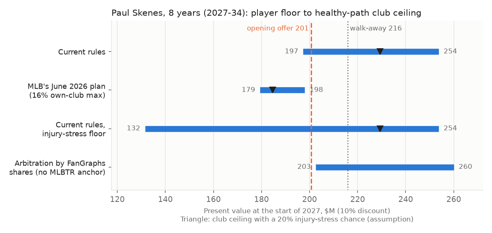

# The roster and CBA engine, and the Paul Skenes extension: a decision memo for the 2026-27 offseason

**Decision memo from public data.** It covers:
- the rules of the 2022-26 Basic Agreement as code
- a test of that code against the real 2025 luxury-tax bills
- where the labor talks stand as of October 12, 2026
- one live decision worked end to end: whether, and at what price, the Pirates should extend Paul Skenes before the agreement expires

*Written 2026-10-12 · Dylan Fanelli · Sources: CBS Sports, AP, MLB.com, MLB Trade Rumors, FanGraphs, Baseball-Reference (each dated below) · Code: `baseball/roster/` (`uv run python -m baseball.roster.cases`) · Independently reviewed 2026-10-13; findings addressed*



## Summary
- **Recommendation: open an eight-year extension (2027-34) before December 1 at about $200M in present value ($285M nominal, CBT AAV about $36M). Walk away above about $215M in present value ($308M nominal).**
  - **Opening offer:** a $25M signing bonus paid before December 1, then $8M, $17M and $25M for 2027-29 and $42M a year for 2030-34.
  - **Walk-away:** the same bonus, then $8M, $18M and $27M and $46M a year.
  - **Where the walk-away comes from:** it is about the club's break-even under two illustrative assumptions, a 20% chance of a major arm injury and a 25% chance that MLB's proposed contract limits are adopted as proposed.
  - **If the club assumes his arm stays healthy and current rules:** its break-even is about $255M in present value. That's the most it could pay, not the price to aim for.
- **The price depends on the next agreement, and the memo doesn't pretend otherwise.**
  - **Current rules:** the bargaining range runs from about $195M to $255M in present value (healthy path). With a 20% injury-stress chance on the club side, the top falls to about $230M.
  - **MLB's June 2026 plan:** the plan caps what his own club would have to pay to keep him at 16% of the cap. The range would be about $180-200M, or about $180-185M with the same injury chance.
  - **What that means for the opening offer (about $200M):**
    - It pays off for the club unless the chance of MLB's plan passing as proposed is above about 60% (at a 20% injury chance).
    - It sits at the player's current-rules floor and above his floor under MLB's plan.
- **Why before December 1:**
  - The agreement expires at 11:59 p.m. ET on December 1. MLB's October memo to clubs says a lockout ends all contact with 40-man players.
  - A deal signed now is priced under known rules and isn't exposed to any new limits on extensions.
  - Its signing bonus is the one piece of pay a stoppage doesn't stop.
  - Waiting gains the club something only if it believes MLB's cap passes, and the union has rejected a cap at every turn.
- **If he says no, the Pirates still have three years of control, though the chance to extend him may close.**
  - **2027 salary:** MLB Trade Rumors projects $7.2M for his first arbitration year.
  - **Value of the control years:** surplus over 2027-29 is worth about $105-165M in present value (low to high WAR case), and about $80M in an injury-stress case.
  - **The risk of waiting:** an extension maximum under a new agreement could make waiting impossible, not just more expensive.
- **The tax engine reproduces the published 2025 bill within $1 for eight of the nine clubs that paid.**
  - **The ninth (the Red Sox):** the published bill is exactly $75,000 below 20% of the published payroll overage. Either the bill used a payroll $375,000 lower than the one published, or the published payroll is off by that much. It's reported here, not adjusted.
  - **A rule the data settled:** the 42.5%/45% surcharge depends on whether the club is a first-time or repeat payor, not on whether it was in that tier the year before.
- **A takeaway for any club:** holding Skenes down in 2024 bought the Pirates nothing.
  - The Rookie of the Year credit erased the extra control year the delay was meant to buy.
  - The late call-up cost them the Prospect Promotion Incentive pick he would have earned.

## (a) Proof the tax engine is right
- **Grain:** one club, 2025 season.
- **Sources:**
  - CBT payroll and bill to the dollar: CBS Sports (Mike Axisa, Dec. 20, 2025).
  - Consecutive seasons over: AP (Ronald Blum, Dec. 20, 2024 and Dec. 19, 2025).
- **Threshold:** $241M.

| Club | CBT payroll | Seasons over (incl. 2025) | Actual bill | Computed | Difference | Rate on the next $ |
|---|---|---|---|---|---|---|
| Dodgers | $417,341,608 | 5 | $169,375,768 | $169,375,769 | +$1 (rounding) | 110% |
| Mets | $346,670,456 | 4 | $91,637,501 | $91,637,502 | +$1 (rounding) | 110% |
| Yankees | $319,522,564 | 4 | $61,774,820 | $61,774,820 | $0 | 110% |
| Phillies | $314,329,912 | 4 | $56,062,903 | $56,062,903 | $0 | 110% |
| Blue Jays | $286,135,551 | 1 | $13,609,719 | $13,609,719 | $0 | 62.5% |
| Padres | $270,351,396 | 1 | $6,992,447 | $6,992,447 | $0 | 32% |
| Red Sox | $248,859,139 | 1 | $1,496,828 | $1,571,828 | **+$75,000** | 20% |
| Astros | $245,991,459 | 2 | $1,497,438 | $1,497,438 | $0 | 30% |
| Rangers | $241,380,966 | 3 | $190,483 | $190,483 | $0 | 50% |

**The rules the bills confirm** (MLB.com glossary, Competitive Balance Tax, read Oct. 12, 2026):
- **Base rate:** 20% / 30% / 50% for the first, second, and third-or-later consecutive season over.
- **Surcharges:** 12% on the part $20-40M over, 42.5% or 45% on $40-60M over, 60% beyond $60M.
- **Pick penalty:** a club $40M or more over has its highest pick in the next draft moved back 10 places. If that pick is in the top six, the second-highest pick moves instead (`cbt_pick_dropped()`).

**Two things the data settled:**
- **The 42.5% vs 45% surcharge goes by payor status.**
  - **The ambiguity:** the glossary says "42.5% in the first year, 45% for each consecutive year after."
  - **What the Phillies show:** they paid $14.4M in 2024 at the 50% and 62% rates (AP, Dec. 20, 2024), which puts them $27.1M over the $237M line and below the $40M tier.
  - **The test:** in 2025 they were charged 95% (50% + 45%) on the $281-301M band. The bill reproduces at 45% and comes out $0.5M too low at 42.5%.
  - **Toronto,** a first-time payor in 2025, reproduces only at 42.5%.
- **Red Sox:** 20% × ($248,859,139 − $241,000,000) = $1,571,828, against a published $1,496,828.
  - **The gap:** exactly $75,000 of tax, or $375,000 of payroll.
  - **Two readings fit equally:** the bill was computed on a payroll $375,000 lower (a late adjustment), or the published payroll is off by that amount.
  - **Status:** no source explains it. The test suite pins the gap so a correction would show up.

**What a club does with this:**
- **The real price of salary** for a club $60M+ over:
  - $1.80 for every $1 of new salary in its first year over (20% + 60%)
  - $1.90 in its second (30% + 60%)
  - $2.10 in its third or later (50% + 60%)
- **2026 tier lines:** $264M, $284M and $304M (the $244M threshold plus $20M steps).
- **Pricing a signing:** `tax_cost_of_signing()` prices any addition against a club's line. For 2027 there's no threshold until a new agreement, so the function requires one passed explicitly.

## (b) The labor clock
**Where it stands (checked 2026-10-12):**
- **Expiration:** the 2022-26 Basic Agreement expires **December 1, 2026 at 11:59 p.m. ET**.
- **The talks:** formal bargaining began May 12.
  - **MLB's position:** its core proposal (May 28) is a 2027 salary cap of $245.3M and a floor of $171.2M. Its economic, roster and schedule offers are tied to the union accepting a cap.
- **The latest session, October 8:** MLB proposed:
  - a 154-game season and best-of-seven Division Series from 2029
  - higher seeds choosing their Wild Card opponents from 2027
- **The union's response:** it is "reviewing" the proposals and restated its opposition to a cap.
- **Sourcing for the Oct. 8 session:** Men's Journal, syndicated by Yahoo Sports (Ezra Lombardi), and the CBS Sports timeline (updated Oct. 8). Both are secondhand accounts of a proposal MLB published on its X account.
- **Lockout preparation:** MLB sent clubs a memo on operating during a lockout (Yahoo Sports, Chris Cwik; Bleacher Nation, Brett Taylor; both Oct. 8). Once owners lock out:
  - all operations involving 40-man players stop: no contact, no free-agent negotiation, no trades
  - the major-league phase of the Rule 5 Draft is postponed at minimum
  - the draft lottery is probably postponed
- **No sign of a deal:** no reporting found a deal or a deadline extension in sight.

**Before December 1, the old rules run the offseason.**
- **Option and qualifying-offer decisions:** a few days after the World Series.
- **The 40-man protection and non-tender deadlines:** in 2025 they fell on November 18 and 21 (Detroit Tigers On SI offseason calendar, undated, 2025-26 season).
  - **For 2026:** the non-tender deadline is expected on Friday, November 20, following the 2023-25 pattern of the Friday before Thanksgiving. That date is not confirmed.
- **The 2022 precedent:** arbitration figures were exchanged on March 22, after the lockout ended, and hearings ran May 2 to June 24 (AP, May 2, 2022).

**Which outputs depend on rules under negotiation:**

| Engine output | 2022-26 rule | MLB proposal | MLBPA proposal | Effect on the Skenes decision |
|---|---|---|---|---|
| Price of his 2030-34 seasons | Open market | Year-1 salary capped at 15% of the cap for a new club and 16% for his own club ("Cornerstone": up to 6 free-agent years), +5% a year after (MLB.com and AP, June 25) | No cap; a higher CBT threshold (reported at $300M) with no draft-pick penalties | MLB plan: the club's cost of keeping him and his best pay both fall to the 16% path. The range moves from about $195-255M to about $180-200M (healthy path). Union plan: more room for big-market bidders, so his outside option rises (not quantified) |
| Payroll floor | None | $171.2M in 2027 | — | The Pirates' 2026 CBT payroll was $120.7M (Spotrac, read Oct. 13). Under a floor they'd have to add about $50M anyway, so Skenes's dollars would partly replace money the club must spend. That raises its effective ceiling under MLB's plan (not quantified) |
| Qualifying-offer pick if he leaves | A revenue-sharing recipient losing a $50M+ player gets a pick between Round 1 and Competitive Balance Round A | Eliminated | Eliminated | The consolation disappears under either plan. Under current rules it depends on the Pirates' status in 2029, not 2025 |
| Free-agency timing | Six years | Five for players 30+ (tied to a cap) | Five for players 30+ | None: he reaches six years after his age-27 season |
| Service time in a stoppage | Not covered | Not addressed | Not addressed | See "Service and control" below. Precedent says lost days are restored |
| Deferred pay | Allowed, at present value | Banned in new deals; existing deals unaffected | — | A deal signed before Dec. 1 keeps the option |
| Limits on extensions | None | Limits count free-agent years projected at signing; AP reports maximums scaled by service time, from $265M/6 years (free-agent eligible) to $500M/12 years (pre-debut). The figure for a player at 3.000 isn't published | None | **Unverified risk:** an extension signed under a new agreement might hit a maximum; one signed now would not |
| Arbitration | Final-offer arbitration | Keep the system, open to a new framework (MLB.com, June 25) | Expanded eligibility | His 2027-29 salary path is the input most exposed to a new framework |
| Minimum salary, options, Rule 5 | $780K; 5 optional assignments; Rule 5 after 4/5 seasons | $1M for 2+ years (MLB.com, June 25); 4 assignments and Rule 5 a year earlier (Aug. 27) | $1.5M (CBS Sports timeline, May 27); 3 assignments (July 1) | None for Skenes. The engine takes each as an argument (`max_assignments`, `years_earlier`) |

**About MLB's limits:**
- **Confirmed:** MLB.com and AP both say "15% of the cap," not "of payroll."
- **The $202M total:** that is MLB's figure. 15% × $245.3M with 5% raises over five years comes to $203.3M by this memo's arithmetic.
- **Not re-checked on Oct. 12:** the union's $300M threshold, its expanded arbitration and three optional assignments, and MLB's four assignments and earlier Rule 5. These come from the repo's CBA reference notes (CBS Sports and MLBPA releases).

## (c) The decision: Paul Skenes

### Why this case
- **The stakes:** it's the largest pre-free-agency decision any club faces this winter. Skenes won the 2024 NL Rookie of the Year and the 2025 NL Cy Young, and was an All-Star in 2026.
- **The labor clock bites:** the extension window and the agreement's expiration overlap, and the next agreement moves his price.
- **It runs every part of the engine:** a Rookie of the Year service credit, a Super Two counterfactual, an arbitration projection, surplus value, extension pricing and qualifying-offer consequences.
- **The tender question is trivial; the price isn't.** He'll be tendered at about $7.2M. What the Pirates should pay for his ages 28-32 is the real question.

### Facts
| Item | Value | Source |
|---|---|---|
| Born | May 29, 2002 (age 25 in 2027) | Baseball-Reference (read Oct. 12, 2026) |
| Service after 2026 | 3.000 | MLBTR 2027 arbitration projections (Darragh McDonald, Oct. 2, 2026), read in Yardbarker's authorized syndication of the full article (mlbtraderumors.com blocks automated reading) |
| 2027 arbitration projection | $7.2M ("Paul Skenes (3.000): $7.2MM") | Same |
| 2024 service | .142 on the field, credited 1.000 for winning Rookie of the Year | Bucs on Deck (undated; written before his May 2024 debut); rule: UB Law Sports Forum (Mike Perlo, Nov. 17, 2022); applied to Skenes: MLBTR via SI (Brady Farkas, Nov. 19, 2024) |
| PPI draft pick | None: he was held down into May 2024 | MLBTR via SI (Nov. 19, 2024) |
| fWAR 2024 / 2025 / 2026 | 4.3 / 6.5 / 4.2 | FanGraphs (read Oct. 12, 2026) |
| bWAR 2024 / 2025 / 2026 | 5.8 / 8.0 / 3.3 | Baseball-Reference (read Oct. 12, 2026) |
| 2026 line | 174.1 IP, 3.82 ERA, 3.33 FIP, 200 SO, 49 BB | Baseball-Reference and FanGraphs (read Oct. 12, 2026) |
| 2026 preseason projections (WAR) | Steamer 5.7, ZiPS 5.0, ATC 5.7, THE BAT 6.0, OOPSY 5.5, Depth Charts 5.4 | FanGraphs (read Oct. 12, 2026) |
| Pirates' status | Revenue-sharing recipient in 2025 | CBS Sports (Mike Axisa), Nov. 5, 2025 |

### Service and control
- **The path:** 3.000 → arbitration in 2027, 2028 and 2029 → six years after 2029 → free agent after his age-27 season.
- **What holding him down bought: nothing.**
  - **The rule:** a player with fewer than 60 days of prior service, on two of the three preseason top-100 lists, receives a full year of service for a top-two Rookie of the Year finish.
  - **Without the credit:** he'd have finished 2026 at 2.142. That is above MLBTR's estimated 2027 Super Two line of 2.133 (not official), so he'd still have reached arbitration in 2027, with four arbitration years and free agency after **2030**.
  - **With it:** the extra year is gone. The May call-up also forfeited the Prospect Promotion Incentive pick.
- **A stoppage and service time:**
  - **The arithmetic:** if a 2027 stoppage cost more than 15 of the 187 season days and the lost days were not credited, he would finish 2027 at 3.150 and become a free agent after 2030 (`timeline("3.000", 2026, [150, 172, 172, 172])`).
  - **Precedent runs the other way:**
    - **1996:** the agreement credited the service lost to the 1994-95 strike (The Hardball Times, Armour and Levitt, Nov. 9, 2016).
    - **2020:** the March 26 agreement gave a full year to players on the roster all of a shortened season, and prorated service otherwise (MLBTR, Mar. 26, 2020).
    - **2022:** the March 2022 settlement saved the full 162-game season (AP, Mar. 10, 2022).
  - **Treatment here:** a small upside for the club, not a reason to wait. The memo doesn't count it.
- **Super Two cutoffs**, by the salary season they set (`SUPER_TWO_CUTOFFS`):

| 2022 | 2023 | 2024 | 2025 | 2026 | 2027 |
|---|---|---|---|---|---|
| 2.116 | 2.128 | 2.118 | 2.132 | 2.140 | 2.133 (MLBTR estimate) |

- **Sources:** UB Law Sports Forum (Nov. 2, 2022) for 2022-23, and AP (Nov. 7, 2025) for 2024-26.

### Projection (assumption, not a published projection)
- **No public 2027 projection existed on October 12.**
- **The base case:** a 5/4/3 weighting of his last three fWAR seasons, (5 × 4.2 + 4 × 6.5 + 3 × 4.3) / 12 = **5.0 WAR** for 2027.
  - **Cross-check:** that sits between his 2026 (4.2) and the 2026 preseason consensus (5.0-6.0).
- **Why fWAR:**
  - **The 2026 gap:** fWAR and bWAR disagree on 2026 (4.2 vs 3.3) because his ERA ran half a run above his FIP.
  - **Consistency:** the FanGraphs $/WAR study prices contracts in projected fWAR.
- **Scenarios:**
  - low ×0.8
  - high ×1.2
  - an illustrative injury stress ×0.6, standing in for a major arm injury
- **Tier cliff in the stress path:** it falls below 2 WAR in 2033-34 (1.8 and 1.4), where FanGraphs' price per win drops from $12.84M to $8.51M. That cliff is why those two seasons are worth so little.
- **Aging (assumption):** flat through age 28, then −0.4 WAR a year. The base path is 5.0 in 2027-30, then 4.6, 4.2, 3.8 and 3.4 in 2031-34.

### Arbitration path
- **The method:**
  - **Year 1:** MLBTR's $7.2M.
  - **Years 2-3:** FanGraphs' July 2026 shares (35% and 50% of the platform season's WAR at free-agent prices), scaled by 7.2 / 8.09.
  - **Why scale:** 8.09 is the share rule's year 1 (15% × 4.2 × $12.84M), so the scaling keeps the path at MLBTR's level.

| Case | 2027 | 2028 | 2029 | PV 2027-29 (10%) |
|---|---|---|---|---|
| Stress | $7.2M | $12.3M | $18.2M | $33M |
| Low | $7.2M | $16.5M | $24.2M | $42M |
| Base | $7.2M | $20.6M | $30.3M | $51M |
| High | $7.2M | $24.7M | $36.3M | $60M |
| FanGraphs shares, no MLBTR anchor (base) | $8.1M | $23.1M | $34.0M | — |

- **The record as a check:** the largest arbitration salary on record is Tarik Skubal's $32M (panel ruling Feb. 5, 2026, after two Cy Youngs; the Tigers filed $19M; AP via WTOP). The high case's $36.3M would break it, so read the high case as an upper bound.

### Surplus over the control years (no extension)
- **Value:** WAR × the free-agent $/WAR at the 2+ WAR tier ($12.84M, +3% a year; FanGraphs, Feb. 24, 2026).
- **Discounting:** 10%, to the start of 2027.

| Case | PV of value, 2027-29 | PV of arbitration pay | PV surplus |
|---|---|---|---|
| Stress | $111M | $33M | $78M |
| Low | $149M | $42M | $106M |
| Base | $186M | $51M | $135M |
| High | $223M | $60M | $163M |

**Base year of the $/WAR (an open question).**
- **What the study says:** it puts "everything in terms of 2025 dollars" and inflates future-year guarantees 5%.
- **How it's read here:** $12.84M is the price of a 2026-season win, because first-year salaries of 2025-26 signings enter at face.
- **If it's a 2025 price instead:** every free-agent value here is 3% higher, and the healthy current-rules ceiling rises from about $255M to about $260M.

### Is the free-agent price believable?
- **The model's price:** his 2030-34 seasons at about **$64M a year in nominal dollars**, or about $54M a year in 2026 dollars.
- **Against the record:** the highest pitcher AAV on record is $43.3M (Max Scherzer, 3 years and $130M, Nov. 29, 2021; Globe and Mail/AP). No pitcher deal above it was found as of Oct. 13, 2026.
- **The result:** the model's price is 25-50% above any pitcher contract ever signed, so it was checked against real deals.

**The check uses FanGraphs' own method** (`comps_check()`, `implied_dpw()`): level pay, deflated 5% a year, divided by the projection aged −0.4 a year.

| Contract | Projection at signing | Implied $/WAR | FanGraphs 2+ WAR rate that offseason | Ratio |
|---|---|---|---|---|
| Yoshinobu Yamamoto, Dodgers, Dec. 2023: 12 years, $325M at 25 (plus a $50.6M posting fee) | 3.1 WAR (FanGraphs, via Dodgers Digest, Dec. 21, 2023) | $18.5M | $14.13M | 1.31 |
| Gerrit Cole, Yankees, Dec. 2019: 9 years, $324M at 29 | Oliver/Tango WAR path, 37.3 over 9 years (MLB.com, Dec. 18, 2019); a more generous scale than fWAR | $7.2M | $11.99M | 0.60 (scales differ) |
| Corbin Burnes, D-backs, Dec. 2024: 6 years, $210M at 30 | none sourced | implies a 3.2-WAR year-1 projection at $13.91M | $13.91M | — |
| Max Fried, Yankees, Dec. 2024: 8 years, $218M | none sourced | implies 3.1 WAR at $13.91M | $13.91M | — |

**What it shows:**
- **The youngest ace in the set paid more than the linear rate, not less.** Yamamoto went for 1.31 times the rate on his projection, before the posting fee.
- **The two 30-year-olds price at plausible projections** of about 3.1-3.2 WAR.
- **Cole can't be compared directly,** because his projection is on a different WAR scale.
- **What's untested:** no pitcher projected near 5 WAR has reached the market at 28. That leaves the $64M a year an extrapolation.
- **What would happen if the market paid less:** both the club's ceiling and the player's floor would fall. The opening offer would then sit closer to the top of the range.

### The extension price
**The model** (`extension_band()`), with one counterfactual for both sides.
- **Club ceiling:** what the club would otherwise pay to have him.
  - **The alternative:** arbitration (base), then the going price for the free-agent seasons it buys.
  - **Under current rules:** that price is his market value.
  - **Under MLB's plan:** it is the lesser of his value and the 16% own-club maximum. That is what the club would pay to keep him, assuming it does keep him; the Cornerstone rule exists so the own club can outbid others by a point.
  - **The healthy-path ceiling** assumes his base projection holds for eight years.
  - **The durability-adjusted ceiling** weights in the stress path. Year to year, an injured pitcher costs the club less in arbitration and nothing in free agency, so an extension moves that risk onto the club.
- **Player floor:** low-case arbitration, then the low-case free-agent price, capped at the 16% path under MLB's plan.
  - **The low case is an assumption:** it stands in for a risk-averse player's certainty equivalent.
  - **Its blind spot:** it ignores his own injury risk, so it is a high floor. The real range is wider at the bottom.
- **Midpoint:** an even split of the range, which is a bargaining assumption (equal bargaining power), not a market fact.
- **MLB's maximum:** 16% of a cap assumed to grow 3% a year (an assumption). That gives $42.9M in 2030, then +5% a year. The 15% maximum for other clubs is $40.2M in 2030.

| Rule set | Player floor | Midpoint | Club ceiling, healthy | Club ceiling, 20% stress chance | Club ceiling, 35% stress chance |
|---|---|---|---|---|---|
| Current rules | $197M | $226M | $254M | $229M | $211M |
| MLB's plan (16% own-club max) | $179M | $189M | $198M | $185M | $175M |
| MLB's plan, if his best outside offer is the 15% new-club max | $174M | $186M | $198M | $185M | $175M |
| Current rules, injury-stress floor | $132M | $193M | $254M | — | — |
| FanGraphs arbitration shares, no MLBTR anchor | $203M | $231M | $260M | — | — |

**The club's break-even price,** weighting the two rule sets by the chance q that MLB's plan is adopted as proposed (`breakeven`). q is not estimated here. The union opposes a cap, and no market price on it was found.

| q | Healthy | 20% stress chance | 35% stress chance | Player floor |
|---|---|---|---|---|
| 0 | $254M | $229M | $211M | $197M |
| 0.25 | $240M | $218M | $202M | $193M |
| 0.5 | $226M | $207M | $193M | $188M |
| 1 | $198M | $185M | $175M | $179M |

**The recommendation:**

| | Signing bonus | 2027 | 2028 | 2029 | 2030-34 (each) | Nominal | CBT AAV | Present value |
|---|---|---|---|---|---|---|---|---|
| Opening offer | $25M | $8M | $17M | $25M | $42M | $285M | $35.6M | about $200M |
| Walk-away | $25M | $8M | $18M | $27M | $46M | $308M | $38.5M | about $215M |

- **The opening offer, about $200M:**
  - **For the club:** it clears the break-even unless q is above about 0.6 (20% stress) or 0.3 (35% stress).
  - **For the player:** it sits at his current-rules floor and $20-30M above his floor under MLB's plan.
- **The walk-away, about $215M:** the club's break-even at 20% stress and q = 0.25. A club more confident that current rules survive, or in his arm, can go higher. The healthy, current-rules limit is about $255M.
- **Why the signing bonus:**
  - **It survives a stoppage.** Salaries are paid by games played and stop in a stoppage; a signing bonus is paid regardless. That is the structure the Blue Jays used with Guerrero's $325M bonus (CBS Sports, Matt Snyder, Apr. 9, 2025).
  - **What a stoppage would cost him otherwise:** canceling 60 games would cost him about $2.7M of a $7.2M arbitration salary (proportional approximation).
  - **It's worth more to him than it costs the club,** and it gives him a reason to sign before December 1.
- **Add an arm clause, as Crochet's deal has.**
  - **Crochet's version:** 120 straight days on the IL with a left-arm injury voids his opt-out after 2030 and adds a $15M 2032 club option.
  - **It has already paid off:** the clause was triggered on Aug. 23, 2026 (shoulder inflammation; MLB.com, Theo DeRosa).
  - **For Skenes:** a similar clause would cut the club's injury exposure and could justify a walk-away nearer the healthy-path ceiling.
- **CBT:** the AAV counts from 2027, when the new deal begins (MLB.com glossary). The Pirates were at $120.7M in 2026, so no plausible 2027 threshold binds.

**Comparables:**

| Player | Deal | Note | Source |
|---|---|---|---|
| Garrett Crochet | Red Sox extension, Apr. 1, 2025: 6 years, $170M (2026-31) | $4M bonus; $24M in 2026, $28M in 2027-30, $30M in 2031; opt-out after 2030; arm clause as above | CBS Sports (Dayn Perry), Apr. 1, 2025; MLB.com, Aug. 23, 2026 |
| Corbin Burnes | Diamondbacks, Dec. 2024: 6 years, $210M | Free agent at 30; opt-out after 2026 | MLB.com, Dec. 28 and 31, 2024 |
| Max Fried | Yankees, Dec. 2024: 8 years, $218M | Free agent; no opt-out, no deferrals | MLB Trade Rumors, Dec. 2024 (day not shown on the page read) |
| Tarik Skubal | Arbitration award, Feb. 5, 2026: $32M | Record arbitration salary | AP via WTOP |

### What changes the answer
- **His arm.** It is the largest single lever on the club ceiling: every 10 points of stress probability lowers the current-rules ceiling by about $12M. The arm clause is the cheapest way to cap that risk.
- **The next agreement.**
  - **If MLB's limits pass,** the club pays more than it had to by signing now.
  - **If they don't,** waiting costs more and may run into a new extension maximum.
  - **The recommendation:** the opening offer is priced to win under both.
- **The Pirates' value of a win.** The ceiling prices wins at the free-agent rate. A club whose marginal revenue per win is lower should treat the ceiling as lower. Under a payroll floor it would be partly higher. Payroll capacity isn't modeled.
- **The free-agent price.** If the market wouldn't pay a 5-WAR pitcher at 28 at the linear rate, both ends fall.
- **Pricing convention:** free-agent seasons are priced at each season's own $/WAR. A real contract signed in the 2029-30 offseason fixes its price at signing, so the later seasons' prices depend on its structure. The difference is small next to the scenario spread.
- **His agent and his preferences.** They aren't modeled. Nothing here is a claim about whether he would sign.

## Method
**Grain.** One player (service, valuation), one club-season (tax), or one transaction (qualifying offer).

**The engine.**
- **`service.py`:**
  - **Service time:** years.days (172 days to the year, at most one year a season, shorter stints carry over).
  - **Timing:** arbitration and free agency, Super Two against a cutoff, the Rookie of the Year credit, control.
  - **Options:** the 20-day rule, the fourth option, five assignments with spring options excluded, minimum days down.
  - **Rule 5:** the June 5 age rule, the first qualified season, and season + 4 for players signed at 18 or under, + 3 for 19 and older.
  - **Rights:** outright refusal and 10-and-5.
- **`money.py`:**
  - **The CBT bill:** components, marginal rate, and the pick penalty with the top-six exception.
  - **Valuation:** tiered $/WAR with growth and a base-year argument, plus FanGraphs' implied-$/WAR check.
  - **Aging and arbitration:** an aging curve and arbitration paths, optionally anchored to an outside year-1 projection.
  - **Surplus and extensions:** surplus value, and extension bands with separate caps on the club's alternative and the player's outside option and an explicit surplus split.
  - **The qualifying offer.**
- **`facts.py`:** every public number, with its source. **`cases.py`:** this memo's numbers and figure.

**Tests.** 43 in `tests/test_roster_service.py` and `tests/test_roster_money.py`.
- **Real bills:** eight 2025 bills within $1, plus the Red Sox gap pinned.
- **Rule edge cases.**
- **Arithmetic:** valuation, extension bands, the implied $/WAR and the comparables check, worked by hand in the comments.
- **The Skenes ceilings, break-evens and base-year sensitivity.**

Fictional players in tests are labeled fictional.

## What this doesn't show
- **Rules confirmed only secondhand:**
  - **The Rookie of the Year credit:** UB Law Sports Forum and MLBTR, not the CBA text.
  - **The outright salary rule:** MLB Trade Rumors.
  - **"Full seasons" topped up with IL days:** The Cub Reporter.
  - **Pool forfeiture on a second qualified signing:** not listed by MLB.com.
  - **The 2026 non-tender date:** inferred from the pattern.
- **Assumptions:**
  - the 5/4/3 weights
  - the ×0.8 floor and ×0.6 stress
  - the stress chances (no sourced injury rate is used)
  - 3% growth and the 10% discount
  - 3% cap growth
  - retention at the own-club maximum
  - the even split
  - All of them are labeled in the code and can be changed.
- **The labor outcome isn't estimated.** The break-even table shows the price for any chance a reader assigns.
- **MLB's plan is modeled through its salary maximums and noted for its floor.** Its effect on demand and the maximum for a 3.000 extension are unknown. The union's plan isn't quantified.
- **No team data.** Everything is public.

## Reproduce
```bash
uv run python -m baseball.roster.cases     # every number in this memo, and the figure
uv run pytest tests/test_roster_service.py tests/test_roster_money.py
```

## Sources
- **CBT bills:** Mike Axisa, "Dodgers rack up record-smashing $169 million luxury tax bill," CBS Sports, Dec. 20, 2025.
- **Payor history:** AP (Ronald Blum), Dec. 19, 2025 and Dec. 20, 2024.
- **CBT rules, service time, options, Rule 5, outright waivers, qualifying offer, 10-and-5:** MLB.com glossary pages (read Oct. 12, 2026).
- **Roster rules:** The Cub Reporter, MLB roster rules (Options; Rule 5 Draft; read Oct. 12, 2026). MLB Trade Rumors, "Mariners Outright Luis Urías" (June 2024).
- **Super Two cutoffs:** AP, "Mason Miller, Zach Neto among 34 Super 2s" (Nov. 7, 2025); UB Law Sports Forum, "2023 Super Two Service Time Set" (Nov. 2, 2022).
- **Rookie of the Year credit:** UB Law Sports Forum (Mike Perlo), "Prospect Promotion Incentive" (Nov. 17, 2022); Brady Farkas, Fastball on SI (Nov. 19, 2024); Bucs on Deck, "Examining Paul Skenes' Service Time" (undated, May 2024).
- **Stoppage precedents:**
  - Mark Armour and Dan Levitt, "A History of the MLBPA's Collective Bargaining Agreement: Part 3," The Hardball Times (Nov. 9, 2016)
  - MLB Trade Rumors, "MLB, MLBPA Reach Deal" (Mar. 26, 2020)
  - AP, "MLB players vote to end lockout, salvaging 162-game season" (Mar. 10, 2022)
  - AP, "Frazier, Mariners argue 1st of delayed arbitration cases" (May 2, 2022)
- **Skenes:** Baseball-Reference and FanGraphs player pages (read Oct. 12, 2026). MLB Trade Rumors, "Projected Arbitration Salaries For 2027" (Darragh McDonald, Oct. 2, 2026), read via Yardbarker's syndication (Oct. 2, 2026) and Pirates On SI (Oct. 3, 2026).
- **Pirates payroll:** Spotrac, Pirates 2026 financial summary (read Oct. 13, 2026).
- **Valuation:** FanGraphs, Ben Clemens, "What Are Teams Paying for a Win in Free Agency? 2026 Edition" (Feb. 24, 2026) and "The Details of Our New Prospect Valuation Methodology" (July 2, 2026).
- **Revenue-sharing status:** CBS Sports (Mike Axisa), qualifying-offer explainer, Nov. 5, 2025.
- **Labor talks:**
  - CBS Sports, "MLB CBA negotiations timeline" (updated Oct. 8, 2026)
  - Men's Journal via Yahoo Sports (Ezra Lombardi), Oct. 8, 2026
  - Yahoo Sports (Chris Cwik) and Bleacher Nation (Brett Taylor) on MLB's lockout memo, Oct. 8, 2026
  - MLB.com (Anthony Castrovince), June 25, 2026
  - AP (Ronald Blum), June 25, 2026
- **Contracts:**
  - Crochet: CBS Sports (Dayn Perry), Apr. 1, 2025; MLB.com (Theo DeRosa), Aug. 23, 2026
  - Burnes: MLB.com, Dec. 28 and Dec. 31, 2024
  - Fried: MLB Trade Rumors, Dec. 2024
  - Yamamoto: Dodgers Digest (Chad Moriyama), Dec. 21, 2023
  - Cole: MLB.com (Andrew Simon), Dec. 18, 2019
  - Scherzer: The Globe and Mail/AP, Nov. 2021
  - Skubal: AP via WTOP, Feb. 2026
  - Guerrero: CBS Sports (Matt Snyder), Apr. 9, 2025
- **2025-26 offseason dates:** Detroit Tigers On SI, offseason calendar (undated, fall 2025).

---
© 2026 Dylan Fanelli. All rights reserved. See [LICENSE](../LICENSE).
