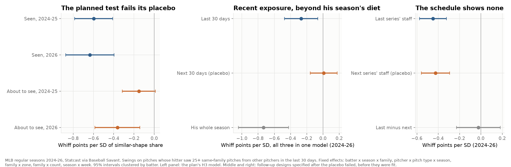

# Do hitters adapt to pitch shapes they've seen from other pitchers? A pre-registered test, MLB 2024–26

**League study from public pitch data.** Every regular-season pitch of 2024–2026 (Statcast). The analysis plan was committed before any outcome was fit, the 2026 season was held out, and the planned test failed its own placebo. This report says so first, then shows the follow-up designs that were also written down before they were run.
*Written 2026-10-18; Dylan Fanelli; Data: Statcast via Baseball Savant, 2,124,882 pitches with a complete shape; Code: `baseball/edge/shape_exposure.py` (`bb shape-exposure`); Plan: [the analysis plan](2026-shape-exposure-plan.md), [development results](2026-shape-exposure-dev-results.md), [2026 results as fit](2026-shape-exposure-2026-results.md), [follow-up plan](2026-shape-exposure-followup-plan.md), each committed before the step after it*



## Summary
- **The question:** when a hitter has recently seen a lot of pitches shaped like this one from *other* pitchers in earlier games, does he miss it less?
  - **Why it matters:** if he does, the reliever who follows a sweeper-heavy starter matters, and so does any pitch whose value rests on a shape spreading through the league.
  - **What was known:** within a game, a hitter does better against a pitch type he has seen more of ([my familiarity study](2026-league-pitch-familiarity.md)). Public work has asked whether the sweeper's decline is hitters adapting or weaker pitchers adopting it, and left it open ([Egros, Aug. 11, 2026](https://edwithsports.substack.com/p/jeepers-sweepers)). I found no public estimate across pitchers and games, by shape.
- **The planned test replicated and then failed its placebo.**
  - **The association:** −0.70 whiff points per SD of similar-shape exposure in 2024–25, and −0.74 (−0.96 to −0.51) on the held-out 2026 season.
  - **The placebo:** exposure from the *next* 30 days, which can't cause anything today, came in at −0.36 (−0.59 to −0.14) in 2026.
  - **What that means:** something stable links a hitter to the shapes he faces, before and after. Under the plan's own rule, the planned result is reported as confounded.
  - **The likeliest reason:** selection. A hitter who handles a shape keeps playing against it; one who doesn't gets platooned away from it.
- **A design that removes the season-level selection finds a smaller recent effect.** It holds his whole-season diet of that shape fixed.
  - **Recent exposure:** −0.27 whiff points per SD (−0.48 to −0.06), 2024–26 pooled.
  - **Placebo:** +0.01 (−0.16 to +0.17).
  - **By season:** −0.27, −0.25 and −0.29, the same direction every year, but no single season is significant alone.
  - **The bigger association:** his whole-season diet, at −0.73 per SD. The public data can't say how much of that is adaptation and how much is selection.
- **The schedule, a source of exposure no manager chooses, finds no adaptation.**
  - **The test:** the staff his team faced in the previous series against the staff it faces in the next one.
  - **The result:** the two are the same (difference −0.02, −0.23 to +0.18).
- **What it's worth:** about 2 runs per club-season (0.5 to 3.8) on the timing design's coefficient.
  - That assumes every relief pitch could be moved from the 75th to the 25th percentile of hitter exposure, which no manager can do. It's an upper bound.

## The decision
1. **Don't reorder a bullpen on cross-pitcher shape exposure.** The recent effect is real in direction but small: a tiebreaker between two otherwise equal arms, not a reason to change a matchup. Same-game familiarity, from my earlier study, is the larger and better-supported effect.
2. **Don't discount a pitcher's price because his shape is spreading through the league.** There's no evidence here that hitters quickly learn a shape from other pitchers.
3. **Don't trust an exposure effect that hasn't faced a lead placebo.** The naive estimate here was 2.7 times the cleaner one. Any club or public model that adjusts whiff rates for exposure from other pitchers should run the same check.
4. **The open question is the season-long piece (−0.73 per SD).** Separating it takes data a club has and the public doesn't: lineup intent, or who was available to play. That's where a club's version of this study should start.

## Findings

### 1. The planned test (2024–25 development, 2026 confirmation)
Whiff points per swing, per 1 SD of the similar-shape share in the last 30 days. Each row is from the plan's model; 95% intervals clustered by batter.

| Test | 2024–25 | 2026 (held out) | Plan's rule | Result |
|---|---|---|---|---|
| H1: last 30 days | −0.70 (−0.87 to −0.52) | −0.74 (−0.96 to −0.51) | negative, excludes 0 | Pass |
| H3: next 30 days (placebo), next to H1 | −0.15 (−0.32 to +0.01) | −0.36 (−0.59 to −0.14) | includes 0 | **Fail in 2026** |
| H3: last 30 days, next to the placebo | −0.60 | −0.63 | | |
| H5: runs per 100 pitches (pitcher's side) | −0.08 (−0.14 to −0.02) | −0.11 (−0.20 to −0.03) | | Carries H1's confound |

- **Samples:** 479,498 swings by 698 batters (2024–25) and 241,285 by 585 (2026), after the plan's 25-pitch minimum.
- **Multiple tests:** after a Benjamini–Hochberg correction across H1, H3 and H5 on 2026, all three stay below 0.05, including the failed placebo (q = 0.002).

**H2, how specific is the effect?**

| Bandwidth | 2024–25 | 2026 |
|---|---|---|
| Narrow (0.5 SD) | −0.23 | −0.26 |
| Planned (1 SD) | −0.70 | −0.74 |
| Wide (2 SD) | −1.20 | −1.24 |

- **The pattern:** the wider the kernel, the stronger the association, the opposite of an exact-shape effect.
- **Two readings, which this data can't separate:**
  - With six shape dimensions, few recent pitches sit within half an SD of any pitch, so the narrow share is noisy and its coefficient shrinks toward zero.
  - What matters is the general look of the family, not the exact shape.

**H4, how fast does it fade?** Three windows in one model:

| Window | 2024–25 | 2026 |
|---|---|---|
| Last 7 days | −0.30 | −0.34 |
| 8–30 days ago | −0.31 | −0.30 |
| 31–90 days ago | −0.26 | −0.51 |

- **What it shows:** no sign of fading over 90 days.
- **Why that matters:** adaptation that lasts for months is hard to tell apart from the selection the placebo found. That's what led to the follow-up designs.

### 2. Follow-up B: recent exposure beyond his season-long diet
- **The model:** the H3 model plus the hitter's season-long share for that shape (all of his other same-season games, before and after) and its count.
  - Season-level selection now sits in the season-long term.
  - The last-30-days term asks whether *recent* exposure matters beyond it.
- **Pre-specified test:** the last-30-days interval excludes zero, and the placebo's includes it.

| Term (whiff points per SD) | 2024–26 pooled | 2024 | 2025 | 2026 |
|---|---|---|---|---|
| Last 30 days | **−0.27 (−0.48 to −0.06)** | −0.27 (−0.63 to +0.08) | −0.25 (−0.60 to +0.09) | −0.29 (−0.63 to +0.05) |
| Next 30 days (placebo) | +0.01 (−0.16 to +0.17) | −0.02 | +0.15 | −0.12 |
| Whole season | −0.73 (−1.04 to −0.42) | −0.62 | −0.83 | −0.75 |

- **Result:** passes pooled (707,467 swings, 797 batters). Each season points the same way, and none clears zero alone.
- **Run value:** the same model on run value per pitch gives −0.10 runs per 100 pitches per SD for the last 30 days, but there the placebo is +0.08 (+0.02 to +0.14).
  - That version fails its own placebo.
  - So the run estimate below is built from the whiff coefficient, not from the run-value model.

### 3. Follow-up A: the schedule
- **The variable:** the share of the previous-series opponent's season pitches (same family, pitcher hand and batter side) that look like this pitch, against the same share for the next-series opponent.
  - Both are computed whether or not the hitter played in those series.
  - Today's lineup is chosen against today's starter, not against last week's staff.

| Term (whiff points per SD) | 2024–26 pooled |
|---|---|
| Previous series' staff | −0.45 (−0.58 to −0.32) |
| Next series' staff (placebo) | −0.43 (−0.56 to −0.29) |
| Previous minus next | **−0.02 (−0.23 to +0.18)** |

- **Result:** no adaptation detected. Exposure from last week's staff predicts no more than exposure from next week's.
  - The bound rules out a gap larger than about a quarter of a whiff point per SD.
- **By season:** 2024 alone shows a gap (−0.46, −0.86 to −0.05); 2025 (+0.15) and 2026 (+0.17) point the other way. One season of three, with nothing correcting for the split, isn't evidence.
- **What both staffs measure:** the opponents a team sees most (its division) stay the same all season. Both shares stand in for the hitter's season-long diet, which is why both carry the same association as Finding 2's season term.

### 4. What it's worth
- **Relief pitches in 2026:** the gap between the 75th and 25th percentile of last-30-days exposure is 1.38 SD.
- **The arithmetic:**
  - 0.27 whiff points per SD × 1.38 SD × 0.47 swings per pitch × 0.12 runs.
  - The 0.12 is the gap between a whiff (+0.115 runs for the pitcher) and any other swing (−0.005).
  - That's 0.021 runs per 100 relief pitches.
- **Per club:** about 10,400 relief pitches a season, so **about 2 runs (0.5 to 3.8)**, and only if every relief pitch could be moved across that gap.

## Method
- **Shape:** release speed, horizontal and vertical movement, release side and height, and extension. Each is standardized within pitch family × pitcher hand on 2024–25.
- **Families:** fastball (FF, SI), cutter (FC), breaking (SL, ST, SV, CU, KC, CS), offspeed (CH, FS, FO, SC).
- **A hitter's diet:** every pitch he saw with the same family, pitcher hand and batter side, from pitchers other than today's, in the window. The current game is never in it.
  - **Similar-shape share:** the kernel-weighted count (exp(−d²/2), d in standardized units) divided by the count. Standardized within family on the 2024–25 targets.
- **Targets:** swings, bunts excluded, on pitches whose hitter saw at least 25 such pitches in the last 30 days.
- **Whiff:** swinging strike, blocked, or foul tip.
- **Model:** a linear probability model.
  - The share and the log of its count.
  - Fixed effects for batter × season × family, pitcher × pitch type × season, family × zone, family × count, and season × week, absorbed by alternating projections.
  - Standard errors clustered by batter.
- **Departures from the plan:**
  - Fixed-effect groups with a single row are dropped. They carry no within-group information, so the estimates don't change.
  - The follow-up designs and the run-value check of Follow-up B weren't in the original plan. Their designs were committed before they were fit.
  - The decision translation uses the whiff coefficient, because the run-value version of the passing design failed its placebo.

## What this doesn't show
- **Intent and availability:** the public data has no lineup intent, no injury or rest information, and no record of who was available. Those are what a club would use to separate the season-long piece.
- **Pitch labels and location:** Statcast's labels decide the family. Shape is physics only: no tunneling with the pitcher's other pitches, and no sequencing.
- **Three seasons:** the 31–90-day window and the season-long share can't be measured on a hitter's first weeks. The schedule design leans on division play, which makes previous and next opponents alike.
- **Hitters as a group:** these are average effects. No individual hitter's adaptation rate is estimated.

## Reproduce
```bash
uv run bb shape-exposure build       # exposures for every 2024-26 pitch (about a minute)
uv run bb shape-exposure fit-dev     # the plan's tests on 2024-25
uv run bb shape-exposure fit-2026    # the plan's tests on 2026
uv run bb shape-exposure followup    # both follow-up designs
uv run bb shape-exposure figure
```
The sequence data (`data/seq/`) comes from `bb pull-league` and `bb seq` for each season.

## Prior work
- My [pitch familiarity study](2026-league-pitch-familiarity.md): the same-game effect, including partial carryover to the next same-handed pitcher in the same game.
- Edward Egros, ["Jeepers! Sweepers!"](https://edwithsports.substack.com/p/jeepers-sweepers) (Aug. 11, 2026): asks whether the sweeper's decline is hitters adapting or weaker pitchers adopting it.
- Davy Andrews, ["They Don't Make Pitch Models Like They Used To"](https://blogs.fangraphs.com/they-dont-make-pitch-models-like-they-used-to/) (FanGraphs, Jan. 20, 2026): stuff grades predict results less well than they did.
