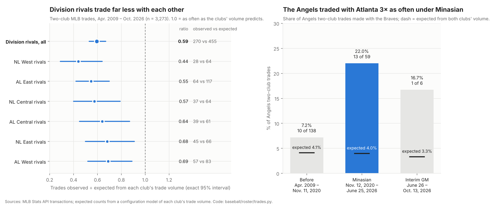

# Who trades with whom: division rivals and front-office ties, MLB 2009–26

**League study from public transaction data.** Every MLB trade in the MLB Stats API from its first record (April 15, 2009) through October 13, 2026, loaded as a graph in Neo4j. It is observational: it counts trades that happened, not offers or prices, and the one front-office explanation below is a hypothesis the data fits, not a tested cause.
*Written 2026-10-13 · Dylan Fanelli · Data: MLB Stats API transactions (3,290 trades, 6,163 player moves, 30 clubs); Baseball-Reference WAR (daily files, read Oct. 13, 2026); Retrosheet transaction file (deals through Dec. 1, 2021; cross-check only) · Outside facts: MLB.com, AP via ABC News, FanGraphs (each dated below) · Code: `baseball/roster/trades.py` (`bb trades`), `baseball/roster/trade_graph.cypher` · Independently reviewed 2026-10-13; findings addressed*



## Summary
- **Division rivals trade with each other at a little over half the rate of other pairs.**
  - **The estimate:** a Poisson model of all 435 pairs, with each club's trade volume held fixed. Rivals trade at 0.56 times the rate of interleague pairs (95% interval 0.49–0.65, p < 10⁻¹⁰). This allows for the extra pair-to-pair variation in the data (dispersion 1.21).
  - **In raw counts:** 270 two-club trades between rivals against 454.7 expected from the clubs' volumes (0.59).
  - **How broad:** every division shows it on its own (0.44 in the NL West to 0.69 in the AL West, each p ≤ 0.004). 52 of 60 rival pairs fall below expectation and one sits at it.
- **It is the division, not the league.** Same-league pairs in other divisions trade at the same rate as interleague pairs (1.03, interval 0.95–1.11, p = 0.53).
- **Three rival pairs haven't traded at all since 2009.**
  - **Dodgers–Giants:** 0 trades against 7.7 expected.
  - **Guardians–Royals:** 0 against 7.4.
  - **Cubs–Cardinals:** 0 against 3.8, weaker evidence because St. Louis trades the least of any club.
  - **Before 2009:** their last trades were in 2007, 2004 and 2007 (MLB.com, Nov. 1, 2021).
- **The deadline is the one window where rivals come closer to normal.**
  - **Deadline:** 0.73 in July–August.
  - **Offseason:** 0.49. The difference from the deadline is significant (p = 0.010).
  - **Rest of the season:** 0.54. The gap to the deadline is not significant (p = 0.08), and the offseason and the rest of the season can't be told apart (p = 0.63).
- **Angels–Braves is the strongest burst of trading between any pair in the data.**
  - **Over the full period:** 24 trades against 8.2 expected, the only pair that clears a false-discovery correction (q = 0.002).
  - **The timing:** the share of Angels trades made with Atlanta rose from 7.2% (10 of 138) to 22.0% (13 of 59) while Perry Minasian was Angels GM (Nov. 12, 2020 – June 26, 2026). Minasian had been Alex Anthopoulos's assistant GM in Atlanta in 2018–20 (MLB.com, Nov. 12, 2020).
  - **Against every pair and period:** in a scan of all 435 pairs across 48 overlapping 5.6-year windows, the Angels–Braves window of January 2021 – August 2026 is the most extreme of all (14 trades vs 2.5 expected, one of them after Minasian's firing).
  - **Not unique:** two other pairs had bursts of 4–5 times expected with no front-office tie offered, Dodgers–Phillies from 2011 and Rangers–White Sox from 2015.
- **The realized-WAR gap in those Angels–Braves trades is ordinary.** The Braves got 8.8 WAR and the Angels −2.4. Almost all of it is one deadline trade for Raisel Iglesias, in which the Angels also shed his contract. Random sets of 13 trades from the same years show a gap that large about 14% of the time.
- **Rival trades are no more lopsided than other trades.** The median realized-WAR gap is 0.28 for rivals and 0.28 for everyone else (p = 0.79).

## What a club can do with it
1. **Treat a division rival as a low-probability partner when ranking targets.**
   - **The prior:** rival pairs complete about 56% as many trades as comparable non-rival pairs. A rival's player is, on base rates alone, a less likely acquisition than an equal player elsewhere.
   - **The limit:** this is a starting point for any one negotiation, not its odds. The data records completed trades, not asks.
2. **Expect rival deals to cluster at the deadline.** Nearly half of rival trades (127 of 270, 47%) came in July–August, against 38% of all two-club trades. Completed trades tell us when rival deals happened, not that moving a given ask to July would raise its chances.
3. **When selling, the rival discount on the buyer pool is small.** Counting each of the four rivals at 0.56, the effective pool is about 27.2 clubs out of 29, roughly 6% fewer.
4. **Count a front-office tie as a small bump, not a strategy.**
   - **The follow-up:** [Do front-office ties predict trade partners?](2026-front-office-ties.md) tests the Angels–Braves idea across all 30 clubs.
   - **Any tie:** a pair whose decision-makers share history trades about 1.14–1.18 times as often as the same pair untied (main estimate 1.18, 1.04–1.34, p = 0.009), and the result holds without the Angels and Braves.
   - **The protégé tie:** 1.19 (p = 0.054), borderline. It isn't significant in a permutation test (p = 0.11) or without the Angels and Braves.
   - **So:** the broad pattern, any shared front-office history, holds without the Angels and Braves. The protégé version, the one the Angels–Braves story is about, doesn't.

## Findings

### 1. Rivals trade with each other at about half the rate of other pairs
Two-club trades, April 15, 2009 – Oct. 13, 2026 (3,273 trades).

**The model.** Pair counts ~ Poisson(exp(club_i + club_j + same division + same league)), with interleague pairs as the baseline. Intervals use quasi-Poisson standard errors (dispersion 1.21).

| Pairs | Rate ratio vs interleague pairs (95% interval) | p |
|---|---|---|
| **Same division** | **0.56 (0.49–0.65)** | **< 10⁻¹⁰** |
| Same league, other division | 1.03 (0.95–1.11) | 0.53 |

**Observed against expected.** Expected counts come from each club's trade volume alone (Method). Exact 95% Poisson intervals.

| Division | Observed | Expected | Ratio (95% interval) | p (as few or fewer) | Rival pairs below expected |
|---|---|---|---|---|---|
| NL West | 28 | 63.7 | 0.44 (0.29–0.64) | < 0.001 | 9 of 10 |
| AL East | 64 | 116.9 | 0.55 (0.42–0.70) | < 0.001 | 10 of 10 |
| NL Central | 37 | 64.5 | 0.57 (0.40–0.79) | < 0.001 | 9 of 10, one tie |
| AL Central | 39 | 61.0 | 0.64 (0.45–0.87) | 0.002 | 7 of 10 |
| NL East | 45 | 66.1 | 0.68 (0.50–0.91) | 0.004 | 8 of 10 |
| AL West | 57 | 82.6 | 0.69 (0.52–0.89) | 0.002 | 9 of 10 |
| **All rivals** | **270** | **454.7** | **0.59 (0.53–0.67)** | **< 10⁻¹⁰** | **52 of 60, one tie** |

- **The pooled interval:** the exact interval, as in the figure. Allowing for the extra pair-to-pair variation widens it to 0.52–0.68 (quasi-Poisson), and bootstrapping over the 60 rival pairs gives 0.51–0.68.
- **The tie:** Cardinals–Brewers, 4 trades against 4.00 expected.
- **Why the two methods differ:** the model compares rivals with non-rival pairs (0.56). The observed-vs-expected ratio compares rivals with what their volume predicts (0.59). Because each club's total is fixed, the trades rivals don't make with each other go to other partners, which nudges non-rival pairs a few percent above 1.0. The model separates the two; the raw ratio can't.

**The pairs that trade least.** No single rival pair is significant after a false-discovery correction across 435 pairs (the smallest q is 0.115). The finding is the pooled one.

| Pair | Trades since Apr. 2009 | Expected | p for the pair alone | Last trade before 2009 |
|---|---|---|---|---|
| Dodgers–Giants | 0 | 7.7 | < 0.001 | Aug. 9, 2007 |
| Guardians–Royals | 0 | 7.4 | < 0.001 | June 4, 2004 |
| Cubs–Cardinals | 0 | 3.8 | 0.023 | July 4, 2007 |
| Phillies–Braves | 1 (Mar. 23, 2023: RHP Jonathan Hughes to Atlanta) | 9.4 | 0.001 | Dec. 20, 2002 |
| Angels–Mariners | 1 (Dec. 19, 2012: Kendrys Morales for Jason Vargas) | 9.2 | 0.001 | — |
| Cubs–Brewers | 1 (Dec. 8, 2016: LHP Caleb Smith to Chicago) | 7.6 | 0.004 | — |
| D-backs–Padres | 1 (July 31, 2013: Ian Kennedy for Joe Thatcher and Matt Stites) | 7.0 | 0.008 | — |

- **Last-trade dates:** from MLB.com (Andrew Simon, Nov. 1, 2021).
- **Retrosheet agrees, once its conditional deals count.** Its file codes the Guardians–Royals (June 4, 2004) and Cubs–Cardinals (July 4, 2007) deals as conditional deals (code C). Its last straight trades (code T) for those pairs are Nov. 6, 2003 and Sept. 24, 2002. It matches Phillies–Braves (Dec. 20, 2002) and Dodgers–Giants (the Aug. 9, 2007 trade, completed Aug. 25).
  - **No deals since 2009 either:** it has none between the three never-traded pairs from April 2009 through its last deal (Dec. 1, 2021).
  - **The once-traded pairs:** it has the same single trades for Angels–Mariners (Dec. 19, 2012) and D-backs–Padres (July 31, 2013).
- **Three-team trades:** none of the 17 involves both clubs of a never-traded pair.

### 2. When rivals do trade: the deadline
Expected counts are refit within each window. Exact 95% intervals.

| Window | Two-club trades | Rivals: observed ÷ expected (95% interval) |
|---|---|---|
| Deadline (July–Aug.) | 1,248 | 0.73 (0.61–0.87) |
| Offseason (Oct.–Mar.) | 1,244 | 0.49 (0.39–0.61) |
| Rest of the season (Apr.–June, Sept.) | 781 | 0.54 (0.41–0.70) |

- **Comparisons:** log-rate tests, with the observed counts' variance scaled by the dispersion of 1.21.

  | Comparison | Ratio of ratios | p | Verdict |
  |---|---|---|---|
  | Deadline vs offseason | 1.49 | 0.010 | Confirmed (still under 0.05 after allowing for three comparisons) |
  | Deadline vs rest of season | 1.36 | 0.08 | Not confirmed |
  | Offseason vs rest of season | 0.91 | 0.63 | No difference |

- **What this does and doesn't show:** the deadline is when rival trades come closest to normal. It doesn't show rivals freeze harder in the offseason than in April–June.
- **What it can't explain:** deadline trades are a different mix (sellers to contenders), and the data can't separate the window from the kind of deal.

**By era and by subset.** Same-division ratio, observed ÷ expected, exact 95% intervals.

| Subset | Two-club trades | Rivals |
|---|---|---|
| 2009–2017 | 1,421 | 0.64 (0.53–0.76) |
| 2018–2026 | 1,852 | 0.56 (0.47–0.65) |
| Trades that included a player with major-league time | 2,666 | 0.60 (0.52–0.69) |
| Minor-league players only | 607 | 0.57 (0.41–0.75) |
| 2009–2011 only | 333 | 0.76 (0.53–1.06) |

- **Stable across eras.** The later era's lower ratio is not a confirmed change (p = 0.29, with the same dispersion adjustment as the windows).
- **Not a minor-league artifact.** Trades involving a player with major-league time show the same deficit.
- **Weaker in the first three seasons.** 2009–11 is borderline on its own (p = 0.056), on the thinnest coverage in the feed (Section 5).

### 3. Rival trades are no more lopsided
For each two-club trade, the realized-WAR gap is what the winning side received minus what it gave (Method).

| Trades | n | Median gap (WAR) | Share with a gap of 1+ WAR |
|---|---|---|---|
| Division rivals | 270 | 0.28 | 26.3% |
| All other pairs | 3,003 | 0.28 | 24.7% |

- **No difference** (Mann-Whitney p = 0.79). Whatever keeps rivals apart, the trades they do make don't come out more one-sided.

### 4. Angels and Braves
**Across all 435 pairs**, ranked by how far each exceeds its expected count over the full period:

| Pair | Trades | Expected | Ratio | q (false-discovery) |
|---|---|---|---|---|
| **Angels–Braves** | **24** | **8.2** | **2.9** | **0.002** |
| Pirates–Yankees | 23 | 10.8 | 2.1 | 0.19 |
| D-backs–White Sox | 17 | 7.6 | 2.2 | 0.30 |
| Nationals–Athletics | 13 | 5.2 | 2.5 | 0.30 |

Only Angels–Braves clears q < 0.10. The other three can't be told apart from chance at this sample.

**Across the Angels' GM tenures.** Periods split at Perry Minasian's hiring (Nov. 12, 2020; MLB.com) and firing (June 26, 2026, when former Cardinals executive John Mozeliak was named interim GM; AP via ABC News). Expected counts are refit to each period.

| Period | Angels two-club trades | With the Braves | Share | Expected | Ratio | p (as many or more) |
|---|---|---|---|---|---|---|
| Apr. 2009 – Nov. 11, 2020 | 138 | 10 | 7.2% | 5.66 | 1.8 | 0.063 |
| **Nov. 12, 2020 – June 25, 2026 (Minasian)** | **59** | **13** | **22.0%** | **2.35** | **5.5** | **1 × 10⁻⁶** |
| June 26 – Oct. 13, 2026 (Mozeliak, interim) | 6 | 1 | 16.7% | 0.20 | 5.1 | 0.18 |

- **The share tripled.** Fisher exact test, Minasian period vs before: p = 0.004.
- **Elevated before Minasian too.** A ratio of 1.8 at p = 0.063 is borderline. Whatever drew the two clubs together partly predates him.
- **The tenure split was chosen after the scan found the pair.** The burst scan is the fairer test: it asks how extreme the pair is against every pair over every window of the same length.

**The burst scan.** All 435 pairs across 48 windows of 5.62 years (the length of Minasian's tenure), starting every three months from April 2009. Each window's expected counts are refit. Each pair's most extreme window is shown below.

| Pair | Window | Trades | Expected | p (as many or more) |
|---|---|---|---|---|
| **Angels–Braves** | **Jan. 2021 – Aug. 2026** | **14** | **2.5** | **4 × 10⁻⁷** |
| Dodgers–Phillies | Apr. 2011 – Nov. 2016 | 12 | 2.5 | 1 × 10⁻⁵ |
| Rangers–White Sox | Oct. 2015 – May 2021 | 13 | 3.4 | 5 × 10⁻⁵ |
| D-backs–Marlins | Apr. 2019 – Nov. 2024 | 10 | 2.8 | 7 × 10⁻⁴ |

- **The strongest burst in the data.** Angels–Braves leads the whole scan. Its window holds the 13 trades of Minasian's tenure plus the Aug. 3, 2026 Suter trade under the interim GM, and it is the last window the scan can start.
- **Allowing for the size of the search.** A crude Bonferroni over 435 pairs × 48 windows puts the top result near p = 0.01. The windows overlap heavily, so that is conservative.
- **Not unique.** Dodgers–Phillies and Rangers–White Sox show bursts of 4–5 times expected, and no front-office tie is offered here for either. A tie is one possible cause of a burst, not the only one.

**What changed hands under Minasian.** The WAR each club got from the players it acquired, through their tenure with that club (Method).

| Date | To the Braves (WAR for Atlanta) | To the Angels (WAR for Los Angeles) |
|---|---|---|
| Feb. 25, 2021 | — | Jack Mayfield (0.19) |
| July 4, 2022 | — | Touki Toussaint (0.09) |
| Aug. 2, 2022 | Raisel Iglesias (7.98) | Jesse Chavez (−0.54), Tucker Davidson (−1.04) |
| Dec. 8, 2023 | Max Stassi (0.00), David Fletcher (0.04) | Evan White (0.00), Tyler Thomas (0.00) |
| May 2, 2024 | Jimmy Herget (0.05) | — |
| May 9, 2024 | — | Luis Guillorme (0.15) |
| Oct. 31, 2024 | Griffin Canning (0.00) | Jorge Soler (−0.60) |
| Dec. 20, 2024 | Davis Daniel (−0.04) | Mitch Farris (−0.02) |
| Mar. 17, 2025 | — | Angel Perdomo (0.00) |
| Mar. 23, 2025 | José Suarez (0.23) | Ian Anderson (−0.61) |
| Apr. 2, 2025 | Michael Petersen (0.04) | — |
| Apr. 3, 2026 | Victor Mederos (0.60) | — |
| June 3, 2026 | Austin Wynns (−0.14) | — |
| **Total** | **8.76** | **−2.38** |

- **One trade carries the gap.** In 12 of the 13 trades, no player produced as much as 1 WAR either way for his new club.
- **The Iglesias numbers.** His 7.98 includes 1.43 WAR in 2026, after the four-year contract Atlanta took on (2022–25) had ended; the tenure rule counts a player's continuous stay with the club. Through 2025 he produced 6.55, and the gap is 9.7. The Angels also shed the rest of that contract, which realized WAR doesn't count.
- **A gap this size is common.** Drawing 13 random two-club trades from the same window 20,000 times gives a one-sided gap of 11.1 WAR or more 13.6% of the time.
- **Over the full period the ledger runs the other way.** The pair's 2015 Andrelton Simmons trade alone gave the Angels 19.9 WAR (2016–20).

### 5. The rest of the market
- **Most and least active clubs** (distinct trades, 2009–26):

  | Most active | Trades | Least active | Trades |
  |---|---|---|---|
  | Rays | 331 | Cardinals | 117 |
  | Pirates | 289 | Nationals | 138 |
  | Mariners | 288 | Rockies | 140 |

  Weighted PageRank in Neo4j Graph Data Science ranks clubs in almost exactly this order, so here it measures activity and adds nothing beyond it.
- **No trading blocs.** Once club volume and rivalry are in the model, the variation left among non-rival pairs is modest (dispersion 1.19, where 1.0 is Poisson variation given the model). Leiden community detection on the club network (weighted by trades, seed 42) returns groups with modularity 0.03, consistent with no structure.

## Method
- **Grain.**
  - A **trade** is one MLB Stats API transaction id with type "Trade" that moves at least one player between two MLB clubs. Cash-only legs and players to be named later are counted on the trade but carry no player.
  - A **pair count** uses two-club trades only (3,273 of 3,290). The 17 trades involving three or more clubs stay in the graph but out of the pair model.
- **Expected counts.**
  - Each club's two-club trades are spread over the other 29 in proportion to their own volume (a configuration model): E_ij = x_i x_j, with x solved so that every club's expected total equals its observed total and no club trades with itself.
  - Within a window, era or subset, the model is refit to that subset's volumes.
- **Tests.**
  - The rival and same-league contrasts come from a Poisson regression with a fixed effect for each club, fit by iteratively reweighted least squares. Standard errors are scaled by the Pearson dispersion (1.21; quasi-Poisson).
  - Observed-vs-expected rows use exact (Garwood) Poisson intervals. The pooled row uses the quasi-Poisson interval.
  - Pair-level tests use Benjamini-Hochberg q across 435 pairs.
- **Divisions.** The current alignment for all seasons. Houston was in the NL Central through 2012. Dropping every Houston pair leaves the result unchanged (0.59, 0.52–0.67).
- **Realized WAR to the acquiring club** (Sections 3 and 4).
  - The player's Baseball-Reference WAR (batting plus pitching, by stint) with the club that acquired him, from the trade through his continuous tenure there.
  - Trades in October–December count from the next season. The first season adds the acquiring club's stint if there is one. After that, a season only with other MLB clubs ends the tenure, and a season with no MLB time is skipped.
  - A re-signing with no break counts as the same tenure. The rule ignores salary and the control a recent trade still has left.
- **Feed repairs.**
  - **Duplicate filings:** the feed filed 15 moves twice under two ids, usually once complete and once with a blank club. The fuller record is kept.
  - **Blank sending club with no fuller copy:** filled from the player's last Baseball-Reference stint (2 trades).
  - **Missing players:** the Francisco Lindor trade (Jan. 7, 2021) is missing every player but Lindor, so the rest are patched from a documented file (`trade_patches.json`). Josh Wolf has no MLB id and is left out (no MLB WAR either way).
  - **Effect on this study:** 14 kept trades carry an incomplete-record flag. None involves a never-traded pair, a once-traded pair above, or the Angels and the Braves.
- **"Player with major-league time":** any Baseball-Reference WAR row before the trade's season, or in that season for trades from July on.
- **Graph.** Neo4j 2026.09.0 with APOC and Graph Data Science.
  - **Nodes:** `(:Team)`, `(:Player)`, `(:Trade)`.
  - **Relationships:** `MADE` (a club's side of a trade, with the WAR it received and sent), `MOVED` (trade to player), `LED_TO` (a club flipped a player it got in an earlier trade), and `TRADED_WITH` (pair totals).

## What this doesn't show
- **Why rivals avoid each other.** The data shows the gap, its size and its timing. It doesn't separate the usual explanations: a traded player helping a rival 13 games a year, worse information between rivals, or ownership preferences. Dave Cameron (FanGraphs, Mar. 5, 2015) treated rival reluctance as the expected part of trade droughts and looked past it; this study measures it.
- **That front-office ties cause trades.** One pair fits the story, and the scan shows bursts without one. The follow-up study tested ties across all 30 clubs and found a modest association (about +14–18%), confirmed for ties of any kind and borderline for the protégé tie.
- **Offers, asks or prices.** Only completed trades are in the feed, so nothing here measures how often rivals talk or what a rival trade costs.
- **Before 2009, and early coverage.** The MLB feed starts April 15, 2009, and records fewer trades in 2009–11 (117, 110 and 108) than later seasons (153–246).
  - **What's missing early:** Retrosheet counts only trades involving players with major-league time. The feed has 1.15–1.34 trades per Retrosheet trade in 2009–11, against 1.46–1.78 in 2012–21. The early feed appears to miss many minor-league-only deals.
  - **Going back further:** Retrosheet's deals run through Dec. 1, 2021, and the file is no longer maintained. It could extend this study back before 2009.
- **Trades of minor leaguers count the same as major-league trades.** That is the feed's definition. Some public drought lists count only major-league deals, so their dates can differ.

## Reproduce
```bash
uv run bb trades                      # pull trades and WAR, build data/graph/, print the pair tests
uv run bb trades --no-pull --report   # rebuild from cached pulls, print this report's tables, redraw the figure
```
- **Library calls:**
  - `rivalry_model()`: Section 1's model.
  - `breakdown()`: the windows, eras, subsets and lopsidedness.
  - `pair_by_period("LAA", "ATL", ["2020-11-12", "2026-06-26"])` and `burst_scan()`: Section 4.
  - `side_gap_baseline()`: the random 13-trade comparison.
  - `retrosheet_check(Path("tran.txt"))`: the Retrosheet coverage ratios and last-deal dates. It needs `tran.txt` from Retrosheet's `tranDB.zip`, kept in `data/raw/trades/`.
- **Load the graph:** run `baseball/roster/trade_graph.cypher` against the local `baseball` Neo4j instance (its import folder is `data/graph/`).
- **Section 5 in Cypher:**
  - **Project:** `CALL gds.graph.project('tp', 'Team', {TRADED_WITH: {orientation: 'UNDIRECTED', properties: ['trades']}})`.
  - **Run:** `gds.pageRank.stream` and `gds.leiden.stats` with `relationshipWeightProperty: 'trades'` (Leiden `randomSeed: 42`).
  - **Clean up:** `CALL gds.graph.drop('tp')`.

## Sources
- MLB Stats API, `/api/v1/transactions`, seasons 2009–2026, read Oct. 13, 2026.
- Baseball-Reference, `war_daily_bat.txt` and `war_daily_pitch.txt`, read Oct. 13, 2026.
- Retrosheet transaction database (`tranDB.zip`), read Oct. 13, 2026. The information used here was obtained free of charge from and is copyrighted by Retrosheet. Interested parties may contact Retrosheet at www.retrosheet.org.
- Andrew Simon, "The longest active trade droughts in MLB," MLB.com, Nov. 1, 2021.
- "Minasian named Angels' general manager," MLB.com, Nov. 12, 2020.
- "Angels fire GM Perry Minasian midway through a 6th straight disappointing season in his tenure," AP via ABC News, June 26, 2026.
- Dave Cameron, "JABO: MLB's Hidden Cold Wars," FanGraphs, Mar. 5, 2015.

---
© 2026 Dylan Fanelli. All rights reserved. See [LICENSE](../LICENSE).
