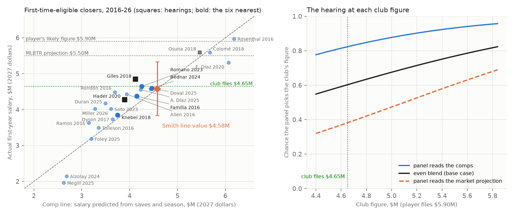

# Cade Smith's 2027 arbitration case, worked from the club side

**An arbitration exercise built from public data.** Cleveland's closer is arbitration-eligible for the first time this winter, after a platform year in which he tied for the major-league lead in saves. This brief works his case the way a club's arbitration group would: the record as a panel reads it, the comparable salaries, the club's filing number, the player's likely number, the midpoint and the odds of winning a hearing there, what losing costs, and whether to settle or try the case.

*An independent exercise: it was not prepared for, requested by or reviewed by the Cleveland Guardians, and I have no affiliation with the club. Written Oct. 18, 2026; Dylan Fanelli; Data: Baseball-Reference, FanGraphs, the MLB Stats API, MLB.com, MLB Trade Rumors, Spotrac and dated reporting, all listed under Sources (facts as of Oct. 18, 2026); Code: `baseball/roster/arbitration.py` (`uv run python -m baseball.roster.arbitration`), tests in `tests/test_arbitration.py`*



## Decision summary
- **File at $4.65M.**
  - **Why that number:** it pays Smith more than every first-time closer since 2016 he matches or beats on the panel's stats (thirteen of them, Romano and Bednar the closest), even with their salaries restated to 2027. It sits $0.07M above what the comparable closers' salaries predict for him ($4.58M), because Romano's salary, restated, sets the floor.
  - **What it concedes:** the platform year. He tied for the major-league lead with 41 saves (with Tampa Bay's Bryan Baker), had a 1.95 ERA and made the All-Star team.
- **Settle between $5.0M and $5.1M.** Open at $5.0M, ideally before December 1.
- **Walk to a hearing above $5.1M.** A hearing's average award is $5.15M, and $5.10M is the last $50K step under it. Above that, the hearing is the cheaper path on average.
- **The player's likely number is about $5.9M** (inference). That puts the midpoint at $5.275M.
  - **The club's chance at that midpoint is about 60% in the base case.** It rises to about 82% if the panel reads the case the way the comparable salaries do. It falls to 38% if the panel reads it like MLB Trade Rumors' $5.5M projection.
- **The one risk:** the panel pays for his ERA, his strikeouts and the All-Star selection the way the market projection does. The comps put him near $4.6M (about $4.7M if ERA is priced too). MLB Trade Rumors' model says $5.5M. The club stays the favorite at $4.65M unless the panel leans about three-to-one toward the market view.
- **The cost of being wrong:**
  - **Losing at $5.9M:** $1.25M more in 2027. Because later arbitration raises build on this salary, the gap repeats through 2029: about $3.4M in present value, or $2.3M if only half of it carries.
  - **Settling at the $5.275M midpoint:** about $0.13M a year above the hearing's average outcome, about $0.35M in present value.
- **The labor clock matters more than usual.** The 2022-26 agreement expires December 1. A lockout ends all contact with 40-man players. In 2022, figures were exchanged March 22 and hearings ran into June. A one-year deal signed before the tender deadline (expected about November 20; not yet announced) removes the hearing and the rules risk together. Cleveland made three such November deals last year.

## The case as a panel sees it

### The rules the panel works under
Source: the 2022-2026 Basic Agreement, Article VI(E), as the MLBPA posts it.
- **Final-offer arbitration.** Club and player exchange figures on the second Friday in January (Jan. 8, 2027, if the next agreement keeps the rule). A three-arbitrator panel picks one figure or the other, nothing in between.
- **The hearing.** Each side gets an hour to present and 30 minutes of rebuttal, the player first, and "neither party shall carry the burden of proof." The decision comes within 24 hours. The panel also gets a confidential tabulation of salaries and is to consider all comparable players rather than a single one, which limits how far one precedent (Hader's, say) can carry either side.
- **What the panel weighs** (Article VI(E)(10)(a)):
  - the quality of his contribution to the club in the platform year, "including but not limited to his overall performance, special qualities of leadership and public appeal"
  - the length and consistency of his career contribution
  - the record of his past compensation
  - comparable baseball salaries
  - any physical or mental defects
  - "the recent performance record of the Club including but not limited to its League standing and attendance"
- **Comparisons:** the panel gives "particular attention" to players with service no more than "one annual service group above" his. The same clause lets the player argue past that "because of special accomplishment."
- **What it can't weigh** (Article VI(E)(10)(b) and (c)):
  - the club's finances or his
  - press comments and testimonials (recognized annual awards for playing excellence are allowed)
  - offers made before the hearing
  - the cost of representation
  - salaries in other sports or occupations
  - the pre-arbitration bonus pool and anything he earned from it
  - statistics and data "generated through the use of performance technology, wearable technology, or 'STATCAST', whether publicly available or not"
  - the competitive balance tax
- **What that means for this brief:** the club's payroll never appears, and neither does any Statcast-based measure. The case is made on his record and on other players' salaries.

### Status (as of Oct. 18, 2026)
| Item | Value | Source |
|---|---|---|
| Service after 2026 | 3.000 (first-time eligible; no Super Two question) | MLB Trade Rumors, Oct. 2, 2026 |
| Control | Arbitration for 2027, 2028 and 2029; free agent after 2029 | Baseball-Reference ("Free Agent: 2030"); `service.timeline("3.000", 2026)` agrees |
| MLBTR 2027 projection | $5.5M | MLB Trade Rumors (Matt Swartz's model), Oct. 2, 2026 |
| Born | May 9, 1999, Abbotsford, B.C. (28 in the 2027 season) | Baseball-Reference |
| Signed | Minor-league free agent, June 18, 2020; added to the 40-man roster Nov. 14, 2023; debut Mar. 30, 2024 | MLB.com player page |
| Past compensation | Pre-arbitration salaries (2026 minimum: $780,000; his exact 2026 figure was not found). His pre-arbitration bonus-pool payment is inadmissible and left out | Baseball-Reference ("Pre-Arb"); Article VI(E)(10)(b) |
| Physical or mental defects | None on the public record: no injured-list placement found for 2024-26 | MLB.com and CBS Sports player pages |
| Club's recent record | 85-77 and AL Central champions in 2026, a third straight playoff berth; reached the ALCS | Baseball-Reference |

### His record
| Season | G | GF | SV | W-L | ERA | IP | SO | BB | HR | WHIP | ERA+ | Other |
|---|---|---|---|---|---|---|---|---|---|---|---|---|
| 2024 | 74 | 2 | 1 | 6-1 | 1.91 | 75.1 | 103 | 17 | 1 | 0.903 | 211 | 28 holds; 9th in AL Cy Young voting, 5th for Rookie of the Year |
| 2025 | 76 | 30 | 16 | 8-5 | 2.93 | 73.2 | 104 | 19 | 4 | 1.005 | 142 | |
| 2026 (platform) | 69 | 60 | **41** (tied for MLB lead) | 6-1 | **1.95** | 74.0 | 107 | 23 | 5 | 0.959 | 212 | All-Star; 41 of 46 save chances (89.1%) |
| Career | 219 | 92 | 58 | 20-7 | 2.26 | 223.0 | 314 | 59 | 10 | 0.955 | 182 | |

Sources: Baseball-Reference (read Oct. 18, 2026); holds, MLB.com; save chances, CBS Sports; the saves tie, Baseball-Reference's 2026 leaders and Yardbarker (Oct. 14, 2026).

### The club's argument, in the panel's language
1. **One full season as a closer.** 41 of his 58 career saves came in 2026. The four first-time closers since 2016 paid $5.0M or more (Rosenthal, Osuna, Colomé, Edwin Díaz) brought 84-135 career saves, the product of two or more seasons in the job.
2. **The comparable salaries.** The thirteen first-time closers he matches or beats on platform saves, platform ERA and career saves were paid $1.94-4.54M. Restated to 2027 at this market's own growth rate, that is $1.96-4.65M. At $4.65M, the club pays him above all of them.
3. **Consistency.** His 2025 was the weakest of his three seasons: a 2.93 ERA, 8-5, and 16 saves. His walks and home runs allowed have risen each year (17, 19, 23 walks; 1, 4, 5 home runs).
4. **The Familia precedent.** Jeurys Familia had 43 saves and a 1.85 ERA in his one full season as a closer. He settled at $4.1M in 2016, a record at the time for a reliever with one full season as closer (MLB.com, Feb. 15, 2020). That is $4.38M in 2027 dollars.
5. **The Hader precedent.** In February 2020 a panel chose Milwaukee's $4.1M over Josh Hader's $6.4M. Hader had 37 saves, 49 career saves, two All-Star selections and two Trevor Hoffman Awards. He asked for a first-year reliever record; the panel paid the club's number.

### What the club concedes
- **The platform year is among the best in the comparison set.** Of the 23 first-time closers since 2016, only Rondón (1.67), Knebel (1.78) and Familia (1.85) had a lower platform ERA, and only Rosenthal (48), Colomé (47) and Familia (43) had more platform saves. No comparable closer beats him on all three panel stats.
- **The All-Star selection counts.** Recognized awards are admissible.
- **His strikeouts are a counting stat a panel reads.** His 107 were more than every comp's except Hader's 138 and Knebel's 126.
- **The club's own record helps him.** A division champion's closer is a contributor to the club's recent performance, and the criteria name leadership and public appeal. The club shouldn't contest either.
- **What conceding these buys:** a filing above every comp he matches keeps the club's number credible. The hearing then turns on one question: one season of closing against two or more.

### The player's two routes past the first-year comps, and the club's answer
- **Closers one service group above.** The rule makes second-year salaries admissible, and these are the exhibits an agent brings:

| Player | Salary season | Platform SV | Platform ERA | Career SV | Salary | First-year salary (base) | Raise on the base |
|---|---|---|---|---|---|---|---|
| Jordan Romano | 2024 | 36 | 2.90 | 97 | $7.75M | $4.5375M | $3.21M |
| Jhoan Duran | 2026 | 32 | 2.06 | 90 | $7.5M | $4.125M | $3.375M |
| Camilo Doval | 2026 | 16 | 3.58 | 108 | $6.1M | $4.525M | $1.575M |
| David Bednar | 2025 | 23 | 5.77 | 84 | $5.9M | $4.51M | $1.39M |

  - **The agent's line:** "Bednar got $5.9M after a 5.77 ERA. Smith tied for the saves lead with a 1.95."
  - **The club's answer:** a second-year salary is a first-year base plus a raise, so it isn't a level comparison. Bednar's $5.9M is his $4.51M first-year salary plus $1.39M; the raise is the only part his 2024 earned, and it was the smallest of the four. Duran's $7.5M is a $4.125M base plus $3.375M for 32 saves and a 2.06 ERA. Smith has no arbitration base. The first-year salaries are the comparison for a first-year case, and that is where all four of these pitchers started: $4.125-4.54M.
- **Special accomplishment.** The player can argue that his season makes salaries "without regard to service" relevant.
  - **The club's answer:** a season tied for the saves lead, with an All-Star selection and no award win, is the top of an ordinary first-year closer class. The clause is meant for something rarer. Hader's panel heard a stronger version in 2020 (two All-Star selections, two Hoffman Awards) and paid the club's figure.

### Where modern metrics would mislead in a hearing
Reliever cases run on traditional numbers: saves first, then ERA, the default hearing statistic (Rieders, FanGraphs, 2015), with innings, strikeouts and awards behind them. WAR is the number to use with the most care. When MLB proposed paying arbitration salaries by a formula on FanGraphs WAR in November 2021, the union's position was that "broad-scope metrics like WAR are not designed and are not fit to determine something as important as player salaries" (CBS Sports, Nov. 11, 2021), and the 2022 agreement kept the old system. Five places where the modern number would hurt the side that leans on it:
- **WAR on his 2025.** Baseball-Reference has him at 0.8 WAR, FanGraphs at 2.7, for the same season. The club could cite 0.8 to call 2025 a down year, and the player would answer with 2.7. A panel can't settle a 1.9-win disagreement between two versions of one statistic, so the argument is better made with his 2.93 ERA, which both sides accept.
- **FIP and xFIP.** His FIP rose from 1.40 to 1.95 to 2.18, and his 2026 xFIP was 2.63, well above his 1.95 ERA. A club might want to argue his ERA will come back up. The panel prices what happened in the platform year, and a 2.18 FIP is elite anyway. The hearing record fits that reading: Roberto Osuna lost his 2018 hearing with a 3.38 ERA and a 1.74 FIP, so a good FIP didn't rescue an ordinary ERA. (One case, no proof of a rule.)
- **Win probability added.** He had 4.7 WPA in 2026 (Baseball-Reference). The player's side may present it as clutch value. Most of it comes from the save situations the panel is already counting, so the club's answer is the save total itself.
- **Stuff and pitch data.** Pitch-shape grades, Stuff-type models and anything else built on Statcast can't be offered by either side. His 36.3% strikeout rate (FanGraphs) is a box-score rate and admissible, but panels pay for results. The club should accept the 107 strikeouts and leave the rate to the player's side.
- **Saves themselves.** Saves are a role statistic. A front office knows that 41 saves partly reflect who got the ninth inning, and that his 2024 setup season (28 holds, 1.91 ERA) was worth about as much in run prevention (15 runs above average, against 16 in 2026; Baseball-Reference). In a hearing, though, saves are what the comparable salaries were paid on. Arguing that saves overstate him would undercut the club's own comps.

## The comparables

**The pool** (`POOL_RULE`): every reliever with 20 or more saves in a platform season from 2015 to 2025 (the MLB Stats API's season leaders) whose next season was his first arbitration year, Super Twos included, and whose salary was set by a one-year settlement or a hearing. That gives 23 closers for 2016-26, plus Papelbon's 2009 record as an exhibit.
- **Screened out, with the reason** (`SCREENED_OUT`): players already past their first arbitration year (Britton, Kela, Treinen, Greene, Rogers, Robles, Trivino, Reyes, Holmes, Sewald, Barlow, Phillips, Vest), Boxberger, Neris and Palencia (still pre-arbitration), and extensions or multi-year deals (Vázquez, Iglesias, Hand, Clase, Fairbanks, Muñoz).
- **The 2023-26 candidates, confirmed Oct. 18, 2026:** each was checked against MLB Trade Rumors' service-time lists, Baseball-Reference's salary table and a dated report of the deal.
  - **Four joined the pool, all settled:** Gregory Soto (2023, $3.925M), Adbert Alzolay (2024, $2.11M), Jason Foley (2025, $3.15M) and Trevor Megill (2025, $1.94M).
  - **Six failed the rule:** Holmes, Sewald and Barlow had their first arbitration year in 2022, Phillips was a Super Two in 2023 and Vest's first year was 2025, so each candidate season was a second year. Palencia (1.154 service) was still pre-arbitration in 2026.
  - **Rechecked the same way:** Britton (a Super Two in 2015), Treinen and Greene (first arbitration year 2018).

**How the six nearest were chosen** (`select_comparables`): nearest to Smith on platform saves, career saves, platform ERA and the year the salary was set. The distance scales (10 saves, 25 career saves, 1.00 of ERA, 8 years) are assumptions. The service rule allows a comp with at most one more year of service; Super Twos (less service) are allowed.

**The six nearest:**

| Player | Salary season | Service class | Platform SV | Platform ERA | IP | SO | Career SV | All-Star (platform) | Salary | How set | In 2027 dollars | Smith vs. comp |
|---|---|---|---|---|---|---|---|---|---|---|---|---|
| **Cade Smith** | 2027 | 3.000 | **41** | **1.95** | 74.0 | 107 | **58** | Yes | — | — | — | — |
| David Bednar | 2024 | 3.076 | 39 | 2.00 | 67.1 | 80 | 61 | Yes | $4.51M | Settled | $4.59M | Smith matches or better |
| Jordan Romano | 2023 | Arb 1 | 36 | 2.11 | 64.0 | 73 | 61 | Yes | $4.5375M | Settled | $4.65M | Smith matches or better |
| Josh Hader | 2020 | Super Two (2.115) | 37 | 2.62 | 75.2 | 138 | 49 | Yes | $4.1M | Hearing: club's $4.1M over his $6.4M | $4.27M | Smith better |
| Corey Knebel | 2018 | Super Two | 39 | 1.78 | 76.0 | 126 | 41 | Yes | $3.65M | Settled | $3.85M | Mixed |
| Ken Giles | 2018 | Arb 1 | 34 | 2.30 | 62.2 | 83 | 65 | No | $4.6M | Hearing: his $4.6M over the club's $4.2M | $4.85M | Mixed |
| Jeurys Familia | 2016 | Arb 1 | 43 | 1.85 | 78.0 | 86 | 49 | No | $4.1M | Settled | $4.38M | Mixed |

**The exhibits each side will add:**

| Player | Salary season | Platform SV | Platform ERA | Career SV | Salary | How set | In 2027 dollars | Who cites it |
|---|---|---|---|---|---|---|---|---|
| Jonathan Papelbon | 2009 | 41 | 2.34 | 113 | $6.25M | Settled; the first-year reliever record | — (too old to restate) | Player: the record |
| Trevor Rosenthal | 2016 | 48 | 2.10 | 96 | $5.6M | Settled | $5.98M | Player; club answers with 96 career saves |
| Roberto Osuna | 2018 | 39 | 3.38 | 95 | $5.3M | Hearing: club's $5.3M over his $5.8M | $5.59M | Both: player for the level, club for the result |
| Álex Colomé | 2018 | 47 | 3.24 | 84 | $5.3M | Settled | $5.59M | Player; club answers with 84 career saves and a 3.24 ERA |
| Edwin Díaz | 2020 | 26 | 5.59 | 135 | $5.1M | Settled | $5.32M | Player; club answers with 135 career saves |
| Héctor Rondón | 2016 | 30 | 1.67 | 59 | $4.2M | Settled | $4.48M | Club: a lower ERA than Smith's, $4.48M in 2027 dollars |
| Cody Allen | 2016 | 34 | 2.99 | 60 | $4.15M | Settled | $4.43M | Club |
| Alexis Díaz | 2025 | 28 | 3.99 | 75 | $4.5M | Settled (3.000) | $4.55M | Club |
| Camilo Doval | 2025 | 23 | 4.88 | 92 | $4.525M | Settled (3.071) | $4.58M | Club: 92 career saves, $4.5M |
| Jhoan Duran | 2025 | 23 | 3.64 | 58 | $4.125M | Settled (3.000) | $4.17M | Club: same career saves, $4.1M |
| Gregory Soto | 2023 | 30 | 3.28 | 50 | $3.925M | Settled (3.102) | $4.02M | Club: an All-Star closer with 30 saves, under $4.0M |
| Jason Foley | 2025 | 28 | 3.15 | 35 | $3.15M | Settled (3.033) | $3.19M | Club |
| Adbert Alzolay | 2024 | 22 | 2.67 | 23 | $2.11M | Settled (3.050) | $2.15M | Club: the low end of the pool |
| Trevor Megill | 2025 | 21 | 2.72 | 21 | $1.94M | Settled (3.002) | $1.96M | Club: the low end of the pool |

- **"In 2027 dollars":** each salary grown at 0.59% a year, the rate the comp line below estimates from these salaries themselves (standard error about 1.0% a year).
- **"Matches or better":** at least as good on platform saves and platform ERA, and the comp has no more than five more career saves (Bednar and Romano have 61, three more than Smith). "Mixed" means each side has an edge.
- **Papelbon's record:** MLB Trade Rumors' records page (January 2017) and MLB.com (February 2020) both list his $6.25M as the record for a first-time-eligible reliever. No first-year salary in the 2016-26 pool is higher.
- **The three first-time closer hearings in the pool:** the club won two (Osuna 2018, Hader 2020) and Giles won one (2018, $4.6M over $4.2M, the closest gap of the three).
- **The bracket** (`bracket`):
  - **Floor:** Romano at $4.65M in 2027 dollars, the highest-paid comp Smith matches or beats on all three panel stats. A filing under it would ask the panel to pay him less than a closer he out-pitched.
  - **Ceiling:** no first-year comp beats him on every stat, so the comps set no ceiling. The player's case for more than about $5.5M rests on first-year comps with 84 or more career saves, the second-year salaries above, or a special-accomplishment argument.

## The arithmetic

### 1. What the comparables say he's worth: $4.58M
- **The comp line** (`fit_comp_line`): log salary on platform saves, career saves and the season the salary was set, fit on the 23 first-time closers of 2016-26. Papelbon's 2009 salary stays an exhibit.
- **What it finds:**
  - **Each platform save** adds about 1.4% to the salary.
  - **Each career save** adds about 0.7%.
  - **The season term** says this market's salaries grew about 0.6% a year, with a standard error of about 1.0%, so the comps can't tell slow growth from none. Closers with under 60 career saves got $3.3-4.2M in 2016-17 and $1.9-4.1M in 2023-26.
  - **The fit:** the typical miss is about 13% in sample (residual standard deviation 0.130 in log terms) and about 16% out of sample (leave-one-out RMSE 0.158). The biggest out-of-sample misses are under the line: Edwin Díaz and Megill, each about 32%, and Alzolay, about 25%. Díaz's 135 career saves predict more than his $5.1M; Alzolay and Megill settled far below Duran and Doval, who had about as many platform saves. On the other side, Mason Miller ($4.0M on 22 saves) sits about 26% over. The three hearing awards sit within 12% of the line (Hader +5%, Osuna −3%, Giles +12%).
- **Smith's line value:** $4.58M, with a prediction standard error of $0.75M.
- **Do panels pay for more than saves?** Added one at a time to the line (`added_predictor_tests`):
  - **Platform ERA:** about 6% less per run of ERA (coefficient −0.060, standard error 0.050). The size matches the 19-comp version, but on 23 comps it sits within its own error, and the fit barely tightens (residual sd 0.128). With it, Smith's 1.95 ERA lifts his value to $4.70M.
  - **An All-Star selection in the platform year:** +1.8%, standard error 7.7%.
  - **Platform strikeouts:** +1.2% per 10, standard error 1.3%.
  - **So:** none of the three is clearly different from zero. ERA has the largest effect, and it is the default hearing statistic, so it is the one to prepare for.
- **Against MLB Trade Rumors:** MLBTR projects $5.5M, about 1.2 standard errors above the line. Its model (Matt Swartz's) uses playing time, role and performance stats with inflation, and its exact terms aren't public. The gap between the two numbers is the hearing question: how much a panel pays above the saves line for his ERA, strikeouts and All-Star selection. The comps' answer is about $0.12M, for the ERA, and even that is uncertain.
- **The pool moves the line more than the filing.** The hand-built ten-comp version of this line put him at $4.90M; the systematic 19 put him at $4.82M; the full 23, with the four added Oct. 18, put him at $4.58M; adding ERA, $4.70M. The filing ranges only $4.65-4.80M across those versions, because Romano's salary sets the floor in each and only the growth rate used to restate it changes.

### 2. The player's likely figure: about $5.9M (inference)
- **The 2026 exchanges as a guide:** in the 18 cases where figures were exchanged for 2026, the player's figure ran a median 1.148 times the club's (MLB.com, Jan. 9, 2026).
- **If the two figures straddle MLBTR's $5.5M at that ratio:** the club would file $5.12M and the player $5.88M (`straddle`). Rounded, the player files $5.9M.
- **A record-claim filing** at $6.3M, above Papelbon's $6.25M, is the other plausible number. Hader filed $6.4M chasing the same record in 2020.

### 3. The hearing odds at each filing
- **How the panel picks:** it takes the figure nearer its own view of his value. So the club wins when the panel's value is below the midpoint.
- **Two views of the panel** (the panel's value is normal with sd $0.75M around each center):
  - **"Reads the comps":** centered on the $4.58M line value.
  - **"Reads the market":** centered on MLBTR's $5.5M.
  - **The base case weights them evenly.** No public record says how panels split between a saves line and a full-stat model, so even weight is the no-information choice. The evidence that exists leans a little toward the market view: players won 8 of 12 hearings in 2026, and Fink found panels picked the model-favored side only about half the time. So the decision below is written on the weight itself.
- **At the recommended filing:**
  - **Midpoint:** ($4.65M + $5.90M) / 2 = $5.275M.
  - **Reads the comps:** P(club) = Φ((5.275 − 4.58) / 0.75) = Φ(0.93) = **0.823**.
  - **Reads the market:** P(club) = Φ((5.275 − 5.50) / 0.75) = Φ(−0.30) = **0.382**.
  - **Base case:** (0.823 + 0.382) / 2 = **0.603**.
- **Expected award** (base case): 0.603 × $4.65M + 0.397 × $5.90M = **$5.15M**. That is the walk-to-hearing point: a settlement above it costs more, on average, than trying the case.
- **The weight that flips it:** the club is the favorite at $4.65M until the panel puts about 73% of its weight on the market view (`breakeven_weight`). File $4.65M if you believe the panel prices him nearer the comps than about three-to-one toward MLBTR; past that, settle up to the walk point for that weight (about $5.28M at 75%).

| Club files | P(club wins), base case | Expected award | P, reads the comps | P, reads the market |
|---|---|---|---|---|
| $4.50M | 0.57 | $5.10M | 0.80 | 0.34 |
| $4.60M | 0.59 | $5.13M | 0.81 | 0.37 |
| **$4.65M** | **0.60** | **$5.15M** | **0.82** | **0.38** |
| $4.75M | 0.62 | $5.18M | 0.84 | 0.41 |
| $4.80M | 0.63 | $5.20M | 0.85 | 0.42 |
| $4.90M | 0.66 | $5.24M | 0.86 | 0.45 |
| $5.00M | 0.68 | $5.29M | 0.88 | 0.47 |
| $5.10M | 0.70 | $5.34M | 0.89 | 0.50 |

(Player files $5.90M in every row.)

### 4. Why $4.65M
- **The expected award barely moves between $4.5M and $4.65M** ($5.10-5.15M). A lower filing buys a lower award when the club wins and gives up almost the same amount in win probability.
- **Below $4.646M, the club files under a comp Smith clearly matches** (Romano, restated). That invites the panel to read the whole filing as a lowball. So the filing is the lowest round figure at or above that floor (`best_filing` with the floor, rounded up to $50K).
- **It matches the theory.** Farber (1980): the side that files nearer the panel's expected award wins more often. $4.65M sits $0.07M above the comp line's $4.58M.
- **Against a record-claim filing ($6.3M):** the midpoint moves to $5.475M, the club's chance rises to 0.69, and the expected award is $5.17M.

### 5. Settle or try the case
- **Settlements cluster near the midpoint.** Bennett (Baseball Prospectus, Feb. 2, 2010): half the gap was the most common settlement point, and the average was 46% of the gap. Here that is $5.225-5.275M.
- **The hearing averages $5.15M** in the base case, about $0.13M a year less than a midpoint settlement.
- **The carry:** later arbitration raises build on this salary, so a 2027 dollar tends to repeat in 2028 and 2029 (`carry_cost`). At a 10% discount rate and full carry:
  - **Settling at the midpoint instead of trying the case:** $0.128M × (1 + 1/1.1 + 1/1.21) = $0.128M × 2.736 = about **$0.35M** in present value.
  - **Losing the hearing:** ($5.90M − $4.65M) × 2.736 = **$3.42M** in present value. If only half the gap carries into 2028-29, it is **$2.33M**. The base-case chance of losing is about 40%.
- **The recommendation:**
  - **Settle at $5.1M or less.** Open at $5.0M before December 1, when a one-year deal can still be signed under known rules.
  - **If figures are exchanged:** file $4.65M and treat the case as file-and-trial. Above $5.1M the hearing is cheaper on average, and the club is the favorite in two of the three views.
  - **If the player files a record claim** ($6.25M or more), try the case. The club's chance rises to about two in three.
- **Cleveland's own practice:** the club has avoided arbitration hearings every year since 2019 (MLB.com, Jan. 12, 2024). It settled with every eligible player before the exchange in 2025 and 2026 (MLB.com, Jan. 10, 2025 and Jan. 8-9, 2026). A settlement inside the $5.0-5.1M range fits that record. A hearing is the fallback if his camp prices him like the market projection.

### Sensitivity
| Case | Line value | P(club wins) at $4.65M | Walk point |
|---|---|---|---|
| Base: even weight on the two views | $4.58M | 0.60 | $5.15M |
| Weight on the market view 0.25 | $4.58M | 0.71 | $5.01M |
| Weight on the market view 0.60 | $4.58M | 0.56 | $5.20M |
| Weight on the market view 0.75 | $4.58M | 0.49 | $5.28M |
| Player files the record claim ($6.3M) | $4.58M | 0.69 | $5.17M |
| Fit without the three hearing awards (Hader, Osuna, Giles) | $4.58M | 0.60 | $5.15M |
| Fit on the original ten hand-picked comps | $4.90M | 0.56 | $5.20M |
| Comp line with platform ERA added | $4.70M | 0.58 | $5.18M |
| Fit including Papelbon (2009) | $4.54M | 0.61 | $5.13M |
| Panel noise sd $0.25M | $4.58M | 0.59 | $5.16M |
| Panel noise sd $0.50M | $4.58M | 0.62 | $5.12M |

- **What moves the answer:** the weight on the market view. At 0.75 the club is an underdog at $4.65M, and the walk point rises to $5.28M, just above the $5.275M midpoint. Settling then becomes the better choice.
- **What moves the line but not the decision:** the comp set. The hand-picked ten put him $0.32M higher than the full 23, yet the chance at $4.65M stays between 0.56 and 0.61 in every version, because a higher line comes with a smaller error.
- **What doesn't move either:** dropping the hearings, ERA in the line, and the panel noise. The two views offset, so noise barely matters.
- **Papelbon:** adding his 2009 salary lowers the estimated growth to 0.5% a year and the line to $4.54M. That would help the club, but it rests on an 18-year-old salary, and a panel would discount a line built on it.

## The labor situation
- **Assumed here:** the 2022-26 system carries into 2027 unchanged. That covers final-offer arbitration, the same criteria and exclusions, the comparisons rule, and an exchange on the second Friday in January (Jan. 8, 2027) with hearings into February (the 2026 figures were exchanged Jan. 9, and the 2026 hearings ran through mid-February).
- **Where talks stand (checked Oct. 18, 2026):**
  - **Expiration:** the agreement expires Dec. 1, 2026 at 11:59 p.m. ET.
  - **The latest proposal found:** MLB's of Oct. 8 (a 154-game season from 2029 and seeding changes), still tied to a salary cap. The union restated its opposition to a cap.
  - **No agreement or extension of the deadline** was reported.

| Rule | 2022-26 | What could change | Effect on this case |
|---|---|---|---|
| Exchange and hearing dates | Exchange on the second Friday in January, hearings into February | A lockout freezes contact with 40-man players. In 2022, figures were exchanged March 22 and hearings ran May 2 to June 24 | Sign before Dec. 1 if possible. Otherwise a hearing could fall in spring training or the season, with the club arguing against its own closer |
| The system | Final offer, panel criteria | MLB (June 25, 2026) proposed to "maintain the status quo" while staying open to changes that would "increase compensation for arbitration-eligible players under a new framework that addresses the league's concerns." In Nov. 2021 MLB proposed pay by a formula on FanGraphs WAR | A WAR formula would price him on 2.6-2.7 WAR a season, with no credit for 41 saves; for a closer the likely direction is lower pay (not quantified). A higher-paying framework would raise his number. A deal signed under the old rules fixes the price either way |
| Eligibility | 3 years, plus Super Twos | The union proposed expanded eligibility | None for Smith (already eligible). More young comparables in later years |
| Service in a stoppage | Not covered | If 2027 games are lost and the days aren't credited, a 120-day 2027 leaves him at 5.120 after 2029 and adds a fourth arbitration year (`timeline("3.000", 2026, [120, 172, 172])`) | The cost of losing the 2027 hearing would carry four years: $1.25M × 3.487 = $4.36M in present value at full carry. Precedent (the 1994-95 strike, 2020, 2022) protected service; see the roster and CBA memo |
| Salary in a stoppage | Paid by days of the season | Same | Filings are full-season numbers. A shortened season prorates either figure |

## What this doesn't show
- **Cleveland's current arbitration policy isn't public.** MLB.com listed it among file-and-trial clubs in 2015 (Simon, Jan. 16, 2015). Its record since then is settlements.
- **The panel model is a stand-in.**
  - **Its parts:** the comp line, MLBTR's projection and the even weighting are the model; the panel's value is assumed normal. The sd is the comp line's prediction error, $0.75M.
  - **What panels actually do:** Fink (2023, Dartmouth) found arbitrators picked the offer a salary model favored only about half the time (166 of 323 hearings, 1990-2022), so real panels are noisier than any line.
- **The comp line has 23 points and three predictors.** ERA, All-Star selections and strikeouts were each tested as a fourth; none was clearly different from zero. More predictors at once would overfit 23 points.
- **The full pool is noisier than the partial one was.** The four closers confirmed Oct. 18 were paid $1.94-3.925M, all under what the first 19 predicted for their saves. Adding them lowered Smith's line value $0.24M and doubled its prediction error. Leaving unconfirmed candidates out had kept the line high.
- **The player's figure is inferred.** It comes from 2026 exchange gaps around the MLBTR projection, and his agent's number may differ.
- **Missing facts:**
  - his exact 2026 salary
  - holds and blown saves for the comps
  - service days for most comps, whom sources list only as first-time eligible
- **The postseason is left out.** His 2026 postseason work isn't in the platform numbers. How a panel treats the postseason wasn't checked.
- **Not modeled:**
  - the relationship cost of a hearing
  - its effect on any extension conversation
  - an extension itself, the other way to avoid a hearing
- **No team data.** Everything is public.

## Reproduce
```bash
uv run python -m baseball.roster.arbitration     # every number in this brief, the sensitivity table and the figure
uv run pytest tests/test_arbitration.py          # 19 tests, arithmetic checked by hand in the comments; no data needed
```

## Sources
- **Cade Smith:**
  - Baseball-Reference player page: standard, value and win-probability tables; born May 9, 1999; 2026 All-Star; 2024 award voting; "Arb Eligible: 2027," "Free Agent: 2030" (read Oct. 18, 2026)
  - Baseball-Reference, 2026 MLB leaders: 41 saves, tied with Bryan Baker; Yardbarker, "The MLB annual save leaders since 2008" (Oct. 14, 2026): "Baker's 41 saves were tied for the most in all of baseball"
  - FanGraphs player page: fWAR, xFIP, strikeout rate (read Oct. 18, 2026)
  - MLB.com player page: 2024 holds (28), signing history, 2026 All-Star activation (read Oct. 18, 2026)
  - CBS Sports player page: 46 save chances (Sept. 24, 2026 note), five blown saves through Aug. 5 (read Oct. 18, 2026)
  - Screwball, "Guardians Bullpen Stats In 2026": 41 saves, 89.1% (read Oct. 18, 2026)
- **Service and projection:** Darragh McDonald, "Projected Arbitration Salaries For 2027," MLB Trade Rumors (Oct. 2, 2026): "Cade Smith: 3.000, $5.5MM."
- **Guardians:**
  - Baseball-Reference, 2026 team page: 85-77, AL Central, ALCS (read Oct. 18, 2026)
  - Mandy Bell, MLB.com: no hearings since 2019 (Jan. 12, 2024)
  - Tim Stebbins, MLB.com: Kwan deal; November 2025 agreements with Festa, Fry and Jones (Jan. 8, 2026)
- **The pool screen:** MLB Stats API, season pitching leaders by saves, 2015-25, and year-by-year career lines (read Oct. 18, 2026).
- **First-year comparables** (platform lines from the MLB Stats API, matching Baseball-Reference for the original ten and the four added Oct. 18, 2026):
  - Bednar: Jake Crouse, MLB.com (Jan. 11, 2024); Spotrac (3.076)
  - Romano: Keegan Matheson, MLB.com (Jan. 14, 2023); Spotrac
  - Hader: Adam McCalvy, MLB.com (Feb. 15, 2020), the source for his $4.1M award, his $6.4M filing, 2.115 service, Papelbon's record and Familia's $4.1M; Brew Crew Ball (Jan. 10, 2020)
  - Knebel: MLB.com (Jan. 12, 2018), $3.65M as reported by USA Today's Bob Nightengale; Brew Crew Ball (Jan. 12, 2018), first year of eligibility as a Super Two
  - Giles: MLB.com (Feb. 3, 2018), his $4.6M over Houston's $4.2M; Spotrac (pre-arbitration 2016-17)
  - Colomé: DRaysBay (Jan. 12, 2018), $5.3M; DRaysBay (Nov. 16, 2017), "just now entering his first year of arbitration"
  - Allen: Spotrac (Jan. 15, 2016); AP via Fox News, "Indians, closer Allen agree to 1-year, $4.15 million deal"
  - Rondón: Spotrac (Jan. 15, 2016)
  - Tolleson: AP via Fox 4 Dallas (Jan. 25, 2016), "Eligible for arbitration for the first time"
  - Ramos: Spotrac (Jan. 15, 2016)
  - Dyson: Spotrac (Jan. 13, 2017); AP via Washington Times (Jan. 13, 2017)
  - Doval 2025: Spotrac (3.071; Jan. 9, 2025)
  - Mason Miller: AJ Cassavell, MLB.com (Jan. 9, 2026)
  - Rosenthal and Papelbon: MLB Trade Rumors, arbitration records page (relief pitchers, Jan. 17, 2017)
  - Osuna: Deesha Thosar, MLB.com (Feb. 3, 2018)
  - Edwin Díaz: Spotrac (signed Jan. 10, 2020)
  - Alexis Díaz: Greg Kuffner, Reds On SI (Jan. 2025); Spotrac (3.000, Jan. 9, 2025)
  - Duran 2025: CBS Sports (Jan. 9, 2025); Spotrac (3.000)
  - Soto: Tim Dierkes, "Projected Arbitration Salaries For 2023," MLB Trade Rumors (Oct. 10, 2022), "Gregory Soto (3.102)"; Alex Coffey, Philadelphia Inquirer (Jan. 13, 2023), "Soto ($3.925 million)"
  - Alzolay: Anthony Franco, "Projected Arbitration Salaries For 2024," MLB Trade Rumors (Oct. 6, 2023), 3.050; Jordan Bastian, MLB.com (Jan. 11, 2024), "$2.11 million for '24"
  - Foley: Anthony Franco, "Projected Arbitration Salaries For 2025," MLB Trade Rumors (Oct. 1, 2024), 3.033; Anne Rogers, MLB.com (Jan. 9, 2025), "Foley at $3.15 million"
  - Megill: the same MLB Trade Rumors list, 3.002; Adam McCalvy, MLB.com (Jan. 10, 2025), "$1.94 million"
  - Screened out: Spotrac player pages (Neris, Kela, Rogers, Robles, Trivino, Reyes); AP via Fox News (Boxberger's 2017 first arbitration salary, Jan. 14, 2017); MLB Trade Rumors' "Projected Arbitration Salaries" lists for 2016 (Oct. 6, 2015; Britton 3.158), 2018 (Oct. 10, 2017; Treinen 3.065, Greene 3.075), 2022 (Feb. 17, 2022; Holmes 3.031, Sewald 3.072, Barlow 3.030), 2023 (Oct. 10, 2022; Phillips 2.136) and 2025 (Oct. 1, 2024; Vest 3.100); Steve Adams, MLB Trade Rumors (Feb. 4, 2015), Britton's $3.2M settlement; Eric Stephen, True Blue LA (Jan. 7, 2023), "Evan Phillips and Brusdar Graterol are Super Two players"; Baseball-Reference salary tables and service time for all nine, Palencia's 1.154 included (read Oct. 18, 2026)
- **Second-year comparables:**
  - Romano 2024: Canadian Press via CP24 (Jan. 12, 2024), "a deal worth US$7.75 million"
  - Bednar 2025: Pittsburgh Baseball Now (Jan. 9, 2025), "$5.9 million"
  - Duran 2026: MLB.com, Phillies avoid arbitration (Jan. 8, 2026), "$7.5 million"
  - Doval 2026: Spotrac (4.071; Jan. 8, 2026); Yankees On SI (Jan. 8, 2026), "$6.1 million"
- **Exchanges and hearings:**
  - Mark Feinsand, MLB.com: "3 takeaways from arbitration deadline" (Jan. 9, 2026), the 18 exchanges; and the 2025 deadline recap (Jan. 10, 2025)
  - AP via NY1 (Feb. 6, 2026); Brew Crew Ball post-deadline recap (2026): players 8-4 in 2026 hearings
  - AP via TSN (Feb. 17, 2024): clubs 353-266 all-time through 2024
  - Andrew Simon, MLB.com, "Arbitration deadline concrete for file-and-trial clubs" (Jan. 16, 2015)
- **Rules:**
  - The 2022-2026 Basic Agreement, Article VI(E), as posted by the MLBPA: the exchange date, the hearing format, the criteria and exclusions in VI(E)(10)
  - MLB.com glossary, Salary Arbitration (read Oct. 18, 2026)
- **Research:**
  - H. S. Farber, "An analysis of final-offer arbitration," *Journal of Conflict Resolution* 24(4), 1980
  - J. Bennett, "Expanded Horizons: Arbitration Negotiations," Baseball Prospectus (Feb. 2, 2010)
  - D. Fink, *Team versus player?* senior thesis, Dartmouth College (June 4, 2023), p. 41
  - Rich Rieders, "An Introduction to Determining Arbitration Salaries: Relief Pitchers," FanGraphs Community (Nov. 22, 2015): saves drive reliever arbitration pay; ERA is a default hearing stat
- **Labor:**
  - Anthony Castrovince, MLB.com (June 25, 2026): MLB's arbitration position
  - Dayn Perry, CBS Sports (Nov. 11, 2021) and Owen Poindexter, Front Office Sports (Nov. 15, 2021): MLB's WAR-formula proposal and the union's response
  - Roundtable (Oct. 9, 2026): MLB's Oct. 8 proposal and the union's response
  - AP (May 2, 2022), as cited in the roster and CBA memo: 2022 exchange and hearing dates
  - The rest of the labor background, the lockout memo and the tender-deadline estimate: [the roster and CBA memo](2026-roster-cba-engine.md)

## Walk me through it
1. **"MLB Trade Rumors says $5.5M. Why file $4.65M?"**
   - **The panel decides on comparable salaries.** A projection is a forecast of them. The 23 first-time closers since 2016 put him at $4.58M on saves and time, and $4.70M if ERA is priced too.
   - **$4.65M is defensible on its face.** It's above every first-year closer he matches or beats on the panel's stats, with their salaries restated to 2027.
   - **The $0.9M gap between the two numbers is the risk I'm flagging.** The comps pay about $0.12M of it, for his ERA, and even that is within their error; nothing measurable for the All-Star selection or strikeouts.
2. **"Their exhibit is Duran's $7.5M."**
   - **It's a second-year salary.** Duran's $7.5M is his $4.125M first-year salary plus a $3.375M raise. The rule makes it admissible, but it isn't a level comparison: Smith has no arbitration base yet.
   - **Where Duran started is the comparison.** All four second-year closers they'll cite (Romano, Duran, Doval, Bednar) started at $4.125-4.54M. We're filing above that.
   - **On Bednar's $5.9M after a 5.77 ERA:** $4.51M of it was his first-year base. The raise his bad year earned was $1.39M, the smallest of the four.
3. **"What's their best first-year comp, and how do you beat it?"**
   - **Their comp:** Rosenthal, 2016. He had 48 saves and got $5.6M, which is $5.98M in 2027 dollars. Colomé ($5.3M, 47 saves) is next.
   - **The answer is career.** Rosenthal had 96 career saves over two seasons as a closer, Colomé 84. Smith has 58, and 41 of them came this year.
   - **Smith's edge is ERA,** 1.95 against 2.10 and 3.24, so the comparisons are mixed. The panel weighs career length and consistency, and that criterion is ours.
4. **"Can't they argue special accomplishment?"**
   - **They can try.** The clause lets them cite salaries without regard to service.
   - **Our answer:** tied for the saves lead, an All-Star selection, no award win. That is the top of a normal first-year closer class. Hader brought more in 2020 (two All-Star selections, two Hoffman Awards) and the panel took Milwaukee's figure.
5. **"His FIP and xFIP are worse than his ERA. Why not argue regression?"**
   - **The panel prices the platform year.** A 2.18 FIP is elite anyway.
   - **The record doesn't reward that argument.** Osuna lost a hearing in 2018 with a 3.38 ERA and a 1.74 FIP.
   - **The club's consistency argument is stronger in ERA and counts:** his 2.93 ERA in 2025, and walks and home runs up each year.
   - **And no Statcast numbers:** pitch grades are inadmissible for both sides.
6. **"What does losing cost us?"**
   - **The 2027 cost:** $1.25M ($5.9M against $4.65M).
   - **The carry:** raises build on the base, so the gap repeats in 2028 and 2029. That's about $3.4M in present value at 10%, or $2.3M if only half carries.
   - **If a stoppage costs him uncredited service,** he gets a fourth arbitration year and the cost is about $4.4M.
7. **"Why not settle at the midpoint and move on?"**
   - **The hearing averages $5.15M** against a $5.275M midpoint. That makes trying the case about $0.35M better in present value, and we're about a 60% favorite.
   - **So I'd settle at $5.1M or less** and try the case above that.
   - **The exception:** if we believe a panel would lean three-to-one toward the market projection, the club is no longer the favorite at $4.65M, the walk point rises to about $5.28M, and settling at the midpoint becomes the better call.
8. **"Why weight the two views evenly?"**
   - **Nothing public says how panels split.** Even weight is the no-information choice.
   - **The evidence leans slightly to the market side** (players 8-4 in 2026 hearings), so I show the decision at every weight. The filing holds until about 73% on the market view.
9. **"How do you know saves drive the number?"**
   - **The comps:** platform and career saves, plus a time trend, fit 23 first-time closers within about 13% in sample and 16% out of sample.
   - **Outside work agrees.** Rieders (FanGraphs, 2015) found career saves had the strongest correlation with first-time reliever pay (83%), with platform saves next (79%).
   - **What else I tested:** ERA is worth about 6% per run, though within its error on 23 comps; an All-Star selection and strikeouts add nothing measurable.
10. **"What happens to all this in a lockout?"**
    - **After December 1:** no contact with 40-man players. In 2022, figures were exchanged March 22 and hearings ran into June.
    - **The plan:** make the $5.0M offer before December 1. The tender deadline is expected around November 20.
    - **Why sign early:** a signed deal is fixed under the old rules, whatever the next agreement does to arbitration. MLB floated a WAR formula in 2021 and is open to "a new framework" now.

---
© 2026 Dylan Fanelli. All rights reserved. See [LICENSE](../LICENSE).
