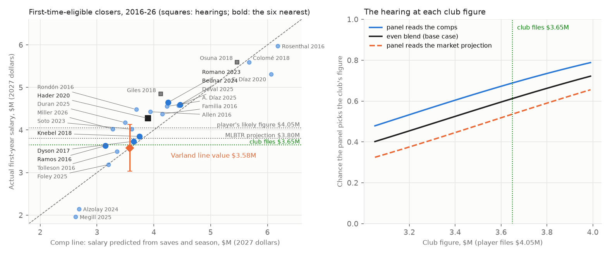

# Louis Varland's 2027 arbitration case, worked from the club side

**A second arbitration exercise built from public data, with the same method as [Cade Smith's](2027-arbitration-brief-smith.md).** Toronto's closer goes to arbitration for the first time this winter as a Super Two, after a platform year with a 1.27 ERA, 35 saves and an All-Star selection, his first year as a closer. This brief works his case the way a club's arbitration group would: the record as a panel reads it, the comparable salaries, the club's filing number, the player's likely number, the midpoint and the odds of winning a hearing there, what losing costs, and whether to settle or try the case.

*An independent exercise: it was not prepared for, requested by or reviewed by the Toronto Blue Jays, and I have no affiliation with the club. Written Oct. 20, 2026; Dylan Fanelli; Data: Baseball-Reference, the MLB Stats API, MLB.com, MLB Trade Rumors, Wikipedia and dated reporting, all listed under Sources (facts as of Oct. 20, 2026); Code: `baseball/roster/arbitration.py` (`uv run bb arb-case varland`), tests in `tests/test_arbitration_varland.py`*



## Decision summary
- **File at $3.65M.**
  - **Why that number:** it pays Varland more than every first-time closer since 2016 he matches or beats on the panel's stats (five of them: Tolleson, Ramos, Alzolay, Foley and Megill), with their salaries restated to 2027. It sits $0.07M above what the comparable closers' salaries predict for him ($3.58M), because A.J. Ramos's salary, restated, sets the floor.
  - **What it concedes:** the platform year. His 1.27 ERA is the lowest of any first-time closer in the comparison set, and he made the All-Star team.
- **Settle between $3.7M and $3.8M.** Open at $3.7M, ideally before December 1.
- **Walk to a hearing above $3.8M.** A hearing's average award is $3.81M, and $3.80M is the last $50K step under it.
- **The player's likely number is about $4.05M** (inference). That puts the midpoint at $3.85M.
  - **The club's chance at that midpoint is about 61% in the base case.** It rises to about 69% if the panel reads the case the way the comparable salaries do, and it stays at 54% even if the panel reads it entirely like MLB Trade Rumors' $3.8M projection. No weighting of the two views makes the club the underdog.
- **The one risk:** the recent market. Fit on the 2020-26 first-year closers alone, the comp line puts him at $4.40M, and the club's chance at $3.65M falls to 40%. That is the player's best argument, and the club's answer is career saves (below).
- **The cost of being wrong:**
  - **Losing at $4.05M:** $0.40M more in 2027. As a Super Two he has four arbitration years, so the gap repeats through 2030: about $1.39M in present value, or $0.90M if only half of it carries.
  - **Settling at the $3.85M midpoint:** about $0.05M a year above the hearing's average outcome, about $0.16M in present value.
- **Toronto files and tries.** The club went to a hearing with Eric Lauer in February 2026 and won ($4.4M over his $5.75M). If figures are exchanged, plan on a hearing.

## Two cases, one method
Both filings sit $0.07M above the comp line, for the same reason: a comp each player clearly matches sets the floor (Romano for Smith, A.J. Ramos for Varland). The difference is how far the market projection sits from the comps:
- **Smith:** MLB Trade Rumors' $5.5M is $0.92M above his $4.58M line. A panel that reads the market wins his case, and the club is the favorite only until the panel leans about three-to-one toward the market view.
- **Varland:** MLB Trade Rumors' $3.8M is $0.22M above his $3.58M line. The two views nearly agree, so the club is the favorite under every weighting, and losing costs $1.39M over four years against $3.42M over three for Smith.
- **The shared lesson:** the comp line and the market projection are two readings of the same salaries. A filing is safest when they agree, and the hearing question is whatever separates them. For Smith that is the ERA, strikeouts and All-Star selection the market prices; for Varland it is whether a panel pays the recent market's higher level for one season of closing.

## The case as a panel sees it

### The rules the panel works under
Source: the 2022-2026 Basic Agreement, Article VI(E), as the MLBPA posts it. The rules are the same as in the Smith brief:
- **Final-offer arbitration:** figures exchanged on the second Friday in January (Jan. 8, 2027, if the next agreement keeps the rule); a three-arbitrator panel picks one figure or the other.
- **The hearing:** an hour each and 30 minutes of rebuttal, the player first, and "neither party shall carry the burden of proof"; a decision within 24 hours.
- **What the panel weighs** (Article VI(E)(10)(a)):
  - the quality of his platform-year contribution, "including but not limited to his overall performance, special qualities of leadership and public appeal"
  - the length and consistency of his career contribution
  - his past compensation
  - comparable baseball salaries
  - any physical or mental defects
  - "the recent performance record of the Club including but not limited to its League standing and attendance"
- **Comparisons:** "particular attention" goes to players no more than "one annual service group above" his, unless the player argues "special accomplishment."
- **What it can't weigh** (Article VI(E)(10)(b) and (c)):
  - either side's finances
  - press comments and testimonials (recognized annual awards for playing excellence are allowed)
  - offers made before the hearing
  - the cost of representation
  - other sports' salaries
  - the pre-arbitration bonus pool
  - Statcast and other performance-technology data
  - the competitive balance tax
- **What being a Super Two changes:**
  - **His service group** is two years (2.163).
  - **One group above** is the three-year, first-time-eligible class, so every comp in the pool is admissible.
  - **Second-year salaries** are two groups above, so the player can cite them only through the special-accomplishment clause. That helps the club more here than in Smith's case.

### Status (as of Oct. 20, 2026)
| Item | Value | Source |
|---|---|---|
| Service after 2026 | 2.163, a Super Two | MLB Trade Rumors, Oct. 2, 2026 (Baseball-Reference: 1.163 entering 2026) |
| Super Two cutoff | Set officially after the season; MLB Trade Rumors' 2027 list includes players at 2.133, so 2.163 clears any cutoff that list implies | MLB Trade Rumors, Oct. 2, 2026 |
| Control | Arbitration for 2027, 2028, 2029 and 2030; free agent after 2030 | Baseball-Reference ("Free Agent: 2031"); `service.timeline("2.163", 2026, super_two_cutoff="2.133")` agrees |
| MLBTR 2027 projection | $3.8M | MLB Trade Rumors (Matt Swartz's model), Oct. 2, 2026 |
| Born | Dec. 9, 1997, St. Paul, Minn. (29 in the 2027 season) | Wikipedia |
| Path | Drafted by Minnesota in the 15th round in 2019 (Concordia University, St. Paul); debut Sept. 7, 2022; traded to Toronto with Ty France for Alan Roden and Kendry Rojas, July 31, 2025 | Wikipedia; MLB.com (July 31, 2025) |
| Past compensation | Pre-arbitration salaries. Any pre-arbitration bonus-pool payment is inadmissible and left out | Article VI(E)(10)(b) |
| Physical or mental defects | None cited in the sources read for this brief | Baseball-Reference; Wikipedia |
| Club's recent record | 79-83 in 2026, fifth in the AL East, eliminated Sept. 23 | Wikipedia, 2026 Toronto Blue Jays season |

### His record
| Season | G | GS | GF | SV | W-L | ERA | IP | SO | BB | HR | ERA+ | Notes |
|---|---|---|---|---|---|---|---|---|---|---|---|---|
| 2022 | 5 | 5 | 0 | 0 | 1-2 | 3.81 | 26.0 | 21 | 6 | 4 | 104 | Minnesota |
| 2023 | 17 | 10 | 1 | 0 | 4-3 | 4.63 | 68.0 | 71 | 17 | 16 | 95 | Minnesota |
| 2024 | 16 | 7 | 1 | 0 | 0-6 | 7.61 | 49.2 | 49 | 16 | 12 | 55 | Minnesota |
| 2025 | 74 | 1 | 8 | 0 | 4-3 | 2.97 | 72.2 | 75 | 22 | 6 | 144 | Minnesota and Toronto; a record 15 postseason appearances for Toronto |
| 2026 (platform) | 71 | 0 | 53 | **35** | 5-6 | **1.27** | 78.0 | 97 | 23 | 2 | **348** | All-Star; AL Reliever of the Month, March-April; first save Apr. 21 |
| Career | 183 | 23 | 63 | 35 | 14-20 | 3.76 | 294.1 | 313 | 84 | 40 | | |

Sources: Baseball-Reference (read Oct. 20, 2026) for the season lines; Wikipedia for the All-Star selection, the monthly award, the first save and the postseason record; career ERA computed from the season lines.

### The club's argument, in the panel's language
1. **One season as a closer.** All 35 of his career saves came in 2026, the first on April 21. Before 2025 he was mostly a starter: 4.63 and 7.61 ERAs in 2023-24.
2. **Length and consistency of career.** His career ERA is 3.76 over 294.1 innings, and 2026 is his only season with saves. The criterion asks for both length and consistency, and his record has one dominant season.
3. **The comparable salaries.** The five first-time closers he matches or beats on platform saves, platform ERA and career saves were paid $1.94-3.40M, which is $1.96-3.63M in 2027 dollars. At $3.65M, the club pays him above all of them.
4. **The Knebel precedent.** Corey Knebel is his nearest comp: a Super Two with 39 saves, a 1.78 ERA, 126 strikeouts, an All-Star selection and 41 career saves after his first full season as closer. He settled at $3.65M for 2018, which is $3.85M in 2027 dollars. The club's filing is $0.20M under that, and Knebel beats Varland on saves and strikeouts.
5. **The club's record.** Toronto finished 79-83 and last in its division. The criteria name the club's league standing, and here it favors the club.
6. **Second-year salaries are two groups above.** As a Super Two, Varland can reach the $5.9-7.75M second-year closers only by arguing special accomplishment.

### What the club concedes
- **The platform ERA is the best in the comparison set.** His 1.27 is lower than every first-time closer since 2016 (Rondón's 1.67 is next), and his ERA+ of 348 is extraordinary.
- **The All-Star selection counts.** Recognized annual awards are admissible. His AL Reliever of the Month award (March-April) is monthly, so whether a panel hears it is the panel's call.
- **His strikeouts:** 97, fewer than Hader's 138, Knebel's 126, Miller's 104 and Allen's and Edwin Díaz's 99, and more than the rest.
- **Public appeal:** a record 15 postseason appearances in Toronto's 2025 World Series run. That is outside the platform season, and how a panel weighs it wasn't checked.
- **What conceding these buys:** a filing above every comp he matches keeps the club credible. The hearing then turns on one question: one great season against a career.

### The player's routes past the club's number, and the club's answer
- **The recent market.** The player's strongest exhibit is the 2020-26 first-year closers alone. Fit on those 12 salaries, the comp line estimates growth of about 5.6% a year and puts him at $4.40M, above MLBTR's projection.
  - **The club's answer:** that line rests on 12 salaries, and the three recent closers with fewer than 40 career saves settled far below it (Alzolay $2.11M, Foley $3.15M, Megill $1.94M). The recent closers paid $4.0M or more had 49-135 career saves; Varland has 35. Across all 23 comps the growth is 0.6% a year.
- **Special accomplishment.** A 1.27 ERA and an ERA+ of 348 are the player's case for citing salaries without regard to service, including the second-year closers (Romano $7.75M, Duran $7.5M, Doval $6.1M, Bednar $5.9M).
  - **The club's answer:** each of those is a first-year base ($4.125-4.54M) plus a raise, so the comparison is the base. The second-year closers had 58 or more career saves before their first arbitration year, against his 35. The clause is meant for something rarer than one season, however good; Hader's panel heard two All-Star selections and two Hoffman Awards in 2020 and paid the club's figure.

### Where modern metrics would mislead in a hearing
- **WAR and FIP help him less than the ERA does.** His 1.83 FIP is excellent and above his 1.27 ERA, so the player's side should lead with ERA. The club gains nothing by citing FIP against a 1.27 ERA; the panel prices the platform year.
- **Stuff and pitch data:** inadmissible for both sides.
- **Saves:** ten of the 24 closers in the pool and exhibit had more than his 35 platform saves, and saves are what the comparable salaries were paid on. The club shouldn't argue that saves overstate a reliever, because its own comps rest on them.

## The comparables

**The pool** is the same as Smith's (`POOL_RULE`): every reliever with 20 or more saves in a platform season from 2015 to 2025 whose next season was his first arbitration year, with the salary set by a one-year settlement or a hearing. That gives 23 closers for 2016-26, plus Papelbon's 2009 record as an exhibit. The screen, its exclusions and the sources for every comp are in the Smith brief.

**The six nearest** (`select_comparables`, the same distance scales):

| Player | Salary season | Service class | Platform SV | Platform ERA | IP | SO | Career SV | All-Star (platform) | Salary | How set | In 2027 dollars | Varland vs. comp |
|---|---|---|---|---|---|---|---|---|---|---|---|---|
| **Louis Varland** | 2027 | Super Two (2.163) | 35 | **1.27** | 78.0 | 97 | 35 | Yes | — | — | — | — |
| Corey Knebel | 2018 | Super Two | 39 | 1.78 | 76.0 | 126 | 41 | Yes | $3.65M | Settled | $3.85M | Mixed |
| David Bednar | 2024 | 3.076 | 39 | 2.00 | 67.1 | 80 | 61 | Yes | $4.51M | Settled | $4.59M | Mixed |
| Jordan Romano | 2023 | Arb 1 | 36 | 2.11 | 64.0 | 73 | 61 | Yes | $4.5375M | Settled | $4.65M | Mixed |
| Josh Hader | 2020 | Super Two (2.115) | 37 | 2.62 | 75.2 | 138 | 49 | Yes | $4.1M | Hearing: club's $4.1M over his $6.4M | $4.27M | Mixed |
| Sam Dyson | 2017 | Arb 1 | 38 | 2.43 | 70.1 | 55 | 40 | No | $3.52M | Settled | $3.74M | Mixed |
| A.J. Ramos | 2016 | Arb 1 | 32 | 2.30 | 70.1 | 87 | 32 | No | $3.4M | Settled | $3.63M | Varland matches or better |

- **"In 2027 dollars":** each salary grown at 0.59% a year, the rate the comp line estimates from these salaries.
- **"Mixed":** each side has an edge. Varland's ERA beats all six; each of the first five has more platform saves or more career saves (by more than five).
- **The bracket** (`bracket`):
  - **Floor:** Ramos at $3.63M in 2027 dollars, the comp among the six he matches or beats on all three stats. Across the whole pool he also matches or beats Tolleson ($3.50M), Foley ($3.19M), Alzolay ($2.15M) and Megill ($1.96M).
  - **Ceiling:** no comp beats him on every stat, so the comps set no ceiling. The player's case for more rests on the recent market, the ERA, or special accomplishment.

## The arithmetic

### 1. What the comparables say he's worth: $3.58M
- **The comp line** (`fit_comp_line`): the same fit as Smith's, on the same 23 first-time closers. Each platform save adds about 1.4%, each career save about 0.7%, and the market grew about 0.6% a year (standard error about 1.0%). The typical miss is about 13% in sample and 16% out of sample (leave-one-out RMSE 0.158).
- **Varland's line value:** $3.58M, with a prediction standard error of $0.55M. That error is smaller than Smith's ($0.75M) because Varland sits nearer the middle of the comps.
- **Do panels pay for more than saves?** The same three tests as Smith's:
  - **Platform ERA:** about 6% less per run (coefficient −0.060, standard error 0.050). His 1.27 ERA lifts his value to $3.79M with it, the largest effect of the three and the one the player's side will press.
  - **An All-Star selection:** +1.8% (standard error 7.7%), $3.59M.
  - **Strikeouts:** +1.2% per 10 (standard error 1.3%), $3.72M.
  - **So:** none is clearly different from zero, and ERA matters most for him, since his is the best in the set.
- **Against MLB Trade Rumors:** MLBTR's $3.8M is $0.22M, about 0.4 standard errors, above the line. Pricing ERA moves the line to $3.79M, almost exactly MLBTR's figure. The comps and the market give nearly the same answer once his ERA is priced.

### 2. The player's likely figure: about $4.05M (inference)
- **The 2026 exchanges:** the player's figure ran a median 1.148 times the club's in the 18 exchanges (MLB.com, Jan. 9, 2026).
- **Straddling MLBTR's $3.8M at that ratio:** the club would file $3.54M and the player $4.06M (`straddle`). Rounded, the player files $4.05M.
- **A high filing:** the widest 2026 ratio, leaving out Skubal's record case, straddling $3.8M gives $4.55M (`high_filing`).

### 3. The hearing odds at each filing
- **Two views of the panel** (sd $0.55M around each center): "reads the comps" centered on $3.58M, and "reads the market" centered on MLBTR's $3.8M, weighted evenly in the base case, the same as Smith's.
- **At the recommended filing:**
  - **Midpoint:** ($3.65M + $4.05M) / 2 = $3.85M.
  - **Reads the comps:** P(club) = Φ((3.85 − 3.58) / 0.55) = Φ(0.49) = **0.689**.
  - **Reads the market:** P(club) = Φ((3.85 − 3.80) / 0.55) = Φ(0.09) = **0.536**.
  - **Base case:** (0.689 + 0.536) / 2 = **0.612**.
- **Expected award** (base case): 0.612 × $3.65M + 0.388 × $4.05M = **$3.81M**, the walk-to-hearing point.
- **No weight flips it.** Even with the panel reading the case entirely like MLBTR, the club wins 54% of the time at $3.65M, so `breakeven_weight` finds no crossing.

| Club files | P(club wins), base case | Expected award | P, reads the comps | P, reads the market |
|---|---|---|---|---|
| $3.35M | 0.51 | $3.70M | 0.59 | 0.43 |
| $3.45M | 0.54 | $3.72M | 0.62 | 0.46 |
| $3.55M | 0.58 | $3.76M | 0.66 | 0.50 |
| **$3.65M** | **0.61** | **$3.81M** | **0.69** | **0.54** |
| $3.75M | 0.65 | $3.86M | 0.72 | 0.57 |
| $3.85M | 0.68 | $3.91M | 0.75 | 0.61 |
| $3.95M | 0.71 | $3.98M | 0.78 | 0.64 |

(Player files $4.05M in every row.)

### 4. Why $3.65M
- **A lower filing buys little.** Dropping from $3.65M to $3.55M lowers the expected award only $0.04M, and below $3.629M the club would file under Ramos, a comp Varland clearly matches. A panel reads that as a lowball.
- **So the filing is the lowest round figure at or above that floor** (`best_filing` with the floor, rounded up to $50K), $0.07M above the comp line, the side Farber (1980) says wins more often.
- **Against a high filing ($4.55M):** the midpoint moves to $4.10M, the club's chance rises to 0.77, and the expected award is $3.86M.

### 5. Settle or try the case
- **Settlements cluster near the midpoint:** half the gap is the most common point and the average is 46% (Bennett, Baseball Prospectus, 2010), here $3.83-3.85M.
- **The hearing averages $3.81M,** about $0.05M a year under a midpoint settlement.
- **The carry:** four arbitration years at a 10% discount rate, 1 + 1/1.1 + 1/1.21 + 1/1.331 = 3.487:
  - **Settling at the midpoint instead of trying the case:** $0.045M × 3.487 = about **$0.16M** in present value.
  - **Losing the hearing:** ($4.05M − $3.65M) × 3.487 = **$1.39M** in present value, or **$0.90M** if only half the gap carries. The base-case chance of losing is about 39%.
- **The recommendation:**
  - **Settle at $3.8M or less.** Open at $3.7M before December 1.
  - **If figures are exchanged:** file $3.65M and expect a hearing. Toronto is a file-and-trial club, and the club is the favorite under every weighting.
  - **If the player files high** ($4.5M or more), try the case: the club's chance rises to about three in four.

### Sensitivity
| Case | Line value | P(club wins) at $3.65M | Walk point |
|---|---|---|---|
| Base: even weight on the two views | $3.58M | 0.61 | $3.81M |
| Weight on the market view 0.25 | $3.58M | 0.65 | $3.79M |
| Weight on the market view 0.60 | $3.58M | 0.60 | $3.81M |
| Weight on the market view 0.75 | $3.58M | 0.57 | $3.82M |
| Player files high ($4.55M) | $3.58M | 0.77 | $3.86M |
| Fit without the three hearing awards (Hader, Osuna, Giles) | $3.57M | 0.61 | $3.81M |
| Fit on the 2020-26 comps only (the recent market) | $4.40M | 0.40 | $3.89M |
| Comp line with platform ERA added | $3.79M | 0.54 | $3.84M |
| Fit including Papelbon (2009) | $3.55M | 0.63 | $3.80M |
| Panel noise sd $0.25M | $3.58M | 0.72 | $3.76M |
| Panel noise sd $0.50M | $3.58M | 0.62 | $3.80M |

- **What moves the answer:** the comp set. On the recent market alone the club is an underdog at $3.65M, and the walk point rises to $3.89M, above the $3.85M midpoint, so settling would be the better choice. Everything else leaves the club the favorite.
- **What barely moves it:** the weight on the market view (0.57-0.65) and the panel noise, because the two views sit only $0.22M apart.

## The labor situation
The same as in the Smith brief:
- **Expiration:** the 2022-26 agreement expires Dec. 1, 2026.
- **Talks:** no agreement or extension of the deadline was reported as of the latest check.
- **A lockout:** it would end contact with 40-man players. In 2022, figures were exchanged March 22 and hearings ran into June.

| Rule | 2022-26 | What could change | Effect on this case |
|---|---|---|---|
| Exchange and hearing dates | Exchange on the second Friday in January | A lockout freezes contact with 40-man players | Sign before Dec. 1 if possible |
| Eligibility | 3 years, plus Super Twos | The union proposed expanded eligibility; the Super Two rule could change | None for 2027 if he signs or the 2027 rules keep Super Twos. His four-year arbitration path depends on that rule |
| Service in a stoppage | Not covered | A 120-day 2027 | No effect on him: with a 120-day 2027 he reaches 6.111 after 2030, past the 6.000 free agency needs (`timeline("2.163", 2026, [120, 172, ...])`), so free agency stays after 2030. For Smith it adds a year |
| The system | Final offer, panel criteria | MLB floated a WAR formula in 2021 | A one-year deal signed under the old rules fixes the price |

## What this doesn't show
- **The panel model is the same stand-in as in the Smith brief:** two views, a normal panel value, and the comp line's error as its spread. Real panels are noisier (Fink, 2023).
- **The Super Two cutoff isn't official yet.** It is set after the season; MLB Trade Rumors' list implies he clears it.
- **The postseason is left out.** His 2025 postseason record is outside the platform year, and how a panel would treat it wasn't checked.
- **The player's figure is inferred** from 2026 exchange gaps around MLBTR's projection.
- **Missing facts:** his exact pre-arbitration salaries, his 2026 save chances and blown saves, and service days for most comps.
- **No team data.** Everything is public.

## Reproduce
```bash
uv run bb arb-case varland                        # every number in this brief, the sensitivity table and the figure
uv run pytest tests/test_arbitration_varland.py   # the Varland case checked by hand; no data needed
```

## Sources
- **Louis Varland:**
  - Baseball-Reference player page: standard and value tables, 2022-26; "Service Time (01/2026): 1.163," "Arb Eligible: 2027," "Free Agent: 2031" (read Oct. 20, 2026)
  - Wikipedia, "Louis Varland": birth date and place, draft, debut, the July 31, 2025 trade, first save (Apr. 21, 2026), 2026 All-Star selection, AL Reliever of the Month (March-April 2026), 15 postseason appearances in 2025 (read Oct. 20, 2026)
  - Keegan Matheson, MLB.com (June 25, 2026): Varland's first half as closer (16 saves, 0.84 ERA) against the club's best relief seasons
  - MLB.com (July 31, 2025): the trade with Minnesota
- **Service and projection:** Darragh McDonald, "Projected Arbitration Salaries For 2027," MLB Trade Rumors (Oct. 2, 2026): "Louis Varland, 2.163, $3.8MM"; Alvin Garcia, Heavy (Oct. 14, 2026): the same $3.8M projection
- **Blue Jays:**
  - Wikipedia, "2026 Toronto Blue Jays season": 79-83, fifth in the AL East, eliminated Sept. 23 (read Oct. 20, 2026)
  - Blue Jays Nation (Jan. 8, 2026): the 2026 arbitration cases and the club's file-and-trial policy
  - AP via CP24 (Feb. 11, 2026): Lauer's hearing (Feb. 3) and the panel's choice of Toronto's $4.4M over his $5.75M
- **Comparables, exchanges, rules, research and labor:** as listed in the [Smith brief](2027-arbitration-brief-smith.md), which uses the same pool, the same 2026 exchanges and the same rules.

## Walk me through it
1. **"Why is Varland's number so much lower than Smith's?"**
   - **Career saves.** Varland has 35, all from 2026; Smith had 58. The comps pay about 0.7% per career save, and the panel weighs career length.
   - **Platform saves.** 35 against 41, at about 1.4% each.
   - **His ERA is better,** 1.27 against 1.95, but ERA adds little measurable pay in the comps (about 6% per run, within its error).
2. **"MLBTR says $3.8M. Why file $3.65M?"**
   - **The comps say $3.58M,** and $3.79M once ERA is priced, so the market and the comps nearly agree.
   - **$3.65M is above every comp he matches,** with Ramos's restated $3.63M as the floor.
   - **The club is the favorite even if the panel reads the case entirely like MLBTR** (54%).
3. **"What's their best argument?"**
   - **The recent market.** The 2020-26 first-year closers alone put him at $4.40M.
   - **Our answer:** the recent closers paid $4.0M or more had 49-135 career saves. The recent ones with fewer than 40 settled at $1.94-3.15M.
4. **"Can they use the second-year closers, Duran's $7.5M?"**
   - **Only through special accomplishment.** As a Super Two he is two service groups below them.
   - **And they're a first-year base plus a raise:** $4.125-4.54M bases. Our filing is a first-year number for a first-year case.
5. **"He's a Super Two. What does that change about the money?"**
   - **Four arbitration years instead of three.** Each 2027 dollar repeats through 2030, so the carry factor is 3.487.
   - **Losing costs about $1.39M** in present value, which is still less than half of Smith's $3.42M, because the gap here is $0.40M against Smith's $1.25M.
6. **"Why not just settle at the midpoint?"**
   - **The hearing averages $3.81M** against a $3.85M midpoint, about $0.16M better in present value, and we're about a 61% favorite.
   - **Toronto files and tries anyway,** and won its 2026 hearing with Lauer.
7. **"Does a lockout change his case?"**
   - **The calendar, yes:** after Dec. 1, no contact with 40-man players.
   - **His free agency, no:** a 120-day 2027 still gets him to six years after 2030. That's different from Smith, who would gain an arbitration year.
8. **"What would change your number?"**
   - **The comp set.** On the recent market alone the walk point rises to $3.89M, above the midpoint, and I'd settle near $3.85M.
   - **The official Super Two cutoff.** If it came in above 2.163, he wouldn't be eligible at all.

---
© 2026 Dylan Fanelli. All rights reserved. See [LICENSE](../LICENSE).
