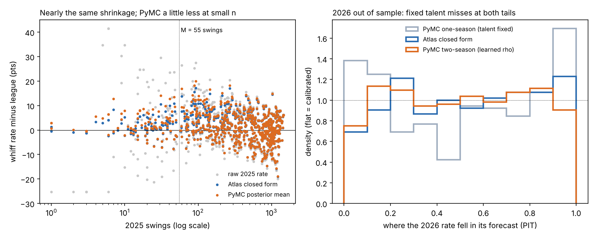

# Hitter whiff rate in PyMC: a hierarchical Bayesian model against the Reliability Atlas

**The answer.**
- **Given the same data, a hierarchical Bayesian model and the Atlas's closed-form regression give almost the same answer.** On 520 hitters scored in 2026, both miss by 3.49 whiff points on average (RMSE 4.94 vs 4.95). Their 80% and 95% intervals cover 81.5% / 95.8% and 80.8% / 95.8%.
- **Year-to-year change is what makes the intervals honest.** A model that treats 2025 talent as 2026 talent covers only 69% / 86%. Letting talent drift, with a year-to-year correlation the model learns from 2024 → 2025 (ρ = 0.917), fixes it. The Atlas gets there with its own ρ (0.931).
- **What the Bayesian model adds is easy extension.** Fit 2024 and 2025 together and each hitter's 2024 swings inform his 2025 level. That cuts the 2026 error by 5.3% (RMSE 4.69, 95% CI for the gain 0.11–0.42 points). The gain comes from the extra season of data, not from Bayes over closed form.

*Written 2026-10-28. Data: Statcast via Baseball Savant, regular seasons 2024 (Mar 20–Sep 30), 2025 (Mar 18–Sep 28) and 2026 (Mar 25–Sep 27): 2,134,079 pitches, the Atlas's exact count. Code: `reports/bayes/whiff_hierarchical.py`. Tests: `tests/test_bayes_whiff.py`. PyMC 6.3.2, ArviZ 1.3.*



## The model
- **Whiff rate** is whiffs per swing, with the repo's flags (`arsenal.SWINGS`, `WHIFFS`). Pitch-clock automatic balls and strikes are dropped.
- **One season (2025):** each hitter's true rate is p<sub>i</sub>, with logit p<sub>i</sub> = μ + σ z<sub>i</sub> and z<sub>i</sub> ~ N(0, 1). Whiffs are Binomial(swings, p<sub>i</sub>).
  - Priors: μ ~ N(logit 0.25, 1), σ ~ HalfNormal(0.5).
  - Posterior: μ = −1.052, σ = 0.353 on the logit scale. That is a talent spread of about 6.7 points near the league rate; the Atlas's τ is 6.2.
- **Two seasons (2024 and 2025):** each season has its own μ and σ. A hitter's standardized talent carries over with correlation ρ: z<sub>2025</sub> = ρ z<sub>2024</sub> + √(1 − ρ²) e. The 2026 forecast takes one more step.
  - ρ = 0.917 (0.894–0.938), learned without any 2026 data. The Atlas's is 0.931 (0.912–0.949), pooled over 2024–26.
- **The 2026 forecast** is a posterior predictive: draw p for 2026, then draw his 2026 whiffs from Binomial(his 2026 swings, p). So the interval carries the 2026 sample's own noise.
- **Sampling:** NUTS, 4 chains × 1,000 draws after 1,000 tuning steps. 0 divergences. Largest R-hat 1.006 (one season) and 1.011 (two seasons). Smallest bulk ESS 283, on μ.

## The test: 2025 → 2026, out of sample
- **Who:** 520 hitters with a 2025 swing and at least 11 swings in 2026 (M/5, the Atlas's rule).
- **Scoring:** the Atlas's own convention. The league's shift from 2025 (25.25%) to 2026 (25.07%) is removed for every method. Every hitter counts once.
- **Coverage:** the share of 2026 rates inside each interval. The Bayesian intervals are scored with a randomized PIT, so whole-number whiff counts get no free coverage.
- **Check:** the repo's `score_forecast()` on the same hitters gives the same Atlas coverage (80.8% / 95.8%) and a 30.6% RMSE cut over raw rates. The Atlas reports 31% for this metric.

| Forecast of the 2026 rate | MAE (pts) | RMSE (pts) | 80% coverage | 95% coverage | 80% width (pts) |
|---|---|---|---|---|---|
| Raw 2025 rate | 4.28 | 7.14 | – | – | – |
| League mean | 5.74 | 7.40 | – | – | – |
| **Atlas closed form** (M = 55, ρ = 0.931) | **3.49** | **4.95** | **80.8%** | **95.8%** | 11.1 |
| PyMC, 2025 only, talent fixed | 3.51 | 4.98 | 69.2% | 86.3% | 9.1 |
| **PyMC, 2025 only + learned ρ** | **3.49** | **4.94** | **81.5%** | **95.8%** | 11.3 |
| PyMC, 2024 and 2025 (learned ρ) | 3.33 | 4.69 | 83.5% | 96.3% | 11.0 |

- **Coverage precision:** with 520 hitters, a coverage rate carries about ±3.4 points (95%) at 80% and ±1.9 at 95%.
- **PyMC (2025 only + ρ) against the Atlas:** RMSE difference −0.01 points (−0.07 to 0.05). No difference.
- **By sample size** (the 2025 weight w = n / (n + 55)), RMSE in points, Atlas against PyMC (2025 + ρ):
  - under M/4 (10 hitters): 10.2 vs 9.8
  - M/4 to M (30): 7.1 vs 7.4
  - M to 3M (67): 7.7 vs 7.6
  - 3M and up (413): 3.89 vs 3.88
  - The small-sample groups are too small to rank the methods.

## Where the two methods agree and where they differ (2025 estimates, 672 hitters)
- **Regulars: the same number.** For the 469 hitters with 166+ swings, the estimates differ by 0.12 points on average (at most 1.2).
- **Small samples: PyMC trusts the data a little more.** Its implied regression constant is 34–35 swings below 166 swings, against the Atlas's 55. Two reasons:
  - The binomial assumes swing-to-swing noise of p(1 − p), about 0.189. The Atlas measured 0.212: real swings are noisier than coin flips (pitch mix, game to game).
  - PyMC's talent spread is a little wider (6.7 points against 6.2).
  - Largest gap: Drew Romo, 7 whiffs in 7 swings. Atlas 33.6%, PyMC 38.0%.
- **The center differs.** PyMC pulls toward the average hitter (every hitter counts once): 26.5%. The Atlas pulls toward the league rate weighted by swings, which regulars dominate: 25.2%. Part-timers whiff more, so for them PyMC's center is arguably the better one.
- **Extremes: PyMC's intervals adapt to the rate; the Atlas's don't.**
  - The Atlas gives every hitter the same talent spread, so a 95% interval at a given sample has the same width at 10% or 40% whiff.
  - PyMC's binomial noise shrinks near 0 and widens toward 50%. The 24 lowest-whiff regulars get 95% intervals of 4.7 points from PyMC and 6.4 from the Atlas; the 24 highest get 9.7 and 9.0.
  - Example: Luis Arraez, 64 whiffs in 1,218 swings. Atlas 6.1% (3.6–8.7), PyMC 6.3% (5.1–7.7).
- **Interval shape:** PyMC's run longer on the high side at small samples (55% of the width above the estimate under M/4). The Atlas's are symmetric and clipped at 0 and 1.
- **Overall width:** about the same (95%: 10.3 points for both, on average).
- **The worked example:** 40% whiffs on 50 swings. Atlas 32.2% (23.4–40.9); PyMC 34.0% (24.5–44.4).

## What it means
- **The Atlas's closed form is a good empirical-Bayes approximation, for this metric.** Use it for speed. The fitted posterior agrees with it where it matters.
- **Use the full model when the structure grows:** more seasons, levels or pitch types, or players with very different rates. The closed form needs a new derivation for each of those; the model needs a few more lines.
- **Not tested here:** other metrics, a beta-binomial likelihood for the extra swing noise, and minor-league data.

## Limits
- **Binomial noise is too small:** each swing is treated as an independent coin flip. That's why PyMC shrinks less at small samples. In 2026 it didn't cost accuracy.
- **The Atlas has seen 2026:** its constants were pooled over 2024–26. PyMC's fits never saw 2026. That favors the Atlas slightly.
- **League shift:** both methods are given 2026's actual league rate, as in the Atlas. A real forecaster wouldn't know it yet. The shift was −0.18 points.

## Reproduce
```
uv sync --group bayes
uv run --group bayes python reports/bayes/whiff_hierarchical.py         # about 2 minutes on a laptop
uv run --group bayes pytest tests/test_bayes_whiff.py
```
Reads `data/seq/` (`bb seq 2024`, `2025`, `2026`). Writes estimates, scores, a summary and trace plots to `reports/bayes/out/` (not committed).
