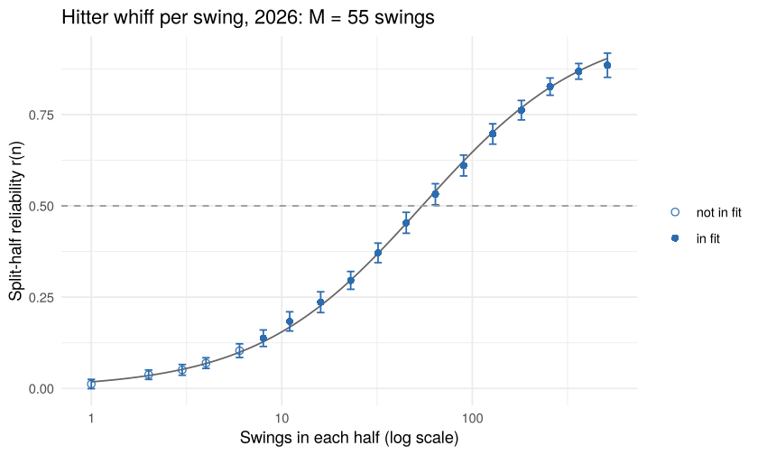

Hitter whiff rate: how far to regress it (the Reliability Atlas step,
rebuilt in R)
================

**Question.** After *n* swings, how much of a hitter’s whiff rate is
really him? And how far should it be regressed toward the league before
anyone acts on it?

**Answer first.** In the 2026 regular season alone, a hitter’s whiff per
swing is half signal after about **55 swings** (95% interval 49-61), in
line with the atlas’s 2024-26 constant of 55 swings (49-63). A hitter
who whiffs on 40% of 50 swings (league 25.1%) is best read as a 32.2%
whiffer, with a 95% interval of 23.4-40.9% for his true level.

This is an R rebuild of one step of the [Reliability
Atlas](../2026-reliability-atlas.md). The Python original is
`baseball/evaluation/reliability.py`. The check that the two agree is
`reports/r/check_against_python.R` (results:
[output/check-results.md](output/check-results.md)).

## 1. Data: one season of swings, from DuckDB

`reports/r/pull_swings.R` pulls every regular-season swing from Baseball
Savant into a DuckDB file. Here we read it back with SQL through DBI.
The swing and whiff lists are the repo’s (`arsenal.SWINGS`, `WHIFFS`).

``` r
# swings <- load_swings(params$db, params$season)   (run in the setup chunk)
tibble(n_swings = nrow(swings), hitters = n_distinct(swings$batter), games = n_distinct(swings$game_pk),
       league_whiff = league_mean, first_day = min(swings$game_date), last_day = max(swings$game_date))
```

<div class="kable-table">

| n_swings | hitters | games | league_whiff | first_day  | last_day   |
|---------:|--------:|------:|-------------:|:-----------|:-----------|
|   340712 |     661 |  2429 |    0.2506956 | 2026-03-25 | 2026-09-27 |

</div>

Grain: one row per swing. The denominator for whiff rate is swings, not
pitches.

## 2. Split each hitter’s season by game

For each hitter, shuffle his games and deal them alternately into two
halves. Then fill each half, game by game, until it holds exactly *n*
swings. Halves never share a game, so a day’s conditions (opponent,
park, how he feels) can’t show up in both halves and pass for skill.

``` r
grid                              # sample sizes where 50+ hitters have 2n swings
```

    ##  [1]   1   2   3   4   6   8  11  16  23  32  45  64  90 128 181 256 362 512

``` r
set.seed(1)
one <- half_rates(swings, deal_games(distinct(swings, batter, game_pk)), grid)
one |> filter(n == 64) |> head(5)
```

<div class="kable-table">

| batter |   n |        a |        b |
|-------:|----:|---------:|---------:|
| 457705 |  64 | 0.453125 | 0.218750 |
| 500743 |  64 | 0.140625 | 0.125000 |
| 502671 |  64 | 0.343750 | 0.296875 |
| 514888 |  64 | 0.296875 | 0.312500 |
| 516782 |  64 | 0.203125 | 0.328125 |

</div>

Each row is one hitter at *n* = 64: his whiff rate in half A (`a`) and
half B (`b`), 64 swings each.

## 3. Correlate the halves, many times

The split-half correlation across hitters is the reliability of an
*n*-swing sample. Because each half holds exactly *n*, no Spearman-Brown
step-up is needed. We repeat over 200 random splits and pool the sums
before taking the ratio. A bootstrap of hitters (100 draws) gives the
intervals.

``` r
rel <- run_splits(swings, grid, reps = params$reps, boot = 100, seed = 2026)   # (run in the setup chunk)
fit <- fit_curve(rel, swings_per_game(swings))
```

``` r
fit$curve
```

<div class="kable-table">

|   n |         r |       r_lo |      r_hi | players |   r_model | in_fit |
|----:|----------:|-----------:|----------:|--------:|----------:|:-------|
|   1 | 0.0120807 | -0.0005828 | 0.0247443 | 650.000 | 0.0180120 | FALSE  |
|   2 | 0.0376023 |  0.0247292 | 0.0504754 | 643.380 | 0.0353866 | FALSE  |
|   3 | 0.0508471 |  0.0362148 | 0.0654794 | 641.695 | 0.0521570 | FALSE  |
|   4 | 0.0693628 |  0.0548154 | 0.0839103 | 639.115 | 0.0683543 | FALSE  |
|   6 | 0.1034595 |  0.0847725 | 0.1221466 | 630.925 | 0.0991430 | FALSE  |
|   8 | 0.1374916 |  0.1148454 | 0.1601379 | 625.995 | 0.1279618 | TRUE   |
|  11 | 0.1835821 |  0.1573219 | 0.2098423 | 617.265 | 0.1678911 | TRUE   |
|  16 | 0.2362004 |  0.2077652 | 0.2646356 | 604.765 | 0.2268904 | TRUE   |
|  23 | 0.2959153 |  0.2715321 | 0.3202985 | 579.550 | 0.2967028 | TRUE   |
|  32 | 0.3711707 |  0.3444269 | 0.3979146 | 556.025 | 0.3698625 | TRUE   |
|  45 | 0.4536003 |  0.4249783 | 0.4822223 | 528.790 | 0.4521766 | TRUE   |
|  64 | 0.5317779 |  0.5029467 | 0.5606090 | 503.955 | 0.5399994 | TRUE   |
|  90 | 0.6104157 |  0.5818171 | 0.6390143 | 462.560 | 0.6227570 | TRUE   |
| 128 | 0.6968767 |  0.6689541 | 0.7247994 | 413.610 | 0.7012982 | TRUE   |
| 181 | 0.7618797 |  0.7351992 | 0.7885603 | 359.150 | 0.7685167 | TRUE   |
| 256 | 0.8264649 |  0.8028448 | 0.8500849 | 280.710 | 0.8244272 | TRUE   |
| 362 | 0.8682775 |  0.8468874 | 0.8896677 | 200.390 | 0.8691088 | TRUE   |
| 512 | 0.8850312 |  0.8518692 | 0.9181933 |  94.255 | 0.9037655 | TRUE   |

</div>

## 4. Fit r(n) = n / (n + M)

M is the sample at which r = 0.5: signal and noise are equal, so you
regress halfway. Points below one typical game (7 swings) are left out
of the fit, as in the atlas.

``` r
tibble(M = fit$M, M_lo = fit$M_lo, M_hi = fit$M_hi, n_for_r_0.7 = 7 * fit$M / 3,
       sigma2_per_swing = fit$sigma2, tau_talent_sd = fit$tau)
```

<div class="kable-table">

|        M |     M_lo |    M_hi | n_for_r_0.7 | sigma2_per_swing | tau_talent_sd |
|---------:|---------:|--------:|------------:|-----------------:|--------------:|
| 54.51864 | 48.57655 | 61.1876 |    127.2102 |        0.2100848 |     0.0620761 |

</div>

**M = 54.5 swings (95% interval 48.6-61.2).** The atlas, pooling
2024-26, has 55.4 (49.0-62.7).

``` r
ggplot(fit$curve, aes(n, r)) +
  geom_function(fun = \(n) n / (n + fit$M), colour = "grey40") +
  geom_errorbar(aes(ymin = r_lo, ymax = r_hi), width = 0.04, colour = "#2b6cb0") +
  geom_point(aes(shape = in_fit), colour = "#2b6cb0", size = 2) +
  geom_hline(yintercept = 0.5, linetype = "dashed", colour = "grey60") +
  scale_x_log10() + scale_shape_manual(values = c(`TRUE` = 16, `FALSE` = 1), labels = c("not in fit", "in fit")) +
  labs(x = "Swings in each half (log scale)", y = "Split-half reliability r(n)", shape = NULL,
       title = sprintf("Hitter whiff per swing, %d: M = %.0f swings", params$season, fit$M)) +
  theme_minimal()
```

<!-- -->

## 5. Regress

Weight on the hitter’s own number: w = n / (n + M). Estimate = league +
w x (observed - league). 95% interval for his true level: estimate +/-
1.96 x tau x sqrt(1 - w).

The atlas’s worked example, with the shipped 2024-26 constants (M =
55.4, tau = 0.0618, league 25.1%):

``` r
regress(observed = 0.40, n = 50, league_mean = 0.251, M = 55.40049, tau = 0.061794)
```

<div class="kable-table">

| observed |   n |  estimate |        lo |        hi |    weight |        sd |
|---------:|----:|----------:|----------:|----------:|----------:|----------:|
|      0.4 |  50 | 0.3216828 | 0.2338756 | 0.4094899 | 0.4743811 | 0.0448004 |

</div>

The atlas prints 32.2% (23.4-40.9). Same here.

Real 2026 hitters with 50-80 swings (call-ups and part-timers), with
this season’s constants:

``` r
regress_hitters(swings, fit, league_mean) |>
  filter(between(swings, 50, 80)) |>
  arrange(desc(observed)) |>
  slice(c(1:4, (n() - 3):n())) |>
  mutate(across(c(observed, estimate, lo, hi), \(x) round(100 * x, 1)), weight = round(weight, 2))
```

<div class="kable-table">

| batter | player_name       | swings | whiffs | observed | estimate |   lo |   hi | weight |
|-------:|:------------------|-------:|-------:|---------:|---------:|-----:|-----:|-------:|
| 669087 | Huff, Sam         |     75 |     35 |     46.7 |     37.6 | 29.7 | 45.5 |   0.58 |
| 678577 | Perez, Junior     |     71 |     28 |     39.4 |     33.2 | 25.2 | 41.2 |   0.57 |
| 814154 | Bandura, Scott    |     67 |     26 |     38.8 |     32.6 | 24.5 | 40.8 |   0.55 |
| 692216 | Kayfus, CJ        |     58 |     22 |     37.9 |     31.7 | 23.2 | 40.2 |   0.52 |
| 703197 | Arroyo, Michael   |     70 |     11 |     15.7 |     19.8 | 11.8 | 27.9 |   0.56 |
| 672613 | Alfonzo, Eliezer  |     51 |      7 |     13.7 |     19.6 | 10.8 | 28.3 |   0.48 |
| 683021 | Stefanic, Michael |     58 |      6 |     10.3 |     17.5 |  9.0 | 25.9 |   0.52 |
| 686823 | Brennan, Will     |     50 |      4 |      8.0 |     16.9 |  8.1 | 25.7 |   0.48 |

</div>

The highest and lowest raw rates move about halfway back toward the
league (25.1%), because 50-80 swings carry only about half weight (w =
0.48-0.58).

## What this does not do

- One season, not three. The atlas pools 2024-26; this uses 2026 only.
  It checks the method, not the shipped constant (though the two land
  within a swing of each other).
- No year-to-year persistence (rho) or in-season drift. Those widen the
  “next season” and “rest of season” intervals in the atlas; `regress()`
  here accepts them as inputs.
- The prior is the league mean. Part-timers are worse hitters on
  average, so a better prior for them might sit above 25.1% whiffs. Not
  tested here.
